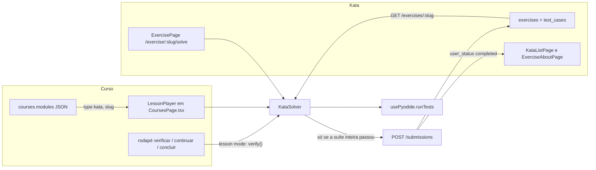
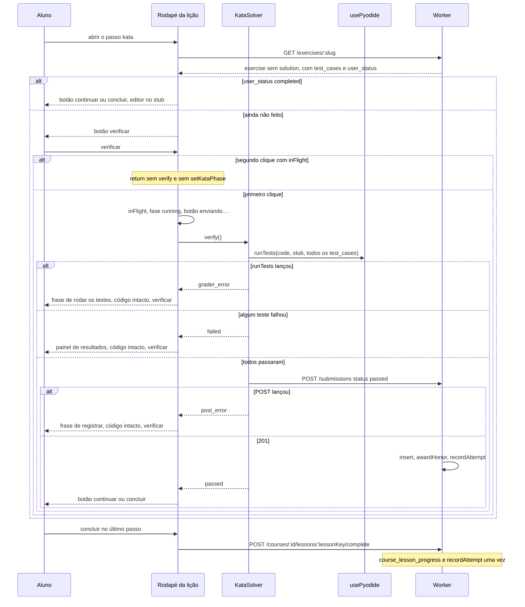

# Kata como passo de lição, uma só implementação

| | |
|---|---|
| **Autor** | a preencher |
| **Data** | 2026-09-29 |
| **Status** | Approved by João 2026-10-21 as the next piece after the usable Courses home; not built |
| **Repositório** | `C:\Users\joaog\PycharmProjects\dev-grind` |

## Overview

Os dois tracks da DevGrind hoje não se encontram. O curso (estilo Mimo/Duolingo) avança uma tela por vez com passos `text`, `fill`, `browser` e `terminal`, guardados como JSON opaco em `courses.modules`. O kata (estilo Codewars) é uma linha em `exercises` com Monaco, Pyodide e `POST /submissions`. O autor de um curso não tem como colocar esse kata dentro de uma lição sem copiar stub e testes para dentro do JSON, e o player joga fora qualquer `type` que não conhece.

A mudança é um passo que só referencia o kata que já existe:

```json
{ "type": "kata", "slug": "saudacao-com-nome" }
```

A experiência de resolver sai de `platform/frontend/src/pages/ExercisePage.tsx` para um único componente, `KataSolver`. A página `/exercise/:slug/solve` e o passo da lição renderizam esse componente. O grader continua sendo só `usePyodide`. No curso, o botão que já existe no rodapé (`verificar`) dispara o mesmo caminho do `enviar` da página do kata: todos os testes, inclusive ocultos, e `POST /submissions` só quando todos passam. Passar na lição e passar na página são a mesma submissão. `user_status === 'completed'` continua sendo o que pinta o check verde na lista, na página sobre e na página de resolver.

Não há tabela nova, não há migration, não há segundo grader e não há segunda barra de ações na lição.

## Background & Motivation

João estuda backend num app de um usuário só. O curso explica e pede um preenchimento ou um comando. O kata pede uma função Python de verdade, com stub, casos visíveis, casos ocultos e uma submissão que conta para o rank. Quando um capítulo precisa dessa prática, o autor hoje tem duas saídas ruins: mandar o aluno sair da lição para `/exercise/:slug/solve`, ou colar stub e testes dentro do passo. A primeira quebra o rodapé único da lição (`continuar` / `concluir`). A segunda cria duas fontes de verdade e convida uma segunda cópia da UI de correção.

O código já separa as duas fontes, e é isso que o spec trava.

### O que o código faz hoje

**Curso.** `courses.modules` é `text` NOT NULL com default `'[]'` (`platform/worker/src/db/schema.ts`). `GET /courses` devolve o JSON parseado e `completed_lessons` lido de `course_lesson_progress`. `POST /courses/:id/lessons/:lessonKey/complete` (`platform/worker/src/routes/courses.ts`) só aceita a chave `${sectionIndex}-${lessonIndex}`, insere uma linha e, se a linha ainda não existia, chama `recordAttempt(db, userId, true)`. Se a linha já existe, responde `{ completed: true, already: true }` e não chama `recordAttempt` de novo.

O player está inteiro em `platform/frontend/src/pages/CoursesPage.tsx`. `asStep` reconhece `text`, `fill`, `browser` e `terminal`. Qualquer outro `type` cai no `return null` e o `.filter` tira o passo da lição. Uma lição que só tenha passos desconhecidos some por completo (`if (!steps.length) continue`). O rodapé é um botão só:

- `fill` e `terminal` mostram `verificar` enquanto não passaram (`needsCheck`).
- `fill` que acerta marca `passed` e o botão vira `continuar` ou `concluir`. O avanço é um segundo clique.
- `terminal` que acerta avança no mesmo clique.
- Erro em `fill` ou `terminal` troca o botão para `tentar novamente`, e `retry()` apaga os blanks ou o input.
- O último passo, depois de passar, chama `onComplete` e volta para a lista da seção. `onComplete` no pai só dá `POST` se `course.completed` ainda não contém a chave.

**Kata.** `ExerciseData` (`platform/frontend/src/lib/exercise.ts`) tem `stub`, `test_cases` e `user_status?: 'completed' | 'attempted' | 'not_attempted'`. `GET /exercises/:slug` (`platform/worker/src/routes/exercises.ts`) exige `requireAuth`, busca só por `slug`, tira `solution` em `publicExercise`, manda todos os `test_cases` (o comentário no handler diz que o Pyodide roda a suíte no browser) e calcula:

```ts
user_status: counts.passed > 0 ? 'completed' : counts.total > 0 ? 'attempted' : 'not_attempted'
```

Os counts são as `submissions` daquele `userId`. Não existe predicado em `exercises.user_id`. Um 404 é `{ detail: 'Exercício não encontrado' }`.

`ExercisePage` (`/exercise/:slug/solve`) tem dois caminhos:

- `handleTest` (`rodar`) filtra `tc.visible` e não grava nada.
- `handleSubmit` (`enviar`) roda `exercise.test_cases` inteiro. Só quando `passedCount === allResults.length` faz `POST /submissions` com `{ exercise_id, code, status: 'passed', test_results, time_spent_seconds }` e liga `submitted`. Falha não gera POST. O código no editor não é limpo. `handleSubmit` não olha `user_status` nem `submitted`: o efeito do slug zera `submitted` em toda visita (`setSubmitted(false)`). Kata já `completed` ainda mostra `enviar`, e um passe novo grava outra linha e soma honor de novo. `submitted` só troca a UI desta montagem: `rodar` fica `disabled`, e o mesmo lugar do `enviar` vira `ver soluções` (`navigate` para `/exercise/${slug}`) na barra desktop, na barra mobile e no pé da sheet de resultados. O check do título é outra coisa: `user_status === 'completed' || allPassed`, inclusive antes deste `enviar`.

O check verde na página de resolver aparece se `user_status === 'completed' || allPassed`. Na lista (`KataListPage`, `done = ex.user_status === 'completed'`) e na página sobre (`ExerciseAboutPage`) o check é só `user_status === 'completed'`. Borda verde do card e do botão da lição do curso usam `var(--green)` no mesmo critério de "feito".

`POST /submissions` (`platform/worker/src/routes/submissions.ts`) insere a linha, chama `awardHonor` se `status === 'passed'` e sempre chama `recordAttempt(db, userId, passed)`. Não há checagem de "já tinha passado". `awardHonor` soma o honor da dificuldade em todo POST `passed`. O cliente da página de resolver nunca manda `failed`.

`GET /submissions/exercise/:exercise_id` já existe e devolve as linhas do usuário, inclusive `code`, da mais nova para a mais antiga. O editor não usa isso. Não vamos usar também.

**Grader.** `usePyodide` (`platform/frontend/src/hooks/usePyodide.ts`) é o único runner. O nome da função sai do stub com `re.search(r'def (\w+)\('`. Cada caso faz `json.loads` de `input` e espalha como argumentos posicionais (`func(*args)`), `json.loads` de `expected`, e compara com `==`. Não existe grader no Worker.

**Autoria.** `create_course` e `append_course_modules` em `platform/worker/src/lib/tools.ts` gravam o array `modules` com `JSON.stringify`, sem validar o formato do passo. A `description` da tool lista só `text`, `fill`, `browser` e `terminal`. O mesmo registry serve `/mcp` e `/chat`. `create_exercise` cria uma linha em `exercises` (slug único, `user_id` do autor, `solution: ''`) e os `test_cases`. Não cria passo de curso.

**Quem é o usuário.** `POST /auth/dev` faz upsert de `dev-user-joao` (`joao@devgrind.dev`) e só existe fora de `ENV === 'production'`. Login Google usa o `sub` da conta. Curso é filtrado por `courses.user_id`. Kata, no GET, não é.

**O que dói.** Um passo `kata` escrito hoje desaparece. Não há componente compartilhado: Monaco, barra de tokens, painel de resultados e o POST moram dentro de `ExercisePage`. Duplicar isso dentro de `StepView` criaria dois `enviar`.

## Goals & Non-Goals

### Goals

- Um passo de curso `{ type: 'kata', slug }` que o player renderiza, em vez de descartar.
- Uma implementação da solução: `KataSolver`. Página do kata e passo da lição são os dois chamadores.
- `verificar` na lição executa o caminho do `enviar`: suíte completa e um `POST /submissions` quando passa.
- Passar nos dois lugares é a mesma linha em `submissions` e o mesmo `user_status`.
- Na lição, kata já `completed` deixa `continuar` / `concluir` na hora, sem novo POST. Em `/solve`, `enviar` continua podendo gravar de novo. O editor abre no `stub` nos dois.
- Conclusão da lição continua só em `course_lesson_progress`, no último passo, pelo POST que já existe.
- `create_course` e `append_course_modules` documentam o passo. `create_exercise` continua só criando kata.
- Slug vazio, 404 ou falha de rede mostram erro em português dentro do passo. A lição não quebra.
- `solution` não sai do servidor. Testes ocultos continuam indo para o browser, como já vão.

### Non-Goals

- Dicas no segundo erro, checagem de `expect` no passo `browser`, match mais frouxo no `terminal`.
- Lembrar em qual passo a lição parou. Recarregar ainda recomeça a lição.
- Roadmap, tipo de curso "projeto", curso de Pytest, trancar a lição seguinte.
- Transformar a lista de katas num curso.
- Recriar issues no Linear.
- Tabela nova para passo kata. `courses.modules` já é JSON. Sem migration.
- Grader no servidor.
- Endpoint novo de "último código". `GET /submissions/exercise/:exercise_id` existe e não será ligado ao editor.
- Idempotência nova de honor. O POST repete honor se alguém enviar de novo; a lição simplesmente não reenvia quando `user_status` já é `completed`.
- Filtro novo de dono em `GET /exercises/:slug`. O passo usa a regra que a rota já tem.
- Editar os cursos de HTML ou Python que já estão no banco.
- Barra `rodar` / `enviar` dentro da lição. Chat embutido no passo. Fonte que não seja JetBrains Mono.

## Proposed Design

### Forma do passo

O curso guarda uma referência. Stub, testes, dicas, dificuldade e enunciado continuam na linha do exercício e nos `test_cases`.

```json
{
  "title": "Funções",
  "lessons": [
    {
      "title": "Saudação",
      "steps": [
        { "type": "text", "body": "Uma função devolve um valor com return." },
        { "type": "kata", "slug": "saudacao-com-nome" }
      ]
    }
  ]
}
```

`asStep` passa a devolver o passo em vez de `null`:

```ts
type Step =
  | { type: 'text'; body: string }
  | { type: 'fill'; prompt: string; file: string; parts: FillPart[]; choices: string[] }
  | { type: 'browser'; prompt: string; starter: string }
  | { type: 'terminal'; prompt: string; expect: string }
  | { type: 'kata'; slug: string }

if (type === 'kata') return { type: 'kata', slug: String(step.slug ?? '').trim() }
return null
```

Slug ausente vira `''`. O passo continua na lista. O erro é da tela, não do parser. Tipos ainda desconhecidos (`quiz`, lixo, etc.) continuam sendo descartados. Lição sem nenhum passo reconhecido continua fora do curso.

O player não copia `stub` nem `test_cases` para o estado da lição. Quem preenche isso é o `GET /exercises/:slug` no momento em que o passo vira o passo ativo. Não há fan-out no `GET /courses`: a lista de cursos continua devolvendo só o slug dentro de `modules`.

### Quem desenha o quê



Não existe um `KataSolver` hoje. O nome fica esse. O arquivo novo é `platform/frontend/src/components/KataSolver.tsx`. `ExercisePage` continua dona da rota: lê `:slug`, mostra o loading que já tem (`carregando exercício...`) e monta `<KataSolver mode="page" />`.

O corte do cromo é este, e os dois PRs seguem o mesmo:

- `ExercisePage` fica com o fetch, o botão voltar, a faixa de dificuldade, o título, o check verde, o botão e a sheet de enunciado no mobile, e o `ChatPanel` (painel desktop e sheet mobile). Navegação e chat não entram no componente compartilhado. O check usa `onGradeState`: pinta se `user_status === 'completed' || allPassed`. Não usa `accepted`. O indicador `⟳ python` usa o mesmo callback, só quando `pyLoading` é true, como hoje.
- `KataSolver` em `mode="page"` fica com o editor, a barra de tokens, o listener de `visualViewport`, a barra de ações (desktop e mobile), a lista de resultados e a sheet mobile de resultados. A barra inclui o ícone de chat do desktop, que chama `onToggleChat`. O botão de chat do header mobile continua na página e mexe no mesmo `showChat`. `ver soluções` mora na barra e no pé da sheet, e chama `onOpenSolutions`.
- `mode="lesson"` não desenha barra de ações, sheet, `ver soluções`, ícone de chat nem `ChatPanel`.

`accepted` e o check não são o mesmo bit. `accepted` liga depois de um POST 2xx nesta montagem, que é o `submitted` de hoje. Só então `rodar` desabilita e `enviar` vira `ver soluções`. Abrir um kata que já está `completed` não liga `accepted`: o check aparece, `rodar` segue habilitado, `enviar` segue na barra.

### KataSolver

Uma instância. Dois modos. O grader e o POST não se repetem.

```ts
export type VerifyResult = 'passed' | 'failed' | 'post_error' | 'grader_error' | 'busy'

export type KataSolverHandle = {
  /** Suíte inteira. POST /submissions só no passe completo com resposta 2xx.
   *  O atalho de "já estava completed" existe só em mode lesson. */
  verify: () => Promise<VerifyResult>
}

export type KataSolverProps = {
  exercise: ExerciseData
  mode: 'page' | 'lesson'
  onAccepted?: () => void
  onKeyboardOpen?: (open: boolean) => void
  /** Um callback só. A página lê pyLoading para o indicador; a lição desabilita o rodapé com pyLoading || running. */
  onActivity?: (activity: { pyLoading: boolean; running: boolean }) => void
  /** page. ExercisePage faz navigate(`/exercise/${slug}`). A lição não passa. */
  onOpenSolutions?: () => void
  /** page. ExercisePage abre ou fecha o ChatPanel. A lição não passa. */
  onToggleChat?: () => void
  /** page. ExercisePage pinta o check com user_status === completed || allPassed. Não usar accepted nesse check. */
  onGradeState?: (state: { allPassed: boolean; accepted: boolean }) => void
}
```

Estado interno, nos dois modos:

- `code` começa em `exercise.stub`. Não há fetch de `GET /submissions/exercise/:id`.
- `results`, `running`, `runType: 'test' | 'submit' | null`.
- `accepted` local, verdadeiro só depois de um POST 2xx nesta montagem. No modo `page` isso troca `enviar` por `ver soluções` e desabilita `rodar`. Não é guarda de `verify` nesse modo. No modo `lesson` também impede um segundo POST nesta montagem.
- `startTime` no mount do componente. `time_spent_seconds` usa a mesma conta de hoje: `Math.round((Date.now() - startTime) / 1000)`.

A única função que grava. O `return` de "já feito" é só da lição. Em `mode === 'page'` o corpo é o `handleSubmit` de hoje: roda a suíte e dá POST sempre que `passedCount === allResults.length`, mesmo com `user_status === 'completed'` e mesmo se `accepted` já é true. O botão some depois do primeiro 2xx, então o segundo POST na mesma visita não tem clique; a função não ganha uma trava que a página hoje não tem.

```ts
async function verify(): Promise<VerifyResult> {
  if (running) return 'busy'
  if (mode === 'lesson' && (accepted || exercise.user_status === 'completed')) return 'passed'
  setRunning(true)
  setRunType('submit')
  try {
    let allResults: TestResult[]
    try {
      allResults = await runTests(code, exercise.stub, exercise.test_cases)
    } catch {
      setRunError('Não foi possível rodar os testes. O código continua no editor.')
      return 'grader_error'
    }
    setResults(allResults)
    const passedCount = allResults.filter(r => r.passed).length
    if (passedCount !== allResults.length) return 'failed'
    try {
      await api.post('/submissions', {
        exercise_id: exercise.id,
        code,
        status: 'passed',
        test_results: allResults,
        time_spent_seconds: Math.round((Date.now() - startTime) / 1000),
      })
    } catch {
      setPostError('Não foi possível registrar esta solução. O código continua no editor.')
      return 'post_error'
    }
    setAccepted(true)
    onAccepted?.()
    return 'passed'
  } finally {
    setRunning(false)
  }
}
```

`runTests` que lança não usa a frase de registro. POST que falha não usa a frase do grader. Os dois deixam `code` como está. Nenhum dos dois chama `onComplete`. Não há trava nova de honor no servidor.

A comparação é a de hoje, `passedCount === allResults.length`, inclusive o caso degenerado de zero testes (0 === 0 passa e dá POST). Não "corrigir" isso aqui. `handleTest` / `rodar` continua existindo só no modo `page` e continua passando só `test_cases.filter(tc => tc.visible)`. A lição não chama `rodar`.

Modo `page` preserva o layout atual de `ExercisePage`:

- Desktop: faixa da dificuldade, split enunciado (38%) e editor, casos visíveis, linha "+ N caso(s) oculto(s) — revelados no envio", barra `rodar` + `enviar`, painel de resultados até 200px, chat opcional.
- Mobile: editor na tela toda, barra de tokens (`TOKENS` sai da página e vai para o componente), ações somem quando `teclado > 0`, resultado em sheet, enunciado em sheet, chat em sheet.
- `enviar` chama `verify`. `rodar` não chama. Com `accepted`, `rodar` fica `disabled={running || pyLoading || accepted}` e os três lugares do `enviar` (barra desktop, barra mobile, pé da sheet) mostram `ver soluções`, que chama `onOpenSolutions`. Sem `accepted`, o rótulo continua `enviar`, inclusive quando `user_status` já é `completed`. `grader_error` e `post_error` não ligam `accepted`: a barra continua em `enviar`, e a frase correspondente aparece junto dos resultados. A troca para `ver soluções` só acontece no `passed`.
- O check do título não mora na barra. `ExercisePage` o desenha com `onGradeState`, regra `user_status === 'completed' || allPassed`, as linhas 258 e 457 de `ExercisePage.tsx`. `allPassed` desta corrida acende o check antes mesmo do POST. `accepted` não entra nessa conta.
- O listener de `visualViewport` muda de página para o componente. `teclado` continua só decidindo se a faixa de ações aparece. Não inventar padding novo. No modo `lesson`, o mesmo boolean sobe por `onKeyboardOpen` para o rodapé da lição esconder junto. `onActivity` sobe `{ pyLoading, running }` nos dois modos. A página não instancia um segundo `usePyodide` para saber se o runtime ainda carrega.

Modo `lesson`:

- Coluna, não o split 38/62. A lição já tem largura máxima ~860px e um rodapé fixo. O enunciado (via `renderDesc`, que escapa HTML antes de montar o markdown) fica em cima, depois os casos visíveis, depois o editor (`minHeight: 280`, `flex: 1`), a barra de tokens no mobile, e os resultados inline debaixo do editor. Sem sheet por cima do rodapé.
- Sem botão `rodar`, sem botão `enviar`, sem `ver soluções`, sem `ChatPanel`.
- Título do exercício, badge de dificuldade com `DIFF_COLOR`, e o mesmo SVG de check (`polyline 20 6 9 17 4 12`, `stroke="var(--green)"`, `aria-label="feito"`) quando `user_status === 'completed'` ou quando o resultado desta corrida é `passed` (`allPassed`, e no passe também `accepted`).
- Copy dos ocultos, no verbo da lição: `+ N caso(s) oculto(s) — revelados ao verificar`. Os inputs ocultos não aparecem antes do `verify`. Depois, o painel mostra o que o painel da página já mostra (saída e esperado do caso, achado por `id`).
- Fonte do editor: `'JetBrains Mono', monospace`, 16px no mobile e 13px no desktop, as mesmas `options` de hoje. O resto da tela usa `var(--f-mono)` / `var(--font)`, que já são JetBrains Mono em `index.css`. Nenhuma fonte nova.
- Falha de teste não limpa `code`. O componente não desmonta porque o índice da lição não muda.

`usePyodide` continua com o `TEST_RUNNER` atual. Cada mount do `KataSolver` carrega o runtime de novo, que é o que já acontece ao sair e voltar de `/solve` (o `pyRef` mora no hook, não no módulo). Aceito. Não promover o runtime a singleton neste trabalho.

### O passo dentro da lição

`LessonPlayer` é dono do rodapé. `StepView` hoje é apresentacional e recebe `value` / `blanks`. O kata não entra nesse estado de string. O passo kata busca o exercício e segura um `ref` do solver.

Fase do passo, resetada toda vez que `index` muda:

| Fase | Quando | Botão | Avança? |
|---|---|---|---|
| `loading` | GET em vôo | `verificar`, desabilitado | não |
| `error` | slug vazio, 404 ou rede no GET. Não inclui falha de POST nem de Pyodide | `verificar`, desabilitado | não |
| `ready` | GET ok, `user_status !== 'completed'`, solver ocioso | `verificar`. Desabilitado enquanto `onActivity` diz `pyLoading` | não; o clique chama `verify()` |
| `running` | este clique já entrou em `verify` | `enviando…`, desabilitado | não. Outro clique não muda a fase |
| `failed` | `verify` devolveu `failed` (suíte não passou) | `verificar` | não; o código fica; painel de resultados |
| `post_error` | a suíte passou e o POST lançou | `verificar`, habilitado quando o solver não está ocupado. Frase: `Não foi possível registrar esta solução. O código continua no editor.` | não. Não chama `onComplete` |
| `grader_error` | `runTests` lançou, antes de qualquer POST | `verificar`, habilitado quando o solver não está ocupado. Frase: `Não foi possível rodar os testes. O código continua no editor.` | não. Não é a frase de registro |
| `passed` | `user_status === 'completed'` no GET, ou `verify` devolveu `passed` | `continuar`, ou `concluir` se for o último passo | sim, no clique seguinte |

O GET não pode ser otimista. Enquanto a fase é `loading`, o botão não é `continuar`. Senão um GET lento deixa pular um kata que a pessoa ainda não fez.

```ts
function loadKata(slug: string) {
  if (!slug) {
    setKataPhase('error')
    setKataError('Este passo não indica qual kata abrir.')
    return
  }
  setKataPhase('loading')
  api.get(`/exercises/${encodeURIComponent(slug)}`)
    .then(r => {
      setExercise(r.data)
      setKataPhase(r.data.user_status === 'completed' ? 'passed' : 'ready')
    })
    .catch(err => {
      if (err.response?.status === 401) return
      const missing = err.response?.status === 404
      setKataError(missing
        ? `Não encontrei o kata «${slug}».`
        : 'Não foi possível carregar este kata.')
      setKataPhase('error')
    })
}
```

401 não vira mensagem da lição. O interceptor de `platform/frontend/src/api/client.ts` já apaga o token e manda para `/login` em 401. 404 e o resto ficam no passo. A lição em volta (barras de progresso, voltar, outros passos) continua montada.

Clique do rodapé quando o passo é kata. `kataPhase` sozinho não basta: o `setState` de `running` ainda não foi commitado quando o segundo clique chega. `inFlight` é um ref, escrito antes do `await`.

```ts
if (step.type === 'kata') {
  if (inFlight.current || kataPhase === 'running') return
  if (kataPhase === 'passed') {
    advance() // o mesmo ramo de hoje: último passo chama onComplete e onBack
    return
  }
  const canVerify = kataPhase === 'ready' || kataPhase === 'failed'
    || kataPhase === 'post_error' || kataPhase === 'grader_error'
  if (!canVerify || solverBusy) return
  const phaseBefore = kataPhase
  inFlight.current = true
  setKataPhase('running')
  try {
    const result = await solverRef.current?.verify()
    if (!result || result === 'busy') {
      setKataPhase(phaseBefore)
      return
    }
    setKataPhase(result)
  } finally {
    inFlight.current = false
  }
  return // não avança neste clique
}
```

`solverBusy` é `pyLoading || running` vindo de `onActivity`. Enquanto o Pyodide carrega, a fase continua `ready` e o botão fica desabilitado com o rótulo `verificar`, não `enviando…`. `enviando…` é só a fase `running`.

`busy` não vira `failed`. O segundo clique encontra `inFlight` e nem chama `verify`. Se mesmo assim `verify` devolver `busy`, a fase volta para `phaseBefore` em vez de ficar presa em `running` e em vez de ir para `failed`. O clique que está de fato no `await` é quem grava `passed`, `failed`, `post_error` ou `grader_error`. Um POST que já deu 201 não pode ser pintado como suíte falha por causa do clique seguinte. JavaScript é single-thread: o ref é escrito antes do primeiro `await`, então o segundo clique do mesmo rodapé não entra no meio da função.

`advance` é o miolo que hoje vive no fim de `goNext`: zera `wrong` / `passed`, e no último passo chama `onComplete()` + `onBack()`. `verify` não chama `onComplete`. `failed`, `post_error` e `grader_error` também não.

`retry()` não roda para kata. Aquele caminho apaga blanks e o input do terminal. Borda vermelha do rodapé pode acender em `failed` (o container já pinta `borderTop` com `#f07178` quando `wrong`), mas o rótulo permanece `verificar`, não `tentar novamente`.

Editar o código depois de `passed` não volta a fase para `ready`. A submissão já foi gravada (ou já existia). Voltar a exigir `verify` causaria um segundo POST e um segundo `awardHonor`. Antes de passar, editar não limpa os `results`; o próximo `verificar` substitui o painel.

O passo kata deixa de centralizar o miolo na vertical (`alignItems: 'center'` no corpo da lição). Monaco precisa de altura. Os outros tipos continuam centrados.

A bolha global de chat (`AppLayout`, escondida só quando o path termina em `/solve`) continua na lição. O offset `lessonDock` de 96px já existe por causa de `document.body.dataset.courseLesson`. O passo não ganha `ChatPanel`. Se a bolha cobrir o botão, é o mesmo conflito visual dos outros passos, não um cromo novo.

### Grader, sem fork

`runTests(code, stub, cases)` segue sendo a única entrada. Contrato que o autor do kata já tem, e que o passo não pode redefinir:

- O nome da função é o primeiro `def nome(` do **stub**, não do código do aluno. Stub sem isso falha todos os casos com `Função não encontrada no stub`.
- `input` é JSON de uma lista. Vira `*args`. `"input": "[\"Ana\"]"` chama `func("Ana")`.
- `expected` é JSON. A comparação é `result == expected`.
- `print` não decide o teste. Entra no texto de `output` como `[print: ...]`.
- Caso oculto é o mesmo objeto com `visible: false`. A lição manda o array inteiro no `verify` e o array visível nunca é um caminho separado dela.

O Worker não reexecuta. `POST /submissions` confia no `status` e no `test_results` que o cliente manda. A lição herda esse modelo. Não adicionar um grader de servidor "já que agora o curso também submete".

### Uma submissão, dois lugares, dois contadores que não se misturam

Passar o kata grava exatamente o que a página de resolver grava, porque é o mesmo handler.

`POST /submissions` com `status: 'passed'`:

1. `INSERT` em `submissions` (`user_id` do JWT, `exercise_id`, `code`, `status`, `test_results`, `time_spent_seconds`).
2. `awardHonor` — soma `HONOR_PER_DIFFICULTY[difficulty] ?? 2`.
3. `recordAttempt(db, userId, true)` — upsert de `daily_progress` do dia: `exercises_attempted + 1`, `exercises_completed + 1`.

Falhar o `verify` não faz POST. `user_status` permanece `not_attempted` se nunca houve submissão, igual à página, que também não grava `failed`. Não criar um POST de falha "para marcar attempted".

`user_status` não tem endpoint próprio. `withStatus` olha se existe alguma submissão `passed` daquele usuário naquele exercício. A lista, a página sobre e `/solve` passam a mostrar o check no próximo GET. Nenhuma das três páginas precisa de código novo para "saber que veio do curso".

Na lição, kata já `completed` no GET: a fase nasce `passed`, `verify` não é chamado, não há segunda linha, não há segundo honor. Em `/solve` essa visita ainda pode dar POST. O atalho não é do handler HTTP, é do modo `lesson`.

Concluir a lição é outro evento, e só acontece no clique de `concluir` do último passo, pelo código que já está em `CoursesPage`:

```ts
if (!lessonKey || course.completed.includes(lessonKey)) return
api.post(`/courses/${course.id}/lessons/${lessonKey}/complete`)
```

O servidor, se a linha de `course_lesson_progress` é nova, insere e chama `recordAttempt(db, userId, true)` uma vez. Se já existe, não chama. Um passo kata que passou no meio da lição não dispara esse POST.

Exemplo, lição de três passos (texto, kata novo, terminal), kata de 8kyu (honor 2):

| Ação | submissions | course_lesson_progress | daily_progress no dia |
|---|---|---|---|
| `continuar` no texto | 0 | 0 | +0 |
| `verificar` no kata, passou | 1 passed, honor +2 | 0 | attempted +1, completed +1 |
| `continuar` | 1 | 0 | igual |
| terminal certo e `concluir` | 1 | 1 linha | attempted +2, completed +2 |

`get_progress` lê os dois lados sem saber do passo: `total_passed` conta submissions `passed`, `lessons_completed` conta `course_lesson_progress`, `completed_last_7_days` soma `daily_progress.exercises_completed`. Os +2 no dia são o kata e a lição, não um kata contado duas vezes. Não pular o `recordAttempt` da lição. Não acrescentar um terceiro.

Se o kata já estava feito e é o último passo, o único write é o complete da lição.

`submit_solution` do MCP é outro escritor (aceita `failed`, chaveia por slug, também chama `awardHonor` e `recordAttempt`). A lição não chama essa tool. O browser chama `POST /submissions`.

### Autoria

`createCourse` e `appendCourseModules` continuam persistindo o JSON que receberam. Não adicionar validação de slug no Worker: o player resolve na hora, e um curso em construção pode referenciar um kata que o autor vai criar em seguida. Não filtrar passos desconhecidos no servidor. Se o servidor passasse a dropar `type: 'kata'`, o player novo não teria o que renderizar.

O que muda é o texto que o modelo lê. As duas tools compartilham `TOOLS` em `platform/worker/src/lib/tools.ts`, então `/mcp` e `/chat` atualizam juntos.

`create_course.description` ganha o quinto tipo, no mesmo estilo telegráfico do texto atual:

> A step type is text, fill, browser, terminal, or kata. ... kata: `{type, slug}` references an existing exercise by slug. Do not copy stub, tests, or solution into the step. Put a kata step only in the lesson where that screen is the right one. The slug must be one `create_exercise` already returned.

O `modules` do `inputSchema` deixa de dizer `[text|fill|browser|terminal]` e passa a dizer `[text|fill|browser|terminal|kata]`.

`append_course_modules` já diz "Same flexible format as create_course." Acrescentar uma frase explícita de que o passo `kata` vale aqui também, para o modelo não tratar o append como um schema menor.

`create_exercise` não ganha campos de passo. A description deixa claro que a tool cria só a linha do kata (slug, stub, test cases) e que texto, fill, browser e terminal não entram aqui. O `inputSchema` continua exigindo `title`, `description`, `difficulty`, `tags`, `stub`, `test_cases`. Sem propriedade `steps`.

Ordem de autoria esperada: `create_exercise` devolve `slug`; o autor coloca `{ "type": "kata", "slug": "<esse slug>" }` num passo de uma lição, via `create_course` ou `append_course_modules`. Nenhum dos dois cursos já gravados (HTML, Python) é reescrito por este trabalho.

### Sequência do verificar



### Acesso

"Não consegue ler" significa: o `GET /exercises/:slug` não deu 2xx.

O que a rota faz de verdade, e o que o passo deve fazer:

- `requireAuth`. Sem Bearer, 401 `{ detail: 'Token ausente' }`. JWT ruim, 401 `{ detail: 'Token inválido ou expirado' }`. O axios manda para `/login`. O passo não desenha uma segunda tela de auth.
- Slug que não existe: 404 `{ detail: 'Exercício não encontrado' }`. O passo mostra `Não encontrei o kata «slug».`
- Não há filtro por `exercises.user_id`, apesar da coluna existir e de `create_exercise` preenchê-la. Qualquer usuário autenticado que conhece o slug lê o exercício. A lição não inventa um 403 de dono. Se um dia o GET ganhar filtro, o passo herda, porque é o mesmo endpoint.
- `solution` é removido em `publicExercise` antes do `c.json`. O tipo `ExerciseData` nem tem o campo. O componente não lê `solution` mesmo se vier sobrando.
- Curso é o oposto: `GET /courses` e o complete exigem `courses.user_id == userId`. Um curso criado por `dev-user-joao` não aparece para a conta Google, e vice-versa. O slug dentro dele, se os dois conseguirem o JSON, resolveria para o mesmo kata. Isso já é verdade para `/exercise/:slug`. Não unificar usuários neste trabalho.

Slug vazio nem chega no GET. Mensagem: `Este passo não indica qual kata abrir.`

Erro de carga não é pulável. O botão não vira `continuar`. Um passo quebrado no meio de uma lição trava aquela lição de propósito: seguir em frente marcaria a lição feita sem o kata.

## API / Interface Changes

Nenhuma rota nova. Nenhum campo novo de request ou response.

| Superfície | Antes | Depois |
|---|---|---|
| `GET /exercises/:slug` | auth, sem filtro de dono, sem `solution`, com testes ocultos e `user_status` | igual; a lição passa a chamar |
| `POST /submissions` | página de resolver, e também qualquer cliente | a lição chama o mesmo body, só no passe completo |
| `POST /courses/:id/lessons/:lessonKey/complete` | fim da lição | igual; não é chamado no passe do kata |
| `GET /submissions/exercise/:exercise_id` | existe, devolve `code` | continua existindo; editor não chama |
| `create_course` / `append_course_modules` | description sem `kata`; JSON opaco | description com `kata: {type, slug}`; persistência igual |
| `create_exercise` | cria linha de kata | igual; description deixa explícito que não cria passo de curso |
| `Step` em `CoursesPage.tsx` | quatro tipos; resto `null` | quinto membro `{ type: 'kata'; slug: string }` sempre mantido |
| UI nova | — | `KataSolver`: `verify(): Promise<VerifyResult>`, `onOpenSolutions`, `onToggleChat`, `onGradeState`, `onActivity` |

Body do POST, idêntico ao de `handleSubmit`:

```ts
{
  exercise_id: string
  code: string
  status: 'passed'
  test_results: TestResult[]
  time_spent_seconds: number
}
```

`TestResult` já é `{ id: number | null; passed: boolean; output: string; expected: string }`.

Tool description proposta, trecho do passo (o resto da description de fill/browser/terminal fica):

```text
kata: {type, slug} references an existing exercise by slug.
Do not copy stub, tests, or solution into the step.
Use it only on the lesson screen where solving that kata is the point.
```

## Data Model Changes

Nenhuma.

| Tabela | Papel neste trabalho |
|---|---|
| `exercises` | fonte do slug, stub, enunciado, dificuldade. `solution` fica na coluna e fora do JSON público. Sem coluna nova. |
| `test_cases` | fonte dos casos. `visible` continua boolean. Sem coluna nova. |
| `submissions` | uma linha por `verify` que recebeu 2xx. A página pode inserir de novo numa visita seguinte. A lição não reinsere se `user_status` já é `completed`. |
| `daily_progress` | `recordAttempt` já escreve daqui, pelos dois handlers que já existem. |
| `courses.modules` | o passo `{type, slug}` cabe no JSON. Sem migration. |
| `course_lesson_progress` | continua sendo "lição concluída", chave `${si}-${li}`, unique `(user_id, course_id, lesson_key)`. |

`resetDb` em `platform/worker/test/helpers.ts` não apaga `course_lesson_progress` (a tabela entrou na migration `0004` e tem FK para `courses` e `users`). Qualquer teste novo que insira progresso precisa colocar `'course_lesson_progress'` em `TABLES_IN_FK_ORDER` antes de `'courses'`. Sem isso, o `DELETE FROM courses` do teste seguinte quebra se o SQLite estiver com foreign keys ligadas.

Volume: um passo kata são ~40–80 bytes no JSON do curso. A suíte continua numa linha por caso, carregada só no GET do slug. Um usuário, D1 local. O POST é um insert mais um update de `users.honor` mais um upsert de `daily_progress`. O alvo de latência da correção é o de hoje: Pyodide no browser, um POST quando passa. O passo acrescenta um GET ao abrir, o mesmo GET que `/solve` já faz.

## Alternatives Considered

### 1. Embutir stub e testes no JSON do curso

O passo carregaria `stub`, `test_cases` e o enunciado. O player não precisaria do GET.

Rejeitado. Duas fontes de verdade: editar o kata na lista não muda a lição, e o contrário também. O grader e o painel seriam copiados ou receberiam um segundo formato de caso. `GET /courses` já devolve `modules` inteiro de todos os cursos do usuário; os testes ocultos iriam nesse payload, inclusive de lições que ninguém abriu, e `solution` estaria a um campo de distância do mesmo JSON. O `user_status` ainda teria de ser buscado à parte, senão o check da lista não acompanharia. Não há ganho que pague isso. O JSON atual cabe a referência sem migration.

### 2. Referência por slug e um `KataSolver` compartilhado

Escolhido. Uma linha de exercício, um runner, um POST, dois shells (`mode: 'page' | 'lesson'`). O curso não sabe corrigir Python. O kata não sabe o que é uma lição. O único acoplamento novo é a string `slug` e o componente.

O custo é o GET ao entrar no passo e o fato de um slug quebrado travar a lição. Os dois são visíveis e locais. O custo de extrair `ExercisePage` é real (o arquivo tem o layout desktop, o mobile, o chat e as sheets), mas é uma mudança só, e evita a segunda barra `rodar` / `enviar`.

### 3. Sair da lição para `/exercise/:slug/solve` e voltar

O passo seria um link. A correção já existe, zero extração.

Rejeitado. A lição deixa de ser uma tela com um rodapé. `continuar` passaria a morar na página do kata (`ver soluções` hoje volta para a página sobre, não para o curso). Não há estado de "passo corrente" para retomar, e salvar esse retorno está fora de escopo. O aluno também veria `rodar` e `enviar`, que a decisão de produto tirou da lição. Deep-link não é composição.

## Security & Privacy

Modelo de ameaça: um usuário, dados no D1 local, código do aluno executado no browser dele. Não há outros alunos lendo a submissão. O risco que importa é vazar `solution`, executar HTML do enunciado, e confiar num POST mentiroso. Nada disso é novo. A lição não pode piorar.

- **`solution`.** `publicExercise` descarta o campo. `create_exercise` grava `''` hoje; mesmo assim o GET não devolve a coluna. O passo não tem campo de solução no JSON do curso. Não renderizar um campo extra se aparecer.
- **Testes ocultos.** Continuam no JSON de `GET /exercises/:slug`, como na página de resolver. Quem abre o devtools lê `input` e `expected`. Não filtrar os ocultos no GET "porque agora o curso também chama": o `verify` precisa deles, e um segundo endpoint sem ocultos seria um grader diferente. Não criar correção no servidor para escondê-los.
- **POST confiado.** O handler não roda a suíte. Um cliente pode mandar `status: 'passed'` com `test_results` vazio e ganhar honor. Já é assim (`submissions.test.ts` cobre honor por `status`, não por reexecução). A lição usa o mesmo endpoint e o mesmo critério do `handleSubmit`. Severidade baixa neste app. Mitigação: nenhuma nova.
- **Auth.** As três rotas usadas (`GET /exercises/:slug`, `POST /submissions`, `POST .../complete`) já têm `requireAuth`. O passo não chama rota anônima.
- **Dono.** Curso é do `user_id`. Exercício, na leitura, não. Documentado de propósito para ninguém "corrigir" o GET neste PR e esconder katas que a lista ainda mostra. `GET /exercises` e `GET /exercises/today` também não filtram `user_id`.
- **XSS.** O enunciado no passo passa por `renderDesc` (`platform/frontend/src/lib/exercise.ts`), que escapa `&`, `<` e `>` antes de gerar `<pre>`, `<code>` e `<strong>`. Não usar `dangerouslySetInnerHTML` com `description` crua. O stub vai para o Monaco, não para HTML. O preview de `fill` / `browser` não muda.
- **Dois logins.** `dev-user-joao` e o `sub` do Google são usuários diferentes. Testar o passo no bypass de dev não prova o curso da conta Google, porque `GET /courses` não cruza `user_id`. O kata em si, uma vez criado, os dois leem.
- **Código do aluno.** Já é persistido em `submissions.code` no passe. A lição não loga o código em `console`. Falha não grava.

## Observability

Não há pipeline de métricas e não vamos criar um. Um usuário local não justifica evento, trace ou feature flag. Os sinais que já existem são as linhas.

| O que aconteceu | Onde olhar |
|---|---|
| Kata aceito na lição ou na página | `submissions.status = 'passed'` daquele `exercise_id` e `user_id`. `honor_gained` na resposta 201. |
| Kata ainda não feito, inclusive depois de vários `verificar` falhos | zero linhas em `submissions`. Igual à página de resolver. Não é bug de observabilidade nova. |
| Lição concluída | uma linha em `course_lesson_progress`. Segunda chamada devolve `already: true`. |
| Dia | `daily_progress.exercises_attempted` / `exercises_completed`. Kata aceito e lição concluída incrementam os dois, uma vez cada. |
| Check na UI | `user_status` no próximo `GET /exercises` e `GET /exercises/:slug`. Lista, sobre e solve já desenham a partir disso. |
| Slug ruim | só a UI do passo. Não há linha. O texto em português é o diagnóstico. |

Worker: `console.error` no JWT inválido já existe em `middleware/auth.ts`. Não adicionar log do corpo do POST. Frontend: sem `console` novo com casos de teste ou código.

Verificação de engenharia, que é o alerta que este repo tem:

- `platform/worker`: `npx tsc --noEmit` e `npm test` (vitest).
- `platform/frontend`: `npx tsc -b`. Não há runner de teste no frontend (`package.json` só tem `dev`, `build`, `lint`, `preview`). Não adicionar Vitest no frontend por causa deste trabalho. O passe do player é typecheck mais o roteiro manual do rollout.

## Rollout Plan

Sem serviço de feature flag. O usuário é um. Rollback é reverter o player e a description das tools.

Ordem de merge: extração do `KataSolver` com a página de resolver intacta, depois o player da lição, depois o texto das tools. O texto não pode ir para o `/chat` antes do player: o modelo passaria a emitir `{type:'kata'}` e `asStep` jogaria o passo fora. Curso sem esse passo não muda em nenhum dos três merges.

Rollback depois dos três:

- Reverter o player devolve o `return null` do tipo desconhecido. Passo kata some de novo. Se a lição só tinha esse passo, a lição some (`steps.length === 0`). Os outros passos da mesma lição ficam.
- Reverter a description faz o modelo parar de emitir o tipo. JSON já gravado com o passo permanece no D1 até alguém editar o curso. Não há migration para desfazer.
- Submissões feitas pela lição são submissões normais. Rollback não as apaga e não deve apagar. O check verde fica.

Como provar localmente, com `POST /auth/dev` (usuário `dev-user-joao`, não a conta Google):

1. `create_exercise` de um kata com um caso visível e um oculto. Stub `def saudacao(nome):`.
2. `create_course` com uma lição de dois passos: `text`, depois `{type:'kata', slug}`. Não editar cursos já existentes.
3. Abrir a lição. O passo aparece. `verificar` com código errado mantém o texto e não cria `submissions`.
4. `verificar` com código certo cria uma submissão `passed`, o botão vira `continuar` (ou `concluir` se for o último). A lista de katas, a página sobre e `/solve` mostram o check depois de recarregar.
5. Entrar de novo na lição. O mesmo passo abre no stub e o botão já é `continuar`, sem segundo POST.
6. `concluir` no último passo cria uma linha de `course_lesson_progress` e não uma segunda submissão.
7. Slug inexistente mostra o erro em português. A lição não fica em branco e o botão não avança.
8. Curso antigo, sem passo kata, abre como antes.
9. Em `/solve`, um kata já `completed` ainda mostra `enviar` e o check, com `rodar` habilitado. `enviar` que passa cria outra `submissions` e só então troca para `ver soluções` e desabilita `rodar`. Recarregar a página volta a mostrar `enviar`.
10. Dois cliques rápidos em `verificar` não deixam o rodapé em `failed` se o primeiro POST deu 201. Falha de Pyodide e falha de POST mostram frases diferentes. Nenhuma das duas chama o complete da lição.

## Riscos

| Severidade | Risco | Mitigação |
|---|---|---|
| Alta | Na extração, `rodar` e `enviar` divergem e a lição ganha um POST diferente. | Um `verify()` dentro do `KataSolver`. A página liga `enviar` nele. A lição chama o mesmo handle. Proibido copiar o `fetch` para `CoursesPage`. O `return 'passed'` cedo só roda com `mode === 'lesson'`. |
| Alta | `asStep` continua devolvendo `null` e o passo some, que é o bug de hoje. | O ramo `type === 'kata'` devolve o passo mesmo com slug vazio. Roteiro manual do item 2. Teste de Worker garante que o JSON gravado ainda tem o passo na volta do `GET /courses`. |
| Média | `tentar novamente` / `retry()` apaga o código do kata. | Fase `failed` não chama `retry()`. Rótulo continua `verificar`. |
| Média | `onComplete` dispara no passe do kata e fecha a lição no meio, ou soma um `recordAttempt` a mais. | `verify` devolve `VerifyResult` e não chama `onComplete`. `passed` só troca o rótulo. `onComplete` fica no clique de `concluir`, como hoje. `post_error` e `grader_error` também não concluem. |
| Média | Durante o GET, o botão já diz `continuar` e dá para pular o kata. | Fase `loading` desabilita o botão. `continuar` só em `passed`. |
| Média | Pyodide (~build full 0.27.0 no jsDelivr) carrega dentro da lição e o passo parece travado. | Mesmo custo de abrir `/solve`. `onActivity` sobe `pyLoading` e `running`. O rodapé desabilita nos dois, sem um segundo `usePyodide`. O rótulo `enviando…` é só a fase `running`. |
| Média | Um segundo clique em `verificar` mapeia `busy` para `failed` e cobre um POST que já passou. | `inFlight` antes do `await`, então o segundo clique nem entra. Se `verify` devolver `busy`, a fase volta para a anterior, nunca para `failed`, e não fica presa em `running`. |
| Baixa | Segundo POST no mesmo kata dá honor de novo. | Em `/solve` isso continua: `enviar` numa visita nova roda a suíte e dá POST mesmo com `user_status === 'completed'`. `accepted` nessa página só troca o botão depois do 2xx desta montagem. Na lição, `verify` devolve `passed` sem POST quando `user_status === 'completed'` ou quando `accepted` já é true. Não adicionar trava de honor no servidor. |
| Baixa | Bolha de chat cobre o rodapé da lição. | Já existe offset `lessonDock`. Sem `ChatPanel` novo no passo. |
| Baixa | Suíte vazia conta como passe (`0 === 0`) e grava submissão. | Comportamento atual de `handleSubmit`. Preservar, não special-case. `create_exercise` exige o campo `test_cases`, mas o array pode vir vazio. |
| Baixa | `awardHonor` devolve 2 para dificuldade fora do mapa (`1kyu`, `2kyu`, lixo). | Não mexer em `honor.ts`. |

## Open Questions

Não há. As decisões de produto deste documento estão fechadas, e o código responde o resto: onde o POST grava progresso, onde a lição grava progresso, o que o GET devolve, e que não existe endpoint de último código que deva ser ligado. Não reabrir referência por slug, rodapé único, editor no stub, ou ausência de migration.

## Key Decisions

1. **O passo é um slug, não uma cópia.** `courses.modules` já é JSON. A linha em `exercises` continua dona de stub, testes e enunciado. Evita duas fontes e evita embarcar testes ocultos no `GET /courses`.
2. **Um componente, `KataSolver`, dois modos.** `page` é dono da barra `rodar` / `enviar`, da sheet de resultados e da troca para `ver soluções`, e chama `onOpenSolutions` / `onToggleChat` para a página guardar navegação e `ChatPanel`. `lesson` não desenha essa barra. Os dois chamam o mesmo `verify()`, com o atalho de "já feito" só na lição.
3. **`verificar` é o `enviar`, não o `rodar`.** Suíte completa, incluindo ocultos. POST só se `passedCount === allResults.length`. Falha não grava e não apaga o editor.
4. **Passe na lição e passe na página são o mesmo `POST /submissions`.** Esse handler já chama `awardHonor` e `recordAttempt`. A lição não escreve progresso por conta própria no passe do kata.
5. **Lição concluída continua sendo o último passo.** `POST /courses/:id/lessons/:lessonKey/complete` e o `recordAttempt` de lá, uma vez, quando a linha é nova. O client já não reenvia se a chave está em `completed_lessons`.
6. **Na lição, kata já `completed` não pede outro envio.** A fase nasce `passed`. O editor ainda abre no `stub`. Em `/solve`, `enviar` continua rodando a suíte e gravando se passar, como `handleSubmit` faz hoje; `ver soluções` só aparece depois de um 2xx nesta montagem. `GET /submissions/exercise/:exercise_id` existe, devolve `code`, e fica de fora. Sem trava nova de honor.
7. **O passo kata é renderizado, nunca filtrado.** `asStep` só devolve `null` para tipos que continuam desconhecidos. Slug vazio ou ilegível vira erro em português dentro do passo e não deixa avançar.
8. **A regra de leitura é a do GET atual, não um filtro de dono novo.** Auth sim. `exercises.user_id` não entra no `WHERE`. `solution` continua no servidor. Testes ocultos continuam no browser. Sem grader novo.
9. **Autoria é description de tool, não conteúdo.** `create_course` e `append_course_modules` documentam `{type, slug}`. `create_exercise` não aprende os outros tipos de passo. Cursos já gravados não são migrados nem editados.
10. **Sem flag.** Rollback é reverter player e description. JSON sem passo kata segue válido. JSON com passo kata, depois do revert do player, volta a perder esse passo no `asStep`.

## References

- `platform/frontend/src/pages/CoursesPage.tsx` — `Step`, `asStep` (o `return null`), `LessonPlayer`, rótulos `verificar` / `continuar` / `concluir` / `tentar novamente`, `POST /courses/:id/lessons/:lessonKey/complete`.
- `platform/frontend/src/pages/ExercisePage.tsx` — `handleTest`, `handleSubmit`, `allPassed`, `TOKENS`, barra mobile, check verde.
- `platform/frontend/src/pages/ExerciseAboutPage.tsx` — check só com `user_status === 'completed'`; a seção "soluções" está vazia de propósito porque a API tira `solution`.
- `platform/frontend/src/pages/KataListPage.tsx` — `done = ex.user_status === 'completed'`, borda verde, filtro `completed` / `attempted` / `not_attempted`.
- `platform/frontend/src/hooks/usePyodide.ts` — `TEST_RUNNER`, `json.loads` + `==`.
- `platform/frontend/src/lib/exercise.ts` — `ExerciseData`, `renderDesc`.
- `platform/frontend/src/api/client.ts` — redirect de 401 para `/login`.
- `platform/frontend/src/components/layout/AppLayout.tsx` — bolha some em `/solve`; `data-course-lesson` sobe a bolha na lição.
- `platform/frontend/src/App.tsx` — rotas `exercise`, `exercise/:slug`, `exercise/:slug/solve`, `courses`.
- `platform/worker/src/routes/exercises.ts` — `publicExercise`, `withStatus`, testes ocultos no GET.
- `platform/worker/src/routes/submissions.ts` — POST grava, `awardHonor`, `recordAttempt`.
- `platform/worker/src/routes/courses.ts` — complete da lição, `recordAttempt` uma vez.
- `platform/worker/src/lib/progress.ts` — upsert de `daily_progress`.
- `platform/worker/src/lib/honor.ts` — honor por dificuldade, sem trava de primeira vez.
- `platform/worker/src/lib/tools.ts` — `create_exercise`, `create_course`, `append_course_modules`, `get_progress`, `submit_solution`. Registry único para MCP e chat.
- `platform/worker/src/db/schema.ts` — `exercises`, `test_cases`, `submissions`, `courses`, `course_lesson_progress`, `daily_progress`.
- `platform/worker/src/routes/auth.ts` — `POST /auth/dev` → `dev-user-joao`.
- `platform/worker/test/submissions.test.ts` — honor e contagem diária no POST.
- `platform/worker/test/helpers.ts` — `resetDb` ainda não lista `course_lesson_progress`.
- `platform/worker/drizzle/0004_course_lesson_progress.sql` — unique `(user_id, course_id, lesson_key)`.
- `platform/frontend/src/index.css` — `--font` e `--f-mono` são JetBrains Mono.

## PR Plan

### PR 1 — Extrair `KataSolver` sem mudar o curso

- **Title:** `Extrair KataSolver da página de resolver`
- **Files / components:** `platform/frontend/src/components/KataSolver.tsx` (novo), `platform/frontend/src/pages/ExercisePage.tsx`, `platform/frontend/src/hooks/usePyodide.ts` (só se o import mudar de lugar; o `TEST_RUNNER` não muda), `platform/frontend/src/lib/exercise.ts` (só se o tipo precisar ser reexportado; não é obrigatório).
- **Dependencies:** nenhuma.
- **Description:** Mover Monaco, `TOKENS`, o listener de `visualViewport`, `usePyodide`, a barra de ações e o painel/sheet de resultados para `KataSolver` em `mode="page"`. Essa barra é do componente: `rodar` (só visíveis, sem POST), `enviar` chamando `verify()`, e, quando `accepted` fica true depois de um 2xx nesta montagem, `rodar` desabilita e `enviar` vira `ver soluções` na barra desktop, na barra mobile e no pé da sheet. `ver soluções` chama `onOpenSolutions`. O ícone de chat da barra desktop chama `onToggleChat`. `ExercisePage` fica com o fetch, o loading, voltar, título, check (via `onGradeState`: `user_status === 'completed' || allPassed`, não `accepted`), enunciado mobile e o `ChatPanel`. `verify` em `mode="page"` não retorna cedo por `user_status === 'completed'` nem por `accepted`. O indicador `⟳ python` continua só em `pyLoading`, lido de `onActivity`. Nenhuma alteração em `CoursesPage.tsx` nem nas tools. Prova manual: kata já feito ainda tem `enviar`; o POST dessa visita ainda acontece se a suíte passa; `ver soluções` não aparece só porque `user_status` já era `completed`. Typecheck do frontend (`npx tsc -b`). Sem runner de teste novo.

### PR 2 — Renderizar o passo `kata` na lição

- **Title:** `Passo kata na lição, pelo mesmo KataSolver`
- **Files / components:** `platform/frontend/src/pages/CoursesPage.tsx` (`Step`, `asStep`, `StepView`, `LessonPlayer`, ref `inFlight`), `platform/frontend/src/components/KataSolver.tsx` (`mode="lesson"`, `VerifyResult`, `onActivity`, `onKeyboardOpen`). Não mexer em `KataListPage.tsx` nem `ExerciseAboutPage.tsx`: o check delas já sai de `user_status`.
- **Dependencies:** PR 1.
- **Description:** `asStep` passa a manter `{ type: 'kata', slug }` mesmo com slug vazio. Ao ativar o passo, `GET /exercises/:slug`. Erros de carga em português (`Este passo não indica qual kata abrir.`, `Não encontrei o kata «…».`, `Não foi possível carregar este kata.`), fase `error`, botão desabilitado. 401 continua com o interceptor. `verify` devolve `passed | failed | post_error | grader_error | busy`. O clique põe `inFlight` e a fase `running` antes do `await`; `busy` não altera a fase. `failed` mostra o painel e deixa `verificar`. `post_error` usa a frase de registrar. `grader_error` usa a frase de rodar os testes. Nenhum dos três chama `onComplete` nem `retry()`. `onActivity` desabilita o rodapé enquanto `pyLoading || running`, sem segundo `usePyodide`. `user_status === 'completed'` nasce em `passed`, editor no `stub`, sem POST. `onComplete` só no último passo, no clique de `concluir`. Layout em coluna, resultados inline, barra de tokens no mobile, rodapé escondido quando o teclado está aberto. Enunciado via `renderDesc`. Não editar cursos já gravados. Typecheck do frontend.

### PR 3 — Documentar o passo nas tools e travar o round-trip

- **Title:** `Documentar o passo kata em create_course`
- **Files / components:** `platform/worker/src/lib/tools.ts` (descriptions de `create_course`, `append_course_modules` e `create_exercise`; schemas de texto, não a função que grava), `platform/worker/test/mcp.test.ts` e, se o teste inserir progresso, `platform/worker/test/helpers.ts` (`course_lesson_progress` em `TABLES_IN_FK_ORDER` antes de `courses`). Sem mudança em `routes/courses.ts`, `routes/submissions.ts` ou `schema.ts`.
- **Dependencies:** PR 2. Não mergear este antes do player, senão o chat emite um passo que `asStep` ainda descartaria se o PR 2 não estiver na mesma build. Em desenvolvimento sequencial, a dependência é o merge do PR 2.
- **Description:** A description de `create_course` lista `kata: {type, slug}` e manda não copiar stub, testes ou solution. `append_course_modules` repete que o formato inclui esse passo. `create_exercise` diz que só cria a linha do kata e não ganha `steps` no schema. Teste via `callTool`: `create_exercise`, depois `create_course` com um passo `{type:'kata', slug}` no meio de um passo `text`; `GET /courses` devolve esse objeto intacto, sem `stub` e sem `solution` dentro de `modules`. Assertir que a description de `create_course` contém `kata` e `slug`, e que o `inputSchema` de `create_exercise` não tem `steps`. `npx tsc --noEmit` e `npm test` no worker. Não alterar linhas de curso já existentes no D1.
