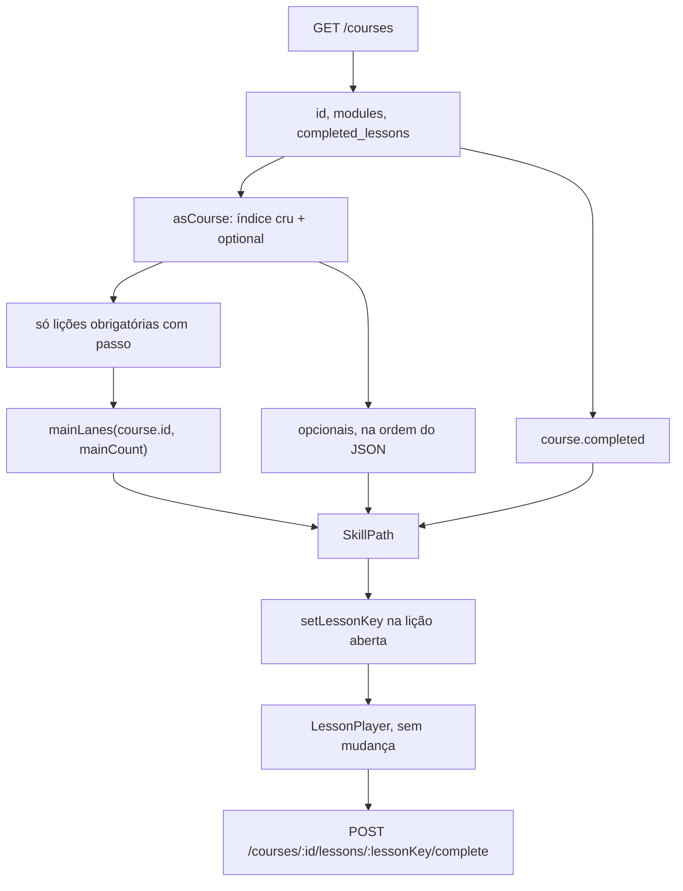

# Trilha do curso: mapa no lugar da lista numerada

| | |
|---|---|
| **Autor** | a preencher |
| **Data** | 2026-09-29 |
| **Status** | Draft |
| **Repositório** | `C:\Users\joaog\PycharmProjects\dev-grind` |

## Overview

Dentro de um curso aberto, a lista numerada de lições (`01  Título`) sai. No lugar entra uma trilha vertical, estreita e centrada: nós quadrados de canto arredondado, ligados por uma curva SVG, sobre um fundo pontilhado. Nó feito leva o check verde que já existe. O nó atual leva um raio e a borda `var(--cyan)`. O próximo fica mais fraco e não abre. A lista de cursos (os cards antes de abrir um curso) e o player da lição não mudam.

A forma da trilha é uma função pura de `course.id` e da quantidade de lições obrigatórias, caminhada do início. A mesma função, no mesmo curso, desenha os mesmos nós em outro dia e em outro browser. Acrescentar uma lição no fim só acrescenta um nó. A função não é gravada em D1, em `courses.modules` nem em `localStorage`. Opcional é uma propriedade da lição (`optional: true`), não um tipo de passo. Ela não entra na caminhada das faixas: sai em ângulo reto da lição obrigatória anterior.

## Background & Motivation

O curso é um JSON opaco em `courses.modules` (`text NOT NULL`, default `'[]'`, `platform/worker/src/db/schema.ts`). Não há tabela de lição. `GET /courses` (`platform/worker/src/routes/courses.ts`, montada em `app.route('/courses', coursesRoutes)` em `platform/worker/src/index.ts`) devolve, para o `user_id` autenticado, o JSON já parseado e `completed_lessons` lido de `course_lesson_progress`. O client deriva o mapa disso. Não há endpoint novo.

O player inteiro está em `platform/frontend/src/pages/CoursesPage.tsx`. Com um curso aberto e nenhuma lição aberta, o bloco `course && !lesson` percorre `section.lessons` e renderiza um botão por lição:

- rótulo `String(li + 1).padStart(2, '0')` mais o título
- classe `card` (fundo `var(--bg-card)`, borda 1px `var(--border)`, raio 6px)
- se `course.completed` contém `${sectionIndex}-${lessonIndex}`, borda `var(--green)` e o SVG de 16px (`polyline points="20 6 9 17 4 12"`, `aria-label="feita"`)
- todo botão chama `setLessonKey`. Não existe nó atual, nem raio, nem lição travada

A chave no client hoje é o índice do array **depois** de `asCourse` filtrar. `asCourse` descarta passo com `type` desconhecido (`asStep` devolve `null`), descarta lição sem passo reconhecido (`if (!steps.length) continue`) e descarta seção que ficou vazia. O servidor, em `lessonKeys`, numera o JSON cru: `${si}-${li}` sobre `modules`, sem filtrar. Os dois coincidem enquanto toda lição tem pelo menos um passo `text`, `fill`, `browser` ou `terminal` e nenhuma seção some. É o caso dos dois cursos locais. Este trabalho deixa de compactar, para um opcional ou um buraco não deslocar as chaves já gravadas.

O card do curso, no bloco `!course`, continua:

```tsx
{item.completed.length} de {item.sections.reduce((n, section) => n + section.lessons.length, 0)} lições
```

`N` é o tamanho de `completed_lessons`. `M` é o número de lições que `asCourse` guardou. Opcional entra em `M`. O campo `courses.is_complete` não entra nessa conta.

### O que está no D1 local

Lido do D1 local do Wrangler (`study-platform`, `platform/worker/wrangler.toml`), tabela `courses`. Este trabalho não dá `UPDATE` nessas linhas.

| id | título | `is_complete` | seções | lições | progresso |
|---|---|---|---|---|---|
| `f0eae0b5-5a5b-4d4b-9914-77d31ae3a49a` | HTML | 1 | `HTML básico` | Tags `0-0`, A página `0-1`, Texto `0-2`, Botão `0-3`, Link `0-4` | as cinco chaves |
| `7fb01e42-de75-44e1-ab31-c11a8fb9f2b5` | Python | 1 | `Python básico` | Valores `0-0`, Variável `0-1`, print `0-2`, if `0-3` | só `0-0` |

Nenhuma lição tem a chave `optional`. Os passos são só `text`, `fill`, `browser` e `terminal`, todos reconhecidos por `asStep`. Não há buraco de índice. HTML tem 5 de 5. Python tem 1 de 4.

`is_complete` aqui significa "o autor terminou de escrever o curso" (`create_course`: `True = all modules are ready`). Python está `is_complete` e o aluno só concluiu `0-0`. O raio não lê essa coluna. Lê `course.completed` contra as lições obrigatórias.

### O que dói

A lista numerada não mostra onde o aluno está. Tudo abre, feito ou não. Não há lugar para um extra que não bloqueie a trilha. Uma trilha desenhada à mão, ou sorteada com `Math.random()` a cada visita, ou mudaria de lugar, ou exigiria gravar coordenadas. A permanência pedida é a função.

## Goals & Non-Goals

### Goals

- Trocar só o índice de lições do curso aberto por uma trilha vertical, a mesma forma no mobile e no desktop.
- Gerar as faixas no client, função pura de `course.id` e da sequência de lições obrigatórias, sem `Math.random()` e sem escrita.
- Garantir o prefixo: acrescentar uma lição obrigatória no fim não move os nós anteriores. A função que garante isso está especificada abaixo, com o curso HTML como exemplo.
- Tratar `optional: true` como flag da lição. Ramificação a 90 graus da obrigatória anterior. Não bloqueia o raio. Conclusão pelo `POST` que já existe, chave `${sectionIndex}-${lessonIndex}` sobre toda lição da seção, opcional incluída.
- Documentar a flag em `create_course` e `append_course_modules`. Sem migration, sem tabela, sem endpoint.
- Manter o player, o rodapé, o fill, `document.body.dataset.courseLesson` e o texto `N de M lições`.

### Non-Goals

- Gravar a trilha. `Math.random()` por visita. Paleta, moedas, streak ou tab bar do Mimo.
- Travar lição por regra que não seja o estado do nó descrito aqui. O `POST` não ganha checagem de ordem.
- Roadmap entre cursos. Passo `kata` do spec `docs/superpowers/specs/2026-09-29-kata-como-passo-de-licao.md`. Esse spec não está implementado; este não depende dele e não o edita.
- Fazer `N de M` ignorar opcionais.
- Editar os cursos HTML e Python já gravados.
- Ícone diferente por lição. O nó feito usa o check; o atual usa o raio; o futuro fica vazio.

## Proposed Design



A página continua dona do fetch, de `asCourse`, de `setLessonKey` e do `POST`. O mapa não chama a API. Dois arquivos novos, os dois no frontend:

- `platform/frontend/src/lib/skillPath.ts` — função pura. Sem React. Congelada.
- `platform/frontend/src/components/SkillPath.tsx` — SVG e botões. Recebe as lições já parseadas.

`CoursesPage.tsx` troca o bloco da lista, preserva índice e flag em `asCourse`, e troca o `flatMap` que resolve a lição aberta (linhas 451–452). `index.css` não ganha token. Os estilos do mapa são inline, como o resto da página.

### Onde fica na UI

O container da página não muda: `maxWidth: 1080`, `pagePadding('40px 48px 72px', isMobile, true)`. O controle `← cursos` e o `h1` do título do curso ficam como estão, alinhados à esquerda.

O `div` de `maxWidth: 640` que hoje embrulha a lista deixa de limitar o mapa. A trilha é uma coluna centrada (`margin-inline: auto`), a mesma geometria abaixo de 768px e acima. `useMediaQuery` não entra na função das faixas. Esticar o nó até 1080px está errado.

O fundo pontilhado cobre só a área do mapa, não a lista de cards e não o player:

```css
background-image: radial-gradient(circle, var(--border) 1.2px, transparent 1.4px);
background-size: 16px 16px;
```

`--border` é `#222222` sobre `--bg` `#0a0a0a`. Sem roxo, sem `BackgroundPatterns.tsx`.

A bolha de chat não sobe nessa tela. `document.body.dataset.courseLesson` só fica `'1'` com uma lição aberta (`CoursesPage`, efeito que já existe; `AppLayout` lê `data-course-lesson` e usa o offset de 96px). O mapa é o ramo `course && !lesson`, então o dataset continua vazio.

### O que o client já tem

`GET /courses` devolve `id`, `modules` e `completed_lessons`. `asCourse` já copia o id e mapeia `completed_lessons` para `course.completed`. O mapa usa esses dois. Não há segundo request.

Contrato da lição no client, depois deste trabalho:

```ts
interface Lesson {
  title: string
  optional: boolean
  steps: Step[]
  sectionIndex: number
  lessonIndex: number
}
```

`optional` é `lesson.optional === true` no JSON. Ausente, `false`, `1` ou `"true"` significam obrigatória. O buraco (nenhum passo reconhecido) não vira `Lesson`: não é nó, não entra na caminhada, não entra em `M`. O índice cru dele continua reservado, porque a próxima lição guarda o `lessonIndex` original, não a posição no array compactado.

```ts
key = `${sectionIndex}-${lessonIndex}`
```

`sectionIndex` é o índice em `modules`. `lessonIndex` é o índice em `lessons` desse objeto. Não é `course.sections.indexOf(section)` sobre um array filtrado, que é o que a lista faz hoje. Seção sem nenhuma lição renderizável não ganha título e não desloca o `sectionIndex` das seguintes.

Há três sítios da chave. O botão da lista (`course.sections.indexOf(section)` mais `li`) sai com o mapa. `lessonKeys` no servidor já numera o JSON cru e aceita a chave crua. O terceiro é o finder que abre o player, e hoje ele ainda compacta. Está em `CoursesPage.tsx` linhas 451–452:

```tsx
const lesson = course?.sections.flatMap((section, si) => section.lessons.map((item, li) => ({ section, item, key: `${si}-${li}` })))
  .find(entry => entry.key === lessonKey)
```

`si` e `li` são a posição depois que `asCourse` descarta lição sem passo reconhecido e seção que ficou vazia. `SkillPath` chama `setLessonKey` com a chave crua. Se o `find` ainda procurar a chave compactada, o clique não resolve: o player não monta, `document.body.dataset.courseLesson` fica vazio e o `POST` não sai. HTML e Python não têm buraco, então esse desvio passa nos itens 1–5 do rollout.

O `flatMap` passa a ignorar o índice do array filtrado:

```tsx
const lesson = course?.sections.flatMap(section => section.lessons.map(item => ({
  section,
  item,
  key: `${item.sectionIndex}-${item.lessonIndex}`,
})))
  .find(entry => entry.key === lessonKey)
```

`setLessonKey`, o `find` e o `POST` usam essa mesma string. O player não monta se `steps.length === 0`. O mapa não chama `setLessonKey` para buraco.

Nos dois cursos locais o resultado é o mesmo de hoje: HTML `0-0`…`0-4`, Python `0-0`…`0-3`. `M` continua 5 e 4, porque não há buraco e todo opcional futuro com passo entra na lista que o card já soma.

### Faixas: função pura, prefixo estável

Três faixas, nesta ordem e com estes nomes no código: `'left'`, `'center'`, `'right'`.

A forma que garante o prefixo é um passeio que não olha para o futuro nem para o conteúdo da lição:

```text
state_0 = FNV1a32("devgrind.skillpath.v1:" + courseId)
lane_{-1} = center          // predecessor virtual, não é nó
(lane_i, state_{i+1}) = Step(state_i, lane_{i-1})    para i = 0 .. n-1
```

`n` é o número de lições obrigatórias com pelo menos um passo, na ordem do JSON, seções na ordem, lições na ordem. Título, chave, flag e lição opcional não são entrada. `Step` não chama `Math.random`, `crypto.getRandomValues`, `Date` nem `localStorage`.

Por indução, o par `(lane_k, state_{k+1})` depende só de `courseId` e de `k`, não de `n`. Logo `mainLanes(id, 5)` é prefixo de `mainLanes(id, 6)`. Acrescentar uma obrigatória no fim consome mais um `Step` e não reescreve as anteriores. Inserir ou reordenar uma obrigatória no meio muda o índice das obrigatórias seguintes, e essas mudam de faixa. Isso é permitido. Inserir uma opcional não muda `n`, então nenhuma faixa se move. Renomear uma lição não muda faixa, porque o título não entra na função.

Editar `Step`, o sal `devgrind.skillpath.v1:` ou as constantes de geometria no mesmo arquivo move os mapas já vistos. O arquivo é o único lugar da função, e fica congelado no dia em que entra. A primeira linha do arquivo é o aviso:

```ts
// Frozen. Changing the salt, Step, or the constants moves every course map.
```

Código normativo. Os números abaixo foram gerados por esta função em Node 24. Não reescrever "por clareza": `Math.imul` e `>>> 0` são parte do resultado. Sem `>>> 0`, o `%` do JavaScript sobre um int32 negativo troca a faixa.

```ts
export function fnv1a(input: string): number {
  let h = 0x811c9dc5
  for (let i = 0; i < input.length; i++) {
    h ^= input.charCodeAt(i)
    h = Math.imul(h, 0x01000193)
  }
  return h >>> 0
}

export function mix(state: number): number {
  state = (state + 0x9e3779b9) >>> 0
  let z = state
  z = Math.imul(z ^ (z >>> 16), 0x85ebca6b)
  z = Math.imul(z ^ (z >>> 13), 0xc2b2ae35)
  return (z ^ (z >>> 16)) >>> 0
}

export type Lane = 'left' | 'center' | 'right'

const LANE_BY_INDEX = ['left', 'center', 'right'] as const

export function mainLanes(courseId: string, mainCount: number): Lane[] {
  let state = fnv1a(`devgrind.skillpath.v1:${courseId}`)
  const lanes: Lane[] = []
  let prev = 1
  for (let i = 0; i < mainCount; i++) {
    state = mix(state)
    const roll = state % 10
    let next: number
    if (roll <= 5) {
      if (prev === 1) next = ((state >>> 4) & 1) === 0 ? 0 : 2
      else next = 1
    } else if (roll <= 7) {
      next = prev
    } else if (prev === 0) {
      next = 2
    } else if (prev === 2) {
      next = 0
    } else {
      next = ((state >>> 4) & 1) === 0 ? 2 : 0
    }
    lanes.push(LANE_BY_INDEX[next])
    prev = next
  }
  return lanes
}
```

`roll` vale 0..9 porque `state` sai de `mix` como uint32.

| roll | peso | efeito |
|---|---|---|
| 0..5 | 60% | troca para a faixa adjacente. Do centro, o bit 4 escolhe esquerda ou direita. Da ponta, vai ao centro. |
| 6..7 | 20% | repete a faixa |
| 8..9 | 20% | zigue-zague: ponta esquerda vai à direita e o inverso. Do centro, o bit 4 escolhe o lado oposto ao da troca adjacente. |

O predecessor virtual é o centro, então o primeiro nó também pode cair no centro, à esquerda ou à direita. Repetir é permitido. O objetivo é um curso não ser esquerda-centro-direita para sempre, e dois cursos tenderem a diferir. Não há garantia de que dois ids curtos nunca colidam nas primeiras faixas; a garantia é a função, não a variedade máxima.

O lado da primeira ramificação é um bit dessa mesma semente. Não avança `mix`, então não mexe no prefixo das faixas. Não depende da chave da âncora: âncoras diferentes do mesmo curso nascem para o mesmo lado, e o segundo opcional daquela âncora vai para o lado oposto.

```ts
export function courseBranchSide(courseId: string): -1 | 1 {
  const seed = fnv1a(`devgrind.skillpath.v1:${courseId}`)
  return (seed & 1) === 0 ? -1 : 1
}
```

`-1` é esquerda, `+1` é direita. Dobrar a chave da âncora num segundo hash foi descartado: a regra aprovada é a semente do curso, e um segundo sal seria outro mapa.

#### Exemplo trabalhado: HTML, cinco lições, depois uma sexta

Id `f0eae0b5-5a5b-4d4b-9914-77d31ae3a49a`. Semente `906121739`. Lado da ramificação `+1` (direita). Esta sexta lição não é gravada. Serve para mostrar o prefixo.

| i | roll | Step | faixa com 5 | faixa com 6 |
|---|---|---|---|---|
| 0 | 4 | adjacente, saindo do centro virtual | right | right |
| 1 | 6 | repete | right | right |
| 2 | 3 | adjacente | center | center |
| 3 | 4 | adjacente | right | right |
| 4 | 9 | zigue-zague, da direita para a esquerda | left | left |
| 5 | 5 | adjacente | — | center |

As cinco primeiras não mudam. A sexta, se um dia for acrescentada no fim da trilha principal, cai no centro.

O mesmo id com uma opcional inserida entre duas obrigatórias continua com `mainCount === 5`. As cinco faixas ficam. O que muda nesse caso é a chave das lições depois do ponto de inserção, porque a chave é o índice no array. Isso já é verdade hoje para qualquer inserção no meio do JSON. `append_course_modules` não faz isso: ele concatena seções no fim (`[...modules, ...novos]` em `platform/worker/src/lib/tools.ts`). Chaves antigas ficam, e as novas obrigatórias são índices novos no fim da caminhada.

Inserir uma obrigatória no índice principal 2 (entre A página e Texto) é outra operação. `n` passa a 6, a função de índice não muda, as lições seguintes trocam de índice principal e portanto de faixa:

| lição | índice principal antes | faixa antes | índice depois | faixa depois |
|---|---|---|---|---|
| Tags | 0 | right | 0 | right |
| A página | 1 | right | 1 | right |
| (nova) | — | — | 2 | center |
| Texto | 2 | center | 3 | right |
| Botão | 3 | right | 4 | left |
| Link | 4 | left | 5 | center |

Os nós posteriores se movem. O prefixo (índices 0 e 1) não. Não existe API de inserção no meio; se alguém editar o JSON à mão, a regra é essa. Este trabalho não edita o HTML.

Python, id `7fb01e42-de75-44e1-ab31-c11a8fb9f2b5`, semente `2245293992`, lado `-1`, quatro obrigatórias: `left, center, left, center`. Não é a sequência do HTML. Uma quinta obrigatória no fim seria `right`, e as quatro primeiras ficariam.

Marcar uma obrigatória já existente como `optional: true` tira ela da caminhada e reindexa as obrigatórias seguintes. Os nós posteriores podem se mover. Flag se define na autoria, não em cima de HTML ou Python.

### Geometria congelada

Constantes no mesmo arquivo, em pixels CSS, sem escala pelo viewport. A coluna das três faixas tem 280px de largura lógica. O canvas cresce se um ramo sair disso; o nó não estica.

```ts
export const NODE = 56
export const NODE_RADIUS = 16
export const V_STEP = 128
export const BRANCH = 96
export const LANE_X: Record<Lane, number> = { left: 48, center: 140, right: 232 }
export const PAD_TOP = 8
export const TITLE_BLOCK = 28

export function mainNodeY(mainIndex: number, sectionStarts: readonly number[]): number {
  let titles = 0
  for (const start of sectionStarts) if (start <= mainIndex) titles += 1
  return PAD_TOP + titles * TITLE_BLOCK + mainIndex * V_STEP + NODE / 2
}
```

`sectionStarts` são os índices principais (não o índice cru) em que começa a primeira lição obrigatória de uma seção. Distância entre centros de faixa: 92px. O nó tem 56px, sobra 36px entre as caixas. 56 ≥ 44, então o alvo de toque é o próprio nó. O título fica dentro do botão, o que só aumenta a área.

`y` do HTML, uma seção começando no índice principal 0: `64 + i * 128`.

| lição | chave | faixa | centro |
|---|---|---|---|
| Tags | `0-0` | right | (232, 64) |
| A página | `0-1` | right | (232, 192) |
| Texto | `0-2` | center | (140, 320) |
| Botão | `0-3` | right | (232, 448) |
| Link | `0-4` | left | (48, 576) |

A curva entre o nó `i` e o nó `i + 1` é cúbica, desenhada em código, não uma imagem e não uma lista de pontos feita à mão:

```ts
function connector(x1: number, y1: number, x2: number, y2: number): string {
  const midY = (y1 + y2) / 2
  return `M ${x1} ${y1} C ${x1} ${midY}, ${x2} ${midY}, ${x2} ${y2}`
}
```

Primeiro trecho do HTML, as duas primeiras em `right`: `M 232 64 C 232 128, 232 128, 232 192`. Segundo trecho, de `right` para `center`: `M 232 192 C 232 256, 140 256, 140 320`.

Traço da trilha: `fill: none`, `stroke: var(--muted)`, `opacity: 0.45`, `strokeWidth: 10`, `strokeLinecap: round`, `strokeLinejoin: round`. O ramo usa o mesmo stroke com `strokeWidth: 6`. O SVG é pintado antes dos nós, para o traço sumir debaixo do quadrado.

Quando duas obrigatórias seguidas caem na mesma faixa, o traço é vertical e atravessa o título. O título leva fundo `var(--bg)` e `padding: 0 4px`, para o glifo não ser cortado. Não desviar o título para o lado: ele fica debaixo do nó.

### Lições opcionais

Não ocupam faixa. Não entram em `mainLanes`. A âncora é a obrigatória anterior na ordem do documento, atravessando seção. Várias opcionais seguidas, entre duas obrigatórias, penduram todas nessa âncora anterior e alternam o lado.

Se a primeira lição do curso é opcional, não há âncora anterior. As opcionais anteriores à primeira obrigatória penduram nessa primeira obrigatória, também a 90 graus, na ordem em que aparecem, antes das opcionais que venham depois dela. Elas abrem desde o início: a primeira obrigatória é o nó atual ou já está feita, então o aluno já "chegou" nela. Nos dois cursos locais a primeira lição é obrigatória (Tags, Valores). A regra existe para o JSON que ainda não foi escrito.

Ordem dos ramos numa âncora:

1. Se esta é a primeira obrigatória do curso, as opcionais que aparecem antes dela.
2. As opcionais depois dela e antes da próxima obrigatória.

Índice `k` nessa lista, lado do curso `s = courseBranchSide(courseId)`:

```ts
export function branchPlacement(
  parentX: number,
  parentY: number,
  indexOnAnchor: number,
  firstSide: -1 | 1,
): { x: number; y: number; side: -1 | 1; depth: number } {
  const depth = Math.floor(indexOnAnchor / 2) + 1
  const side = indexOnAnchor % 2 === 0 ? firstSide : (firstSide === 1 ? -1 : 1)
  return { x: parentX + side * depth * BRANCH, y: parentY, side, depth }
}
```

| k | lado | profundidade | onde |
|---|---|---|---|
| 0 | o lado do curso | 1 | a 96px da âncora |
| 1 | o oposto | 1 | a 96px para o outro lado |
| 2 | o lado do curso | 2 | a 192px, mais para fora, não em cima do primeiro |
| 3 | o oposto | 2 | a 192px |

O `y` é o da âncora. O traço é horizontal, da borda do nó pai até a borda do ramo, não de centro a centro:

```text
x0 = parentX + side * (NODE / 2)
x1 = branchX - side * (NODE / 2)
M x0 parentY L x1 parentY
```

Exemplo, sem gravar nada no HTML. Uma opcional cuja âncora é A página, a primeira dessa âncora. A página está em (232, 192), lado do curso `+1`. O ramo cai em (328, 192). O traço vai de `x = 260` a `x = 300`, `y = 192`. Uma segunda opcional na mesma âncora cai em (136, 192). Uma terceira cai em (424, 192). 328 fica fora da coluna de 280px. O canvas cresce, continua centrado (`width: fit-content; margin-inline: auto; max-width: 100%; overflow-x: auto`). A página de 1080px não ganha scroll horizontal. O nó não é escalado. Num viewport de 390px com gutter de 16px (`MOBILE_GUTTER`), um ramo de profundidade 2 pode rolar dentro do mapa. Isso é o comportamento, não um motivo para encurtar `BRANCH` no mobile.

Um ramo pode cair perto do `x` de outra faixa. Não "corrigir" empurrando o ramo para uma faixa. O `y` é o da âncora, e as outras obrigatórias estão a 128px dali.

Curso sem nenhuma obrigatória não existe no D1. A função mesmo assim é total: `mainLanes` devolve `[]`, não há curva e não há raio. Não há âncora obrigatória, então a regra dos 18px na seção "Título de seção" não se aplica. O parágrafo abaixo é a única regra de layout desse curso.

As opcionais desenhadas, de todas as seções, formam uma única fileira em torno de `LANE_X.center` (140). O `k` corre nessa fileira, na ordem do documento, e `branchPlacement` usa 140 como `parentX`. O lado é `courseBranchSide`. Abrem na hora.

`sectionCount` é o número de seções com pelo menos uma lição desenhada. Seção vazia ou só com buraco não entra e não ganha título. O `y` da fileira reserva uma banda de `TITLE_BLOCK` por seção contada. Não chamar `mainNodeY(0, [0])`: isso vale 64 e só cabe um título.

```ts
y = PAD_TOP + sectionCount * TITLE_BLOCK + NODE / 2
```

Cada título fica em `x = LANE_X.center` (140), não no `x` do primeiro ramo. A banda da seção contada `s` (0-based) vai de `PAD_TOP + s * TITLE_BLOCK` até `PAD_TOP + (s + 1) * TITLE_BLOCK`. O topo da caixa do nó é `y - NODE / 2`, que cai no fim da última banda.

Exemplo numérico de duas seções, curso que não está no D1, lado `+1`. O primeiro ramo não está em 140: com esse lado ele está em `140 + 96`. O título não o segue.

| | |
|---|---|
| `sectionCount` | 2 |
| `y` da fileira | 8 + 2 × 28 + 28 = 92 |
| topo do nó | 64 |
| título da seção 0 | x = 140, banda y = 8..36 |
| título da seção 1 | x = 140, banda y = 36..64 |
| primeiro ramo (`k = 0`) | (236, 92) |
| segundo ramo (`k = 1`) | (44, 92) |

Uma seção só cai em `y = 64`, o mesmo número que `mainNodeY(0, [0])`, porque `sectionCount` é 1. Com outra contagem, usar a fórmula, não o 64.

### Estados do nó

Há no máximo um nó atual: a primeira lição obrigatória cuja chave não está em `course.completed`. Se não houver, não há raio. HTML está nesse caso (as cinco chaves existem). Python: `0-0` feita, atual é `0-1` (Variável), `0-2` e `0-3` são futuras. Hoje as quatro abrem. Depois, `0-2` e `0-3` não abrem até cada obrigatória anterior estar feita. É a trava pedida, não uma trava extra.

```ts
const currentKey = required.find(lesson => !completed.has(lesson.key))?.key ?? null

function anchorReached(anchorKey: string): boolean {
  return anchorKey === currentKey || completed.has(anchorKey)
}
```

| estado | quando | borda | ícone | clique |
|---|---|---|---|---|
| feita | obrigatória em `completed` | `var(--green)` | o check que já existe | abre, replay |
| atual | `key === currentKey` | `var(--cyan)`, mais `box-shadow: 0 0 0 4px var(--cyan-glow)` | raio | abre |
| futura | obrigatória, nem feita nem atual | `var(--border)`, opacidade 0.4 | nenhum | não abre |
| opcional disponível | âncora alcançada, não feita | `var(--cyan)`, sem raio e sem glow | nenhum | abre |
| opcional fechada | âncora ainda não alcançada | igual à futura | nenhum | não abre |
| opcional feita | opcional em `completed` | `var(--green)` | o mesmo check | abre, replay |

A opcional disponível ou feita mostra a palavra `opcional` debaixo do título, 10px, `letter-spacing: 0.06em`, `uppercase`, cor `var(--muted)`, `font-family: var(--font)`. A fechada também mostra, junto com a opacidade 0.4.

Terminar uma obrigatória põe a chave em `completed`. No render seguinte, `currentKey` é a próxima obrigatória que falta, ou `null`. Terminar uma opcional acrescenta a chave dela e não muda `currentKey`, porque a busca ignora opcional. Não escrever um `if (!optional) moveBolt()`.

Uma obrigatória feita depois do raio (progresso furado: `0-0` e `0-2` feitos, `0-1` não) continua verde e clicável. O raio fica em `0-1`. "Futura" significa não feita e não atual. O D1 local não tem esse furo; a definição cobre.

O botão é `<button type="button">`. Fechado e futuro usam `disabled`. O atual leva `aria-current="step"`. O check mantém `aria-label="feita"` e o mesmo `polyline`. O raio é `aria-hidden`. Nome acessível do botão é o título visível.

SVG do raio, traço só, cor `var(--cyan)`:

```svg
<svg width="22" height="22" viewBox="0 0 24 24" fill="none" stroke="var(--cyan)" stroke-width="2.2" stroke-linecap="round" stroke-linejoin="round" aria-hidden="true">
  <polyline points="13 2 4 14 12 14 11 22 20 10 12 10 13 2" />
</svg>
```

O check dentro do nó usa o mesmo `viewBox` e o mesmo `polyline points="20 6 9 17 4 12"`, `stroke="var(--green)"`, `strokeWidth="2.4"`, desenhado a 22px. Não é outro ícone.

Nó: 56×56, `border-radius: 16`, fundo `var(--bg-card)`, borda 2px. Não usar a classe `card` (raio 6px, borda 1px). Título debaixo do nó: `font-family: var(--font)`, 12px, `line-height: 1.35`, largura 88px, no máximo duas linhas, `text-align: center`, cor `var(--text)` quando o nó está ativo e `var(--muted)` quando está apagado. JetBrains Mono já é `--font`. Não carregar outra fonte.

### Título de seção

O estilo que já está na lista fica, só muda de lugar: 12px, `letter-spacing: 0.06em`, `uppercase`, `var(--faint)`, centralizado na coluna, no `TITLE_BLOCK` imediatamente acima do primeiro nó obrigatório daquela seção. No HTML, "HTML básico" fica acima de Tags.

Seção que só tem opcionais, num curso que tem pelo menos uma obrigatória, não empurra a trilha. Esta regra dos 18px não vale para o curso sem obrigatória: lá os títulos empilham em `x = 140`, na fórmula da fileira. Aqui a âncora é um nó obrigatório, que já tem o título da seção dele no `TITLE_BLOCK` acima do próprio nó. O título da seção só-opcional, no mesmo estilo, centra no `x` do primeiro ramo dela, 18px acima da caixa do nó. Se a caixa desse título intersectar o título da seção da âncora, ele desce para baixo do rótulo `opcional` desse primeiro ramo, ainda numa linha, ainda `var(--faint)`. Sem isso, os dois títulos disputam a faixa acima do mesmo `y`.

### Player

`LessonPlayer`, `StepView`, rodapé (`verificar`, `continuar`, `concluir`, `tentar novamente`), fill e o `POST` ficam. Abrir um nó é `setLessonKey(key)` com a chave crua. Quem entrega essa chave ao player é o `flatMap` das linhas 451–452, reescrito para `item.sectionIndex` e `item.lessonIndex`, como na seção "O que o client já tem". `onComplete` continua a não reenviar se a chave já está em `course.completed`, atualiza o array na hora e reverte se o `POST` falha. O servidor, se a linha existe, responde `{ completed: true, already: true }` e não chama `recordAttempt` de novo.

O player não ganha selo "opcional". A palavra existe só no mapa.

### Autoria

`createCourse` e `appendCourseModules` fazem `JSON.stringify` do array que receberam. Não validam passo. Não passam a validar. A flag sobrevive porque o JSON é opaco. Ausência continua significando obrigatória, que é o que HTML e Python já são.

As `description` das tools estão em inglês e continuam em inglês, no mesmo tom telegráfico. O que muda:

`create_course.description` ganha, depois da lista de tipos de passo: `A lesson is required unless it sets optional to boolean true. optional is a property of the lesson, not a step type. Absence means required.`

O `modules` do `inputSchema` de `create_course` passa de `{title, lessons: [{title, steps: [text|fill|browser|terminal]}]}` para `{title, lessons: [{title, optional?: true, steps: [text|fill|browser|terminal]}]}`.

`append_course_modules.description` ganha: `Lessons may set optional: true, same as create_course. Absence means required.`

O `modules` do append passa a dizer que o formato inclui `optional: true` na lição.

Exemplo que o autor grava, e que o `GET` devolve intacto:

```json
{ "title": "Um extra", "optional": true, "steps": [{ "type": "text", "body": "..." }] }
```

Os tipos de passo continuam `text`, `fill`, `browser` e `terminal`. O passo `kata` não entra nesta description.

### Casos que o código de hoje não responde, já fechados

- Primeira lição opcional: âncora é a primeira obrigatória, a 90 graus, clicável desde o início. Os cursos locais não estão nesse caso.
- Curso só de opcionais: sem faixa, sem raio, uma fileira, `y = PAD_TOP + sectionCount * TITLE_BLOCK + NODE / 2`, títulos em `x = 140`. Duas seções dão `y = 92`, não 64. A regra dos 18px não entra. Não está no D1.
- Curso com todas as obrigatórias feitas: sem raio. HTML está nesse caso. Replay continua.
- `is_complete === true` não apaga o raio. Python prova por que.
- Buraco (passo só de tipo desconhecido, inclusive um `kata` que este spec não implementa): não é nó, não conta em `M`, o índice cru fica. O `flatMap` que abre o player usa esse índice, não a posição no array filtrado. Quando o outro spec passar a reconhecer o passo, o buraco vira nó sem renumerar os vizinhos. Até lá, `asStep` continua devolvendo `null` para tipo desconhecido.
- Progresso fora de ordem: o raio é a primeira obrigatória ausente; uma feita mais adiante permanece feita.

## API / Interface Changes

Nenhuma rota nova. `GET /courses` e `POST /courses/:id/lessons/:lessonKey/complete` ficam.

| superfície | antes | depois |
|---|---|---|
| `GET /courses` | `modules`, `completed_lessons`, `id` | igual. O mapa lê isso no client |
| `POST .../complete` | aceita qualquer chave que `lessonKeys` conheça; não olha ordem | igual |
| `create_course` / `append_course_modules` | description sem `optional`; `run` não valida | description com `optional: true`; `run` continua sem validar |
| Lista no curso aberto | botões `01  Título` | `SkillPath` |
| Card `N de M lições` | conta as lições que `asCourse` guardou | a mesma conta, e a lista agora inclui opcional com passo |
| Player | `LessonPlayer` | igual |

Antes, no schema da tool:

```text
Sections. Each: {title, lessons: [{title, steps: [text|fill|browser|terminal]}]}
```

Depois:

```text
Sections. Each: {title, lessons: [{title, optional?: true, steps: [text|fill|browser|terminal]}]}
```

## Data Model Changes

Nenhuma. Sem migration, sem coluna, sem tabela.

`courses.modules` continua `text`. `course_lesson_progress` continua com `lesson_key` e o unique `(user_id, course_id, lesson_key)` da migration `platform/worker/drizzle/0004_course_lesson_progress.sql`. A chave não muda de formato. Opcional não é passo, então não há o que migrar nos passos.

Os dois cursos locais permanecem byte a byte. Ausência de `optional` já é o caso obrigatório. Não rodar `UPDATE`.

Custo de armazenamento deste trabalho: zero bytes. O HTML ocupa 2336 bytes de `modules`, o Python 1412. A trilha é O(n) no client, n na casa das dezenas de lições, não milhares. Não há request extra depois do `GET /courses`. O desenho cabe num frame.

## Alternatives Considered

### 1. Gravar o array de faixas na linha do curso na primeira geração

Rejeitada. A trilha tem de nascer no código e permanecer por curso sem escrita. Uma função semeada faz isso. O custo real, que a alternativa evitaria: editar a função depois move os mapas antigos. A mitigação é isolar a função, congelar o sal e travar o resultado do HTML e do Python num teste. Não é mitigação gravar uma cópia "por segurança". Duas fontes (a função e a coluna) divergem no dia em que alguém corrige um bug na função e esquece a coluna, ou o contrário.

### 2. `Math.random()` e depois salvar

Rejeitada. São duas fontes, e um reload antes do save embaralha. O mapa também passaria a depender de um write no primeiro open, que hoje não existe: abrir um curso é só `setOpenId` em memória. Falha de rede no save deixaria a próxima visita diferente.

### 3. Hash de cada chave de lição para uma faixa, independente

Rejeitada como desenho principal. Nós vizinhos podem cair na mesma faixa sem nenhum passeio, e o passo não "prefere trocar de faixa". Também não produz o zigue-zague curto como decisão em relação à faixa anterior. O passeio com `lane_{i-1}` é o que dá repetir às vezes e trocar na maioria. O hash por chave ainda seria puro e estável, mas não é a trilha pedida.

Uma lista de coordenadas desenhada à mão no JSON foi descartada pelo mesmo motivo da alternativa 1, com um defeito a mais: `append_course_modules` não saberia o próximo ponto sem editar essa lista.

## Security & Privacy

O mapa não amplia o payload. `GET /courses` e o `POST` de conclusão já exigem `requireAuth` e `courses.user_id == userId`. O id do curso já está no client; usá-lo como semente não revela nada. A flag `optional` é conteúdo, não permissão.

A trava de lição futura é de interface. Quem chamar `POST /courses/:id/lessons/0-3/complete` com a sessão do dono, e a chave existir, conclui a lição mesmo que o mapa a mostre fechada. O handler não olha a chave anterior. Isso já é verdade. Para um único usuário, não é fronteira de segurança e este spec não a cria: criar seria uma regra nova no `POST`, fora do escopo. Não logar a semente, não escrever a faixa em `localStorage` (o `localStorage` deste app guarda token, chave de IA e progresso de livro, não curso).

Título de lição entra como texto React, não como HTML. Não usar `dangerouslySetInnerHTML` nem `foreignObject` com string crua no SVG.

Não há dado de outro usuário no mapa. Curso de `dev-user-joao` não aparece para a conta Google, porque o `GET` filtra `user_id`. Nada aqui cruza essa fronteira.

## Observability

Não há pipeline de métrica no repo, e esta tela não cria um. A função pura não tem falha de runtime para alertar: ou o teste bate com o snapshot, ou o mapa se moveu.

Sem `console.log` no painter. O erro de carga que já existe (`Não foi possível carregar os cursos.`) continua sendo o único sinal de rede, porque o mapa não faz request.

O sinal de regressão é o teste de `skillPath.ts`: faixas do HTML, faixas do Python, prefixo de 5 para 6, lado `+1` e `-1`, e ausência de `Math.random` no arquivo. Quebrar o congelamento falha o teste, não um alarme em produção.

## Riscos

| Severidade | Risco | Mitigação |
|---|---|---|
| Alta | Alguém "melhora" `Step`, o sal ou `LANE_X` e todo curso já visto troca de lugar. | Arquivo único, comentário de congelamento, teste com os dois ids reais. Não há coluna para reconciliar. |
| Média | `asCourse` ou o `flatMap` das linhas 451–452 continua montando a chave com o índice do array filtrado. O mapa chama `setLessonKey` com a chave crua, o finder não acha a lição, o player não monta e o `POST` não sai. HTML e Python não têm buraco, então os itens 1–5 passam mesmo assim. | Os dois sítios usam `sectionIndex` e `lessonIndex` guardados na lição. O item 6 do rollout cobre seção vazia e irmão com passo desconhecido. |
| Média | Python deixa de abrir `0-2` e `0-3` até `0-1` estar feita. Hoje os quatro botões abrem. | É o estado "futura". HTML não muda de clicabilidade: as cinco estão feitas e seguem abrindo. |
| Baixa | `POST` conclui uma lição futura se for chamado fora do mapa. | Aceito. Sem regra nova no handler. |
| Baixa | Ramo de profundidade 2 passa da largura do telefone. | `overflow-x: auto` no mapa, sem escala, trilha principal centrada. |
| Baixa | Traço vertical da faixa repetida atravessa o título. | Fundo `var(--bg)` no rótulo. Não mover o título para o lado. |
| Baixa | Um passo `kata` isolado, quando esse spec for escrito por cima deste, some se `asStep` ainda devolver `null`. | O buraco reserva o índice. Este spec não implementa o passo e não edita o outro documento. |

## Rollout Plan

Não há feature flag no frontend. Um usuário. A troca da lista é direta no deploy do client.

Ordem: o módulo puro pode entrar antes da UI (não é chamado ainda). A description das tools pode entrar em paralelo: até a UI existir, uma lição com `optional: true` aparece como card numerado normal, sempre clicável, e a chave já é a definitiva. Quando o mapa entra, essa chave vira ramo sem migração.

Rollback: reverter o commit do frontend. Não há migration para desfazer. Reverter a description da tool não apaga flag já gravada; `asCourse` antigo ignora campo desconhecido e mostra a lição como obrigatória na lista. Isso é seguro.

Não aplicar script no D1 local nem no remoto. Não marcar `[done]` de implementação aqui: isto é o desenho.

Verificação manual, sem editar as linhas:

1. HTML abre a trilha Tags → Link nas faixas `right, right, center, right, left`, todas verdes, sem raio, todas abrem o player.
2. Python abre `left, center, left, center`. Valores verde. Variável com raio e borda ciano. print e if apagados e desabilitados.
3. Recarregar não move nó.
4. `← cursos`, o card `5 de 5` e `1 de 4`, e o player de uma lição feita, seguem iguais.
5. Um curso criado no teste, não no D1 local, com uma opcional entre duas obrigatórias: a obrigatória seguinte não muda de faixa em relação ao curso sem a opcional (mesmo id, mesmo `mainCount`), o ramo sai na horizontal, e concluir a opcional não tira o raio da obrigatória que ainda falta.
6. Outro curso de teste, também fora do D1 local. `modules[0]` é uma seção sem lições. `modules[1]` tem três lições: a primeira só com `{ "type": "desconhecido" }`, as duas seguintes com um passo `text`. A do meio abre o player (`dataset.courseLesson` fica `'1'`) e o `POST` vai para `.../lessons/1-1/complete`, não para `0-0`. A vizinha continua com a chave `1-2`. As duas não viram `0-0` e `0-1`. Não editar HTML nem Python para este caso.

`npx tsc --noEmit` no worker no PR das tools, mais `npm test`. No frontend, `npx tsc -b` e o teste de node do PR do gerador.

## Open Questions

Não há. Permanência, ramo a 90 graus e "opcional é flag de lição" estão fechados. Os bordos que o D1 não exercita (primeira lição opcional, curso só de opcionais, progresso fora de ordem, buraco de passo) estão decididos na seção do desenho, não em aberto.

## References

- `platform/frontend/src/pages/CoursesPage.tsx` — lista `01`, `asCourse`, `asStep`, o `flatMap` das linhas 451–452, card `N de M`, `POST`, `dataset.courseLesson`.
- `platform/frontend/src/index.css` — `--bg` `#0a0a0a`, `--bg-card` `#111111`, `--cyan` `#22d3ee`, `--green` `#22c55e`, `--muted` `#717171`, `--border` `#222222`, `--font` JetBrains Mono. Também `--cyan-glow`, `--faint`, `--border-lit`, `--text`.
- `platform/frontend/src/components/layout/AppLayout.tsx` — offset da bolha quando `data-course-lesson` é `'1'`.
- `platform/frontend/src/lib/layout.ts` — `MOBILE_GUTTER` 16, `pagePadding`.
- `platform/worker/src/routes/courses.ts` — `GET /`, `lessonKeys`, `POST /:id/lessons/:lessonKey/complete`.
- `platform/worker/src/lib/tools.ts` — `create_course`, `append_course_modules`, `createCourse`, `appendCourseModules`.
- `platform/worker/src/db/schema.ts` — `courses`, `course_lesson_progress`.
- `platform/worker/drizzle/0004_course_lesson_progress.sql` — unique da chave.
- `docs/superpowers/specs/2026-09-29-kata-como-passo-de-licao.md` — passo `kata`. Não é dependência e não deve ser editado por este trabalho.
- D1 local `study-platform`: cursos `f0eae0b5-5a5b-4d4b-9914-77d31ae3a49a` (HTML) e `7fb01e42-de75-44e1-ab31-c11a8fb9f2b5` (Python).

## Key Decisions

1. **A permanência é a função, não uma coluna.** `mainLanes(courseId, n)` mais o bit de `courseBranchSide` no mesmo sal. Sem D1, sem `localStorage`. Editar a função move mapa antigo; por isso o arquivo é congelado e o teste trava os dois ids reais.
2. **O passeio é por índice, com memória da faixa anterior.** `lane_i = Step(state_i, lane_{i-1})`, `state_0 = FNV1a32("devgrind.skillpath.v1:" + courseId)`, predecessor virtual no centro. Título e chave não entram. Isso é o que faz o prefixo sobreviver a um append e a um rename, e o que faz 60% trocar de faixa, 20% repetir e 20% zigue-zaguear. Hash independente por lição foi rejeitado.
3. **Opcional não é tipo de passo e não entra na caminhada.** `optional === true` apenas. Ramo horizontal (`y` da âncora), lado único do curso, profundidade `floor(k / 2) + 1`. A âncora das que vêm antes da primeira obrigatória é essa primeira obrigatória, clicável desde o início.
4. **A chave continua `${sectionIndex}-${lessonIndex}` cru.** Opcional ocupa índice. Buraco reserva índice. O botão da lista, o `flatMap` que abre o player e o `POST` usam esses campos guardados, não o índice do array filtrado. Sem migration. O `recordAttempt` não muda. O raio é derivado no render, não gravado.
5. **`courses.is_complete` não é progresso do aluno.** O raio usa `completed_lessons`. Python está marcado completo na autoria e ainda tem três lições fechadas.
6. **Geometria única, 280px de faixas, nós de 56px.** `LANE_X` 48 / 140 / 232, `V_STEP` 128, `BRANCH` 96. Mobile não tem outra função. Ramo que não cabe rola dentro do mapa.
7. **Nada de endpoint e nada de edição dos cursos locais.** A description da tool documenta a flag; o `run` continua sem validar.

## PR Plan

### PR 1 — Congelar o gerador da trilha

- **Title:** `Congelar mainLanes e a geometria da trilha`
- **Files / components:** `platform/frontend/src/lib/skillPath.ts` (novo), `platform/frontend/src/lib/skillPath.test.ts` (novo), `platform/frontend/package.json` (script `test`), `platform/frontend/tsconfig.app.json` (`exclude` de `src/**/*.test.ts`).
- **Dependencies:** nenhuma.
- **Description:** A função normativa deste spec, as constantes e `mainNodeY` / `branchPlacement` / `courseBranchSide`. O teste roda com `node --experimental-strip-types --test` (o app tsconfig só tem `types: ["vite/client"]` e `verbatimModuleSyntax`; o teste fica fora do `tsc -b` para não puxar `node:test`). Assertir: HTML `right,right,center,right,left` e a sexta `center`; Python `left,center,left,center`; `mainLanes(id, 5)` prefixo de `mainLanes(id, 6)`; lados `+1` e `-1`; `y` de Tags `64` e de Link `576`; ramo `k = 2` a `2 * 96` no lado do curso. Ler o fonte e falhar se contiver `Math.random`. O módulo ainda não é importado pela página. Isso é intencional: o snapshot se revisa antes do SVG. `npx tsc -b` no frontend continua verde.

### PR 2 — Trocar a lista numerada pelo mapa

- **Title:** `Desenhar a trilha no curso aberto`
- **Files / components:** `platform/frontend/src/components/SkillPath.tsx` (novo), `platform/frontend/src/pages/CoursesPage.tsx` (`Lesson`, `asCourse`, o bloco `course && !lesson`, e o `flatMap` das linhas 451–452 que hoje monta `` `${si}-${li}` ``). Sem mudança em `LessonPlayer`, `routes/courses.ts`, `schema.ts` ou `index.css`.
- **Dependencies:** PR 1.
- **Description:** `asCourse` guarda `optional`, `sectionIndex` e `lessonIndex` crus e não compacta a chave. O `flatMap` que resolve `lessonKey` para o player usa esses dois campos, não `si`/`li` do array filtrado. O bloco da lista vira `SkillPath` com os estados, a curva, o ramo, o título de seção e o rótulo `opcional`. Curso sem obrigatória usa só a fileira `y = PAD_TOP + sectionCount * TITLE_BLOCK + NODE / 2`, títulos em `x = 140`. A regra dos 18px fica restrita à seção só-opcional que tem âncora obrigatória. Card, `← cursos`, o corpo do player, `dataset.courseLesson` e o `POST` ficam. Não editar as linhas de HTML e Python. `npx tsc -b` no frontend e o teste do PR 1 de novo. Checagem manual dos itens 1–6 do rollout, inclusive o buraco: seção anterior vazia, irmão anterior com passo desconhecido, a lição abre e conclui como `1-1`, a vizinha continua `1-2`.

### PR 3 — Documentar `optional` nas tools

- **Title:** `Documentar optional: true em create_course`
- **Files / components:** `platform/worker/src/lib/tools.ts` (só `description` e texto de `inputSchema` de `create_course` e `append_course_modules`), `platform/worker/test/mcp.test.ts`.
- **Dependencies:** nenhuma. Pode entrar antes ou depois do PR 2. Não depende do mapa para o JSON ser válido.
- **Description:** As frases em inglês deste spec. O `run` não valida. Teste via `callTool`: `create_course` com uma obrigatória e uma `{ title, optional: true, steps: [{ type: 'text', body }] }`; `GET /courses` devolve `optional: true` só na segunda; a description das duas tools contém `optional: true`. O teste usa o D1 do Vitest, não o sqlite local, e não altera HTML nem Python. `npx tsc --noEmit` e `npm test` no worker.
