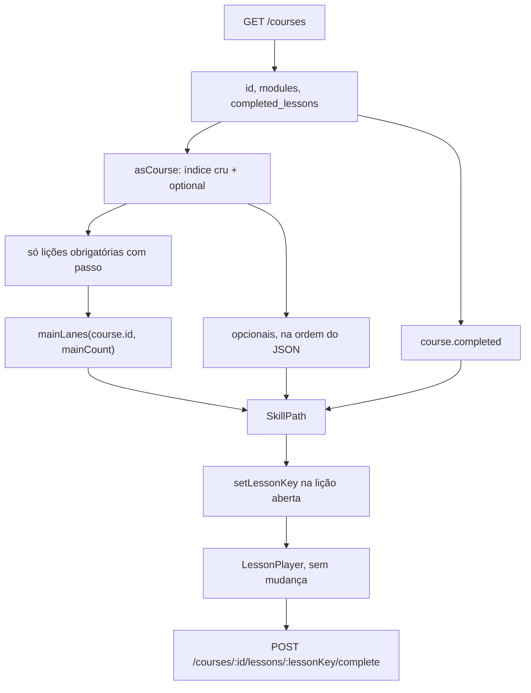
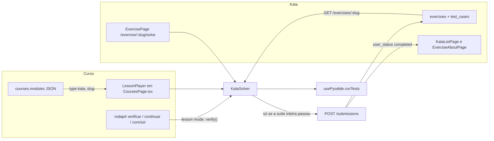
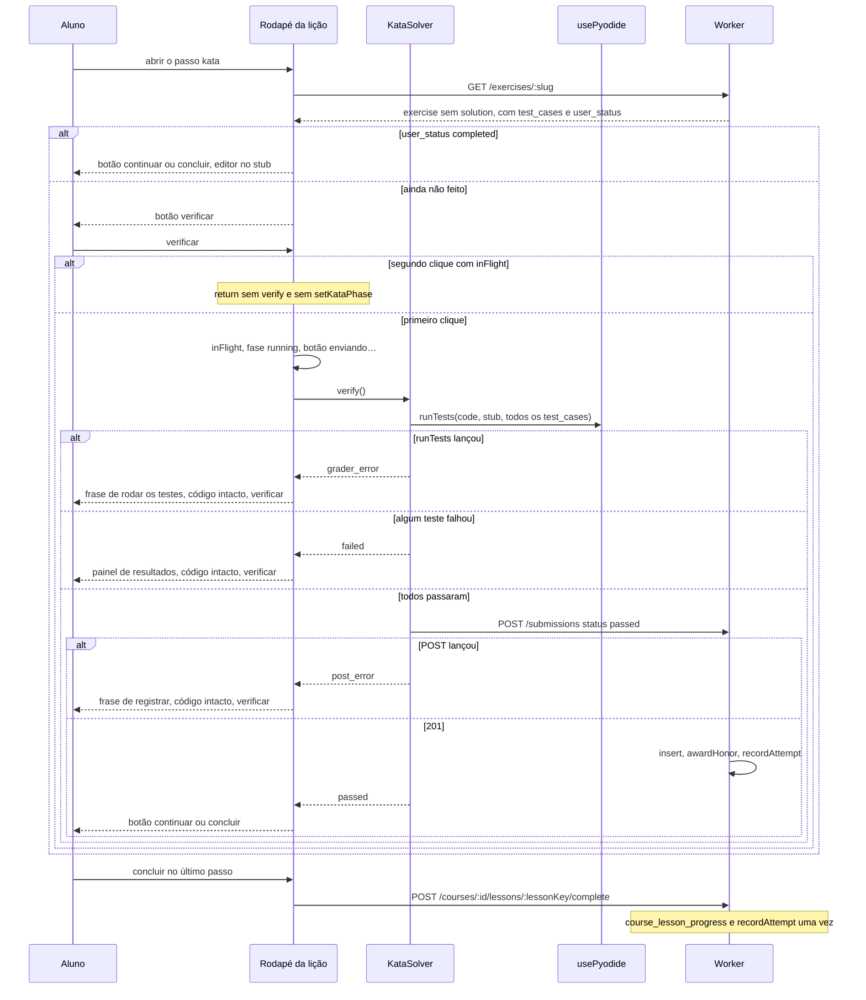

# Courses: home, search and views, roadmaps

**Status:** Part 1 implemented. Part 2 implemented. Part 3 (roadmaps) approved by João on 2026-10-21; plan: Part 3a (worker) done and reviewed, Part 3b (screens) planned below. Part 4 (lesson map) implemented. Part 5 (kata as a lesson step) approved, not built. This is the single MD for the Courses area: spec, Acceptance and plans. New Courses work is added here as a new Part, with its plan in a "Plan: Part N" section. The older Courses files were merged in on 2026-10-21 (see "Where the old files went").

## The request (João's words)

Part 1: "whats missing on courses. The roadmap or career is a group of courses making a roadmap ... second organize make main page of menu usable with individual courses." / "first at all make a course useble." / "you will build your courses using IA, so later I will build the mcp or api to do that."

Parts 2 and 3: "falta mt coisa, falta pesquisa, ordenadores, tipo de visualizacao, lista grade e galeria e atual. Falta a feature de roadmap, é agrupador de cursos para fazer um roadmap por exemplo de backend em python (controlavel pela IA, criar editar apagar etc...)"

Answers on 2026-10-21: everything about courses in one spec; a roadmap is just an empty folder, the AI decides what goes in it and we give the AI the tools; a course can be in several roadmaps; deleting a roadmap can also delete its courses through an option; the app also has delete buttons, not only the AI; tabs `Cursos | Roadmaps`; sorters most recent, name A-Z and progress; default order stays "em andamento primeiro"; search looks in title and description; "atual" is today's card view, so there are four views; grid is compact and gallery is large.

## Where the old files went

| Old file | Section here |
|---|---|
| `specs/2026-09-29-trilha-do-curso.md` | Part 4: Lesson map |
| `specs/2026-09-29-kata-como-passo-de-licao.md` | Part 5: Kata as a lesson step |
| `plans/2026-10-21-courses-home.md` | Plan: Part 1 |
| `plans/2026-10-21-courses-search-views.md` | Plan: Part 2 |
| `plans/2026-10-02-trilha-do-curso.md` | Plan: Part 4 |

## Part 1: Courses home (implemented)

Today `/courses` was a flat list of cards. Which course and lesson was open lived only in React state. Part 1 made one course usable end to end.

1. **Course card.** Title, description, a progress bar with `done / total lessons`, and one state word: `não iniciado`, `em andamento` or `concluído`. Optional lessons count only when done.
2. **Continue button.** `continuar` opens the first required lesson not completed, in map order; `concluído` reads `revisar`; `não iniciado` reads `começar`. The card body opens the course map.
3. **URL state.** `/courses/:courseId` is the map and `/courses/:courseId/:lessonKey` is the lesson. An unknown course shows "curso não encontrado" with a link back to the list; an unknown lesson shows "lição não encontrada" with a link back to the map. The `body.dataset.courseLesson` flag stays, set from the route.
4. **Empty state.** "Nenhum curso ainda." and one line that courses are created by the AI assistant.
5. **List order.** In progress first, then not started, then completed; inside a group the API order (newest first).
6. **Mobile inside a course.** The bottom menu is hidden on the map and the lesson; the chat (AI) button becomes a small square at the top right. Other pages unchanged.
7. **Desktop.** Same list, progress and URLs; sidebar and chat bubble unchanged.

Contract kept: the `modules` JSON and the tools `create_course` and `append_course_modules` do not change.

### Part 1 acceptance (passed 2026-10-21, 15 of 15, mocked data)

```gherkin
Background:
  Given I am logged in

Scenario: The list shows progress and state for each course
  Given there are two courses: "HTML" with 5 lessons and 0 completed, "Python" with 4 lessons and 2 completed
  When I open "/courses"
  Then "HTML" shows state "não iniciado" and progress "0 de 5"
  And "Python" shows state "em andamento" and progress "2 de 4"

Scenario: A finished course shows as completed
  Given there is a course "HTML" with 5 lessons and 5 completed
  When I open "/courses"
  Then "HTML" shows state "concluído" and progress "5 de 5"
  And "HTML" has a "revisar" button

Scenario: Courses in progress come first
  Given there are courses "HTML" (5 of 5 done), "Git" (0 of 3 done) and "Python" (2 of 4 done)
  When I open "/courses"
  Then the order is "Python", "Git", "HTML"

Scenario: Continue opens the first unfinished lesson
  Given "Python" has 4 lessons and the first 2 are completed
  When I open "/courses" and press "continuar" on "Python"
  Then the address is "/courses/<python id>/0-2"
  And I see the lesson player for the third lesson

Scenario: A course that was never started offers to begin
  Given "HTML" has 5 lessons and none are completed
  When I open "/courses"
  Then "HTML" has a "começar" button

Scenario: Opening a course puts it in the address
  Given "Python" has 4 lessons and the first 2 are completed
  When I open "/courses" and press the "Python" card
  Then the address is "/courses/<python id>"
  And I see the lesson map of "Python"

Scenario: Reloading a lesson address reopens the same lesson
  Given "Python" has 4 lessons and the first 2 are completed
  When I open "/courses/<python id>/0-2" and reload the page
  Then I see the lesson player for the third lesson

Scenario: Back from a lesson returns to the map, then to the list
  Given "Python" has 4 lessons and the first 2 are completed
  When I open "/courses/<python id>/0-2" and press the on-screen back button
  Then the address is "/courses/<python id>"
  When I press the on-screen back button
  Then the address is "/courses"

Scenario: An unknown course is labelled, not blank
  When I open "/courses/does-not-exist"
  Then I see "curso não encontrado" and a link back to "/courses"

Scenario: An unknown lesson is labelled, not blank
  When I open "/courses/<python id>/9-9"
  Then I see "lição não encontrada" and a link back to "/courses/<python id>"

Scenario: No courses yet
  Given there are no courses
  When I open "/courses"
  Then I see "Nenhum curso ainda."
  And I see that courses are created by the AI assistant
  And I do not see a button to create a course

Scenario: The courses request fails
  Given `GET /courses` fails
  When I open "/courses"
  Then I see "Não foi possível carregar os cursos."
  When `GET /courses` works again and I press "tentar de novo"
  Then I see the course "Python"

@mobile
Scenario: Inside a course the bottom menu is hidden and the AI button moves to the top
  When I open "/courses/<python id>"
  Then the bottom menu is not visible
  And the AI button is a small square at the top right
  And the AI button does not cover another control

@mobile
Scenario: On the list the bottom menu and the AI button stay as they are
  When I open "/courses"
  Then the bottom menu is visible
  And the AI button is at its usual place above the bottom menu

@desktop
Scenario: Desktop keeps the sidebar and the chat bubble
  When I open "/courses/<python id>"
  Then the sidebar is visible
  And the AI button is at its usual place at the bottom right
```

## Part 2: Search, sorters and views (implemented)

Frontend only. Applies to the `Cursos` tab and, once Part 3 exists, to the `Roadmaps` tab and the course list inside a roadmap.

1. **Search box** above the list. Matches title and description, ignoring case and accents, updates as you type, and does not survive a reload. A clear button appears with text. No match: "Nenhum curso encontrado para “<text>”" with a `limpar busca` button.
2. **Sorter** (one select): `Padrão` (em andamento primeiro, then não iniciado, then concluído, as in Part 1), `Mais recentes`, `Nome A-Z` and `Progresso` (highest percentage first; ties by title). The sorter is a view over the already-loaded list; it never refetches.
3. **Four views**, switched by a four-button control:
   - `cards`: today's card (title, description, bar, count and state, action button). Default.
   - `lista`: one compact row per course (title, thin bar, `done/total`, state word, action button).
   - `grade`: compact cards in columns (2 on a 390px phone, up to 4 on desktop): title, thin bar, `done/total`. Tapping opens the map; there is no action button.
   - `galeria`: large tiles (1 column on phone, 2 on desktop) with a progress ring, title, description, count, state and the action button.
4. **Remembered per device.** The chosen view and sorter are saved in `localStorage` (wrapped in try/catch; the page works without it).
5. **Created date.** The sorter `Mais recentes` needs the course creation date on the client. If `GET /courses` does not return `created_at` today, the worker adds it to the response; no schema change.
6. **Touch targets.** Every control is at least `--ctl-md` high on mobile; the view control uses icons with text labels for screen readers.

### Part 2 acceptance

```gherkin
Background:
  Given I am logged in
  And there are courses "HTML", "Git" and "Python" with different progress and creation dates

Scenario: Search narrows the list by title
  When I open "/courses" and type "pyth"
  Then I see only "Python"

Scenario: Search ignores case and accents
  Given there is a course with the description "Introdução a Banco de Dados"
  When I type "INTRODUCAO"
  Then I see that course

Scenario: Search with no match
  When I type "zzzz"
  Then I see "Nenhum curso encontrado para “zzzz”"
  When I press "limpar busca"
  Then I see all courses

Scenario: Default order is em andamento first
  When I open "/courses"
  Then the sorter shows "Padrão"
  And the order is in progress, then not started, then completed

Scenario Outline: Sorters
  When I choose the sorter "<sorter>"
  Then the order is <order>
  Examples:
    | sorter         | order                                             |
    | Mais recentes  | newest created first                              |
    | Nome A-Z       | alphabetical by title                             |
    | Progresso      | highest percentage first, ties by title           |

Scenario Outline: Views
  When I choose the view "<view>"
  Then the courses appear as <shape>
  Examples:
    | view    | shape                                                       |
    | cards   | today's cards with bar, count, state and action button      |
    | lista   | one compact row each with a thin bar and the action button  |
    | grade   | compact cards in columns without an action button           |
    | galeria | large tiles with a progress ring and the action button      |

@mobile
Scenario: The grid fits a phone
  When I choose the view "grade" at 390px
  Then I see 2 columns
  And no card overflows the screen horizontally

@mobile
Scenario: The gallery is one column on a phone and two on desktop
  When I choose the view "galeria" at 390px
  Then I see 1 column
  When the screen is 1280px wide
  Then I see 2 columns

Scenario: The choices are remembered
  Given I chose the view "lista" and the sorter "Nome A-Z"
  When I reload the page
  Then the view is "lista" and the sorter is "Nome A-Z"
  And the search box is empty

Scenario: Sorting and searching work together
  When I type "p" and choose the sorter "Nome A-Z"
  Then I see only matching courses in alphabetical order

Scenario: Every view keeps the continue action working
  When I choose "lista" and press "continuar" on "Python"
  Then the address is the first unfinished lesson of "Python"
  When I choose "galeria" and press "continuar" on "Python"
  Then the address is the same
  When I choose "grade" and press the "Python" tile
  Then the address is "/courses/<python id>"
```

## Part 3: Roadmaps (implemented)

A roadmap is an empty folder with a title and a description. What goes in it, and in what order, is decided by the AI through MCP tools; the app does not impose a structure (no phases, no required order). A course can be in several roadmaps. Roadmaps belong to one user.

### Data (migration `0006_roadmaps`)

- `roadmaps`: `id` text primary key, `user_id` text not null references `users`, `title` text not null, `description` text, `created_at` text default `CURRENT_TIMESTAMP`.
- `roadmap_courses`: `roadmap_id` references `roadmaps`, `course_id` references `courses`, `position` integer not null, primary key (`roadmap_id`, `course_id`). Positions are 0-based and contiguous; the worker rewrites them after every change.
- Deleting a roadmap removes its `roadmap_courses` rows. Deleting a course removes its `roadmap_courses` rows and its `course_lesson_progress` rows. Every query is scoped by `user_id`.

### Worker API (used by the app)

- `GET /roadmaps` returns the user's roadmaps, each with `id`, `title`, `description`, `created_at` and `course_ids` in position order.
- `DELETE /roadmaps/:id?delete_courses=true|false` (default `false`): with `true`, the roadmap's courses are deleted too. 404 if the roadmap is not the user's.
- `DELETE /courses/:id`: deletes the course, its progress and its roadmap memberships. 404 if not the user's.
- No create or update route for the app: roadmaps are made and edited only by the AI.

### MCP tools (used by the AI, in `lib/tools.ts`, each scoped to the token's user)

- `list_courses`: `id`, `title`, `description`, lesson count and `created_at` of each course (the AI needs ids).
- `list_roadmaps`: each roadmap with its ordered `course_ids`.
- `create_roadmap { title, description?, course_ids? }`: creates the folder, optionally with courses in that order.
- `update_roadmap { roadmap_id, title?, description? }`.
- `add_courses_to_roadmap { roadmap_id, course_ids, position? }`: appends, or inserts at `position`; ids already in the roadmap are ignored; unknown ids make the whole call fail with the list of unknown ids.
- `remove_courses_from_roadmap { roadmap_id, course_ids }`: removes membership only.
- `reorder_roadmap_courses { roadmap_id, course_ids }`: `course_ids` must be exactly the current members in the new order.
- `delete_roadmap { roadmap_id, delete_courses? }`: `delete_courses` defaults to `false`; the tool description states that `true` deletes the courses and their progress for good.

### App screens

- **Tabs** `Cursos | Roadmaps` at the top of `/courses`; the tab is in the address as `/courses?tab=roadmaps`. Search, sorter and views from Part 2 apply to both tabs.
- **Roadmap card** (all four views): title, description, "N cursos · X de Y lições" (summed over its courses, optional rule as in Part 1) and a bar. Sorters on this tab: `Padrão` (the order the AI gave, newest roadmap first), `Mais recentes`, `Nome A-Z`, `Progresso`.
- **Roadmap page** `/roadmaps/:roadmapId`: title, description, the roadmap's progress and its courses in the AI's order, shown as course cards with their position number and the chosen view. The page has the search box and the view switch of Part 2, but no sorter: the order is always the AI's. A `continuar` button on top opens the first required lesson not done in the first course that is not `concluído`. A course missing from the list (deleted) is skipped. Unknown roadmap: "roadmap não encontrado" with a link to `/courses?tab=roadmaps`. Empty roadmap: "Roadmap vazio. A IA adiciona cursos aqui."
- **Delete roadmap** (button on the roadmap page); superseded by Part 6, which moves it into the `ações` menu: a confirmation with a checkbox `apagar os cursos também` (off by default), the count of courses that would be deleted, and `apagar` / `cancelar`. After deleting, the app returns to the Roadmaps tab.
- **Delete course** (button on the course map header); superseded by Part 6, which moves it into the `ações` menu: a confirmation naming the course and warning that progress is lost, with `apagar` / `cancelar`. After deleting, the app returns to the list.
- **Empty Roadmaps tab:** "Nenhum roadmap ainda. A IA cria roadmaps para agrupar seus cursos." No create button.
- **Mobile:** the bottom menu stays on the Roadmaps tab and on the roadmap page (only a course page hides it).

### Part 3 acceptance

```gherkin
Background:
  Given I am logged in
  And there are courses "Python Basics", "FastAPI" and "SQL"

Scenario: The Roadmaps tab lists the folders with progress
  Given a roadmap "Backend with Python" containing "Python Basics", "FastAPI", "SQL" in that order
  When I open "/courses?tab=roadmaps"
  Then I see "Backend with Python" with "3 cursos"
  And I see the summed progress of its three courses

Scenario: Empty Roadmaps tab
  Given there are no roadmaps
  When I open "/courses?tab=roadmaps"
  Then I see "Nenhum roadmap ainda."
  And I do not see a button to create a roadmap

Scenario: A roadmap page shows its courses in the AI's order
  Given a roadmap "Backend with Python" containing "SQL", "Python Basics" in that order
  When I open the roadmap
  Then the address is "/roadmaps/<roadmap id>"
  And I see "SQL" as 1 and "Python Basics" as 2

Scenario: An empty roadmap
  Given an empty roadmap "Mobile"
  When I open it
  Then I see "Roadmap vazio. A IA adiciona cursos aqui."

Scenario: A course with no required lesson does not decide the roadmap state (revised 2026-10-23, João)
  Given a roadmap with "Python Basics" completed and a course whose lessons are all optional and not done
  When I open "/courses?tab=roadmaps"
  Then the roadmap shows state "concluído"
  And the trail marks no stage as current for the optional-only course
  # Supersedes the earlier rule "the roadmap stays em andamento". The progress sum "X de Y lições" is unchanged.
  # A roadmap whose members all have no required lesson counts them as before (fallback).

Scenario: Continue skips a course with no required lesson
  Given a roadmap with an optional-only course first and "FastAPI" with 1 of 3 lessons done second
  When I press the filled button "continuar" of the roadmap
  Then the address is the second lesson of "FastAPI"

Scenario: The tab bar does not move when I switch tabs
  When I open "/courses" at 390px and note the tab bar position
  And I press the tab "Roadmaps"
  Then the tab bar is at the same position
  And the same holds at 320px, 1280px and 1600px

Scenario: An empty roadmap card has no action button
  Given an empty roadmap "Mobile"
  When I open "/courses?tab=roadmaps"
  Then the card of "Mobile" has no "começar" button in any of the four views

Scenario: The roadmap page keeps the AI's order whatever the saved sorter
  Given the saved sorter is "Progresso"
  And a roadmap with "SQL" first and "Python Basics" second
  When I open the roadmap
  Then I see "SQL" as 1 and "Python Basics" as 2
  And the page has no sorter control

Scenario: Continue on a roadmap goes to the first unfinished course
  Given a roadmap with "Python Basics" completed and "FastAPI" with 1 of 3 lessons done
  When I press "continuar" on the roadmap
  Then the address is the second lesson of "FastAPI"

Scenario: An unknown roadmap is labelled
  When I open "/roadmaps/does-not-exist"
  Then I see "roadmap não encontrado" and a link to "/courses?tab=roadmaps"

Scenario: The tab is in the address
  When I open "/courses" and press the tab "Roadmaps"
  Then the address is "/courses?tab=roadmaps"
  When I reload the page
  Then the Roadmaps tab is selected

Scenario: A course can be in two roadmaps
  Given "SQL" is in "Backend with Python" and in "Data"
  When I open each roadmap
  Then I see "SQL" in both

Scenario (superseded by Part 6; the button moved into the `ações` menu): Deleting a roadmap keeps its courses by default
  Given a roadmap "Backend with Python" with two courses
  When I press "apagar" on the roadmap and confirm without ticking "apagar os cursos também"
  Then the roadmap is gone
  And both courses still exist in the Cursos tab

Scenario (superseded by Part 6; the button moved into the `ações` menu): Deleting a roadmap can delete its courses too
  Given a roadmap "Backend with Python" with two courses
  When I press "apagar", tick "apagar os cursos também" and confirm
  Then the roadmap and both courses are gone
  And the confirmation had shown "2 cursos"

Scenario (superseded by Part 6; the button moved into the `ações` menu): Cancel deletes nothing
  When I press "apagar" on a roadmap and then "cancelar"
  Then the roadmap and its courses still exist

Scenario (superseded by Part 6; the button moved into the `ações` menu): Deleting a course removes it from every roadmap
  Given "SQL" is in two roadmaps
  When I press "apagar" on the "SQL" course map and confirm
  Then "SQL" is gone from the Cursos tab and from both roadmaps
  And I am back on the course list

Scenario (superseded by Part 6; the button moved into the `ações` menu): No dialog is left open after deleting a course
  Given I deleted a course from its map and landed on "/courses"
  When I open another course from the list
  Then no dialog is open
  And the deleted course never appears in the list, not even while it reloads

@mobile
Scenario: The bottom menu stays on the Roadmaps tab and the roadmap page
  When I open "/courses?tab=roadmaps" and then a roadmap
  Then the bottom menu is visible on both screens

Scenario: Search, sorter and views work on the Roadmaps tab
  When I search "back" on the Roadmaps tab and choose the view "galeria"
  Then I see only matching roadmaps as large tiles
```

Worker scenarios, checked by Vitest tests that mirror them (route and tool level, with an authenticated test user and a second user):

```gherkin
Scenario: create_roadmap makes a folder, with or without courses
  When the AI calls create_roadmap { title: "Backend" }
  Then list_roadmaps shows "Backend" with no courses
  When the AI calls create_roadmap { title: "Web", course_ids: [B, A] }
  Then list_roadmaps shows "Web" with courses B then A

Scenario: add, remove and reorder keep positions contiguous
  Given a roadmap with courses A, B, C
  When the AI adds D at position 1
  Then the order is A, D, B, C
  When the AI removes D
  Then the order is A, B, C with positions 0, 1, 2
  When the AI reorders to C, A, B
  Then the order is C, A, B

Scenario: reorder must name exactly the members
  Given a roadmap with courses A, B
  When the AI reorders to A
  Then the call fails and the order stays A, B

Scenario: unknown or foreign course ids are rejected
  When the AI adds a course id that does not exist or belongs to another user
  Then the call fails listing the bad ids
  And nothing changes

Scenario: update_roadmap changes title and description
  When the AI calls update_roadmap with a new title
  Then list_roadmaps shows the new title and the same courses

Scenario: delete_roadmap keeps courses unless asked
  When the AI calls delete_roadmap with delete_courses omitted
  Then the roadmap is gone and its courses and their progress remain
  When the AI calls delete_roadmap with delete_courses true
  Then the roadmap, its courses, their lesson progress and other roadmaps' links to them are gone

Scenario: A user never sees or changes another user's roadmaps
  Given a roadmap of user 1
  When user 2 lists, updates, deletes or adds to it
  Then user 2 gets 404 or an error and user 1's data is unchanged

Scenario: DELETE /courses/:id removes progress and memberships
  When the app deletes a course that has progress and is in a roadmap
  Then the course, its course_lesson_progress rows and its roadmap_courses rows are gone

Scenario: list_courses gives the AI the ids it needs
  When the AI calls list_courses
  Then each course has id, title, description, lesson count and created_at
```


## Part 4: Lesson map (trilha do curso, implemented)

> Merged verbatim from `specs/2026-09-29-trilha-do-curso.md` on 2026-10-21 (headings shifted down 2 levels).

| | |
|---|---|
| **Autor** | a preencher |
| **Data** | 2026-09-29 |
| **Status** | Approved, implemented (plan 2026-10-02-trilha-do-curso, tasks 1-5) |
| **Repositório** | `C:\Users\joaog\PycharmProjects\dev-grind` |

#### Overview

Dentro de um curso aberto, a lista numerada de lições (`01  Título`) sai. No lugar entra uma trilha vertical, estreita e centrada: nós quadrados de canto arredondado, ligados por uma curva SVG, sobre um fundo pontilhado. Nó feito leva o check verde que já existe. O nó atual leva um raio e a borda `var(--cyan)`. O próximo fica mais fraco e não abre. A lista de cursos (os cards antes de abrir um curso) e o player da lição não mudam.

A forma da trilha é uma função pura de `course.id` e da quantidade de lições obrigatórias, caminhada do início. A mesma função, no mesmo curso, desenha os mesmos nós em outro dia e em outro browser. Acrescentar uma lição no fim só acrescenta um nó. A função não é gravada em D1, em `courses.modules` nem em `localStorage`. Opcional é uma propriedade da lição (`optional: true`), não um tipo de passo. Ela não entra na caminhada das faixas: sai em ângulo reto da lição obrigatória anterior.

#### Background & Motivation

O curso é um JSON opaco em `courses.modules` (`text NOT NULL`, default `'[]'`, `platform/worker/src/db/schema.ts`). Não há tabela de lição. `GET /courses` (`platform/worker/src/routes/courses.ts`, montada em `app.route('/courses', coursesRoutes)` em `platform/worker/src/index.ts`) devolve, para o `user_id` autenticado, o JSON já parseado e `completed_lessons` lido de `course_lesson_progress`. O client deriva o mapa disso. Não há endpoint novo.

O player inteiro está em `platform/frontend/src/pages/CoursesPage.tsx`. Com um curso aberto e nenhuma lição aberta, o bloco `course && !lesson` percorre `section.lessons` e renderiza um botão por lição:

- rótulo `String(li + 1).padStart(2, '0')` mais o título
- classe `card` (fundo `var(--bg-card)`, borda 1px `var(--border)`, raio 6px)
- se `course.completed` contém `${sectionIndex}-${lessonIndex}`, borda `var(--green)` e o SVG de 16px (`polyline points="20 6 9 17 4 12"`, `aria-label="feita"`)
- todo botão chama `setLessonKey`. Não existe nó atual, nem raio, nem lição travada

A chave no client hoje é o índice do array **depois** de `asCourse` filtrar. `asCourse` descarta passo com `type` desconhecido (`asStep` devolve `null`), descarta lição sem passo reconhecido (`if (!steps.length) continue`) e descarta seção que ficou vazia. O servidor, em `lessonKeys`, numera o JSON cru: `${si}-${li}` sobre `modules`, sem filtrar. Os dois coincidem enquanto toda lição tem pelo menos um passo `text`, `fill`, `browser` ou `terminal` e nenhuma seção some. É o caso dos dois cursos locais. Este trabalho deixa de compactar, para um opcional ou um buraco não deslocar as chaves já gravadas.

O card do curso, no bloco `!course`, continua:

```tsx
{item.completed.length} de {item.sections.reduce((n, section) => n + section.lessons.length, 0)} lições
```

`N` é o tamanho de `completed_lessons`. `M` é o número de lições que `asCourse` guardou. Opcional entra em `M`. O campo `courses.is_complete` não entra nessa conta.

##### O que está no D1 local

Lido do D1 local do Wrangler (`study-platform`, `platform/worker/wrangler.toml`), tabela `courses`. Este trabalho não dá `UPDATE` nessas linhas.

| id | título | `is_complete` | seções | lições | progresso |
|---|---|---|---|---|---|
| `f0eae0b5-5a5b-4d4b-9914-77d31ae3a49a` | HTML | 1 | `HTML básico` | Tags `0-0`, A página `0-1`, Texto `0-2`, Botão `0-3`, Link `0-4` | as cinco chaves |
| `7fb01e42-de75-44e1-ab31-c11a8fb9f2b5` | Python | 1 | `Python básico` | Valores `0-0`, Variável `0-1`, print `0-2`, if `0-3` | só `0-0` |

Nenhuma lição tem a chave `optional`. Os passos são só `text`, `fill`, `browser` e `terminal`, todos reconhecidos por `asStep`. Não há buraco de índice. HTML tem 5 de 5. Python tem 1 de 4.

`is_complete` aqui significa "o autor terminou de escrever o curso" (`create_course`: `True = all modules are ready`). Python está `is_complete` e o aluno só concluiu `0-0`. O raio não lê essa coluna. Lê `course.completed` contra as lições obrigatórias.

##### O que dói

A lista numerada não mostra onde o aluno está. Tudo abre, feito ou não. Não há lugar para um extra que não bloqueie a trilha. Uma trilha desenhada à mão, ou sorteada com `Math.random()` a cada visita, ou mudaria de lugar, ou exigiria gravar coordenadas. A permanência pedida é a função.

#### Goals & Non-Goals

##### Goals

- Trocar só o índice de lições do curso aberto por uma trilha vertical, a mesma forma no mobile e no desktop.
- Gerar as faixas no client, função pura de `course.id` e da sequência de lições obrigatórias, sem `Math.random()` e sem escrita.
- Garantir o prefixo: acrescentar uma lição obrigatória no fim não move os nós anteriores. A função que garante isso está especificada abaixo, com o curso HTML como exemplo.
- Tratar `optional: true` como flag da lição. Ramificação a 90 graus da obrigatória anterior. Não bloqueia o raio. Conclusão pelo `POST` que já existe, chave `${sectionIndex}-${lessonIndex}` sobre toda lição da seção, opcional incluída.
- Documentar a flag em `create_course` e `append_course_modules`. Sem migration, sem tabela, sem endpoint.
- Manter o player, o rodapé, o fill, `document.body.dataset.courseLesson` e o texto `N de M lições`.

##### Non-Goals

- Gravar a trilha. `Math.random()` por visita. Paleta, moedas, streak ou tab bar do Mimo.
- Travar lição por regra que não seja o estado do nó descrito aqui. O `POST` não ganha checagem de ordem.
- Roadmap entre cursos. Passo `kata` do spec `docs/superpowers/specs/2026-09-29-kata-como-passo-de-licao.md`. Esse spec não está implementado; este não depende dele e não o edita.
- Fazer `N de M` ignorar opcionais.
- Editar os cursos HTML e Python já gravados.
- Ícone diferente por lição. O nó feito usa o check; o atual usa o raio; o futuro fica vazio.

#### Proposed Design



A página continua dona do fetch, de `asCourse`, de `setLessonKey` e do `POST`. O mapa não chama a API. Dois arquivos novos, os dois no frontend:

- `platform/frontend/src/lib/skillPath.ts` — função pura. Sem React. Congelada.
- `platform/frontend/src/components/SkillPath.tsx` — SVG e botões. Recebe as lições já parseadas.

`CoursesPage.tsx` troca o bloco da lista, preserva índice e flag em `asCourse`, e troca o `flatMap` que resolve a lição aberta (linhas 451–452). `index.css` não ganha token. Os estilos do mapa são inline, como o resto da página.

##### Onde fica na UI

O container da página não muda: `maxWidth: 1080`, `pagePadding('40px 48px 72px', isMobile, true)`. O controle `← cursos` e o `h1` do título do curso ficam como estão, alinhados à esquerda.

O `div` de `maxWidth: 640` que hoje embrulha a lista deixa de limitar o mapa. A trilha é uma coluna centrada (`margin-inline: auto`), a mesma geometria abaixo de 768px e acima. `useMediaQuery` não entra na função das faixas. Esticar o nó até 1080px está errado.

O fundo pontilhado cobre só a área do mapa, não a lista de cards e não o player:

```css
background-image: radial-gradient(circle, var(--border) 1.2px, transparent 1.4px);
background-size: 16px 16px;
```

`--border` é `#222222` sobre `--bg` `#0a0a0a`. Sem roxo, sem `BackgroundPatterns.tsx`.

A bolha de chat não sobe nessa tela. `document.body.dataset.courseLesson` só fica `'1'` com uma lição aberta (`CoursesPage`, efeito que já existe; `AppLayout` lê `data-course-lesson` e usa o offset de 96px). O mapa é o ramo `course && !lesson`, então o dataset continua vazio.

##### O que o client já tem

`GET /courses` devolve `id`, `modules` e `completed_lessons`. `asCourse` já copia o id e mapeia `completed_lessons` para `course.completed`. O mapa usa esses dois. Não há segundo request.

Contrato da lição no client, depois deste trabalho:

```ts
interface Lesson {
  title: string
  optional: boolean
  steps: Step[]
  sectionIndex: number
  lessonIndex: number
}
```

`optional` é `lesson.optional === true` no JSON. Ausente, `false`, `1` ou `"true"` significam obrigatória. O buraco (nenhum passo reconhecido) não vira `Lesson`: não é nó, não entra na caminhada, não entra em `M`. O índice cru dele continua reservado, porque a próxima lição guarda o `lessonIndex` original, não a posição no array compactado.

```ts
key = `${sectionIndex}-${lessonIndex}`
```

`sectionIndex` é o índice em `modules`. `lessonIndex` é o índice em `lessons` desse objeto. Não é `course.sections.indexOf(section)` sobre um array filtrado, que é o que a lista faz hoje. Seção sem nenhuma lição renderizável não ganha título e não desloca o `sectionIndex` das seguintes.

Há três sítios da chave. O botão da lista (`course.sections.indexOf(section)` mais `li`) sai com o mapa. `lessonKeys` no servidor já numera o JSON cru e aceita a chave crua. O terceiro é o finder que abre o player, e hoje ele ainda compacta. Está em `CoursesPage.tsx` linhas 451–452:

```tsx
const lesson = course?.sections.flatMap((section, si) => section.lessons.map((item, li) => ({ section, item, key: `${si}-${li}` })))
  .find(entry => entry.key === lessonKey)
```

`si` e `li` são a posição depois que `asCourse` descarta lição sem passo reconhecido e seção que ficou vazia. `SkillPath` chama `setLessonKey` com a chave crua. Se o `find` ainda procurar a chave compactada, o clique não resolve: o player não monta, `document.body.dataset.courseLesson` fica vazio e o `POST` não sai. HTML e Python não têm buraco, então esse desvio passa nos itens 1–5 do rollout.

O `flatMap` passa a ignorar o índice do array filtrado:

```tsx
const lesson = course?.sections.flatMap(section => section.lessons.map(item => ({
  section,
  item,
  key: `${item.sectionIndex}-${item.lessonIndex}`,
})))
  .find(entry => entry.key === lessonKey)
```

`setLessonKey`, o `find` e o `POST` usam essa mesma string. O player não monta se `steps.length === 0`. O mapa não chama `setLessonKey` para buraco.

Nos dois cursos locais o resultado é o mesmo de hoje: HTML `0-0`…`0-4`, Python `0-0`…`0-3`. `M` continua 5 e 4, porque não há buraco e todo opcional futuro com passo entra na lista que o card já soma.

##### Faixas: função pura, prefixo estável

Três faixas, nesta ordem e com estes nomes no código: `'left'`, `'center'`, `'right'`.

A forma que garante o prefixo é um passeio que não olha para o futuro nem para o conteúdo da lição:

```text
state_0 = FNV1a32("devgrind.skillpath.v1:" + courseId)
lane_{-1} = center          // predecessor virtual, não é nó
(lane_i, state_{i+1}) = Step(state_i, lane_{i-1})    para i = 0 .. n-1
```

`n` é o número de lições obrigatórias com pelo menos um passo, na ordem do JSON, seções na ordem, lições na ordem. Título, chave, flag e lição opcional não são entrada. `Step` não chama `Math.random`, `crypto.getRandomValues`, `Date` nem `localStorage`.

Por indução, o par `(lane_k, state_{k+1})` depende só de `courseId` e de `k`, não de `n`. Logo `mainLanes(id, 5)` é prefixo de `mainLanes(id, 6)`. Acrescentar uma obrigatória no fim consome mais um `Step` e não reescreve as anteriores. Inserir ou reordenar uma obrigatória no meio muda o índice das obrigatórias seguintes, e essas mudam de faixa. Isso é permitido. Inserir uma opcional não muda `n`, então nenhuma faixa se move. Renomear uma lição não muda faixa, porque o título não entra na função.

Editar `Step`, o sal `devgrind.skillpath.v1:` ou as constantes de geometria no mesmo arquivo move os mapas já vistos. O arquivo é o único lugar da função, e fica congelado no dia em que entra. A primeira linha do arquivo é o aviso:

```ts
// Frozen. Changing the salt, Step, or the constants moves every course map.
```

Código normativo. Os números abaixo foram gerados por esta função em Node 24. Não reescrever "por clareza": `Math.imul` e `>>> 0` são parte do resultado. Sem `>>> 0`, o `%` do JavaScript sobre um int32 negativo troca a faixa.

```ts
export function fnv1a(input: string): number {
  let h = 0x811c9dc5
  for (let i = 0; i < input.length; i++) {
    h ^= input.charCodeAt(i)
    h = Math.imul(h, 0x01000193)
  }
  return h >>> 0
}

export function mix(state: number): number {
  state = (state + 0x9e3779b9) >>> 0
  let z = state
  z = Math.imul(z ^ (z >>> 16), 0x85ebca6b)
  z = Math.imul(z ^ (z >>> 13), 0xc2b2ae35)
  return (z ^ (z >>> 16)) >>> 0
}

export type Lane = 'left' | 'center' | 'right'

const LANE_BY_INDEX = ['left', 'center', 'right'] as const

export function mainLanes(courseId: string, mainCount: number): Lane[] {
  let state = fnv1a(`devgrind.skillpath.v1:${courseId}`)
  const lanes: Lane[] = []
  let prev = 1
  for (let i = 0; i < mainCount; i++) {
    state = mix(state)
    const roll = state % 10
    let next: number
    if (roll <= 5) {
      if (prev === 1) next = ((state >>> 4) & 1) === 0 ? 0 : 2
      else next = 1
    } else if (roll <= 7) {
      next = prev
    } else if (prev === 0) {
      next = 2
    } else if (prev === 2) {
      next = 0
    } else {
      next = ((state >>> 4) & 1) === 0 ? 2 : 0
    }
    lanes.push(LANE_BY_INDEX[next])
    prev = next
  }
  return lanes
}
```

`roll` vale 0..9 porque `state` sai de `mix` como uint32.

| roll | peso | efeito |
|---|---|---|
| 0..5 | 60% | troca para a faixa adjacente. Do centro, o bit 4 escolhe esquerda ou direita. Da ponta, vai ao centro. |
| 6..7 | 20% | repete a faixa |
| 8..9 | 20% | zigue-zague: ponta esquerda vai à direita e o inverso. Do centro, o bit 4 escolhe o lado oposto ao da troca adjacente. |

O predecessor virtual é o centro, então o primeiro nó também pode cair no centro, à esquerda ou à direita. Repetir é permitido. O objetivo é um curso não ser esquerda-centro-direita para sempre, e dois cursos tenderem a diferir. Não há garantia de que dois ids curtos nunca colidam nas primeiras faixas; a garantia é a função, não a variedade máxima.

O lado da primeira ramificação é um bit dessa mesma semente. Não avança `mix`, então não mexe no prefixo das faixas. Não depende da chave da âncora: âncoras diferentes do mesmo curso nascem para o mesmo lado, e o segundo opcional daquela âncora vai para o lado oposto.

```ts
export function courseBranchSide(courseId: string): -1 | 1 {
  const seed = fnv1a(`devgrind.skillpath.v1:${courseId}`)
  return (seed & 1) === 0 ? -1 : 1
}
```

`-1` é esquerda, `+1` é direita. Dobrar a chave da âncora num segundo hash foi descartado: a regra aprovada é a semente do curso, e um segundo sal seria outro mapa.

###### Exemplo trabalhado: HTML, cinco lições, depois uma sexta

Id `f0eae0b5-5a5b-4d4b-9914-77d31ae3a49a`. Semente `906121739`. Lado da ramificação `+1` (direita). Esta sexta lição não é gravada. Serve para mostrar o prefixo.

| i | roll | Step | faixa com 5 | faixa com 6 |
|---|---|---|---|---|
| 0 | 4 | adjacente, saindo do centro virtual | right | right |
| 1 | 6 | repete | right | right |
| 2 | 3 | adjacente | center | center |
| 3 | 4 | adjacente | right | right |
| 4 | 9 | zigue-zague, da direita para a esquerda | left | left |
| 5 | 5 | adjacente | — | center |

As cinco primeiras não mudam. A sexta, se um dia for acrescentada no fim da trilha principal, cai no centro.

O mesmo id com uma opcional inserida entre duas obrigatórias continua com `mainCount === 5`. As cinco faixas ficam. O que muda nesse caso é a chave das lições depois do ponto de inserção, porque a chave é o índice no array. Isso já é verdade hoje para qualquer inserção no meio do JSON. `append_course_modules` não faz isso: ele concatena seções no fim (`[...modules, ...novos]` em `platform/worker/src/lib/tools.ts`). Chaves antigas ficam, e as novas obrigatórias são índices novos no fim da caminhada.

Inserir uma obrigatória no índice principal 2 (entre A página e Texto) é outra operação. `n` passa a 6, a função de índice não muda, as lições seguintes trocam de índice principal e portanto de faixa:

| lição | índice principal antes | faixa antes | índice depois | faixa depois |
|---|---|---|---|---|
| Tags | 0 | right | 0 | right |
| A página | 1 | right | 1 | right |
| (nova) | — | — | 2 | center |
| Texto | 2 | center | 3 | right |
| Botão | 3 | right | 4 | left |
| Link | 4 | left | 5 | center |

Os nós posteriores se movem. O prefixo (índices 0 e 1) não. Não existe API de inserção no meio; se alguém editar o JSON à mão, a regra é essa. Este trabalho não edita o HTML.

Python, id `7fb01e42-de75-44e1-ab31-c11a8fb9f2b5`, semente `2245293992`, lado `-1`, quatro obrigatórias: `left, center, left, center`. Não é a sequência do HTML. Uma quinta obrigatória no fim seria `right`, e as quatro primeiras ficariam.

Marcar uma obrigatória já existente como `optional: true` tira ela da caminhada e reindexa as obrigatórias seguintes. Os nós posteriores podem se mover. Flag se define na autoria, não em cima de HTML ou Python.

##### Geometria congelada

Constantes no mesmo arquivo, em pixels CSS, sem escala pelo viewport. A coluna das três faixas tem 280px de largura lógica. O canvas cresce se um ramo sair disso; o nó não estica.

```ts
export const NODE = 56
export const NODE_RADIUS = 16
export const V_STEP = 128
export const BRANCH = 96
export const LANE_X: Record<Lane, number> = { left: 48, center: 140, right: 232 }
export const PAD_TOP = 8
export const TITLE_BLOCK = 28

export function mainNodeY(mainIndex: number, sectionStarts: readonly number[]): number {
  let titles = 0
  for (const start of sectionStarts) if (start <= mainIndex) titles += 1
  return PAD_TOP + titles * TITLE_BLOCK + mainIndex * V_STEP + NODE / 2
}
```

`sectionStarts` são os índices principais (não o índice cru) em que começa a primeira lição obrigatória de uma seção. Distância entre centros de faixa: 92px. O nó tem 56px, sobra 36px entre as caixas. 56 ≥ 44, então o alvo de toque é o próprio nó. O título fica dentro do botão, o que só aumenta a área.

`y` do HTML, uma seção começando no índice principal 0: `64 + i * 128`.

| lição | chave | faixa | centro |
|---|---|---|---|
| Tags | `0-0` | right | (232, 64) |
| A página | `0-1` | right | (232, 192) |
| Texto | `0-2` | center | (140, 320) |
| Botão | `0-3` | right | (232, 448) |
| Link | `0-4` | left | (48, 576) |

A curva entre o nó `i` e o nó `i + 1` é cúbica, desenhada em código, não uma imagem e não uma lista de pontos feita à mão:

```ts
function connector(x1: number, y1: number, x2: number, y2: number): string {
  const midY = (y1 + y2) / 2
  return `M ${x1} ${y1} C ${x1} ${midY}, ${x2} ${midY}, ${x2} ${y2}`
}
```

Primeiro trecho do HTML, as duas primeiras em `right`: `M 232 64 C 232 128, 232 128, 232 192`. Segundo trecho, de `right` para `center`: `M 232 192 C 232 256, 140 256, 140 320`.

Traço da trilha: `fill: none`, `stroke: var(--muted)`, `opacity: 0.45`, `strokeWidth: 10`, `strokeLinecap: round`, `strokeLinejoin: round`. O ramo usa o mesmo stroke com `strokeWidth: 6`. O SVG é pintado antes dos nós, para o traço sumir debaixo do quadrado.

Quando duas obrigatórias seguidas caem na mesma faixa, o traço é vertical e atravessa o título. O título leva fundo `var(--bg)` e `padding: 0 4px`, para o glifo não ser cortado. Não desviar o título para o lado: ele fica debaixo do nó.

##### Lições opcionais

Não ocupam faixa. Não entram em `mainLanes`. A âncora é a obrigatória anterior na ordem do documento, atravessando seção. Várias opcionais seguidas, entre duas obrigatórias, penduram todas nessa âncora anterior e alternam o lado.

Se a primeira lição do curso é opcional, não há âncora anterior. As opcionais anteriores à primeira obrigatória penduram nessa primeira obrigatória, também a 90 graus, na ordem em que aparecem, antes das opcionais que venham depois dela. Elas abrem desde o início: a primeira obrigatória é o nó atual ou já está feita, então o aluno já "chegou" nela. Nos dois cursos locais a primeira lição é obrigatória (Tags, Valores). A regra existe para o JSON que ainda não foi escrito.

Ordem dos ramos numa âncora:

1. Se esta é a primeira obrigatória do curso, as opcionais que aparecem antes dela.
2. As opcionais depois dela e antes da próxima obrigatória.

Índice `k` nessa lista, lado do curso `s = courseBranchSide(courseId)`:

```ts
export function branchPlacement(
  parentX: number,
  parentY: number,
  indexOnAnchor: number,
  firstSide: -1 | 1,
): { x: number; y: number; side: -1 | 1; depth: number } {
  const depth = Math.floor(indexOnAnchor / 2) + 1
  const side = indexOnAnchor % 2 === 0 ? firstSide : (firstSide === 1 ? -1 : 1)
  return { x: parentX + side * depth * BRANCH, y: parentY, side, depth }
}
```

| k | lado | profundidade | onde |
|---|---|---|---|
| 0 | o lado do curso | 1 | a 96px da âncora |
| 1 | o oposto | 1 | a 96px para o outro lado |
| 2 | o lado do curso | 2 | a 192px, mais para fora, não em cima do primeiro |
| 3 | o oposto | 2 | a 192px |

O `y` é o da âncora. O traço é horizontal, da borda do nó pai até a borda do ramo, não de centro a centro:

```text
x0 = parentX + side * (NODE / 2)
x1 = branchX - side * (NODE / 2)
M x0 parentY L x1 parentY
```

Exemplo, sem gravar nada no HTML. Uma opcional cuja âncora é A página, a primeira dessa âncora. A página está em (232, 192), lado do curso `+1`. O ramo cai em (328, 192). O traço vai de `x = 260` a `x = 300`, `y = 192`. Uma segunda opcional na mesma âncora cai em (136, 192). Uma terceira cai em (424, 192). 328 fica fora da coluna de 280px. O canvas cresce, continua centrado (`width: fit-content; margin-inline: auto; max-width: 100%; overflow-x: auto`). A página de 1080px não ganha scroll horizontal. O nó não é escalado. Num viewport de 390px com gutter de 16px (`MOBILE_GUTTER`), um ramo de profundidade 2 pode rolar dentro do mapa. Isso é o comportamento, não um motivo para encurtar `BRANCH` no mobile.

Um ramo pode cair perto do `x` de outra faixa. Não "corrigir" empurrando o ramo para uma faixa. O `y` é o da âncora, e as outras obrigatórias estão a 128px dali.

Curso sem nenhuma obrigatória não existe no D1. A função mesmo assim é total: `mainLanes` devolve `[]`, não há curva e não há raio. Não há âncora obrigatória, então a regra dos 18px na seção "Título de seção" não se aplica. O parágrafo abaixo é a única regra de layout desse curso.

As opcionais desenhadas, de todas as seções, formam uma única fileira em torno de `LANE_X.center` (140). O `k` corre nessa fileira, na ordem do documento, e `branchPlacement` usa 140 como `parentX`. O lado é `courseBranchSide`. Abrem na hora.

`sectionCount` é o número de seções com pelo menos uma lição desenhada. Seção vazia ou só com buraco não entra e não ganha título. O `y` da fileira reserva uma banda de `TITLE_BLOCK` por seção contada. Não chamar `mainNodeY(0, [0])`: isso vale 64 e só cabe um título.

```ts
y = PAD_TOP + sectionCount * TITLE_BLOCK + NODE / 2
```

Cada título fica em `x = LANE_X.center` (140), não no `x` do primeiro ramo. A banda da seção contada `s` (0-based) vai de `PAD_TOP + s * TITLE_BLOCK` até `PAD_TOP + (s + 1) * TITLE_BLOCK`. O topo da caixa do nó é `y - NODE / 2`, que cai no fim da última banda.

Exemplo numérico de duas seções, curso que não está no D1, lado `+1`. O primeiro ramo não está em 140: com esse lado ele está em `140 + 96`. O título não o segue.

| | |
|---|---|
| `sectionCount` | 2 |
| `y` da fileira | 8 + 2 × 28 + 28 = 92 |
| topo do nó | 64 |
| título da seção 0 | x = 140, banda y = 8..36 |
| título da seção 1 | x = 140, banda y = 36..64 |
| primeiro ramo (`k = 0`) | (236, 92) |
| segundo ramo (`k = 1`) | (44, 92) |

Uma seção só cai em `y = 64`, o mesmo número que `mainNodeY(0, [0])`, porque `sectionCount` é 1. Com outra contagem, usar a fórmula, não o 64.

##### Estados do nó

Há no máximo um nó atual: a primeira lição obrigatória cuja chave não está em `course.completed`. Se não houver, não há raio. HTML está nesse caso (as cinco chaves existem). Python: `0-0` feita, atual é `0-1` (Variável), `0-2` e `0-3` são futuras. Hoje as quatro abrem. Depois, `0-2` e `0-3` não abrem até cada obrigatória anterior estar feita. É a trava pedida, não uma trava extra.

```ts
const currentKey = required.find(lesson => !completed.has(lesson.key))?.key ?? null

function anchorReached(anchorKey: string): boolean {
  return anchorKey === currentKey || completed.has(anchorKey)
}
```

| estado | quando | borda | ícone | clique |
|---|---|---|---|---|
| feita | obrigatória em `completed` | `var(--green)` | o check que já existe | abre, replay |
| atual | `key === currentKey` | `var(--cyan)`, mais `box-shadow: 0 0 0 4px var(--cyan-glow)` | raio | abre |
| futura | obrigatória, nem feita nem atual | `var(--border)`, opacidade 0.4 | nenhum | não abre |
| opcional disponível | âncora alcançada, não feita | `var(--cyan)`, sem raio e sem glow | nenhum | abre |
| opcional fechada | âncora ainda não alcançada | igual à futura | nenhum | não abre |
| opcional feita | opcional em `completed` | `var(--green)` | o mesmo check | abre, replay |

A opcional disponível ou feita mostra a palavra `opcional` debaixo do título, 10px, `letter-spacing: 0.06em`, `uppercase`, cor `var(--muted)`, `font-family: var(--font)`. A fechada também mostra, junto com a opacidade 0.4.

Terminar uma obrigatória põe a chave em `completed`. No render seguinte, `currentKey` é a próxima obrigatória que falta, ou `null`. Terminar uma opcional acrescenta a chave dela e não muda `currentKey`, porque a busca ignora opcional. Não escrever um `if (!optional) moveBolt()`.

Uma obrigatória feita depois do raio (progresso furado: `0-0` e `0-2` feitos, `0-1` não) continua verde e clicável. O raio fica em `0-1`. "Futura" significa não feita e não atual. O D1 local não tem esse furo; a definição cobre.

O botão é `<button type="button">`. Fechado e futuro usam `disabled`. O atual leva `aria-current="step"`. O check mantém `aria-label="feita"` e o mesmo `polyline`. O raio é `aria-hidden`. Nome acessível do botão é o título visível.

SVG do raio, traço só, cor `var(--cyan)`:

```svg
<svg width="22" height="22" viewBox="0 0 24 24" fill="none" stroke="var(--cyan)" stroke-width="2.2" stroke-linecap="round" stroke-linejoin="round" aria-hidden="true">
  <polyline points="13 2 4 14 12 14 11 22 20 10 12 10 13 2" />
</svg>
```

O check dentro do nó usa o mesmo `viewBox` e o mesmo `polyline points="20 6 9 17 4 12"`, `stroke="var(--green)"`, `strokeWidth="2.4"`, desenhado a 22px. Não é outro ícone.

Nó: 56×56, `border-radius: 16`, fundo `var(--bg-card)`, borda 2px. Não usar a classe `card` (raio 6px, borda 1px). Título debaixo do nó: `font-family: var(--font)`, 12px, `line-height: 1.35`, largura 88px, no máximo duas linhas, `text-align: center`, cor `var(--text)` quando o nó está ativo e `var(--muted)` quando está apagado. JetBrains Mono já é `--font`. Não carregar outra fonte.

##### Título de seção

O estilo que já está na lista fica, só muda de lugar: 12px, `letter-spacing: 0.06em`, `uppercase`, `var(--faint)`, centralizado na coluna, no `TITLE_BLOCK` imediatamente acima do primeiro nó obrigatório daquela seção. No HTML, "HTML básico" fica acima de Tags.

Seção que só tem opcionais, num curso que tem pelo menos uma obrigatória, não empurra a trilha. Esta regra dos 18px não vale para o curso sem obrigatória: lá os títulos empilham em `x = 140`, na fórmula da fileira. Aqui a âncora é um nó obrigatório, que já tem o título da seção dele no `TITLE_BLOCK` acima do próprio nó. O título da seção só-opcional, no mesmo estilo, centra no `x` do primeiro ramo dela, 18px acima da caixa do nó. Se a caixa desse título intersectar o título da seção da âncora, ele desce para baixo do rótulo `opcional` desse primeiro ramo, ainda numa linha, ainda `var(--faint)`. Sem isso, os dois títulos disputam a faixa acima do mesmo `y`.

##### Player

`LessonPlayer`, `StepView`, rodapé (`verificar`, `continuar`, `concluir`, `tentar novamente`), fill e o `POST` ficam. Abrir um nó é `setLessonKey(key)` com a chave crua. Quem entrega essa chave ao player é o `flatMap` das linhas 451–452, reescrito para `item.sectionIndex` e `item.lessonIndex`, como na seção "O que o client já tem". `onComplete` continua a não reenviar se a chave já está em `course.completed`, atualiza o array na hora e reverte se o `POST` falha. O servidor, se a linha existe, responde `{ completed: true, already: true }` e não chama `recordAttempt` de novo.

O player não ganha selo "opcional". A palavra existe só no mapa.

##### Autoria

`createCourse` e `appendCourseModules` fazem `JSON.stringify` do array que receberam. Não validam passo. Não passam a validar. A flag sobrevive porque o JSON é opaco. Ausência continua significando obrigatória, que é o que HTML e Python já são.

As `description` das tools estão em inglês e continuam em inglês, no mesmo tom telegráfico. O que muda:

`create_course.description` ganha, depois da lista de tipos de passo: `A lesson is required unless it sets optional to boolean true. optional is a property of the lesson, not a step type. Absence means required.`

O `modules` do `inputSchema` de `create_course` passa de `{title, lessons: [{title, steps: [text|fill|browser|terminal]}]}` para `{title, lessons: [{title, optional?: true, steps: [text|fill|browser|terminal]}]}`.

`append_course_modules.description` ganha: `Lessons may set optional: true, same as create_course. Absence means required.`

O `modules` do append passa a dizer que o formato inclui `optional: true` na lição.

Exemplo que o autor grava, e que o `GET` devolve intacto:

```json
{ "title": "Um extra", "optional": true, "steps": [{ "type": "text", "body": "..." }] }
```

Os tipos de passo continuam `text`, `fill`, `browser` e `terminal`. O passo `kata` não entra nesta description.

##### Casos que o código de hoje não responde, já fechados

- Primeira lição opcional: âncora é a primeira obrigatória, a 90 graus, clicável desde o início. Os cursos locais não estão nesse caso.
- Curso só de opcionais: sem faixa, sem raio, uma fileira, `y = PAD_TOP + sectionCount * TITLE_BLOCK + NODE / 2`, títulos em `x = 140`. Duas seções dão `y = 92`, não 64. A regra dos 18px não entra. Não está no D1.
- Curso com todas as obrigatórias feitas: sem raio. HTML está nesse caso. Replay continua.
- `is_complete === true` não apaga o raio. Python prova por que.
- Buraco (passo só de tipo desconhecido, inclusive um `kata` que este spec não implementa): não é nó, não conta em `M`, o índice cru fica. O `flatMap` que abre o player usa esse índice, não a posição no array filtrado. Quando o outro spec passar a reconhecer o passo, o buraco vira nó sem renumerar os vizinhos. Até lá, `asStep` continua devolvendo `null` para tipo desconhecido.
- Progresso fora de ordem: o raio é a primeira obrigatória ausente; uma feita mais adiante permanece feita.

#### API / Interface Changes

Nenhuma rota nova. `GET /courses` e `POST /courses/:id/lessons/:lessonKey/complete` ficam.

| superfície | antes | depois |
|---|---|---|
| `GET /courses` | `modules`, `completed_lessons`, `id` | igual. O mapa lê isso no client |
| `POST .../complete` | aceita qualquer chave que `lessonKeys` conheça; não olha ordem | igual |
| `create_course` / `append_course_modules` | description sem `optional`; `run` não valida | description com `optional: true`; `run` continua sem validar |
| Lista no curso aberto | botões `01  Título` | `SkillPath` |
| Card `N de M lições` | conta as lições que `asCourse` guardou | a mesma conta, e a lista agora inclui opcional com passo |
| Player | `LessonPlayer` | igual |

Antes, no schema da tool:

```text
Sections. Each: {title, lessons: [{title, steps: [text|fill|browser|terminal]}]}
```

Depois:

```text
Sections. Each: {title, lessons: [{title, optional?: true, steps: [text|fill|browser|terminal]}]}
```

#### Data Model Changes

Nenhuma. Sem migration, sem coluna, sem tabela.

`courses.modules` continua `text`. `course_lesson_progress` continua com `lesson_key` e o unique `(user_id, course_id, lesson_key)` da migration `platform/worker/drizzle/0004_course_lesson_progress.sql`. A chave não muda de formato. Opcional não é passo, então não há o que migrar nos passos.

Os dois cursos locais permanecem byte a byte. Ausência de `optional` já é o caso obrigatório. Não rodar `UPDATE`.

Custo de armazenamento deste trabalho: zero bytes. O HTML ocupa 2336 bytes de `modules`, o Python 1412. A trilha é O(n) no client, n na casa das dezenas de lições, não milhares. Não há request extra depois do `GET /courses`. O desenho cabe num frame.

#### Alternatives Considered

##### 1. Gravar o array de faixas na linha do curso na primeira geração

Rejeitada. A trilha tem de nascer no código e permanecer por curso sem escrita. Uma função semeada faz isso. O custo real, que a alternativa evitaria: editar a função depois move os mapas antigos. A mitigação é isolar a função, congelar o sal e travar o resultado do HTML e do Python num teste. Não é mitigação gravar uma cópia "por segurança". Duas fontes (a função e a coluna) divergem no dia em que alguém corrige um bug na função e esquece a coluna, ou o contrário.

##### 2. `Math.random()` e depois salvar

Rejeitada. São duas fontes, e um reload antes do save embaralha. O mapa também passaria a depender de um write no primeiro open, que hoje não existe: abrir um curso é só `setOpenId` em memória. Falha de rede no save deixaria a próxima visita diferente.

##### 3. Hash de cada chave de lição para uma faixa, independente

Rejeitada como desenho principal. Nós vizinhos podem cair na mesma faixa sem nenhum passeio, e o passo não "prefere trocar de faixa". Também não produz o zigue-zague curto como decisão em relação à faixa anterior. O passeio com `lane_{i-1}` é o que dá repetir às vezes e trocar na maioria. O hash por chave ainda seria puro e estável, mas não é a trilha pedida.

Uma lista de coordenadas desenhada à mão no JSON foi descartada pelo mesmo motivo da alternativa 1, com um defeito a mais: `append_course_modules` não saberia o próximo ponto sem editar essa lista.

#### Security & Privacy

O mapa não amplia o payload. `GET /courses` e o `POST` de conclusão já exigem `requireAuth` e `courses.user_id == userId`. O id do curso já está no client; usá-lo como semente não revela nada. A flag `optional` é conteúdo, não permissão.

A trava de lição futura é de interface. Quem chamar `POST /courses/:id/lessons/0-3/complete` com a sessão do dono, e a chave existir, conclui a lição mesmo que o mapa a mostre fechada. O handler não olha a chave anterior. Isso já é verdade. Para um único usuário, não é fronteira de segurança e este spec não a cria: criar seria uma regra nova no `POST`, fora do escopo. Não logar a semente, não escrever a faixa em `localStorage` (o `localStorage` deste app guarda token, chave de IA e progresso de livro, não curso).

Título de lição entra como texto React, não como HTML. Não usar `dangerouslySetInnerHTML` nem `foreignObject` com string crua no SVG.

Não há dado de outro usuário no mapa. Curso de `dev-user-joao` não aparece para a conta Google, porque o `GET` filtra `user_id`. Nada aqui cruza essa fronteira.

#### Observability

Não há pipeline de métrica no repo, e esta tela não cria um. A função pura não tem falha de runtime para alertar: ou o teste bate com o snapshot, ou o mapa se moveu.

Sem `console.log` no painter. O erro de carga que já existe (`Não foi possível carregar os cursos.`) continua sendo o único sinal de rede, porque o mapa não faz request.

O sinal de regressão é o teste de `skillPath.ts`: faixas do HTML, faixas do Python, prefixo de 5 para 6, lado `+1` e `-1`, e ausência de `Math.random` no arquivo. Quebrar o congelamento falha o teste, não um alarme em produção.

#### Riscos

| Severidade | Risco | Mitigação |
|---|---|---|
| Alta | Alguém "melhora" `Step`, o sal ou `LANE_X` e todo curso já visto troca de lugar. | Arquivo único, comentário de congelamento, teste com os dois ids reais. Não há coluna para reconciliar. |
| Média | `asCourse` ou o `flatMap` das linhas 451–452 continua montando a chave com o índice do array filtrado. O mapa chama `setLessonKey` com a chave crua, o finder não acha a lição, o player não monta e o `POST` não sai. HTML e Python não têm buraco, então os itens 1–5 passam mesmo assim. | Os dois sítios usam `sectionIndex` e `lessonIndex` guardados na lição. O item 6 do rollout cobre seção vazia e irmão com passo desconhecido. |
| Média | Python deixa de abrir `0-2` e `0-3` até `0-1` estar feita. Hoje os quatro botões abrem. | É o estado "futura". HTML não muda de clicabilidade: as cinco estão feitas e seguem abrindo. |
| Baixa | `POST` conclui uma lição futura se for chamado fora do mapa. | Aceito. Sem regra nova no handler. |
| Baixa | Ramo de profundidade 2 passa da largura do telefone. | `overflow-x: auto` no mapa, sem escala, trilha principal centrada. |
| Baixa | Traço vertical da faixa repetida atravessa o título. | Fundo `var(--bg)` no rótulo. Não mover o título para o lado. |
| Baixa | Um passo `kata` isolado, quando esse spec for escrito por cima deste, some se `asStep` ainda devolver `null`. | O buraco reserva o índice. Este spec não implementa o passo e não edita o outro documento. |

#### Rollout Plan

Não há feature flag no frontend. Um usuário. A troca da lista é direta no deploy do client.

Ordem: o módulo puro pode entrar antes da UI (não é chamado ainda). A description das tools pode entrar em paralelo: até a UI existir, uma lição com `optional: true` aparece como card numerado normal, sempre clicável, e a chave já é a definitiva. Quando o mapa entra, essa chave vira ramo sem migração.

Rollback: reverter o commit do frontend. Não há migration para desfazer. Reverter a description da tool não apaga flag já gravada; `asCourse` antigo ignora campo desconhecido e mostra a lição como obrigatória na lista. Isso é seguro.

Não aplicar script no D1 local nem no remoto. Não marcar `[done]` de implementação aqui: isto é o desenho.

Verificação manual, sem editar as linhas:

1. HTML abre a trilha Tags → Link nas faixas `right, right, center, right, left`, todas verdes, sem raio, todas abrem o player.
2. Python abre `left, center, left, center`. Valores verde. Variável com raio e borda ciano. print e if apagados e desabilitados.
3. Recarregar não move nó.
4. `← cursos`, o card `5 de 5` e `1 de 4`, e o player de uma lição feita, seguem iguais.
5. Um curso criado no teste, não no D1 local, com uma opcional entre duas obrigatórias: a obrigatória seguinte não muda de faixa em relação ao curso sem a opcional (mesmo id, mesmo `mainCount`), o ramo sai na horizontal, e concluir a opcional não tira o raio da obrigatória que ainda falta.
6. Outro curso de teste, também fora do D1 local. `modules[0]` é uma seção sem lições. `modules[1]` tem três lições: a primeira só com `{ "type": "desconhecido" }`, as duas seguintes com um passo `text`. A do meio abre o player (`dataset.courseLesson` fica `'1'`) e o `POST` vai para `.../lessons/1-1/complete`, não para `0-0`. A vizinha continua com a chave `1-2`. As duas não viram `0-0` e `0-1`. Não editar HTML nem Python para este caso.

`npx tsc --noEmit` no worker no PR das tools, mais `npm test`. No frontend, `npx tsc -b` e o teste de node do PR do gerador.

#### Open Questions

Não há. Permanência, ramo a 90 graus e "opcional é flag de lição" estão fechados. Os bordos que o D1 não exercita (primeira lição opcional, curso só de opcionais, progresso fora de ordem, buraco de passo) estão decididos na seção do desenho, não em aberto.

#### References

- `platform/frontend/src/pages/CoursesPage.tsx` — lista `01`, `asCourse`, `asStep`, o `flatMap` das linhas 451–452, card `N de M`, `POST`, `dataset.courseLesson`.
- `platform/frontend/src/index.css` — `--bg` `#0a0a0a`, `--bg-card` `#111111`, `--cyan` `#22d3ee`, `--green` `#22c55e`, `--muted` `#717171`, `--border` `#222222`, `--font` JetBrains Mono. Também `--cyan-glow`, `--faint`, `--border-lit`, `--text`.
- `platform/frontend/src/components/layout/AppLayout.tsx` — offset da bolha quando `data-course-lesson` é `'1'`.
- `platform/frontend/src/lib/layout.ts` — `MOBILE_GUTTER` 16, `pagePadding`.
- `platform/worker/src/routes/courses.ts` — `GET /`, `lessonKeys`, `POST /:id/lessons/:lessonKey/complete`.
- `platform/worker/src/lib/tools.ts` — `create_course`, `append_course_modules`, `createCourse`, `appendCourseModules`.
- `platform/worker/src/db/schema.ts` — `courses`, `course_lesson_progress`.
- `platform/worker/drizzle/0004_course_lesson_progress.sql` — unique da chave.
- `docs/superpowers/specs/2026-09-29-kata-como-passo-de-licao.md` — passo `kata`. Não é dependência e não deve ser editado por este trabalho.
- D1 local `study-platform`: cursos `f0eae0b5-5a5b-4d4b-9914-77d31ae3a49a` (HTML) e `7fb01e42-de75-44e1-ab31-c11a8fb9f2b5` (Python).

#### Key Decisions

1. **A permanência é a função, não uma coluna.** `mainLanes(courseId, n)` mais o bit de `courseBranchSide` no mesmo sal. Sem D1, sem `localStorage`. Editar a função move mapa antigo; por isso o arquivo é congelado e o teste trava os dois ids reais.
2. **O passeio é por índice, com memória da faixa anterior.** `lane_i = Step(state_i, lane_{i-1})`, `state_0 = FNV1a32("devgrind.skillpath.v1:" + courseId)`, predecessor virtual no centro. Título e chave não entram. Isso é o que faz o prefixo sobreviver a um append e a um rename, e o que faz 60% trocar de faixa, 20% repetir e 20% zigue-zaguear. Hash independente por lição foi rejeitado.
3. **Opcional não é tipo de passo e não entra na caminhada.** `optional === true` apenas. Ramo horizontal (`y` da âncora), lado único do curso, profundidade `floor(k / 2) + 1`. A âncora das que vêm antes da primeira obrigatória é essa primeira obrigatória, clicável desde o início.
4. **A chave continua `${sectionIndex}-${lessonIndex}` cru.** Opcional ocupa índice. Buraco reserva índice. O botão da lista, o `flatMap` que abre o player e o `POST` usam esses campos guardados, não o índice do array filtrado. Sem migration. O `recordAttempt` não muda. O raio é derivado no render, não gravado.
5. **`courses.is_complete` não é progresso do aluno.** O raio usa `completed_lessons`. Python está marcado completo na autoria e ainda tem três lições fechadas.
6. **Geometria única, 280px de faixas, nós de 56px.** `LANE_X` 48 / 140 / 232, `V_STEP` 128, `BRANCH` 96. Mobile não tem outra função. Ramo que não cabe rola dentro do mapa.
7. **Nada de endpoint e nada de edição dos cursos locais.** A description da tool documenta a flag; o `run` continua sem validar.

#### PR Plan

##### PR 1 — Congelar o gerador da trilha

- **Title:** `Congelar mainLanes e a geometria da trilha`
- **Files / components:** `platform/frontend/src/lib/skillPath.ts` (novo), `platform/frontend/src/lib/skillPath.test.ts` (novo), `platform/frontend/package.json` (script `test`), `platform/frontend/tsconfig.app.json` (`exclude` de `src/**/*.test.ts`).
- **Dependencies:** nenhuma.
- **Description:** A função normativa deste spec, as constantes e `mainNodeY` / `branchPlacement` / `courseBranchSide`. O teste roda com `node --experimental-strip-types --test` (o app tsconfig só tem `types: ["vite/client"]` e `verbatimModuleSyntax`; o teste fica fora do `tsc -b` para não puxar `node:test`). Assertir: HTML `right,right,center,right,left` e a sexta `center`; Python `left,center,left,center`; `mainLanes(id, 5)` prefixo de `mainLanes(id, 6)`; lados `+1` e `-1`; `y` de Tags `64` e de Link `576`; ramo `k = 2` a `2 * 96` no lado do curso. Ler o fonte e falhar se contiver `Math.random`. O módulo ainda não é importado pela página. Isso é intencional: o snapshot se revisa antes do SVG. `npx tsc -b` no frontend continua verde.

##### PR 2 — Trocar a lista numerada pelo mapa

- **Title:** `Desenhar a trilha no curso aberto`
- **Files / components:** `platform/frontend/src/components/SkillPath.tsx` (novo), `platform/frontend/src/pages/CoursesPage.tsx` (`Lesson`, `asCourse`, o bloco `course && !lesson`, e o `flatMap` das linhas 451–452 que hoje monta `` `${si}-${li}` ``). Sem mudança em `LessonPlayer`, `routes/courses.ts`, `schema.ts` ou `index.css`.
- **Dependencies:** PR 1.
- **Description:** `asCourse` guarda `optional`, `sectionIndex` e `lessonIndex` crus e não compacta a chave. O `flatMap` que resolve `lessonKey` para o player usa esses dois campos, não `si`/`li` do array filtrado. O bloco da lista vira `SkillPath` com os estados, a curva, o ramo, o título de seção e o rótulo `opcional`. Curso sem obrigatória usa só a fileira `y = PAD_TOP + sectionCount * TITLE_BLOCK + NODE / 2`, títulos em `x = 140`. A regra dos 18px fica restrita à seção só-opcional que tem âncora obrigatória. Card, `← cursos`, o corpo do player, `dataset.courseLesson` e o `POST` ficam. Não editar as linhas de HTML e Python. `npx tsc -b` no frontend e o teste do PR 1 de novo. Checagem manual dos itens 1–6 do rollout, inclusive o buraco: seção anterior vazia, irmão anterior com passo desconhecido, a lição abre e conclui como `1-1`, a vizinha continua `1-2`.

##### PR 3 — Documentar `optional` nas tools

- **Title:** `Documentar optional: true em create_course`
- **Files / components:** `platform/worker/src/lib/tools.ts` (só `description` e texto de `inputSchema` de `create_course` e `append_course_modules`), `platform/worker/test/mcp.test.ts`.
- **Dependencies:** nenhuma. Pode entrar antes ou depois do PR 2. Não depende do mapa para o JSON ser válido.
- **Description:** As frases em inglês deste spec. O `run` não valida. Teste via `callTool`: `create_course` com uma obrigatória e uma `{ title, optional: true, steps: [{ type: 'text', body }] }`; `GET /courses` devolve `optional: true` só na segunda; a description das duas tools contém `optional: true`. O teste usa o D1 do Vitest, não o sqlite local, e não altera HTML nem Python. `npx tsc --noEmit` e `npm test` no worker.

## Part 5: Kata as a lesson step (approved, not built)

> Merged verbatim from `specs/2026-09-29-kata-como-passo-de-licao.md` on 2026-10-21 (headings shifted down 2 levels).

| | |
|---|---|
| **Autor** | a preencher |
| **Data** | 2026-09-29 |
| **Status** | Approved by João 2026-10-21 as the next piece after the usable Courses home; not built |
| **Repositório** | `C:\Users\joaog\PycharmProjects\dev-grind` |

#### Overview

Os dois tracks da DevGrind hoje não se encontram. O curso (estilo Mimo/Duolingo) avança uma tela por vez com passos `text`, `fill`, `browser` e `terminal`, guardados como JSON opaco em `courses.modules`. O kata (estilo Codewars) é uma linha em `exercises` com Monaco, Pyodide e `POST /submissions`. O autor de um curso não tem como colocar esse kata dentro de uma lição sem copiar stub e testes para dentro do JSON, e o player joga fora qualquer `type` que não conhece.

A mudança é um passo que só referencia o kata que já existe:

```json
{ "type": "kata", "slug": "saudacao-com-nome" }
```

A experiência de resolver sai de `platform/frontend/src/pages/ExercisePage.tsx` para um único componente, `KataSolver`. A página `/exercise/:slug/solve` e o passo da lição renderizam esse componente. O grader continua sendo só `usePyodide`. No curso, o botão que já existe no rodapé (`verificar`) dispara o mesmo caminho do `enviar` da página do kata: todos os testes, inclusive ocultos, e `POST /submissions` só quando todos passam. Passar na lição e passar na página são a mesma submissão. `user_status === 'completed'` continua sendo o que pinta o check verde na lista, na página sobre e na página de resolver.

Não há tabela nova, não há migration, não há segundo grader e não há segunda barra de ações na lição.

#### Background & Motivation

João estuda backend num app de um usuário só. O curso explica e pede um preenchimento ou um comando. O kata pede uma função Python de verdade, com stub, casos visíveis, casos ocultos e uma submissão que conta para o rank. Quando um capítulo precisa dessa prática, o autor hoje tem duas saídas ruins: mandar o aluno sair da lição para `/exercise/:slug/solve`, ou colar stub e testes dentro do passo. A primeira quebra o rodapé único da lição (`continuar` / `concluir`). A segunda cria duas fontes de verdade e convida uma segunda cópia da UI de correção.

O código já separa as duas fontes, e é isso que o spec trava.

##### O que o código faz hoje

**Curso.** `courses.modules` é `text` NOT NULL com default `'[]'` (`platform/worker/src/db/schema.ts`). `GET /courses` devolve o JSON parseado e `completed_lessons` lido de `course_lesson_progress`. `POST /courses/:id/lessons/:lessonKey/complete` (`platform/worker/src/routes/courses.ts`) só aceita a chave `${sectionIndex}-${lessonIndex}`, insere uma linha e, se a linha ainda não existia, chama `recordAttempt(db, userId, true)`. Se a linha já existe, responde `{ completed: true, already: true }` e não chama `recordAttempt` de novo.

O player está inteiro em `platform/frontend/src/pages/CoursesPage.tsx`. `asStep` reconhece `text`, `fill`, `browser` e `terminal`. Qualquer outro `type` cai no `return null` e o `.filter` tira o passo da lição. Uma lição que só tenha passos desconhecidos some por completo (`if (!steps.length) continue`). O rodapé é um botão só:

- `fill` e `terminal` mostram `verificar` enquanto não passaram (`needsCheck`).
- `fill` que acerta marca `passed` e o botão vira `continuar` ou `concluir`. O avanço é um segundo clique.
- `terminal` que acerta avança no mesmo clique.
- Erro em `fill` ou `terminal` troca o botão para `tentar novamente`, e `retry()` apaga os blanks ou o input.
- O último passo, depois de passar, chama `onComplete` e volta para a lista da seção. `onComplete` no pai só dá `POST` se `course.completed` ainda não contém a chave.

**Kata.** `ExerciseData` (`platform/frontend/src/lib/exercise.ts`) tem `stub`, `test_cases` e `user_status?: 'completed' | 'attempted' | 'not_attempted'`. `GET /exercises/:slug` (`platform/worker/src/routes/exercises.ts`) exige `requireAuth`, busca só por `slug`, tira `solution` em `publicExercise`, manda todos os `test_cases` (o comentário no handler diz que o Pyodide roda a suíte no browser) e calcula:

```ts
user_status: counts.passed > 0 ? 'completed' : counts.total > 0 ? 'attempted' : 'not_attempted'
```

Os counts são as `submissions` daquele `userId`. Não existe predicado em `exercises.user_id`. Um 404 é `{ detail: 'Exercício não encontrado' }`.

`ExercisePage` (`/exercise/:slug/solve`) tem dois caminhos:

- `handleTest` (`rodar`) filtra `tc.visible` e não grava nada.
- `handleSubmit` (`enviar`) roda `exercise.test_cases` inteiro. Só quando `passedCount === allResults.length` faz `POST /submissions` com `{ exercise_id, code, status: 'passed', test_results, time_spent_seconds }` e liga `submitted`. Falha não gera POST. O código no editor não é limpo. `handleSubmit` não olha `user_status` nem `submitted`: o efeito do slug zera `submitted` em toda visita (`setSubmitted(false)`). Kata já `completed` ainda mostra `enviar`, e um passe novo grava outra linha e soma honor de novo. `submitted` só troca a UI desta montagem: `rodar` fica `disabled`, e o mesmo lugar do `enviar` vira `ver soluções` (`navigate` para `/exercise/${slug}`) na barra desktop, na barra mobile e no pé da sheet de resultados. O check do título é outra coisa: `user_status === 'completed' || allPassed`, inclusive antes deste `enviar`.

O check verde na página de resolver aparece se `user_status === 'completed' || allPassed`. Na lista (`KataListPage`, `done = ex.user_status === 'completed'`) e na página sobre (`ExerciseAboutPage`) o check é só `user_status === 'completed'`. Borda verde do card e do botão da lição do curso usam `var(--green)` no mesmo critério de "feito".

`POST /submissions` (`platform/worker/src/routes/submissions.ts`) insere a linha, chama `awardHonor` se `status === 'passed'` e sempre chama `recordAttempt(db, userId, passed)`. Não há checagem de "já tinha passado". `awardHonor` soma o honor da dificuldade em todo POST `passed`. O cliente da página de resolver nunca manda `failed`.

`GET /submissions/exercise/:exercise_id` já existe e devolve as linhas do usuário, inclusive `code`, da mais nova para a mais antiga. O editor não usa isso. Não vamos usar também.

**Grader.** `usePyodide` (`platform/frontend/src/hooks/usePyodide.ts`) é o único runner. O nome da função sai do stub com `re.search(r'def (\w+)\('`. Cada caso faz `json.loads` de `input` e espalha como argumentos posicionais (`func(*args)`), `json.loads` de `expected`, e compara com `==`. Não existe grader no Worker.

**Autoria.** `create_course` e `append_course_modules` em `platform/worker/src/lib/tools.ts` gravam o array `modules` com `JSON.stringify`, sem validar o formato do passo. A `description` da tool lista só `text`, `fill`, `browser` e `terminal`. O mesmo registry serve `/mcp` e `/chat`. `create_exercise` cria uma linha em `exercises` (slug único, `user_id` do autor, `solution: ''`) e os `test_cases`. Não cria passo de curso.

**Quem é o usuário.** `POST /auth/dev` faz upsert de `dev-user-joao` (`joao@devgrind.dev`) e só existe fora de `ENV === 'production'`. Login Google usa o `sub` da conta. Curso é filtrado por `courses.user_id`. Kata, no GET, não é.

**O que dói.** Um passo `kata` escrito hoje desaparece. Não há componente compartilhado: Monaco, barra de tokens, painel de resultados e o POST moram dentro de `ExercisePage`. Duplicar isso dentro de `StepView` criaria dois `enviar`.

#### Goals & Non-Goals

##### Goals

- Um passo de curso `{ type: 'kata', slug }` que o player renderiza, em vez de descartar.
- Uma implementação da solução: `KataSolver`. Página do kata e passo da lição são os dois chamadores.
- `verificar` na lição executa o caminho do `enviar`: suíte completa e um `POST /submissions` quando passa.
- Passar nos dois lugares é a mesma linha em `submissions` e o mesmo `user_status`.
- Na lição, kata já `completed` deixa `continuar` / `concluir` na hora, sem novo POST. Em `/solve`, `enviar` continua podendo gravar de novo. O editor abre no `stub` nos dois.
- Conclusão da lição continua só em `course_lesson_progress`, no último passo, pelo POST que já existe.
- `create_course` e `append_course_modules` documentam o passo. `create_exercise` continua só criando kata.
- Slug vazio, 404 ou falha de rede mostram erro em português dentro do passo. A lição não quebra.
- `solution` não sai do servidor. Testes ocultos continuam indo para o browser, como já vão.

##### Non-Goals

- Dicas no segundo erro, checagem de `expect` no passo `browser`, match mais frouxo no `terminal`.
- Lembrar em qual passo a lição parou. Recarregar ainda recomeça a lição.
- Roadmap, tipo de curso "projeto", curso de Pytest, trancar a lição seguinte.
- Transformar a lista de katas num curso.
- Recriar issues no Linear.
- Tabela nova para passo kata. `courses.modules` já é JSON. Sem migration.
- Grader no servidor.
- Endpoint novo de "último código". `GET /submissions/exercise/:exercise_id` existe e não será ligado ao editor.
- Idempotência nova de honor. O POST repete honor se alguém enviar de novo; a lição simplesmente não reenvia quando `user_status` já é `completed`.
- Filtro novo de dono em `GET /exercises/:slug`. O passo usa a regra que a rota já tem.
- Editar os cursos de HTML ou Python que já estão no banco.
- Barra `rodar` / `enviar` dentro da lição. Chat embutido no passo. Fonte que não seja JetBrains Mono.

#### Proposed Design

##### Forma do passo

O curso guarda uma referência. Stub, testes, dicas, dificuldade e enunciado continuam na linha do exercício e nos `test_cases`.

```json
{
  "title": "Funções",
  "lessons": [
    {
      "title": "Saudação",
      "steps": [
        { "type": "text", "body": "Uma função devolve um valor com return." },
        { "type": "kata", "slug": "saudacao-com-nome" }
      ]
    }
  ]
}
```

`asStep` passa a devolver o passo em vez de `null`:

```ts
type Step =
  | { type: 'text'; body: string }
  | { type: 'fill'; prompt: string; file: string; parts: FillPart[]; choices: string[] }
  | { type: 'browser'; prompt: string; starter: string }
  | { type: 'terminal'; prompt: string; expect: string }
  | { type: 'kata'; slug: string }

if (type === 'kata') return { type: 'kata', slug: String(step.slug ?? '').trim() }
return null
```

Slug ausente vira `''`. O passo continua na lista. O erro é da tela, não do parser. Tipos ainda desconhecidos (`quiz`, lixo, etc.) continuam sendo descartados. Lição sem nenhum passo reconhecido continua fora do curso.

O player não copia `stub` nem `test_cases` para o estado da lição. Quem preenche isso é o `GET /exercises/:slug` no momento em que o passo vira o passo ativo. Não há fan-out no `GET /courses`: a lista de cursos continua devolvendo só o slug dentro de `modules`.

##### Quem desenha o quê



Não existe um `KataSolver` hoje. O nome fica esse. O arquivo novo é `platform/frontend/src/components/KataSolver.tsx`. `ExercisePage` continua dona da rota: lê `:slug`, mostra o loading que já tem (`carregando exercício...`) e monta `<KataSolver mode="page" />`.

O corte do cromo é este, e os dois PRs seguem o mesmo:

- `ExercisePage` fica com o fetch, o botão voltar, a faixa de dificuldade, o título, o check verde, o botão e a sheet de enunciado no mobile, e o `ChatPanel` (painel desktop e sheet mobile). Navegação e chat não entram no componente compartilhado. O check usa `onGradeState`: pinta se `user_status === 'completed' || allPassed`. Não usa `accepted`. O indicador `⟳ python` usa o mesmo callback, só quando `pyLoading` é true, como hoje.
- `KataSolver` em `mode="page"` fica com o editor, a barra de tokens, o listener de `visualViewport`, a barra de ações (desktop e mobile), a lista de resultados e a sheet mobile de resultados. A barra inclui o ícone de chat do desktop, que chama `onToggleChat`. O botão de chat do header mobile continua na página e mexe no mesmo `showChat`. `ver soluções` mora na barra e no pé da sheet, e chama `onOpenSolutions`.
- `mode="lesson"` não desenha barra de ações, sheet, `ver soluções`, ícone de chat nem `ChatPanel`.

`accepted` e o check não são o mesmo bit. `accepted` liga depois de um POST 2xx nesta montagem, que é o `submitted` de hoje. Só então `rodar` desabilita e `enviar` vira `ver soluções`. Abrir um kata que já está `completed` não liga `accepted`: o check aparece, `rodar` segue habilitado, `enviar` segue na barra.

##### KataSolver

Uma instância. Dois modos. O grader e o POST não se repetem.

```ts
export type VerifyResult = 'passed' | 'failed' | 'post_error' | 'grader_error' | 'busy'

export type KataSolverHandle = {
  /** Suíte inteira. POST /submissions só no passe completo com resposta 2xx.
   *  O atalho de "já estava completed" existe só em mode lesson. */
  verify: () => Promise<VerifyResult>
}

export type KataSolverProps = {
  exercise: ExerciseData
  mode: 'page' | 'lesson'
  onAccepted?: () => void
  onKeyboardOpen?: (open: boolean) => void
  /** Um callback só. A página lê pyLoading para o indicador; a lição desabilita o rodapé com pyLoading || running. */
  onActivity?: (activity: { pyLoading: boolean; running: boolean }) => void
  /** page. ExercisePage faz navigate(`/exercise/${slug}`). A lição não passa. */
  onOpenSolutions?: () => void
  /** page. ExercisePage abre ou fecha o ChatPanel. A lição não passa. */
  onToggleChat?: () => void
  /** page. ExercisePage pinta o check com user_status === completed || allPassed. Não usar accepted nesse check. */
  onGradeState?: (state: { allPassed: boolean; accepted: boolean }) => void
}
```

Estado interno, nos dois modos:

- `code` começa em `exercise.stub`. Não há fetch de `GET /submissions/exercise/:id`.
- `results`, `running`, `runType: 'test' | 'submit' | null`.
- `accepted` local, verdadeiro só depois de um POST 2xx nesta montagem. No modo `page` isso troca `enviar` por `ver soluções` e desabilita `rodar`. Não é guarda de `verify` nesse modo. No modo `lesson` também impede um segundo POST nesta montagem.
- `startTime` no mount do componente. `time_spent_seconds` usa a mesma conta de hoje: `Math.round((Date.now() - startTime) / 1000)`.

A única função que grava. O `return` de "já feito" é só da lição. Em `mode === 'page'` o corpo é o `handleSubmit` de hoje: roda a suíte e dá POST sempre que `passedCount === allResults.length`, mesmo com `user_status === 'completed'` e mesmo se `accepted` já é true. O botão some depois do primeiro 2xx, então o segundo POST na mesma visita não tem clique; a função não ganha uma trava que a página hoje não tem.

```ts
async function verify(): Promise<VerifyResult> {
  if (running) return 'busy'
  if (mode === 'lesson' && (accepted || exercise.user_status === 'completed')) return 'passed'
  setRunning(true)
  setRunType('submit')
  try {
    let allResults: TestResult[]
    try {
      allResults = await runTests(code, exercise.stub, exercise.test_cases)
    } catch {
      setRunError('Não foi possível rodar os testes. O código continua no editor.')
      return 'grader_error'
    }
    setResults(allResults)
    const passedCount = allResults.filter(r => r.passed).length
    if (passedCount !== allResults.length) return 'failed'
    try {
      await api.post('/submissions', {
        exercise_id: exercise.id,
        code,
        status: 'passed',
        test_results: allResults,
        time_spent_seconds: Math.round((Date.now() - startTime) / 1000),
      })
    } catch {
      setPostError('Não foi possível registrar esta solução. O código continua no editor.')
      return 'post_error'
    }
    setAccepted(true)
    onAccepted?.()
    return 'passed'
  } finally {
    setRunning(false)
  }
}
```

`runTests` que lança não usa a frase de registro. POST que falha não usa a frase do grader. Os dois deixam `code` como está. Nenhum dos dois chama `onComplete`. Não há trava nova de honor no servidor.

A comparação é a de hoje, `passedCount === allResults.length`, inclusive o caso degenerado de zero testes (0 === 0 passa e dá POST). Não "corrigir" isso aqui. `handleTest` / `rodar` continua existindo só no modo `page` e continua passando só `test_cases.filter(tc => tc.visible)`. A lição não chama `rodar`.

Modo `page` preserva o layout atual de `ExercisePage`:

- Desktop: faixa da dificuldade, split enunciado (38%) e editor, casos visíveis, linha "+ N caso(s) oculto(s) — revelados no envio", barra `rodar` + `enviar`, painel de resultados até 200px, chat opcional.
- Mobile: editor na tela toda, barra de tokens (`TOKENS` sai da página e vai para o componente), ações somem quando `teclado > 0`, resultado em sheet, enunciado em sheet, chat em sheet.
- `enviar` chama `verify`. `rodar` não chama. Com `accepted`, `rodar` fica `disabled={running || pyLoading || accepted}` e os três lugares do `enviar` (barra desktop, barra mobile, pé da sheet) mostram `ver soluções`, que chama `onOpenSolutions`. Sem `accepted`, o rótulo continua `enviar`, inclusive quando `user_status` já é `completed`. `grader_error` e `post_error` não ligam `accepted`: a barra continua em `enviar`, e a frase correspondente aparece junto dos resultados. A troca para `ver soluções` só acontece no `passed`.
- O check do título não mora na barra. `ExercisePage` o desenha com `onGradeState`, regra `user_status === 'completed' || allPassed`, as linhas 258 e 457 de `ExercisePage.tsx`. `allPassed` desta corrida acende o check antes mesmo do POST. `accepted` não entra nessa conta.
- O listener de `visualViewport` muda de página para o componente. `teclado` continua só decidindo se a faixa de ações aparece. Não inventar padding novo. No modo `lesson`, o mesmo boolean sobe por `onKeyboardOpen` para o rodapé da lição esconder junto. `onActivity` sobe `{ pyLoading, running }` nos dois modos. A página não instancia um segundo `usePyodide` para saber se o runtime ainda carrega.

Modo `lesson`:

- Coluna, não o split 38/62. A lição já tem largura máxima ~860px e um rodapé fixo. O enunciado (via `renderDesc`, que escapa HTML antes de montar o markdown) fica em cima, depois os casos visíveis, depois o editor (`minHeight: 280`, `flex: 1`), a barra de tokens no mobile, e os resultados inline debaixo do editor. Sem sheet por cima do rodapé.
- Sem botão `rodar`, sem botão `enviar`, sem `ver soluções`, sem `ChatPanel`.
- Título do exercício, badge de dificuldade com `DIFF_COLOR`, e o mesmo SVG de check (`polyline 20 6 9 17 4 12`, `stroke="var(--green)"`, `aria-label="feito"`) quando `user_status === 'completed'` ou quando o resultado desta corrida é `passed` (`allPassed`, e no passe também `accepted`).
- Copy dos ocultos, no verbo da lição: `+ N caso(s) oculto(s) — revelados ao verificar`. Os inputs ocultos não aparecem antes do `verify`. Depois, o painel mostra o que o painel da página já mostra (saída e esperado do caso, achado por `id`).
- Fonte do editor: `'JetBrains Mono', monospace`, 16px no mobile e 13px no desktop, as mesmas `options` de hoje. O resto da tela usa `var(--f-mono)` / `var(--font)`, que já são JetBrains Mono em `index.css`. Nenhuma fonte nova.
- Falha de teste não limpa `code`. O componente não desmonta porque o índice da lição não muda.

`usePyodide` continua com o `TEST_RUNNER` atual. Cada mount do `KataSolver` carrega o runtime de novo, que é o que já acontece ao sair e voltar de `/solve` (o `pyRef` mora no hook, não no módulo). Aceito. Não promover o runtime a singleton neste trabalho.

##### O passo dentro da lição

`LessonPlayer` é dono do rodapé. `StepView` hoje é apresentacional e recebe `value` / `blanks`. O kata não entra nesse estado de string. O passo kata busca o exercício e segura um `ref` do solver.

Fase do passo, resetada toda vez que `index` muda:

| Fase | Quando | Botão | Avança? |
|---|---|---|---|
| `loading` | GET em vôo | `verificar`, desabilitado | não |
| `error` | slug vazio, 404 ou rede no GET. Não inclui falha de POST nem de Pyodide | `verificar`, desabilitado | não |
| `ready` | GET ok, `user_status !== 'completed'`, solver ocioso | `verificar`. Desabilitado enquanto `onActivity` diz `pyLoading` | não; o clique chama `verify()` |
| `running` | este clique já entrou em `verify` | `enviando…`, desabilitado | não. Outro clique não muda a fase |
| `failed` | `verify` devolveu `failed` (suíte não passou) | `verificar` | não; o código fica; painel de resultados |
| `post_error` | a suíte passou e o POST lançou | `verificar`, habilitado quando o solver não está ocupado. Frase: `Não foi possível registrar esta solução. O código continua no editor.` | não. Não chama `onComplete` |
| `grader_error` | `runTests` lançou, antes de qualquer POST | `verificar`, habilitado quando o solver não está ocupado. Frase: `Não foi possível rodar os testes. O código continua no editor.` | não. Não é a frase de registro |
| `passed` | `user_status === 'completed'` no GET, ou `verify` devolveu `passed` | `continuar`, ou `concluir` se for o último passo | sim, no clique seguinte |

O GET não pode ser otimista. Enquanto a fase é `loading`, o botão não é `continuar`. Senão um GET lento deixa pular um kata que a pessoa ainda não fez.

```ts
function loadKata(slug: string) {
  if (!slug) {
    setKataPhase('error')
    setKataError('Este passo não indica qual kata abrir.')
    return
  }
  setKataPhase('loading')
  api.get(`/exercises/${encodeURIComponent(slug)}`)
    .then(r => {
      setExercise(r.data)
      setKataPhase(r.data.user_status === 'completed' ? 'passed' : 'ready')
    })
    .catch(err => {
      if (err.response?.status === 401) return
      const missing = err.response?.status === 404
      setKataError(missing
        ? `Não encontrei o kata «${slug}».`
        : 'Não foi possível carregar este kata.')
      setKataPhase('error')
    })
}
```

401 não vira mensagem da lição. O interceptor de `platform/frontend/src/api/client.ts` já apaga o token e manda para `/login` em 401. 404 e o resto ficam no passo. A lição em volta (barras de progresso, voltar, outros passos) continua montada.

Clique do rodapé quando o passo é kata. `kataPhase` sozinho não basta: o `setState` de `running` ainda não foi commitado quando o segundo clique chega. `inFlight` é um ref, escrito antes do `await`.

```ts
if (step.type === 'kata') {
  if (inFlight.current || kataPhase === 'running') return
  if (kataPhase === 'passed') {
    advance() // o mesmo ramo de hoje: último passo chama onComplete e onBack
    return
  }
  const canVerify = kataPhase === 'ready' || kataPhase === 'failed'
    || kataPhase === 'post_error' || kataPhase === 'grader_error'
  if (!canVerify || solverBusy) return
  const phaseBefore = kataPhase
  inFlight.current = true
  setKataPhase('running')
  try {
    const result = await solverRef.current?.verify()
    if (!result || result === 'busy') {
      setKataPhase(phaseBefore)
      return
    }
    setKataPhase(result)
  } finally {
    inFlight.current = false
  }
  return // não avança neste clique
}
```

`solverBusy` é `pyLoading || running` vindo de `onActivity`. Enquanto o Pyodide carrega, a fase continua `ready` e o botão fica desabilitado com o rótulo `verificar`, não `enviando…`. `enviando…` é só a fase `running`.

`busy` não vira `failed`. O segundo clique encontra `inFlight` e nem chama `verify`. Se mesmo assim `verify` devolver `busy`, a fase volta para `phaseBefore` em vez de ficar presa em `running` e em vez de ir para `failed`. O clique que está de fato no `await` é quem grava `passed`, `failed`, `post_error` ou `grader_error`. Um POST que já deu 201 não pode ser pintado como suíte falha por causa do clique seguinte. JavaScript é single-thread: o ref é escrito antes do primeiro `await`, então o segundo clique do mesmo rodapé não entra no meio da função.

`advance` é o miolo que hoje vive no fim de `goNext`: zera `wrong` / `passed`, e no último passo chama `onComplete()` + `onBack()`. `verify` não chama `onComplete`. `failed`, `post_error` e `grader_error` também não.

`retry()` não roda para kata. Aquele caminho apaga blanks e o input do terminal. Borda vermelha do rodapé pode acender em `failed` (o container já pinta `borderTop` com `#f07178` quando `wrong`), mas o rótulo permanece `verificar`, não `tentar novamente`.

Editar o código depois de `passed` não volta a fase para `ready`. A submissão já foi gravada (ou já existia). Voltar a exigir `verify` causaria um segundo POST e um segundo `awardHonor`. Antes de passar, editar não limpa os `results`; o próximo `verificar` substitui o painel.

O passo kata deixa de centralizar o miolo na vertical (`alignItems: 'center'` no corpo da lição). Monaco precisa de altura. Os outros tipos continuam centrados.

A bolha global de chat (`AppLayout`, escondida só quando o path termina em `/solve`) continua na lição. O offset `lessonDock` de 96px já existe por causa de `document.body.dataset.courseLesson`. O passo não ganha `ChatPanel`. Se a bolha cobrir o botão, é o mesmo conflito visual dos outros passos, não um cromo novo.

##### Grader, sem fork

`runTests(code, stub, cases)` segue sendo a única entrada. Contrato que o autor do kata já tem, e que o passo não pode redefinir:

- O nome da função é o primeiro `def nome(` do **stub**, não do código do aluno. Stub sem isso falha todos os casos com `Função não encontrada no stub`.
- `input` é JSON de uma lista. Vira `*args`. `"input": "[\"Ana\"]"` chama `func("Ana")`.
- `expected` é JSON. A comparação é `result == expected`.
- `print` não decide o teste. Entra no texto de `output` como `[print: ...]`.
- Caso oculto é o mesmo objeto com `visible: false`. A lição manda o array inteiro no `verify` e o array visível nunca é um caminho separado dela.

O Worker não reexecuta. `POST /submissions` confia no `status` e no `test_results` que o cliente manda. A lição herda esse modelo. Não adicionar um grader de servidor "já que agora o curso também submete".

##### Uma submissão, dois lugares, dois contadores que não se misturam

Passar o kata grava exatamente o que a página de resolver grava, porque é o mesmo handler.

`POST /submissions` com `status: 'passed'`:

1. `INSERT` em `submissions` (`user_id` do JWT, `exercise_id`, `code`, `status`, `test_results`, `time_spent_seconds`).
2. `awardHonor` — soma `HONOR_PER_DIFFICULTY[difficulty] ?? 2`.
3. `recordAttempt(db, userId, true)` — upsert de `daily_progress` do dia: `exercises_attempted + 1`, `exercises_completed + 1`.

Falhar o `verify` não faz POST. `user_status` permanece `not_attempted` se nunca houve submissão, igual à página, que também não grava `failed`. Não criar um POST de falha "para marcar attempted".

`user_status` não tem endpoint próprio. `withStatus` olha se existe alguma submissão `passed` daquele usuário naquele exercício. A lista, a página sobre e `/solve` passam a mostrar o check no próximo GET. Nenhuma das três páginas precisa de código novo para "saber que veio do curso".

Na lição, kata já `completed` no GET: a fase nasce `passed`, `verify` não é chamado, não há segunda linha, não há segundo honor. Em `/solve` essa visita ainda pode dar POST. O atalho não é do handler HTTP, é do modo `lesson`.

Concluir a lição é outro evento, e só acontece no clique de `concluir` do último passo, pelo código que já está em `CoursesPage`:

```ts
if (!lessonKey || course.completed.includes(lessonKey)) return
api.post(`/courses/${course.id}/lessons/${lessonKey}/complete`)
```

O servidor, se a linha de `course_lesson_progress` é nova, insere e chama `recordAttempt(db, userId, true)` uma vez. Se já existe, não chama. Um passo kata que passou no meio da lição não dispara esse POST.

Exemplo, lição de três passos (texto, kata novo, terminal), kata de 8kyu (honor 2):

| Ação | submissions | course_lesson_progress | daily_progress no dia |
|---|---|---|---|
| `continuar` no texto | 0 | 0 | +0 |
| `verificar` no kata, passou | 1 passed, honor +2 | 0 | attempted +1, completed +1 |
| `continuar` | 1 | 0 | igual |
| terminal certo e `concluir` | 1 | 1 linha | attempted +2, completed +2 |

`get_progress` lê os dois lados sem saber do passo: `total_passed` conta submissions `passed`, `lessons_completed` conta `course_lesson_progress`, `completed_last_7_days` soma `daily_progress.exercises_completed`. Os +2 no dia são o kata e a lição, não um kata contado duas vezes. Não pular o `recordAttempt` da lição. Não acrescentar um terceiro.

Se o kata já estava feito e é o último passo, o único write é o complete da lição.

`submit_solution` do MCP é outro escritor (aceita `failed`, chaveia por slug, também chama `awardHonor` e `recordAttempt`). A lição não chama essa tool. O browser chama `POST /submissions`.

##### Autoria

`createCourse` e `appendCourseModules` continuam persistindo o JSON que receberam. Não adicionar validação de slug no Worker: o player resolve na hora, e um curso em construção pode referenciar um kata que o autor vai criar em seguida. Não filtrar passos desconhecidos no servidor. Se o servidor passasse a dropar `type: 'kata'`, o player novo não teria o que renderizar.

O que muda é o texto que o modelo lê. As duas tools compartilham `TOOLS` em `platform/worker/src/lib/tools.ts`, então `/mcp` e `/chat` atualizam juntos.

`create_course.description` ganha o quinto tipo, no mesmo estilo telegráfico do texto atual:

> A step type is text, fill, browser, terminal, or kata. ... kata: `{type, slug}` references an existing exercise by slug. Do not copy stub, tests, or solution into the step. Put a kata step only in the lesson where that screen is the right one. The slug must be one `create_exercise` already returned.

O `modules` do `inputSchema` deixa de dizer `[text|fill|browser|terminal]` e passa a dizer `[text|fill|browser|terminal|kata]`.

`append_course_modules` já diz "Same flexible format as create_course." Acrescentar uma frase explícita de que o passo `kata` vale aqui também, para o modelo não tratar o append como um schema menor.

`create_exercise` não ganha campos de passo. A description deixa claro que a tool cria só a linha do kata (slug, stub, test cases) e que texto, fill, browser e terminal não entram aqui. O `inputSchema` continua exigindo `title`, `description`, `difficulty`, `tags`, `stub`, `test_cases`. Sem propriedade `steps`.

Ordem de autoria esperada: `create_exercise` devolve `slug`; o autor coloca `{ "type": "kata", "slug": "<esse slug>" }` num passo de uma lição, via `create_course` ou `append_course_modules`. Nenhum dos dois cursos já gravados (HTML, Python) é reescrito por este trabalho.

##### Sequência do verificar



##### Acesso

"Não consegue ler" significa: o `GET /exercises/:slug` não deu 2xx.

O que a rota faz de verdade, e o que o passo deve fazer:

- `requireAuth`. Sem Bearer, 401 `{ detail: 'Token ausente' }`. JWT ruim, 401 `{ detail: 'Token inválido ou expirado' }`. O axios manda para `/login`. O passo não desenha uma segunda tela de auth.
- Slug que não existe: 404 `{ detail: 'Exercício não encontrado' }`. O passo mostra `Não encontrei o kata «slug».`
- Não há filtro por `exercises.user_id`, apesar da coluna existir e de `create_exercise` preenchê-la. Qualquer usuário autenticado que conhece o slug lê o exercício. A lição não inventa um 403 de dono. Se um dia o GET ganhar filtro, o passo herda, porque é o mesmo endpoint.
- `solution` é removido em `publicExercise` antes do `c.json`. O tipo `ExerciseData` nem tem o campo. O componente não lê `solution` mesmo se vier sobrando.
- Curso é o oposto: `GET /courses` e o complete exigem `courses.user_id == userId`. Um curso criado por `dev-user-joao` não aparece para a conta Google, e vice-versa. O slug dentro dele, se os dois conseguirem o JSON, resolveria para o mesmo kata. Isso já é verdade para `/exercise/:slug`. Não unificar usuários neste trabalho.

Slug vazio nem chega no GET. Mensagem: `Este passo não indica qual kata abrir.`

Erro de carga não é pulável. O botão não vira `continuar`. Um passo quebrado no meio de uma lição trava aquela lição de propósito: seguir em frente marcaria a lição feita sem o kata.

#### API / Interface Changes

Nenhuma rota nova. Nenhum campo novo de request ou response.

| Superfície | Antes | Depois |
|---|---|---|
| `GET /exercises/:slug` | auth, sem filtro de dono, sem `solution`, com testes ocultos e `user_status` | igual; a lição passa a chamar |
| `POST /submissions` | página de resolver, e também qualquer cliente | a lição chama o mesmo body, só no passe completo |
| `POST /courses/:id/lessons/:lessonKey/complete` | fim da lição | igual; não é chamado no passe do kata |
| `GET /submissions/exercise/:exercise_id` | existe, devolve `code` | continua existindo; editor não chama |
| `create_course` / `append_course_modules` | description sem `kata`; JSON opaco | description com `kata: {type, slug}`; persistência igual |
| `create_exercise` | cria linha de kata | igual; description deixa explícito que não cria passo de curso |
| `Step` em `CoursesPage.tsx` | quatro tipos; resto `null` | quinto membro `{ type: 'kata'; slug: string }` sempre mantido |
| UI nova | — | `KataSolver`: `verify(): Promise<VerifyResult>`, `onOpenSolutions`, `onToggleChat`, `onGradeState`, `onActivity` |

Body do POST, idêntico ao de `handleSubmit`:

```ts
{
  exercise_id: string
  code: string
  status: 'passed'
  test_results: TestResult[]
  time_spent_seconds: number
}
```

`TestResult` já é `{ id: number | null; passed: boolean; output: string; expected: string }`.

Tool description proposta, trecho do passo (o resto da description de fill/browser/terminal fica):

```text
kata: {type, slug} references an existing exercise by slug.
Do not copy stub, tests, or solution into the step.
Use it only on the lesson screen where solving that kata is the point.
```

#### Data Model Changes

Nenhuma.

| Tabela | Papel neste trabalho |
|---|---|
| `exercises` | fonte do slug, stub, enunciado, dificuldade. `solution` fica na coluna e fora do JSON público. Sem coluna nova. |
| `test_cases` | fonte dos casos. `visible` continua boolean. Sem coluna nova. |
| `submissions` | uma linha por `verify` que recebeu 2xx. A página pode inserir de novo numa visita seguinte. A lição não reinsere se `user_status` já é `completed`. |
| `daily_progress` | `recordAttempt` já escreve daqui, pelos dois handlers que já existem. |
| `courses.modules` | o passo `{type, slug}` cabe no JSON. Sem migration. |
| `course_lesson_progress` | continua sendo "lição concluída", chave `${si}-${li}`, unique `(user_id, course_id, lesson_key)`. |

`resetDb` em `platform/worker/test/helpers.ts` não apaga `course_lesson_progress` (a tabela entrou na migration `0004` e tem FK para `courses` e `users`). Qualquer teste novo que insira progresso precisa colocar `'course_lesson_progress'` em `TABLES_IN_FK_ORDER` antes de `'courses'`. Sem isso, o `DELETE FROM courses` do teste seguinte quebra se o SQLite estiver com foreign keys ligadas.

Volume: um passo kata são ~40–80 bytes no JSON do curso. A suíte continua numa linha por caso, carregada só no GET do slug. Um usuário, D1 local. O POST é um insert mais um update de `users.honor` mais um upsert de `daily_progress`. O alvo de latência da correção é o de hoje: Pyodide no browser, um POST quando passa. O passo acrescenta um GET ao abrir, o mesmo GET que `/solve` já faz.

#### Alternatives Considered

##### 1. Embutir stub e testes no JSON do curso

O passo carregaria `stub`, `test_cases` e o enunciado. O player não precisaria do GET.

Rejeitado. Duas fontes de verdade: editar o kata na lista não muda a lição, e o contrário também. O grader e o painel seriam copiados ou receberiam um segundo formato de caso. `GET /courses` já devolve `modules` inteiro de todos os cursos do usuário; os testes ocultos iriam nesse payload, inclusive de lições que ninguém abriu, e `solution` estaria a um campo de distância do mesmo JSON. O `user_status` ainda teria de ser buscado à parte, senão o check da lista não acompanharia. Não há ganho que pague isso. O JSON atual cabe a referência sem migration.

##### 2. Referência por slug e um `KataSolver` compartilhado

Escolhido. Uma linha de exercício, um runner, um POST, dois shells (`mode: 'page' | 'lesson'`). O curso não sabe corrigir Python. O kata não sabe o que é uma lição. O único acoplamento novo é a string `slug` e o componente.

O custo é o GET ao entrar no passo e o fato de um slug quebrado travar a lição. Os dois são visíveis e locais. O custo de extrair `ExercisePage` é real (o arquivo tem o layout desktop, o mobile, o chat e as sheets), mas é uma mudança só, e evita a segunda barra `rodar` / `enviar`.

##### 3. Sair da lição para `/exercise/:slug/solve` e voltar

O passo seria um link. A correção já existe, zero extração.

Rejeitado. A lição deixa de ser uma tela com um rodapé. `continuar` passaria a morar na página do kata (`ver soluções` hoje volta para a página sobre, não para o curso). Não há estado de "passo corrente" para retomar, e salvar esse retorno está fora de escopo. O aluno também veria `rodar` e `enviar`, que a decisão de produto tirou da lição. Deep-link não é composição.

#### Security & Privacy

Modelo de ameaça: um usuário, dados no D1 local, código do aluno executado no browser dele. Não há outros alunos lendo a submissão. O risco que importa é vazar `solution`, executar HTML do enunciado, e confiar num POST mentiroso. Nada disso é novo. A lição não pode piorar.

- **`solution`.** `publicExercise` descarta o campo. `create_exercise` grava `''` hoje; mesmo assim o GET não devolve a coluna. O passo não tem campo de solução no JSON do curso. Não renderizar um campo extra se aparecer.
- **Testes ocultos.** Continuam no JSON de `GET /exercises/:slug`, como na página de resolver. Quem abre o devtools lê `input` e `expected`. Não filtrar os ocultos no GET "porque agora o curso também chama": o `verify` precisa deles, e um segundo endpoint sem ocultos seria um grader diferente. Não criar correção no servidor para escondê-los.
- **POST confiado.** O handler não roda a suíte. Um cliente pode mandar `status: 'passed'` com `test_results` vazio e ganhar honor. Já é assim (`submissions.test.ts` cobre honor por `status`, não por reexecução). A lição usa o mesmo endpoint e o mesmo critério do `handleSubmit`. Severidade baixa neste app. Mitigação: nenhuma nova.
- **Auth.** As três rotas usadas (`GET /exercises/:slug`, `POST /submissions`, `POST .../complete`) já têm `requireAuth`. O passo não chama rota anônima.
- **Dono.** Curso é do `user_id`. Exercício, na leitura, não. Documentado de propósito para ninguém "corrigir" o GET neste PR e esconder katas que a lista ainda mostra. `GET /exercises` e `GET /exercises/today` também não filtram `user_id`.
- **XSS.** O enunciado no passo passa por `renderDesc` (`platform/frontend/src/lib/exercise.ts`), que escapa `&`, `<` e `>` antes de gerar `<pre>`, `<code>` e `<strong>`. Não usar `dangerouslySetInnerHTML` com `description` crua. O stub vai para o Monaco, não para HTML. O preview de `fill` / `browser` não muda.
- **Dois logins.** `dev-user-joao` e o `sub` do Google são usuários diferentes. Testar o passo no bypass de dev não prova o curso da conta Google, porque `GET /courses` não cruza `user_id`. O kata em si, uma vez criado, os dois leem.
- **Código do aluno.** Já é persistido em `submissions.code` no passe. A lição não loga o código em `console`. Falha não grava.

#### Observability

Não há pipeline de métricas e não vamos criar um. Um usuário local não justifica evento, trace ou feature flag. Os sinais que já existem são as linhas.

| O que aconteceu | Onde olhar |
|---|---|
| Kata aceito na lição ou na página | `submissions.status = 'passed'` daquele `exercise_id` e `user_id`. `honor_gained` na resposta 201. |
| Kata ainda não feito, inclusive depois de vários `verificar` falhos | zero linhas em `submissions`. Igual à página de resolver. Não é bug de observabilidade nova. |
| Lição concluída | uma linha em `course_lesson_progress`. Segunda chamada devolve `already: true`. |
| Dia | `daily_progress.exercises_attempted` / `exercises_completed`. Kata aceito e lição concluída incrementam os dois, uma vez cada. |
| Check na UI | `user_status` no próximo `GET /exercises` e `GET /exercises/:slug`. Lista, sobre e solve já desenham a partir disso. |
| Slug ruim | só a UI do passo. Não há linha. O texto em português é o diagnóstico. |

Worker: `console.error` no JWT inválido já existe em `middleware/auth.ts`. Não adicionar log do corpo do POST. Frontend: sem `console` novo com casos de teste ou código.

Verificação de engenharia, que é o alerta que este repo tem:

- `platform/worker`: `npx tsc --noEmit` e `npm test` (vitest).
- `platform/frontend`: `npx tsc -b`. Não há runner de teste no frontend (`package.json` só tem `dev`, `build`, `lint`, `preview`). Não adicionar Vitest no frontend por causa deste trabalho. O passe do player é typecheck mais o roteiro manual do rollout.

#### Rollout Plan

Sem serviço de feature flag. O usuário é um. Rollback é reverter o player e a description das tools.

Ordem de merge: extração do `KataSolver` com a página de resolver intacta, depois o player da lição, depois o texto das tools. O texto não pode ir para o `/chat` antes do player: o modelo passaria a emitir `{type:'kata'}` e `asStep` jogaria o passo fora. Curso sem esse passo não muda em nenhum dos três merges.

Rollback depois dos três:

- Reverter o player devolve o `return null` do tipo desconhecido. Passo kata some de novo. Se a lição só tinha esse passo, a lição some (`steps.length === 0`). Os outros passos da mesma lição ficam.
- Reverter a description faz o modelo parar de emitir o tipo. JSON já gravado com o passo permanece no D1 até alguém editar o curso. Não há migration para desfazer.
- Submissões feitas pela lição são submissões normais. Rollback não as apaga e não deve apagar. O check verde fica.

Como provar localmente, com `POST /auth/dev` (usuário `dev-user-joao`, não a conta Google):

1. `create_exercise` de um kata com um caso visível e um oculto. Stub `def saudacao(nome):`.
2. `create_course` com uma lição de dois passos: `text`, depois `{type:'kata', slug}`. Não editar cursos já existentes.
3. Abrir a lição. O passo aparece. `verificar` com código errado mantém o texto e não cria `submissions`.
4. `verificar` com código certo cria uma submissão `passed`, o botão vira `continuar` (ou `concluir` se for o último). A lista de katas, a página sobre e `/solve` mostram o check depois de recarregar.
5. Entrar de novo na lição. O mesmo passo abre no stub e o botão já é `continuar`, sem segundo POST.
6. `concluir` no último passo cria uma linha de `course_lesson_progress` e não uma segunda submissão.
7. Slug inexistente mostra o erro em português. A lição não fica em branco e o botão não avança.
8. Curso antigo, sem passo kata, abre como antes.
9. Em `/solve`, um kata já `completed` ainda mostra `enviar` e o check, com `rodar` habilitado. `enviar` que passa cria outra `submissions` e só então troca para `ver soluções` e desabilita `rodar`. Recarregar a página volta a mostrar `enviar`.
10. Dois cliques rápidos em `verificar` não deixam o rodapé em `failed` se o primeiro POST deu 201. Falha de Pyodide e falha de POST mostram frases diferentes. Nenhuma das duas chama o complete da lição.

#### Riscos

| Severidade | Risco | Mitigação |
|---|---|---|
| Alta | Na extração, `rodar` e `enviar` divergem e a lição ganha um POST diferente. | Um `verify()` dentro do `KataSolver`. A página liga `enviar` nele. A lição chama o mesmo handle. Proibido copiar o `fetch` para `CoursesPage`. O `return 'passed'` cedo só roda com `mode === 'lesson'`. |
| Alta | `asStep` continua devolvendo `null` e o passo some, que é o bug de hoje. | O ramo `type === 'kata'` devolve o passo mesmo com slug vazio. Roteiro manual do item 2. Teste de Worker garante que o JSON gravado ainda tem o passo na volta do `GET /courses`. |
| Média | `tentar novamente` / `retry()` apaga o código do kata. | Fase `failed` não chama `retry()`. Rótulo continua `verificar`. |
| Média | `onComplete` dispara no passe do kata e fecha a lição no meio, ou soma um `recordAttempt` a mais. | `verify` devolve `VerifyResult` e não chama `onComplete`. `passed` só troca o rótulo. `onComplete` fica no clique de `concluir`, como hoje. `post_error` e `grader_error` também não concluem. |
| Média | Durante o GET, o botão já diz `continuar` e dá para pular o kata. | Fase `loading` desabilita o botão. `continuar` só em `passed`. |
| Média | Pyodide (~build full 0.27.0 no jsDelivr) carrega dentro da lição e o passo parece travado. | Mesmo custo de abrir `/solve`. `onActivity` sobe `pyLoading` e `running`. O rodapé desabilita nos dois, sem um segundo `usePyodide`. O rótulo `enviando…` é só a fase `running`. |
| Média | Um segundo clique em `verificar` mapeia `busy` para `failed` e cobre um POST que já passou. | `inFlight` antes do `await`, então o segundo clique nem entra. Se `verify` devolver `busy`, a fase volta para a anterior, nunca para `failed`, e não fica presa em `running`. |
| Baixa | Segundo POST no mesmo kata dá honor de novo. | Em `/solve` isso continua: `enviar` numa visita nova roda a suíte e dá POST mesmo com `user_status === 'completed'`. `accepted` nessa página só troca o botão depois do 2xx desta montagem. Na lição, `verify` devolve `passed` sem POST quando `user_status === 'completed'` ou quando `accepted` já é true. Não adicionar trava de honor no servidor. |
| Baixa | Bolha de chat cobre o rodapé da lição. | Já existe offset `lessonDock`. Sem `ChatPanel` novo no passo. |
| Baixa | Suíte vazia conta como passe (`0 === 0`) e grava submissão. | Comportamento atual de `handleSubmit`. Preservar, não special-case. `create_exercise` exige o campo `test_cases`, mas o array pode vir vazio. |
| Baixa | `awardHonor` devolve 2 para dificuldade fora do mapa (`1kyu`, `2kyu`, lixo). | Não mexer em `honor.ts`. |

#### Open Questions

Não há. As decisões de produto deste documento estão fechadas, e o código responde o resto: onde o POST grava progresso, onde a lição grava progresso, o que o GET devolve, e que não existe endpoint de último código que deva ser ligado. Não reabrir referência por slug, rodapé único, editor no stub, ou ausência de migration.

#### Key Decisions

1. **O passo é um slug, não uma cópia.** `courses.modules` já é JSON. A linha em `exercises` continua dona de stub, testes e enunciado. Evita duas fontes e evita embarcar testes ocultos no `GET /courses`.
2. **Um componente, `KataSolver`, dois modos.** `page` é dono da barra `rodar` / `enviar`, da sheet de resultados e da troca para `ver soluções`, e chama `onOpenSolutions` / `onToggleChat` para a página guardar navegação e `ChatPanel`. `lesson` não desenha essa barra. Os dois chamam o mesmo `verify()`, com o atalho de "já feito" só na lição.
3. **`verificar` é o `enviar`, não o `rodar`.** Suíte completa, incluindo ocultos. POST só se `passedCount === allResults.length`. Falha não grava e não apaga o editor.
4. **Passe na lição e passe na página são o mesmo `POST /submissions`.** Esse handler já chama `awardHonor` e `recordAttempt`. A lição não escreve progresso por conta própria no passe do kata.
5. **Lição concluída continua sendo o último passo.** `POST /courses/:id/lessons/:lessonKey/complete` e o `recordAttempt` de lá, uma vez, quando a linha é nova. O client já não reenvia se a chave está em `completed_lessons`.
6. **Na lição, kata já `completed` não pede outro envio.** A fase nasce `passed`. O editor ainda abre no `stub`. Em `/solve`, `enviar` continua rodando a suíte e gravando se passar, como `handleSubmit` faz hoje; `ver soluções` só aparece depois de um 2xx nesta montagem. `GET /submissions/exercise/:exercise_id` existe, devolve `code`, e fica de fora. Sem trava nova de honor.
7. **O passo kata é renderizado, nunca filtrado.** `asStep` só devolve `null` para tipos que continuam desconhecidos. Slug vazio ou ilegível vira erro em português dentro do passo e não deixa avançar.
8. **A regra de leitura é a do GET atual, não um filtro de dono novo.** Auth sim. `exercises.user_id` não entra no `WHERE`. `solution` continua no servidor. Testes ocultos continuam no browser. Sem grader novo.
9. **Autoria é description de tool, não conteúdo.** `create_course` e `append_course_modules` documentam `{type, slug}`. `create_exercise` não aprende os outros tipos de passo. Cursos já gravados não são migrados nem editados.
10. **Sem flag.** Rollback é reverter player e description. JSON sem passo kata segue válido. JSON com passo kata, depois do revert do player, volta a perder esse passo no `asStep`.

#### References

- `platform/frontend/src/pages/CoursesPage.tsx` — `Step`, `asStep` (o `return null`), `LessonPlayer`, rótulos `verificar` / `continuar` / `concluir` / `tentar novamente`, `POST /courses/:id/lessons/:lessonKey/complete`.
- `platform/frontend/src/pages/ExercisePage.tsx` — `handleTest`, `handleSubmit`, `allPassed`, `TOKENS`, barra mobile, check verde.
- `platform/frontend/src/pages/ExerciseAboutPage.tsx` — check só com `user_status === 'completed'`; a seção "soluções" está vazia de propósito porque a API tira `solution`.
- `platform/frontend/src/pages/KataListPage.tsx` — `done = ex.user_status === 'completed'`, borda verde, filtro `completed` / `attempted` / `not_attempted`.
- `platform/frontend/src/hooks/usePyodide.ts` — `TEST_RUNNER`, `json.loads` + `==`.
- `platform/frontend/src/lib/exercise.ts` — `ExerciseData`, `renderDesc`.
- `platform/frontend/src/api/client.ts` — redirect de 401 para `/login`.
- `platform/frontend/src/components/layout/AppLayout.tsx` — bolha some em `/solve`; `data-course-lesson` sobe a bolha na lição.
- `platform/frontend/src/App.tsx` — rotas `exercise`, `exercise/:slug`, `exercise/:slug/solve`, `courses`.
- `platform/worker/src/routes/exercises.ts` — `publicExercise`, `withStatus`, testes ocultos no GET.
- `platform/worker/src/routes/submissions.ts` — POST grava, `awardHonor`, `recordAttempt`.
- `platform/worker/src/routes/courses.ts` — complete da lição, `recordAttempt` uma vez.
- `platform/worker/src/lib/progress.ts` — upsert de `daily_progress`.
- `platform/worker/src/lib/honor.ts` — honor por dificuldade, sem trava de primeira vez.
- `platform/worker/src/lib/tools.ts` — `create_exercise`, `create_course`, `append_course_modules`, `get_progress`, `submit_solution`. Registry único para MCP e chat.
- `platform/worker/src/db/schema.ts` — `exercises`, `test_cases`, `submissions`, `courses`, `course_lesson_progress`, `daily_progress`.
- `platform/worker/src/routes/auth.ts` — `POST /auth/dev` → `dev-user-joao`.
- `platform/worker/test/submissions.test.ts` — honor e contagem diária no POST.
- `platform/worker/test/helpers.ts` — `resetDb` ainda não lista `course_lesson_progress`.
- `platform/worker/drizzle/0004_course_lesson_progress.sql` — unique `(user_id, course_id, lesson_key)`.
- `platform/frontend/src/index.css` — `--font` e `--f-mono` são JetBrains Mono.

#### PR Plan

##### PR 1 — Extrair `KataSolver` sem mudar o curso

- **Title:** `Extrair KataSolver da página de resolver`
- **Files / components:** `platform/frontend/src/components/KataSolver.tsx` (novo), `platform/frontend/src/pages/ExercisePage.tsx`, `platform/frontend/src/hooks/usePyodide.ts` (só se o import mudar de lugar; o `TEST_RUNNER` não muda), `platform/frontend/src/lib/exercise.ts` (só se o tipo precisar ser reexportado; não é obrigatório).
- **Dependencies:** nenhuma.
- **Description:** Mover Monaco, `TOKENS`, o listener de `visualViewport`, `usePyodide`, a barra de ações e o painel/sheet de resultados para `KataSolver` em `mode="page"`. Essa barra é do componente: `rodar` (só visíveis, sem POST), `enviar` chamando `verify()`, e, quando `accepted` fica true depois de um 2xx nesta montagem, `rodar` desabilita e `enviar` vira `ver soluções` na barra desktop, na barra mobile e no pé da sheet. `ver soluções` chama `onOpenSolutions`. O ícone de chat da barra desktop chama `onToggleChat`. `ExercisePage` fica com o fetch, o loading, voltar, título, check (via `onGradeState`: `user_status === 'completed' || allPassed`, não `accepted`), enunciado mobile e o `ChatPanel`. `verify` em `mode="page"` não retorna cedo por `user_status === 'completed'` nem por `accepted`. O indicador `⟳ python` continua só em `pyLoading`, lido de `onActivity`. Nenhuma alteração em `CoursesPage.tsx` nem nas tools. Prova manual: kata já feito ainda tem `enviar`; o POST dessa visita ainda acontece se a suíte passa; `ver soluções` não aparece só porque `user_status` já era `completed`. Typecheck do frontend (`npx tsc -b`). Sem runner de teste novo.

##### PR 2 — Renderizar o passo `kata` na lição

- **Title:** `Passo kata na lição, pelo mesmo KataSolver`
- **Files / components:** `platform/frontend/src/pages/CoursesPage.tsx` (`Step`, `asStep`, `StepView`, `LessonPlayer`, ref `inFlight`), `platform/frontend/src/components/KataSolver.tsx` (`mode="lesson"`, `VerifyResult`, `onActivity`, `onKeyboardOpen`). Não mexer em `KataListPage.tsx` nem `ExerciseAboutPage.tsx`: o check delas já sai de `user_status`.
- **Dependencies:** PR 1.
- **Description:** `asStep` passa a manter `{ type: 'kata', slug }` mesmo com slug vazio. Ao ativar o passo, `GET /exercises/:slug`. Erros de carga em português (`Este passo não indica qual kata abrir.`, `Não encontrei o kata «…».`, `Não foi possível carregar este kata.`), fase `error`, botão desabilitado. 401 continua com o interceptor. `verify` devolve `passed | failed | post_error | grader_error | busy`. O clique põe `inFlight` e a fase `running` antes do `await`; `busy` não altera a fase. `failed` mostra o painel e deixa `verificar`. `post_error` usa a frase de registrar. `grader_error` usa a frase de rodar os testes. Nenhum dos três chama `onComplete` nem `retry()`. `onActivity` desabilita o rodapé enquanto `pyLoading || running`, sem segundo `usePyodide`. `user_status === 'completed'` nasce em `passed`, editor no `stub`, sem POST. `onComplete` só no último passo, no clique de `concluir`. Layout em coluna, resultados inline, barra de tokens no mobile, rodapé escondido quando o teclado está aberto. Enunciado via `renderDesc`. Não editar cursos já gravados. Typecheck do frontend.

##### PR 3 — Documentar o passo nas tools e travar o round-trip

- **Title:** `Documentar o passo kata em create_course`
- **Files / components:** `platform/worker/src/lib/tools.ts` (descriptions de `create_course`, `append_course_modules` e `create_exercise`; schemas de texto, não a função que grava), `platform/worker/test/mcp.test.ts` e, se o teste inserir progresso, `platform/worker/test/helpers.ts` (`course_lesson_progress` em `TABLES_IN_FK_ORDER` antes de `courses`). Sem mudança em `routes/courses.ts`, `routes/submissions.ts` ou `schema.ts`.
- **Dependencies:** PR 2. Não mergear este antes do player, senão o chat emite um passo que `asStep` ainda descartaria se o PR 2 não estiver na mesma build. Em desenvolvimento sequencial, a dependência é o merge do PR 2.
- **Description:** A description de `create_course` lista `kata: {type, slug}` e manda não copiar stub, testes ou solution. `append_course_modules` repete que o formato inclui esse passo. `create_exercise` diz que só cria a linha do kata e não ganha `steps` no schema. Teste via `callTool`: `create_exercise`, depois `create_course` com um passo `{type:'kata', slug}` no meio de um passo `text`; `GET /courses` devolve esse objeto intacto, sem `stub` e sem `solution` dentro de `modules`. Assertir que a description de `create_course` contém `kata` e `slug`, e que o `inputSchema` de `create_exercise` não tem `steps`. `npx tsc --noEmit` e `npm test` no worker. Não alterar linhas de curso já existentes no D1.

## Part 6: Actions menu on the Courses page (implemented)

### The request (João's words, 2026-10-23)

"esse botão de apagar curso não deveria estar dentro do curso, deveria estar na página de cursos dentro de um menu Menu Almôndega (Meatball Menu) ali no canto direito onde fica os campos de cursos e roadmap [image, red box at the right end of the tab bar] vai abrir um context menu e vai ter a opção de criar, deletar cursos, editar cursos, criar, editar, apagar roadmaps, depois criamos o motor de edição. aí tu faz do melhor jeito possível da UX e UI."

### Reading

- A button with three dots sits at the right end of the row of the `Cursos | Roadmaps` tabs. It opens a context menu with the management actions.
- The delete button leaves the course map header. The management actions live only on `/courses`.
- Create and edit need an editing engine that does not exist. João will build it later. This part builds the menu and the delete actions. The create and edit items exist in the menu but do nothing yet.
- Part 3 put the delete-course button on the course map and the delete-roadmap button on the roadmap page. This part supersedes both lines of Part 3: both buttons move into the menu. Create and edit routes stay out of scope until the engine exists.

### Proposals

1. **The button.** Name `ações`. Three dots. `aria-label="ações"`, `aria-haspopup="menu"`, `aria-expanded`. Size: `--ctl-md` (44px) on mobile, 32px on desktop. It sits on the same row as the tabs, flush right. The row height does not change, so the tab bar keeps its position (Part 3 scenario "The tab bar does not move when I switch tabs").
2. **The menu follows the tab.** On Cursos: `criar curso`, `editar cursos`, `apagar cursos`. On Roadmaps: `criar roadmap`, `editar roadmaps`, `apagar roadmaps`. The items `criar` and `editar` are disabled and show `em breve` until the editing engine exists. `apagar` is the only active item.
3. **Delete flow (superseded by the delete-mode revision).** `apagar cursos` opened a dialog with a checklist of all courses (title, progress), none ticked. The button `apagar` stays disabled until one is ticked. The confirmation names the number and the titles. `apagar roadmaps` works the same, with the checkbox `apagar os cursos também` (off by default) and the count of courses that would go. The dialog works in every view, so no view needs checkboxes. Why a dialog and not a selection mode on the list: four views (cards, lista, grade, galeria) would each need a checkbox layout.
4. **No new Worker route.** A bulk delete calls the existing `DELETE /courses/:id` and `DELETE /roadmaps/:id` one by one. The result lists what failed. A 404 counts as deleted.
5. **Popover, not a sheet.** On mobile the menu opens under the button, aligned to the right edge, with 44px items. It closes on `Escape`, on a click outside and on choosing an item. Focus goes to the first active item on open and returns to the button on close. Arrow keys move between active items.
6. **Empty lists.** With no courses, `apagar cursos` is disabled. With no roadmaps, `apagar roadmaps` is disabled.

### Part 6 acceptance

```gherkin
Background:
  Given I am logged in
  And there are courses "Python Basics", "FastAPI" and "SQL"

@decided
Scenario: The actions button sits at the right end of the tab bar
  When I open "/courses"
  Then I see a button "ações" at the right end of the tab row
  And the tab bar is at the same position on both tabs

@decided
Scenario: The menu on the Cursos tab
  When I press "ações"
  Then I see "criar curso", "editar cursos" and "apagar cursos"
  And "criar curso" and "editar cursos" are disabled and show "em breve"

@decided
Scenario: The menu follows the Roadmaps tab
  When I open "/courses?tab=roadmaps" and press "ações"
  Then I see "criar roadmap", "editar roadmaps" and "apagar roadmaps"

@decided
Scenario: The menu closes without an action
  Given the menu is open
  When I press Escape
  Then the menu is closed
  And the focus is on "ações"
  When I open the menu and click outside it
  Then the menu is closed

@decided
Scenario: The menu is usable with the keyboard
  When I focus "ações" and press Enter
  Then the focus is on "apagar cursos"
  When I press the arrow keys
  Then the focus moves only between the active items

@decided
Scenario (superseded by the delete-mode revision): Delete courses from the list dialog
  When I press "ações" and "apagar cursos"
  Then I see every course with a checkbox, none ticked
  And "apagar" is disabled
  When I tick "SQL" and "FastAPI" and press "apagar"
  Then I see a confirmation that names "2 cursos", "SQL" and "FastAPI"
  When I confirm
  Then "SQL" and "FastAPI" are gone from the list and from every roadmap
  And "Python Basics" remains

@decided
Scenario (superseded by the delete-mode revision): The confirmation is a separate step
  Given I ticked "SQL" in the delete dialog and pressed "apagar"
  Then I see the confirmation with "voltar" focused
  When I press Enter once more
  Then nothing is deleted
  And "voltar" returns me to the list with "SQL" still ticked

@decided
Scenario (superseded by the delete-mode revision): Cancel deletes nothing
  When I tick a course in the delete dialog and press "cancelar"
  Then no course is deleted

@decided
Scenario (superseded by the delete-mode revision): Delete roadmaps keeps the courses by default
  Given a roadmap "Backend with Python" with two courses
  When I press "ações" and "apagar roadmaps", tick "Backend with Python" and confirm
  Then the roadmap is gone
  And both courses remain in the Cursos tab

@decided
Scenario (superseded by the delete-mode revision): Delete roadmaps and their courses
  When I tick a roadmap and "apagar os cursos também" and confirm
  Then the confirmation had shown the number of courses
  And the roadmap and its courses are gone

@decided
Scenario (superseded by the delete-mode revision): One delete fails and the others go
  Given the Worker returns 500 for "DELETE /courses/<id of SQL>"
  When I delete "SQL" and "FastAPI" in one dialog
  Then "FastAPI" is gone
  And I see an error that names "SQL"
  And "SQL" is still in the list

@decided
Scenario (superseded by the delete-mode revision): Delete is disabled when the list is empty
  Given there are no courses
  When I press "ações"
  Then "apagar cursos" is disabled

@decided
Scenario: The course map has no delete button
  When I open a course
  Then I do not see "apagar curso"

@decided
Scenario: The roadmap page has no delete button
  When I open a roadmap
  Then I do not see "apagar roadmap"

@decided @mobile
Scenario: The menu fits a phone
  Given the screen is 390 px wide
  When I press "ações"
  Then the menu is inside the screen and every item is at least 44 px high
  And the bottom menu stays visible
```

### Revision: delete mode on the list (João, 2026-10-23; approved; supersedes the delete dialog above)

João's words: "não quero assim [the checklist dialog]; modifica para os cards ficarem shaking quando o mouse não estiver sobre eles ... aí eu consigo selecionar o card para deletar. Eu estou falando da página dos cursos. Eu pensei em algo assim [mock: at the right end of the tab row the buttons `apagar` and `sair do modo` appear next to the `⋯`]. Eu pensei também ... colocar um ícone de lixeira vermelha no topo direito." Then, in the approval: "não precisa mais do tremor, me arrependi". The shake is dropped. The rest is approved.

Decisions:

- The checklist dialog (proposal 3 above) is superseded. Delete is a **delete mode** on the list itself.
- **Entry (revised 2026-10-23):** only the menu item `apagar cursos` / `apagar roadmaps` of the `⋯` menu enters the mode. There is no trash icon in the tab row. The item is disabled when the list is empty.
- **In the mode** every card, row, tile and gallery tile shows a selection mark (an empty circle at the top left). A click or a tap selects the item: a red outline and a check mark. A second click clears it. A click does not open the course or the roadmap, and the item action button (`revisar`, `continuar`) is inactive.
- **The tab row (revised 2026-10-23):** in the mode it shows `sair do modo` and then `apagar N`, and the `⋯` button is hidden on every screen size. `apagar N` is the main button: solid red fill with dark text when N is above 0, and muted with a thin border when N is 0 (disabled). `sair do modo` is quiet: muted text, thin border, no fill. The tab bar keeps its position.
- **`apagar`** opens the existing confirmation (`ConfirmDialog`: titles, progress warning, and on the Roadmaps tab the checkbox `apagar os cursos também` with the count). Only the confirmation deletes.
- **Exit:** `sair do modo`, `Escape` and switching the tab leave the mode and clear the selection. A successful delete ends the mode.
- **Failure:** the mode stays on, the failed items stay selected, and an error names them.
- **Keyboard:** `Tab` moves between items, `Space` selects, `Escape` leaves the mode.
- Both tabs and all four views.
- **Phone (revised 2026-10-23):** the same two buttons as on desktop, 44 px high. From 460 px up they fit the tab row and the list does not move. Below 460 px they sit in a row under the tab bar (see the `@open` scenario).
- **Search (decided 2026-10-23):** typing in the search field clears the selection, so a selected item is always visible and is the one that gets deleted.
- **Look:** in the mode the item action button looks inactive (dimmed, default cursor).
- **Focus (revised 2026-10-23):** after a successful delete, `sair do modo` or `Escape`, the focus goes to the `ações` button, which comes back when the mode ends. After a cancel in the confirmation the mode stays on, so the focus returns to `apagar N`.

```gherkin
@decided
Scenario: Delete mode starts from the menu
  When I press "ações" and "apagar cursos"
  Then every item shows an empty selection mark
  And I see "sair do modo" and "apagar" at the right end of the tab row
  And the "ações" button is hidden
  And I do not see a trash icon
  And the tab bar is at the same position

@decided
Scenario: The two buttons of the mode look different
  Given I am in delete mode
  Then "apagar" is muted with a thin border while nothing is selected
  When I select one item
  Then "apagar 1" has a solid red fill
  And "sair do modo" has no fill

@decided
Scenario: Select items and delete them
  Given I am in delete mode
  When I click "SQL" and "FastAPI"
  Then both show a selection mark
  And "apagar" shows "2"
  And no course page opens
  When I press "apagar"
  Then I see a confirmation that names "2 cursos", "SQL" and "FastAPI"
  When I confirm
  Then "SQL" and "FastAPI" are gone from the list and from every roadmap
  And the mode is off

@decided
Scenario: Apagar is disabled with nothing selected
  Given I am in delete mode
  Then "apagar" is disabled

@decided
Scenario: Cancel in the confirmation deletes nothing
  Given I selected "SQL" in delete mode and pressed "apagar"
  When I press "cancelar"
  Then "SQL" still exists
  And the mode is still on with "SQL" selected

@decided
Scenario: Leaving the mode clears the selection
  Given I selected "SQL" in delete mode
  When I press "sair do modo"
  Then none is selected and the "ações" button is back with the focus
  And a click on "SQL" opens the course

@decided
Scenario: Escape and the other tab leave the mode
  Given I am in delete mode
  When I press Escape
  Then the mode is off
  When I enter delete mode and press the tab "Roadmaps"
  Then the mode is off

@decided
Scenario: Delete mode on the Roadmaps tab
  Given a roadmap "Backend with Python" with two courses
  When I enter delete mode on the Roadmaps tab, select it and press "apagar"
  Then the confirmation has the checkbox "apagar os cursos também", off
  And confirming without it keeps both courses

@decided
Scenario: One delete fails and the others go
  Given the Worker returns 500 for "DELETE /courses/<id of SQL>"
  When I select "SQL" and "FastAPI" and confirm
  Then "FastAPI" is gone
  And I see an error that names "SQL"
  And "SQL" is still selected and the mode is on

@decided
Scenario: Delete mode works in every view
  When I enter delete mode in the views "cards", "lista", "grade" and "galeria"
  Then every item shows a selection mark and can be selected

@decided
Scenario: Delete mode cannot start on an empty list
  Given there are no courses
  When I press "ações"
  Then "apagar cursos" is disabled

@decided @mobile
Scenario: Delete mode on a phone
  Given the screen is 390 px wide
  When I enter delete mode and touch "SQL"
  Then "SQL" is selected
  And the tab row shows "sair do modo" and "apagar 1", and the "ações" button is hidden
  And the tab bar does not move and the list does not move down
  And every control is at least 44 px high

@open
Scenario: Delete mode below 460 px
  Given the screen is 390 px wide
  When I enter delete mode
  Then "apagar N" and "sair do modo" sit in a row under the tab bar
  And the tab bar does not move
  # Safe default: the pair needs about 450 px. A phone has 280 to 350 px. João may change it.

@decided
Scenario: Typing in the search clears the selection
  Given I selected "SQL" in delete mode
  When I type "py" into the search field
  Then no item is selected and "apagar" is disabled

@decided
Scenario: After a delete the focus is on the actions button
  Given I deleted "SQL" in delete mode
  Then the focus is on "ações"

@decided
Scenario: A change of address leaves the mode
  Given I am in delete mode with "SQL" selected
  When I open "/courses?tab=roadmaps" and then "/courses"
  Then the mode is off and nothing is selected
```

### Contract

- No Worker, D1 or MCP change. The app calls the existing delete routes.
- The `ações` menu is the only place where the app deletes. The confirmation dialog stays `ConfirmDialog` (focus trap, `busy`, error text).
- Delete is a mode on the list (see the revision). The confirmation is the only place that deletes.
- The disabled items `criar` and `editar` are placeholders for the editing engine. The engine gets its own Part.

### Out of scope

The editing engine, the create and edit forms, undo, bulk actions other than delete, any change to the AI delete tools (see the debt in "Contract and risks").

## Contract and risks (Parts 1-3)

- The `modules` JSON, `create_course` and `append_course_modules` stay as they are.
- Deleting is permanent. Mitigations: `delete_courses` defaults to `false`; the app always asks for confirmation and shows the number of courses that would go; the tool description states the effect. There is no undo and no soft delete in this version.
- Position bookkeeping lives in one worker function used by every roadmap tool, with tests, so the tools cannot leave gaps or duplicates.
- **Debt (`@open`, João 2026-10-23): the AI can delete courses without a confirmation.** The in-app chat and the daily agent share the MCP tool registry (`routes/chat.ts` sends every registered tool to the model and runs whatever it calls, no allow-list, no confirmation). `delete_roadmap` with `delete_courses: true` is the first destructive tool in the registry, so the AI can erase courses and their progress for good, while the app's own button asks first. Reviewer options: (a) a "never delete without the user's yes" rule in the chat system prompt and `agent/daily_prompt.md` (soft guard), (b) remove `delete_courses` from the AI tool and keep course deletion in the app, (c) a two-step delete with a confirm token. João decided to leave it as is for now: another agent will leave this branch and design the whole system (tool permissions and confirmations for the product's AI, which needs an ADR). Until then the safe default stays: `delete_courses` is `false` unless the boolean `true` is sent, and the tool description tells the AI to use it only on a clear request. Linear: not created yet (the local Python needed by the Linear script is broken); create it when Python is fixed: title "AI delete tools need a permission and confirmation design", Area `agent`, type Improvement, priority high.

## Out of scope (Parts 1-3)

Roadmap phases or sections, drag-and-drop ordering in the app, creating or editing roadmaps from the app, course cover images, editing course content from the app or a new MCP tool to edit or delete a single course, the kata as a lesson step, ownership, price and publish flag, marketplace, reviews and reactions, buying G coins, sharing a roadmap with other users, the AI authoring flow.

## Suggested build order (Parts 2-3; one plan each, after approval)

1. Part 2 (search, sorters, views): frontend only.
2. Part 3a: migration, worker lib, routes, MCP tools and their Vitest tests.
3. Part 3b: tabs, roadmap page and the two delete flows.

---

## Plan: Part 1 (Courses home)

> **Done — historical.** This plan was executed; the code and `git log` are the current state. Skip it unless debugging how it was built.

> Merged verbatim from `plans/2026-10-21-courses-home.md` on 2026-10-21 (headings shifted down 2 levels).

> **For agentic workers:** REQUIRED SUB-SKILL: Use superpowers:subagent-driven-development (recommended) or superpowers:executing-plans to implement this plan task-by-task. Steps use checkbox (`- [ ]`) syntax for tracking.

**Goal:** Make a course usable from the Courses page: progress and state on each card, a continue button, the open course and lesson in the URL, an honest empty state, and a mobile layout that hides the bottom menu inside a course and moves the AI button to the top.

**Architecture:** One pure module `src/lib/courseProgress.ts` computes progress, state, the continue target, the list order and the "inside a course" route test, tested with `node --test`. `CoursesPage` stops keeping the open course and lesson in React state and reads them from one splat route `courses/*`, so navigating between list, map and lesson does not remount the page or refetch. A new `CourseCard` draws the card. `AppLayout` hides `MobileNav` and `ChatBubble` moves to the top on course routes. No worker, schema or `modules` change.

**Tech Stack:** React 19, react-router-dom, Vite, TypeScript; tests with `node --experimental-strip-types --test`.

**Spec:** `docs/superpowers/specs/2026-10-21-courses.md`, Part 1 only (approved by João on 2026-10-21). Its Part 1 Acceptance scenarios are the final check (Task 5). Parts 2 and 3 get their own plans.

#### Global Constraints

- English for code, comments and commits; user-visible strings stay Portuguese exactly as in the spec: `não iniciado`, `em andamento`, `concluído`, `continuar`, `começar`, `revisar`, `curso não encontrado`, `lição não encontrada`, `Nenhum curso ainda.`, `Não foi possível carregar os cursos.`, `tentar de novo`.
- Do not touch `platform/worker`, the `modules` JSON, `LessonPlayer` internals, `SkillPath`, or `lib/skillPath.ts`.
- JetBrains Mono only; use tokens (`--fs-*`, `--ctl-*`, `--sp-*`, `--radius-*`) on mobile, as the surrounding code does.
- Lesson key stays `${sectionIndex}-${lessonIndex}` using the original indices (holes allowed).
- "Go back" in the scenarios means the on-screen back button (`← cursos` from the map, `← <course title>` from a lesson), which goes to the parent address. Browser back also works because every move is a `navigate` push.
- Commit per task, explicit staging, English imperative subject ≤ 72 chars, no amend, no `--no-verify`. Work stays on `feat/course-lesson-progress` (or a `feat/courses-home` branch cut from it; the executor chooses and says which).
- Models: Sonnet for Tasks 1-4; the final review of the whole diff on Opus.

#### Review Focus

- A course whose only lessons are optional and undone: total is 0, shows `0 de 0` and `não iniciado`, must not crash or show NaN% in the bar.
- A `completed` key that no lesson has (a lesson was removed from the course): ignored in progress.
- A lesson with started parts but none completed: `em andamento`, not `não iniciado`.
- Lesson holes (lesson `0-1` missing because it had no valid step): continue target uses real keys, never an index guess.
- Opening `/courses/<id>` while `GET /courses` is still loading: shows `Carregando…`, not "curso não encontrado".
- Finishing the last step of a lesson (`onComplete` then `onBack`) lands on the course map, not the list.

#### File Structure

| File | Responsibility |
|---|---|
| `src/lib/courseProgress.ts` (new) | Pure: `lessonKeyOf`, `courseProgress`, `continueTarget`, `orderCourses`, `actionLabel`, `isInsideCourse` |
| `src/lib/courseProgress.test.ts` (new) | `node --test` for the module above |
| `src/components/CourseCard.tsx` (new) | One list card: title, description, bar, count, state, action button |
| `src/components/CourseNotFound.tsx` (new) | Labelled "not found" notice with a link back |
| `src/pages/CoursesPage.tsx` | Reads course and lesson from the URL, renders list / map / lesson / notices |
| `src/App.tsx` | Route `courses/*` |
| `src/components/layout/AppLayout.tsx` | Hide `MobileNav` in a course; `ChatBubble` as a top square |
| `src/components/SkillPath.contract.test.ts` | Update the page assertions that this refactor moves |
| `package.json` | Add `src/lib/courseProgress.test.ts` to the `test` script |

Paths are relative to `platform/frontend/`.

---

##### Task 1: Pure course progress module

**Files:**
- Create: `src/lib/courseProgress.ts`, `src/lib/courseProgress.test.ts`
- Modify: `package.json` (append the test file to the `test` script)

**Interfaces:**
- Consumes: `Course` from `./courseModel` (type-only import).
- Produces:
  - `type CourseState = 'não iniciado' | 'em andamento' | 'concluído'`
  - `lessonKeyOf(l: { sectionIndex: number; lessonIndex: number }): string`
  - `courseProgress(course: Course): { done: number; total: number; state: CourseState }`
  - `continueTarget(course: Course): string | null` (a lesson key, or `null` when every required lesson is done)
  - `orderCourses<T extends Course>(courses: T[]): T[]` (does not mutate)
  - `actionLabel(state: CourseState): 'começar' | 'continuar' | 'revisar'`
  - `isInsideCourse(pathname: string): boolean`

Rules: `total` counts required lessons plus optional lessons that are completed; `done` counts completed lessons that exist in the course; `state` is `concluído` when `total > 0 && done >= total`, else `em andamento` when `done > 0` or any `parts` value is `> 0`, else `não iniciado`. `continueTarget` is the first lesson, in section then lesson order, that is not optional and not completed. `orderCourses` sorts em andamento, então não iniciado, então concluído, keeping the input order inside a group. `isInsideCourse` is true for `/courses/<something>` and false for `/courses`, `/courses/` and other paths.

- [ ] **Step 1: Write the failing tests**

`src/lib/courseProgress.test.ts`:

```ts
import assert from 'node:assert/strict'
import { describe, it } from 'node:test'
import type { Course } from './courseModel.ts'
import { actionLabel, continueTarget, courseProgress, isInsideCourse, lessonKeyOf, orderCourses } from './courseProgress.ts'

function makeCourse(id: string, lessons: { optional?: boolean; lessonIndex?: number }[], completed: string[], parts: Record<string, number> = {}): Course {
  return {
    id,
    title: id,
    description: null,
    completed,
    parts,
    sections: [{
      title: 'S',
      lessons: lessons.map((l, i) => ({
        title: `L${i}`, description: '', optional: l.optional === true, steps: [],
        sectionIndex: 0, lessonIndex: l.lessonIndex ?? i,
      })),
    }],
  }
}

const required = (n: number) => Array.from({ length: n }, () => ({}))
const keys = (n: number) => Array.from({ length: n }, (_, i) => `0-${i}`)

describe('courseProgress', () => {
  it('none done is não iniciado', () => {
    assert.deepEqual(courseProgress(makeCourse('html', required(5), [])), { done: 0, total: 5, state: 'não iniciado' })
  })
  it('some done is em andamento', () => {
    assert.deepEqual(courseProgress(makeCourse('py', required(4), keys(2))), { done: 2, total: 4, state: 'em andamento' })
  })
  it('all done is concluído', () => {
    assert.deepEqual(courseProgress(makeCourse('html', required(5), keys(5))), { done: 5, total: 5, state: 'concluído' })
  })
  it('an undone optional lesson is not counted', () => {
    const c = makeCourse('c', [{}, {}, { optional: true }], keys(2))
    assert.deepEqual(courseProgress(c), { done: 2, total: 2, state: 'concluído' })
  })
  it('a done optional lesson is counted', () => {
    const c = makeCourse('c', [{}, { optional: true }], keys(2))
    assert.deepEqual(courseProgress(c), { done: 2, total: 2, state: 'concluído' })
  })
  it('only undone optional lessons gives 0 de 0 and não iniciado', () => {
    assert.deepEqual(courseProgress(makeCourse('c', [{ optional: true }], [])), { done: 0, total: 0, state: 'não iniciado' })
  })
  it('ignores completed keys that no lesson has', () => {
    assert.deepEqual(courseProgress(makeCourse('c', required(2), ['0-0', '9-9'])), { done: 1, total: 2, state: 'em andamento' })
  })
  it('started parts without a finished lesson is em andamento', () => {
    assert.equal(courseProgress(makeCourse('c', required(2), [], { '0-0': 1 })).state, 'em andamento')
  })
})

describe('continueTarget', () => {
  it('is the first required lesson not completed', () => {
    assert.equal(continueTarget(makeCourse('py', required(4), keys(2))), '0-2')
  })
  it('is the first lesson when nothing is done', () => {
    assert.equal(continueTarget(makeCourse('html', required(5), [])), '0-0')
  })
  it('skips optional lessons', () => {
    assert.equal(continueTarget(makeCourse('c', [{}, { optional: true }, {}], ['0-0'])), '0-2')
  })
  it('uses the real key when a lesson index has a hole', () => {
    const c = makeCourse('c', [{ lessonIndex: 0 }, { lessonIndex: 2 }], ['0-0'])
    assert.equal(continueTarget(c), '0-2')
  })
  it('is null when every required lesson is done', () => {
    assert.equal(continueTarget(makeCourse('c', required(2), keys(2))), null)
  })
})

describe('orderCourses', () => {
  it('lists em andamento, then não iniciado, then concluído', () => {
    const list = [makeCourse('HTML', required(5), keys(5)), makeCourse('Git', required(3), []), makeCourse('Python', required(4), keys(2))]
    assert.deepEqual(orderCourses(list).map(c => c.id), ['Python', 'Git', 'HTML'])
  })
  it('keeps the input order inside a group and does not mutate', () => {
    const list = [makeCourse('A', required(2), []), makeCourse('B', required(2), []), makeCourse('C', required(2), [])]
    const before = list.map(c => c.id)
    assert.deepEqual(orderCourses(list).map(c => c.id), ['A', 'B', 'C'])
    assert.deepEqual(list.map(c => c.id), before)
  })
})

describe('actionLabel and helpers', () => {
  it('maps the state to the button word', () => {
    assert.equal(actionLabel('não iniciado'), 'começar')
    assert.equal(actionLabel('em andamento'), 'continuar')
    assert.equal(actionLabel('concluído'), 'revisar')
  })
  it('builds the lesson key from the raw indices', () => {
    assert.equal(lessonKeyOf({ sectionIndex: 1, lessonIndex: 3 }), '1-3')
  })
  it('knows when the path is inside a course', () => {
    assert.equal(isInsideCourse('/courses/abc'), true)
    assert.equal(isInsideCourse('/courses/abc/0-1'), true)
    assert.equal(isInsideCourse('/courses'), false)
    assert.equal(isInsideCourse('/courses/'), false)
    assert.equal(isInsideCourse('/exercise/abc'), false)
  })
})
```

- [ ] **Step 2: Run to verify it fails**

Run (in `platform/frontend`): `node --experimental-strip-types --test src/lib/courseProgress.test.ts`
Expected: FAIL, cannot find `./courseProgress.ts`.

- [ ] **Step 3: Implement**

`src/lib/courseProgress.ts`:

```ts
import type { Course } from './courseModel'

export type CourseState = 'não iniciado' | 'em andamento' | 'concluído'

export interface CourseProgress { done: number; total: number; state: CourseState }

export function lessonKeyOf(lesson: { sectionIndex: number; lessonIndex: number }): string {
  return `${lesson.sectionIndex}-${lesson.lessonIndex}`
}

export function courseProgress(course: Course): CourseProgress {
  const completed = new Set(course.completed)
  let done = 0
  let total = 0
  for (const lesson of course.sections.flatMap(section => section.lessons)) {
    const isDone = completed.has(lessonKeyOf(lesson))
    if (!lesson.optional || isDone) total++
    if (isDone) done++
  }
  const started = done > 0 || Object.values(course.parts).some(count => count > 0)
  const state: CourseState = total > 0 && done >= total ? 'concluído' : started ? 'em andamento' : 'não iniciado'
  return { done, total, state }
}

export function continueTarget(course: Course): string | null {
  const completed = new Set(course.completed)
  for (const lesson of course.sections.flatMap(section => section.lessons)) {
    if (!lesson.optional && !completed.has(lessonKeyOf(lesson))) return lessonKeyOf(lesson)
  }
  return null
}

const GROUP: Record<CourseState, number> = { 'em andamento': 0, 'não iniciado': 1, 'concluído': 2 }

export function orderCourses<T extends Course>(courses: T[]): T[] {
  return courses
    .map((course, index) => ({ course, index, group: GROUP[courseProgress(course).state] }))
    .sort((a, b) => a.group - b.group || a.index - b.index)
    .map(entry => entry.course)
}

export function actionLabel(state: CourseState): 'começar' | 'continuar' | 'revisar' {
  return state === 'concluído' ? 'revisar' : state === 'em andamento' ? 'continuar' : 'começar'
}

export function isInsideCourse(pathname: string): boolean {
  return /^\/courses\/[^/]/.test(pathname)
}
```

- [ ] **Step 4: Register the test and run the whole suite**

In `package.json`, append ` src/lib/courseProgress.test.ts` to the end of the `test` script (after `src/mobile/mobile.contract.test.ts`).
Run: `npm test` and `npx tsc -b`
Expected: all green, exit code 0.

- [ ] **Step 5: Prove the tests bite**

Temporarily change `if (!lesson.optional || isDone) total++` to `total++`, run `node --experimental-strip-types --test src/lib/courseProgress.test.ts`, confirm `an undone optional lesson is not counted` fails, then restore.

- [ ] **Step 6: Commit**

```bash
git add platform/frontend/src/lib/courseProgress.ts platform/frontend/src/lib/courseProgress.test.ts platform/frontend/package.json
git commit -m "Add pure course progress, continue target and ordering"
```

---

##### Task 2: Course and lesson in the URL

**Files:**
- Create: `src/components/CourseNotFound.tsx`
- Modify: `src/App.tsx`, `src/pages/CoursesPage.tsx` (the `CoursesPage` component only, from `export default function CoursesPage()` to the end), `src/components/SkillPath.contract.test.ts`

**Interfaces:**
- Consumes: `lessonKeyOf` from `../lib/courseProgress`.
- Produces: addresses `/courses`, `/courses/:courseId`, `/courses/:courseId/:lessonKey`. `CourseNotFound` props: `{ text: string; to: string; linkText: string }`.

- [ ] **Step 1: Route**

In `src/App.tsx` change `<Route path="courses" element={<CoursesPage />} />` to `<Route path="courses/*" element={<CoursesPage />} />`. One route keeps the page mounted while moving between list, map and lesson, so `GET /courses` is not repeated.

- [ ] **Step 2: Notice component**

`src/components/CourseNotFound.tsx`:

```tsx
import { Link } from 'react-router-dom'
import { useMediaQuery, MOBILE_QUERY } from '../hooks/useMediaQuery'

export default function CourseNotFound({ text, to, linkText }: { text: string; to: string; linkText: string }) {
  const isMobile = useMediaQuery(MOBILE_QUERY)
  return (
    <div role="status">
      <p style={{ color: 'var(--muted)', fontSize: isMobile ? 'var(--fs-base)' : undefined }}>{text}</p>
      <Link to={to} style={{ color: 'var(--cyan)', display: 'inline-flex', alignItems: 'center', minHeight: isMobile ? 'var(--ctl-md)' : undefined, fontSize: isMobile ? 'var(--fs-base)' : undefined }}>
        {linkText}
      </Link>
    </div>
  )
}
```

- [ ] **Step 3: Read the address in `CoursesPage`**

Add `import { useNavigate, useParams } from 'react-router-dom'`, `import CourseNotFound from '../components/CourseNotFound'` and `import { lessonKeyOf } from '../lib/courseProgress'` to the imports.

Replace the two `useState` lines for `openId` and `lessonKey` with:

```tsx
  const navigate = useNavigate()
  const [courseId, lessonKey] = (useParams()['*'] ?? '').split('/').filter(Boolean)
```

Replace the `course` / `lesson` derivation so it uses them (keep the `flatMap` shape, use `lessonKeyOf(item)` for the key):

```tsx
  const course = courses.find(item => item.id === courseId) ?? null
  const lesson = course?.sections.flatMap(section => section.lessons.map(item => ({
    section,
    item,
    key: lessonKeyOf(item),
  })))
    .find(entry => entry.key === lessonKey)
  const ready = !loading && !loadError
```

Keep the `useEffect` that sets `document.body.dataset.courseLesson` unchanged.

- [ ] **Step 4: Rewire the render**

In the returned JSX:
- Change the card `onClick={() => setOpenId(item.id)}` to `onClick={() => navigate(`/courses/${item.id}`)}` (Task 3 replaces the card; keep it working until then). Change the list condition `!course && courses.map(...)` to `!courseId && courses.map(...)` and the empty-state condition `!course && !loadError && !loading && courses.length === 0` to `!courseId && ready && courses.length === 0`.
- Leave the loading line as it is, `{!course && !loadError && loading && <p ...>Carregando…</p>}`, so a course address that is still loading shows `Carregando…` and never "curso não encontrado".
- Back button on the map: `onClick={() => navigate('/courses')}`.
- `SkillPath` `onOpen={key => navigate(`/courses/${course.id}/${key}`)}`.
- `LessonPlayer`: `onBack={() => navigate(`/courses/${course.id}`)}`. `onComplete` keeps using `lessonKey` from the address (it is a string there; the `!lessonKey` guard stays).
- After the map block add:

```tsx
        {courseId && ready && !course && (
          <CourseNotFound text="curso não encontrado" to="/courses" linkText="← cursos" />
        )}
        {course && lessonKey && ready && !lesson && (
          <CourseNotFound text="lição não encontrada" to={`/courses/${course.id}`} linkText={`← ${course.title}`} />
        )}
```

- The map block condition `course && !lesson` must also require no `lessonKey`, so an unknown lesson shows only the notice: `course && !lessonKey`.

- [ ] **Step 5: Update the contract test**

In `src/components/SkillPath.contract.test.ts`, test "removes the numbered lesson list...": replace the assertion `/item\.sectionIndex}-\$\{item\.lessonIndex\}/` with `/lessonKeyOf\(item\)/`. Leave `dataset\.courseLesson` and `<SkillPath`. Remove the `/de \{item\.sections\.reduce/` assertion in Task 3 (it moves to the card), not here.

- [ ] **Step 6: Verify**

Run: `npx tsc -b`, `npm test`, `npm run build`. Expected: exit 0.
Browser (servers on 5173/8787): open `/courses`, press a card (address becomes `/courses/<id>`), press a node (address gets `/<key>`), reload (same lesson reopens), `← <course>` returns to the map, `← cursos` to the list. Open `/courses/nope` and `/courses/<id>/9-9`: the two notices appear.

- [ ] **Step 7: Commit**

```bash
git add platform/frontend/src/App.tsx platform/frontend/src/pages/CoursesPage.tsx platform/frontend/src/components/CourseNotFound.tsx platform/frontend/src/components/SkillPath.contract.test.ts
git commit -m "Keep the open course and lesson in the Courses address"
```

---

##### Task 3: Course card, continue button, order, empty state

**Files:**
- Create: `src/components/CourseCard.tsx`
- Modify: `src/pages/CoursesPage.tsx` (list block and empty state), `src/components/SkillPath.contract.test.ts`

**Interfaces:**
- Consumes: `courseProgress`, `continueTarget`, `actionLabel`, `orderCourses` from `../lib/courseProgress`; `Course` from `../lib/courseModel`.
- Produces: `CourseCard` props `{ course: Course; onOpen: () => void; onAction: () => void }`.

- [ ] **Step 1: Card**

`src/components/CourseCard.tsx`:

```tsx
import type { Course } from '../lib/courseModel'
import { actionLabel, courseProgress, type CourseState } from '../lib/courseProgress'
import { useMediaQuery, MOBILE_QUERY } from '../hooks/useMediaQuery'

const STATE_COLOR: Record<CourseState, string> = {
  'não iniciado': 'var(--muted)',
  'em andamento': 'var(--cyan)',
  'concluído': 'var(--green)',
}

export default function CourseCard({ course, onOpen, onAction }: { course: Course; onOpen: () => void; onAction: () => void }) {
  const isMobile = useMediaQuery(MOBILE_QUERY)
  const { done, total, state } = courseProgress(course)
  const percent = total > 0 ? Math.round((done / total) * 100) : 0
  const size = isMobile ? 'var(--fs-base)' : undefined
  return (
    <div className="card" style={{ width: '100%', maxWidth: 640, padding: '18px 20px', marginBottom: 10 }}>
      <button
        type="button"
        onClick={onOpen}
        aria-label={course.title}
        style={{ display: 'block', width: '100%', textAlign: 'left', background: 'none', border: 'none', padding: 0, color: 'inherit', cursor: 'pointer', fontFamily: 'inherit' }}
      >
        <span style={{ display: 'block', fontSize: isMobile ? 'var(--fs-lg)' : 18, fontWeight: 700, marginBottom: 6 }}>{course.title}</span>
        {course.description && <span style={{ display: 'block', color: 'var(--muted)', marginBottom: 8, fontSize: size }}>{course.description}</span>}
      </button>
      <div
        role="progressbar"
        aria-label={`${course.title}: ${done} de ${total} lições`}
        aria-valuemin={0}
        aria-valuemax={total}
        aria-valuenow={done}
        style={{ height: 4, borderRadius: 4, background: 'rgba(255,255,255,0.12)', margin: '8px 0' }}
      >
        <div style={{ height: '100%', width: `${percent}%`, borderRadius: 4, background: STATE_COLOR[state] === 'var(--muted)' ? 'var(--cyan)' : STATE_COLOR[state] }} />
      </div>
      <div style={{ display: 'flex', alignItems: 'center', justifyContent: 'space-between', gap: 12 }}>
        <span style={{ fontSize: size }}>
          <span style={{ color: 'var(--text)' }}>{done} de {total} lições</span>
          <span style={{ color: STATE_COLOR[state] }}> · {state}</span>
        </span>
        <button
          type="button"
          onClick={onAction}
          style={{
            background: 'none', border: '1px solid var(--cyan)', borderRadius: 'var(--radius-lg)', color: 'var(--cyan)', cursor: 'pointer',
            fontFamily: 'inherit', fontSize: size, padding: '0 14px', minHeight: isMobile ? 'var(--ctl-md)' : 32, whiteSpace: 'nowrap',
          }}
        >
          {actionLabel(state)}
        </button>
      </div>
    </div>
  )
}
```

- [ ] **Step 2: Use it in the list**

In `CoursesPage.tsx` add `import CourseCard from '../components/CourseCard'` and `import { continueTarget, orderCourses } from '../lib/courseProgress'`. Replace the list block (`{!courseId && courses.map(item => ( <button ...> ... </button> ))}`) with:

```tsx
        {!courseId && orderCourses(courses).map(item => (
          <CourseCard
            key={item.id}
            course={item}
            onOpen={() => navigate(`/courses/${item.id}`)}
            onAction={() => {
              const key = continueTarget(item)
              navigate(key ? `/courses/${item.id}/${key}` : `/courses/${item.id}`)
            }}
          />
        ))}
```

Replace the empty state `<p>` with:

```tsx
          <div>
            <p style={{ color: 'var(--muted)', margin: 0 }}>Nenhum curso ainda.</p>
            <p style={{ color: 'var(--muted)', fontSize: isMobile ? 'var(--fs-sm)' : 12 }}>Os cursos são criados pelo assistente de IA.</p>
          </div>
```

Delete the now-unused old card `button` code. There must be no button that creates a course.

- [ ] **Step 3: Contract test**

In `SkillPath.contract.test.ts` remove the assertion `/de \{item\.sections\.reduce/`. Add to the same test: `const card = readFileSync(join(here, './CourseCard.tsx'), 'utf8'); assert.match(card, /de \{total\} lições/)`.

- [ ] **Step 4: Verify**

Run: `npx tsc -b`, `npm test`, `npm run build`. Expected: exit 0.
Browser: the two local courses show bar, count, state and the right button; `continuar` lands on the first unfinished lesson.

- [ ] **Step 5: Commit**

```bash
git add platform/frontend/src/components/CourseCard.tsx platform/frontend/src/pages/CoursesPage.tsx platform/frontend/src/components/SkillPath.contract.test.ts
git commit -m "Show progress, state and a continue button on each course card"
```

---

##### Task 4: Mobile layout inside a course

**Files:**
- Modify: `src/components/layout/AppLayout.tsx`, `src/pages/CoursesPage.tsx` (map title padding)

**Interfaces:**
- Consumes: `isInsideCourse` from `../../lib/courseProgress`.

- [ ] **Step 1: Hide the dock inside a course**

In `AppLayout.tsx` import `isInsideCourse`. In `AppLayout()` compute `const inCourse = isMobile && isInsideCourse(location.pathname)` and render `{isMobile && !inCourse && <MobileNav />}`.

- [ ] **Step 2: Move the AI button to the top**

In `ChatBubble()` compute `const inCourse = isMobile && isInsideCourse(location.pathname)` after `isMobile`. When `inCourse`:
- the button style uses `top: 'calc(' + MOBILE_TOP_INSET + ' + 20px)'` (no `bottom`), `right: 20`, `width: 'var(--ctl-md)'`, `height: 'var(--ctl-md)'`, `borderRadius: 'var(--radius-md)'`, border `1px solid var(--border)` (`var(--cyan)` while open), background `var(--bg-card)`, no box-shadow, and a 16px icon;
- the open panel uses `top: 'calc(' + MOBILE_TOP_INSET + ' + 20px + var(--ctl-md) + 8px)'` (no `bottom`), `right: 20`, `maxHeight: calc(100dvh - ${MOBILE_TOP_INSET} - 20px - var(--ctl-md) - 8px - 16px)`.

Write the two style objects as local constants chosen by `inCourse`; leave the existing bottom styles untouched for every other case. `raised` is irrelevant while `inCourse`.

- [ ] **Step 3: Keep the map title clear of the square**

In the map header in `CoursesPage.tsx`, give the `<h1>` `paddingRight: isMobile ? 'calc(var(--ctl-md) + var(--sp-2))' : undefined`.

- [ ] **Step 4: Verify**

Run: `npx tsc -b`, `npm test`, `npm run build`. Expected: exit 0.
Browser at 390x844: on the map and on a lesson the bottom menu is gone and a small square sits top right without covering `← cursos`, the progress strip or the title; opening it shows the chat panel below it. On `/courses` the menu and the round button are unchanged. At desktop width nothing changed.

- [ ] **Step 5: Commit**

```bash
git add platform/frontend/src/components/layout/AppLayout.tsx platform/frontend/src/pages/CoursesPage.tsx
git commit -m "Hide the bottom menu inside a course and move the AI button to the top"
```

---

##### Task 5: Run the spec's Acceptance scenarios

**Files:** none (verification; screenshots go under `.playwright-mcp/`, not committed).

- [ ] **Step 1: Servers**

Start the worker and the frontend (`npm run dev` in each) or reuse running ones. Touch files if the page is blank (`find src -type f -newer package.json -exec touch {} +`).

- [ ] **Step 2: Mock the data per scenario**

With `browser_run_code_unsafe`, route only the API call (the app calls `/api/courses`; the page itself is `/courses`, so match the `/api` prefix):

```js
async (page) => {
  const mk = (id, title, n, done, optional = []) => ({
    id, title, description: `${title} course`,
    modules: [{ title: 'Basics', lessons: Array.from({ length: n }, (_, i) => ({ title: `Lesson ${i + 1}`, optional: optional.includes(i), steps: [{ type: 'text', body: `Body ${i + 1}` }] })) }],
    completed_lessons: Array.from({ length: done }, (_, i) => `0-${i}`), lesson_parts: {},
  })
  await page.route('**/api/courses', r => r.request().method() === 'GET'
    ? r.fulfill({ json: [mk('python-id', 'Python', 4, 2), mk('html-id', 'HTML', 5, 0)] })
    : r.continue())
}
```

Change the array per scenario (`[]` for the empty state, `r.fulfill({ status: 500 })` for the error). After each scenario run `await page.unrouteAll()`.

- [ ] **Step 3: Run all 15 scenarios**

Go through every `Scenario:` in the spec's Acceptance section: desktop ones at 1280x800, `@mobile` at 390x844, the others at both. Measure with `page.evaluate` where the scenario states a position (AI button top right, not covering a control; menu hidden). Record pass or fail for each.

- [ ] **Step 4: Final checks**

Run in `platform/frontend`: `npx tsc -b`, `npm run build`, `npm test`. Run in `platform/worker`: `npx tsc --noEmit`, `npm test` (unchanged, but confirms nothing moved). Expected: all exit 0.

- [ ] **Step 5: Report**

List each scenario with pass or fail, the commands run with their exit codes, and anything not verified. A failed scenario is fixed in the task that owns it, not patched here.

---

#### Self-Review

- **Spec coverage:** card progress and state (Task 1, 3); continue button (1, 3); URL state and not-found notices (2); empty state (3); order (1, 3); mobile menu hidden and AI square (4); desktop unchanged (4, constraints); Acceptance run (5). No worker change, as the spec says.
- **Placeholders:** none; every code step has code.
- **Types:** `CourseState`, `courseProgress`, `continueTarget`, `orderCourses`, `actionLabel`, `isInsideCourse`, `lessonKeyOf` are defined in Task 1 and used with the same names in Tasks 2-4.
- **Review Focus:** zero-total, stale keys and started parts are tests in Task 1; holes are a test in Task 1; loading-vs-not-found is Task 2 step 4 (`ready`); completion landing on the map is Task 2 step 4 (`onBack` to the map).
- **Known limitation:** pages reserve bottom space for the dock through `pagePadding`; inside a course the dock is hidden, so the map keeps about 100px of empty space at the bottom. Judge it in Task 4 step 4; not changed unless it looks wrong.

---

## Plan: Part 2 (search, sorters and views)

> **Done — historical.** This plan was executed; the code and `git log` are the current state. Skip it unless debugging how it was built.

> Merged verbatim from `plans/2026-10-21-courses-search-views.md` on 2026-10-21 (headings shifted down 2 levels).

> **For agentic workers:** REQUIRED SUB-SKILL: Use superpowers:subagent-driven-development (recommended) or superpowers:executing-plans to implement this plan task-by-task. Steps use checkbox (`- [ ]`) syntax for tracking.

**Goal:** Add a search box, three sorters and four views (cards, lista, grade, galeria) to the Courses list, with the view and sorter remembered per device.

**Architecture:** One pure module `src/lib/courseView.ts` does the text matching, sorting and the stored preferences, tested with `node --test`. Three small presentational components draw the extra views next to the existing `CourseCard`; `CourseList` picks the layout for the chosen view; `CourseToolbar` holds the search box, the sorter and the view switch. `CoursesPage` keeps the query in state and the preferences in a small hook. No worker change: `GET /courses` already returns `created_at`.

**Tech Stack:** React 19, react-router-dom, Vite, TypeScript; tests with `node --experimental-strip-types --test`.

**Spec:** `docs/superpowers/specs/2026-10-21-courses.md`, Part 2 (approved by João on 2026-10-21). Its Part 2 Acceptance scenarios are the final check (Task 5). Part 3 (roadmaps) gets its own plans and will reuse the toolbar and the views.

#### Global Constraints

- English for code, comments and commits. User-visible strings stay Portuguese exactly: `Padrão`, `Mais recentes`, `Nome A-Z`, `Progresso`, `cards`, `lista`, `grade`, `galeria`, `limpar busca`, `Nenhum curso encontrado para “<text>”` (curly quotes), search placeholder `buscar cursos`.
- Inside `src/lib/`, value imports between modules use the `.ts` extension (`./courseProgress.ts`) because `node --test` runs them without a bundler. Type-only imports can omit it. Outside `lib/`, imports stay extension-less like the rest of the app.
- Do not touch `platform/worker`, `LessonPlayer`, `SkillPath`, `lib/skillPath.ts`, `lib/courseProgress.ts`, or the existing behavior of `CourseCard` (it is the `cards` view as it is).
- JetBrains Mono only. On mobile use tokens (`--fs-*`, `--ctl-*`, `--sp-*`, `--radius-*`); inputs and selects use `var(--fs-input)` on mobile (no iOS zoom); every control at least `var(--ctl-md)` high on mobile. No glow, blur or gradients.
- Defaults: view `cards`, sorter `default` (shown as `Padrão`). Storage keys: `devgrind.courses.view` and `devgrind.courses.sort`. Every `localStorage` access is in try/catch and the page works without it. The search text is never stored.
- Commit per task, explicit staging, English imperative subject ≤ 72 chars, no amend, no `--no-verify`. Stay on `feat/course-lesson-progress`.
- Models: Sonnet for Tasks 1-4; final review of the whole diff on Opus.

#### Review Focus

- Stored garbage (`localStorage` has `view=banana`, or access throws): falls back to `cards` and `default`, never crashes.
- Search with only spaces, with accents (`introducao` finds `Introdução`), with regex characters (`c++`, `(`): matches literally and never throws.
- A course without `created_at` sorts last under `Mais recentes`; equal values keep the input order (stable).
- `Progresso` with total 0 (no NaN) and ties broken by title.
- Gallery ring and thin bars with total 0: no NaN, no overflow.
- Long titles and descriptions in the 2-column grid at 320px: ellipsis or clamp, no horizontal page scroll.
- Switching view or sorter keeps the search text; searching in `default` order keeps the group order.
- An action button inside a clickable tile/row must not also trigger the tile's open (no double navigation).

#### File Structure

| File | Responsibility |
|---|---|
| `src/lib/courseModel.ts` | Add optional `created_at` to `Course` and read it in `asCourse` |
| `src/lib/courseView.ts` (new) | Pure: `normalizeText`, `matchesQuery`, `sortCourses`, `visibleCourses`, `loadPrefs`, `savePrefs`, `VIEWS`, `SORTS` |
| `src/lib/courseView.test.ts` (new) | `node --test` for the module above |
| `src/components/ProgressBar.tsx` (new) | Thin bar used by the row and the tile |
| `src/components/CourseRow.tsx` (new) | `lista` view item |
| `src/components/CourseTile.tsx` (new) | `grade` view item |
| `src/components/CourseGalleryTile.tsx` (new) | `galeria` view item with the progress ring |
| `src/components/CourseList.tsx` (new) | Picks the layout and item component for the chosen view |
| `src/components/CourseToolbar.tsx` (new) | Search box, sorter select, four-button view switch |
| `src/hooks/useCoursePrefs.ts` (new) | Preferences state backed by `loadPrefs`/`savePrefs` |
| `src/pages/CoursesPage.tsx` | Query state, toolbar, filtered list, no-match message |
| `package.json` | Add `src/lib/courseView.test.ts` to the `test` script |

Paths are relative to `platform/frontend/`.

---

##### Task 1: Creation date on the course model

**Files:**
- Modify: `src/lib/courseModel.ts`, `src/lib/courseModel.test.ts`

**Interfaces:**
- Produces: `Course.created_at?: string`; `asCourse` fills it from `row.created_at` when it is a non-empty string.

- [ ] **Step 1: Failing test.** In `courseModel.test.ts`, inside `describe('asCourse', ...)`, add two tests using the same minimal valid row shape the file already uses (one module, one lesson with one `text` step):

```ts
  it('keeps created_at when the row has it', () => {
    const course = asCourse({
      id: 'c1', title: 'T', description: null, completed_lessons: [], created_at: '2026-10-01 10:00:00',
      modules: [{ title: 'S', lessons: [{ title: 'L', steps: [{ type: 'text', body: 'x' }] }] }],
    })
    assert.equal(course?.created_at, '2026-10-01 10:00:00')
  })
  it('leaves created_at undefined when the row has none', () => {
    const course = asCourse({
      id: 'c1', title: 'T', description: null, completed_lessons: [],
      modules: [{ title: 'S', lessons: [{ title: 'L', steps: [{ type: 'text', body: 'x' }] }] }],
    })
    assert.equal(course?.created_at, undefined)
  })
```

- [ ] **Step 2: Run, expect FAIL.** `node --experimental-strip-types --test src/lib/courseModel.test.ts` (first new test fails: `undefined`).

- [ ] **Step 3: Implement.** In `courseModel.ts` add `created_at?: string` to `interface Course` and, in the object returned by `asCourse`, add `created_at: typeof row.created_at === 'string' && row.created_at ? row.created_at : undefined,`.

- [ ] **Step 4: Verify.** `npm test` and `npx tsc -b`, exit 0.

- [ ] **Step 5: Commit.** `git add platform/frontend/src/lib/courseModel.ts platform/frontend/src/lib/courseModel.test.ts` then commit "Carry the course creation date into the client model".

---

##### Task 2: Pure search, sort and preferences module

**Files:**
- Create: `src/lib/courseView.ts`, `src/lib/courseView.test.ts`
- Modify: `package.json` (append ` src/lib/courseView.test.ts` to the `test` script)

**Interfaces:**
- Consumes: `Course` (type) from `./courseModel`; `courseProgress`, `orderCourses` from `./courseProgress.ts`.
- Produces:
  - `type ViewKey = 'cards' | 'lista' | 'grade' | 'galeria'`, `type SortKey = 'default' | 'recent' | 'name' | 'progress'`
  - `VIEWS: ViewKey[]`, `SORTS: { key: SortKey; label: string }[]`
  - `normalizeText(text: string): string`
  - `matchesQuery(item: { title: string; description?: string | null }, query: string): boolean`
  - `sortCourses<T extends Course>(courses: T[], key: SortKey): T[]` (stable, does not mutate)
  - `visibleCourses<T extends Course>(courses: T[], query: string, key: SortKey): T[]`
  - `interface CoursePrefs { view: ViewKey; sort: SortKey }`, `DEFAULT_PREFS`
  - `loadPrefs(storage: Pick<Storage, 'getItem'> | null): CoursePrefs`, `savePrefs(storage: Pick<Storage, 'setItem'> | null, prefs: CoursePrefs): void`

- [ ] **Step 1: Failing tests.** `src/lib/courseView.test.ts`:

```ts
import assert from 'node:assert/strict'
import { describe, it } from 'node:test'
import type { Course } from './courseModel.ts'
import { DEFAULT_PREFS, loadPrefs, matchesQuery, normalizeText, savePrefs, sortCourses, visibleCourses } from './courseView.ts'

function make(id: string, title: string, done: number, total: number, created_at?: string, description: string | null = null): Course {
  return {
    id, title, description, created_at,
    completed: Array.from({ length: done }, (_, i) => `0-${i}`),
    parts: {},
    sections: [{
      title: 'S',
      lessons: Array.from({ length: total }, (_, i) => ({ title: `L${i}`, description: '', optional: false, steps: [], sectionIndex: 0, lessonIndex: i })),
    }],
  }
}

const ids = (list: Course[]) => list.map(c => c.id)

describe('normalizeText and matchesQuery', () => {
  it('ignores case, accents and surrounding spaces', () => {
    assert.equal(normalizeText('  Introdução À Árvore '), 'introducao a arvore')
    assert.equal(matchesQuery({ title: 'Banco', description: 'Introdução a Banco de Dados' }, 'INTRODUCAO'), true)
  })
  it('matches title or description, not the join of both', () => {
    assert.equal(matchesQuery({ title: 'abc', description: 'def' }, 'c d'), false)
    assert.equal(matchesQuery({ title: 'abc', description: 'def' }, 'def'), true)
  })
  it('an empty or blank query matches everything', () => {
    assert.equal(matchesQuery({ title: 'x' }, ''), true)
    assert.equal(matchesQuery({ title: 'x' }, '   '), true)
  })
  it('treats regex characters literally', () => {
    assert.equal(matchesQuery({ title: 'C++ basics' }, 'c++'), true)
    assert.equal(matchesQuery({ title: 'abc' }, '('), false)
  })
})

describe('sortCourses', () => {
  const html = make('html', 'HTML', 5, 5, '2026-10-01 10:00:00')
  const git = make('git', 'Git', 0, 3, '2026-10-03 10:00:00')
  const py = make('py', 'Python', 2, 4, '2026-10-02 10:00:00')
  it('default is em andamento, não iniciado, concluído', () => {
    assert.deepEqual(ids(sortCourses([html, git, py], 'default')), ['py', 'git', 'html'])
  })
  it('recent is newest created first; missing dates go last', () => {
    const none = make('none', 'None', 0, 1)
    assert.deepEqual(ids(sortCourses([html, none, git, py], 'recent')), ['git', 'py', 'html', 'none'])
  })
  it('name is alphabetical, accent and case insensitive, numeric aware', () => {
    const a = make('a', 'água', 0, 1), b = make('b', 'Banco', 0, 1), c10 = make('c10', 'Curso 10', 0, 1), c2 = make('c2', 'Curso 2', 0, 1)
    assert.deepEqual(ids(sortCourses([c10, b, c2, a], 'name')), ['a', 'b', 'c2', 'c10'])
  })
  it('progress is highest percentage first, ties by title, total 0 is 0%', () => {
    const half = make('half', 'Zeta', 1, 2), half2 = make('half2', 'Alfa', 2, 4), empty = make('empty', 'Vazio', 0, 0), full = make('full', 'Cheio', 3, 3)
    assert.deepEqual(ids(sortCourses([empty, half, full, half2], 'progress')), ['full', 'half2', 'half', 'empty'])
  })
  it('keeps the input order for equal keys and does not mutate', () => {
    const list = [make('a', 'Same', 0, 1, '2026-10-01'), make('b', 'Same', 0, 1, '2026-10-01')]
    const before = ids(list)
    assert.deepEqual(ids(sortCourses(list, 'name')), ['a', 'b'])
    assert.deepEqual(ids(sortCourses(list, 'recent')), ['a', 'b'])
    assert.deepEqual(ids(list), before)
  })
})

describe('visibleCourses', () => {
  it('filters then sorts', () => {
    const list = [make('b', 'Backend', 0, 1), make('a', 'Algoritmos', 0, 1), make('p', 'Python', 0, 1)]
    assert.deepEqual(ids(visibleCourses(list, 'a', 'name')), ['a', 'b'])
  })
  it('a query with no match gives an empty list', () => {
    assert.deepEqual(visibleCourses([make('a', 'A', 0, 1)], 'zzzz', 'default'), [])
  })
})

describe('preferences', () => {
  const store = (initial: Record<string, string> = {}) => {
    const data = { ...initial }
    return { data, getItem: (k: string) => data[k] ?? null, setItem: (k: string, v: string) => { data[k] = v } }
  }
  it('defaults when storage is empty or missing', () => {
    assert.deepEqual(loadPrefs(store()), DEFAULT_PREFS)
    assert.deepEqual(loadPrefs(null), DEFAULT_PREFS)
  })
  it('round-trips a saved choice', () => {
    const s = store()
    savePrefs(s, { view: 'lista', sort: 'name' })
    assert.deepEqual(loadPrefs(s), { view: 'lista', sort: 'name' })
  })
  it('falls back per field when a stored value is garbage', () => {
    const s = store({ 'devgrind.courses.view': 'banana', 'devgrind.courses.sort': 'progress' })
    assert.deepEqual(loadPrefs(s), { view: 'cards', sort: 'progress' })
  })
  it('never throws when storage throws', () => {
    const boom = { getItem: () => { throw new Error('blocked') }, setItem: () => { throw new Error('blocked') } }
    assert.deepEqual(loadPrefs(boom), DEFAULT_PREFS)
    assert.doesNotThrow(() => savePrefs(boom, DEFAULT_PREFS))
  })
})
```

- [ ] **Step 2: Run, expect FAIL** (cannot find `./courseView.ts`): `node --experimental-strip-types --test src/lib/courseView.test.ts`.

- [ ] **Step 3: Implement** `src/lib/courseView.ts`:

```ts
import type { Course } from './courseModel'
import { courseProgress, orderCourses } from './courseProgress.ts'

export type ViewKey = 'cards' | 'lista' | 'grade' | 'galeria'
export type SortKey = 'default' | 'recent' | 'name' | 'progress'

export const VIEWS: ViewKey[] = ['cards', 'lista', 'grade', 'galeria']
export const SORTS: { key: SortKey; label: string }[] = [
  { key: 'default', label: 'Padrão' },
  { key: 'recent', label: 'Mais recentes' },
  { key: 'name', label: 'Nome A-Z' },
  { key: 'progress', label: 'Progresso' },
]

export function normalizeText(text: string): string {
  return text.normalize('NFD').replace(/[̀-ͯ]/g, '').toLowerCase().trim()
}

export function matchesQuery(item: { title: string; description?: string | null }, query: string): boolean {
  const q = normalizeText(query)
  if (!q) return true
  return normalizeText(item.title).includes(q) || normalizeText(item.description ?? '').includes(q)
}

function percentOf(course: Course): number {
  const { done, total } = courseProgress(course)
  return total > 0 ? done / total : 0
}

const byTitle = (a: Course, b: Course) => a.title.localeCompare(b.title, 'pt', { sensitivity: 'base', numeric: true })

export function sortCourses<T extends Course>(courses: T[], key: SortKey): T[] {
  if (key === 'default') return orderCourses(courses)
  const indexed = courses.map((course, index) => ({ course, index }))
  indexed.sort((a, b) => {
    if (key === 'name') return byTitle(a.course, b.course) || a.index - b.index
    if (key === 'progress') return percentOf(b.course) - percentOf(a.course) || byTitle(a.course, b.course) || a.index - b.index
    const ca = a.course.created_at ?? ''
    const cb = b.course.created_at ?? ''
    if (ca !== cb) {
      if (!ca) return 1
      if (!cb) return -1
      return ca < cb ? 1 : -1
    }
    return a.index - b.index
  })
  return indexed.map(entry => entry.course)
}

export function visibleCourses<T extends Course>(courses: T[], query: string, key: SortKey): T[] {
  return sortCourses(courses.filter(course => matchesQuery(course, query)), key)
}

export interface CoursePrefs { view: ViewKey; sort: SortKey }
export const DEFAULT_PREFS: CoursePrefs = { view: 'cards', sort: 'default' }

const VIEW_KEY = 'devgrind.courses.view'
const SORT_KEY = 'devgrind.courses.sort'

export function loadPrefs(storage: Pick<Storage, 'getItem'> | null): CoursePrefs {
  try {
    const view = storage?.getItem(VIEW_KEY)
    const sort = storage?.getItem(SORT_KEY)
    return {
      view: VIEWS.includes(view as ViewKey) ? (view as ViewKey) : DEFAULT_PREFS.view,
      sort: SORTS.some(item => item.key === sort) ? (sort as SortKey) : DEFAULT_PREFS.sort,
    }
  } catch {
    return DEFAULT_PREFS
  }
}

export function savePrefs(storage: Pick<Storage, 'setItem'> | null, prefs: CoursePrefs): void {
  try {
    storage?.setItem(VIEW_KEY, prefs.view)
    storage?.setItem(SORT_KEY, prefs.sort)
  } catch { /* storage is unavailable */ }
}
```

- [ ] **Step 4: Register and run.** Append ` src/lib/courseView.test.ts` to the `test` script in `package.json`. Run `npm test` and `npx tsc -b`, exit 0.

- [ ] **Step 5: Prove the tests bite.** Temporarily change `normalizeText` to drop `.toLowerCase()`; confirm `ignores case, accents and surrounding spaces` fails; restore.

- [ ] **Step 6: Commit.** `git add platform/frontend/src/lib/courseView.ts platform/frontend/src/lib/courseView.test.ts platform/frontend/package.json` then commit "Add pure course search, sorting and view preferences".

---

##### Task 3: The extra views

**Files:**
- Create: `src/components/ProgressBar.tsx`, `src/components/CourseRow.tsx`, `src/components/CourseTile.tsx`, `src/components/CourseGalleryTile.tsx`, `src/components/CourseList.tsx`

**Interfaces:**
- Consumes: `courseProgress`, `actionLabel`, `CourseState` from `../lib/courseProgress`; `ViewKey` from `../lib/courseView`; `Course`; the existing `CourseCard` (`{ course, onOpen, onAction }`).
- Produces: `CourseList` props `{ courses: Course[]; view: ViewKey; onOpen: (course: Course) => void; onAction: (course: Course) => void }`. Row, Tile and GalleryTile take `{ course, onOpen, onAction }` (Tile ignores `onAction`; it has no action button).

Shared look: the state colours come from the same map as `CourseCard` (`não iniciado` muted, `em andamento` cyan, `concluído` green). Put that map in `ProgressBar.tsx` as `export const STATE_COLOR` and import it in the three new components (do not edit `CourseCard`).

- [ ] **Step 1: ProgressBar and the state colours.** `src/components/ProgressBar.tsx`:

```tsx
import type { CourseState } from '../lib/courseProgress'

export const STATE_COLOR: Record<CourseState, string> = {
  'não iniciado': 'var(--muted)',
  'em andamento': 'var(--cyan)',
  'concluído': 'var(--green)',
}

export function percentOf(done: number, total: number): number {
  return total > 0 ? Math.round((done / total) * 100) : 0
}

export default function ProgressBar({ done, total, label, done100 }: { done: number; total: number; label: string; done100: boolean }) {
  return (
    <div
      role="progressbar"
      aria-label={label}
      aria-valuemin={0}
      aria-valuemax={total}
      aria-valuenow={done}
      style={{ height: 4, borderRadius: 4, background: 'rgba(255,255,255,0.12)', overflow: 'hidden' }}
    >
      <div style={{ height: '100%', width: `${percentOf(done, total)}%`, background: done100 ? 'var(--green)' : 'var(--cyan)' }} />
    </div>
  )
}
```

- [ ] **Step 2: CourseRow (`lista`).** One row: left column (title with ellipsis, thin bar, `done/total · state`), right the action button. The whole row opens the map; the title is a `button` without its own `onClick` (the click bubbles to the row, so it fires once); the action button stops propagation.

```tsx
import type { Course } from '../lib/courseModel'
import { actionLabel, courseProgress } from '../lib/courseProgress'
import { useMediaQuery, MOBILE_QUERY } from '../hooks/useMediaQuery'
import ProgressBar, { STATE_COLOR } from './ProgressBar'

export default function CourseRow({ course, onOpen, onAction }: { course: Course; onOpen: () => void; onAction: () => void }) {
  const isMobile = useMediaQuery(MOBILE_QUERY)
  const { done, total, state } = courseProgress(course)
  const size = isMobile ? 'var(--fs-base)' : undefined
  return (
    <div
      className="card"
      onClick={onOpen}
      style={{ display: 'flex', alignItems: 'center', gap: 12, width: '100%', maxWidth: 640, padding: '10px 14px', marginBottom: 8, cursor: 'pointer', boxSizing: 'border-box' }}
    >
      <div style={{ flex: 1, minWidth: 0 }}>
        <button
          type="button"
          style={{ display: 'block', width: '100%', textAlign: 'left', background: 'none', border: 'none', padding: 0, color: 'inherit', cursor: 'pointer', fontFamily: 'inherit', fontWeight: 700, fontSize: isMobile ? 'var(--fs-lg)' : 15, overflow: 'hidden', textOverflow: 'ellipsis', whiteSpace: 'nowrap' }}
        >
          {course.title}
        </button>
        <div style={{ margin: '6px 0' }}>
          <ProgressBar done={done} total={total} label={`${course.title}: ${done} de ${total} lições`} done100={state === 'concluído'} />
        </div>
        <span style={{ fontSize: isMobile ? 'var(--fs-sm)' : 12 }}>
          <span>{done}/{total}</span>
          <span style={{ color: STATE_COLOR[state] }}> · {state}</span>
        </span>
      </div>
      <button
        type="button"
        onClick={e => { e.stopPropagation(); onAction() }}
        style={{ background: 'none', border: '1px solid var(--cyan)', borderRadius: 'var(--radius-lg)', color: 'var(--cyan)', cursor: 'pointer', fontFamily: 'inherit', fontSize: size, padding: '0 14px', minHeight: isMobile ? 'var(--ctl-md)' : 32, whiteSpace: 'nowrap' }}
      >
        {actionLabel(state)}
      </button>
    </div>
  )
}
```

- [ ] **Step 3: CourseTile (`grade`).** Compact tile, no action button: title clamped to 2 lines, thin bar, `done/total`. Same click rules.

```tsx
import type { Course } from '../lib/courseModel'
import { courseProgress } from '../lib/courseProgress'
import { useMediaQuery, MOBILE_QUERY } from '../hooks/useMediaQuery'
import ProgressBar, { STATE_COLOR } from './ProgressBar'

export default function CourseTile({ course, onOpen }: { course: Course; onOpen: () => void; onAction?: () => void }) {
  const isMobile = useMediaQuery(MOBILE_QUERY)
  const { done, total, state } = courseProgress(course)
  return (
    <div
      className="card"
      onClick={onOpen}
      style={{ minWidth: 0, padding: '12px 14px', cursor: 'pointer', boxSizing: 'border-box', display: 'flex', flexDirection: 'column', gap: 8 }}
    >
      <button
        type="button"
        style={{ display: '-webkit-box', WebkitLineClamp: 2, WebkitBoxOrient: 'vertical', overflow: 'hidden', width: '100%', textAlign: 'left', background: 'none', border: 'none', padding: 0, color: 'inherit', cursor: 'pointer', fontFamily: 'inherit', fontWeight: 700, fontSize: isMobile ? 'var(--fs-base)' : 14, overflowWrap: 'anywhere' }}
      >
        {course.title}
      </button>
      <ProgressBar done={done} total={total} label={`${course.title}: ${done} de ${total} lições`} done100={state === 'concluído'} />
      <span style={{ fontSize: isMobile ? 'var(--fs-sm)' : 12, color: STATE_COLOR[state] }}>{done}/{total}</span>
    </div>
  )
}
```

- [ ] **Step 4: CourseGalleryTile (`galeria`).** Large tile: progress ring (64px SVG, percent in the centre), title, description (clamped to 3 lines), `done de total lições · state`, action button. Ring uses `r=26`, circumference `2*Math.PI*26`, dash from `percentOf`; track `rgba(255,255,255,0.12)`, stroke cyan or green when `concluído`; no NaN when total is 0.

```tsx
import type { Course } from '../lib/courseModel'
import { actionLabel, courseProgress } from '../lib/courseProgress'
import { useMediaQuery, MOBILE_QUERY } from '../hooks/useMediaQuery'
import { STATE_COLOR, percentOf } from './ProgressBar'

const RADIUS = 26
const CIRC = 2 * Math.PI * RADIUS

export default function CourseGalleryTile({ course, onOpen, onAction }: { course: Course; onOpen: () => void; onAction: () => void }) {
  const isMobile = useMediaQuery(MOBILE_QUERY)
  const { done, total, state } = courseProgress(course)
  const percent = percentOf(done, total)
  const size = isMobile ? 'var(--fs-base)' : undefined
  return (
    <div
      className="card"
      onClick={onOpen}
      style={{ minWidth: 0, padding: '20px', cursor: 'pointer', boxSizing: 'border-box', display: 'flex', flexDirection: 'column', gap: 12 }}
    >
      <div style={{ display: 'flex', alignItems: 'center', gap: 16 }}>
        <svg width="64" height="64" viewBox="0 0 64 64" role="img" aria-label={`${percent}%`} style={{ flexShrink: 0 }}>
          <circle cx="32" cy="32" r={RADIUS} fill="none" stroke="rgba(255,255,255,0.12)" strokeWidth="6" />
          <circle
            cx="32" cy="32" r={RADIUS} fill="none" strokeWidth="6" strokeLinecap="round"
            stroke={state === 'concluído' ? 'var(--green)' : 'var(--cyan)'}
            strokeDasharray={`${(CIRC * percent) / 100} ${CIRC}`}
            transform="rotate(-90 32 32)"
          />
          <text x="32" y="36" textAnchor="middle" fontSize="13" fontFamily="var(--font)" fill="var(--text)">{percent}%</text>
        </svg>
        <button
          type="button"
          style={{ flex: 1, minWidth: 0, textAlign: 'left', background: 'none', border: 'none', padding: 0, color: 'inherit', cursor: 'pointer', fontFamily: 'inherit', fontWeight: 700, fontSize: isMobile ? 'var(--fs-lg)' : 18, overflowWrap: 'anywhere' }}
        >
          {course.title}
        </button>
      </div>
      {course.description && (
        <span style={{ color: 'var(--muted)', fontSize: size, display: '-webkit-box', WebkitLineClamp: 3, WebkitBoxOrient: 'vertical', overflow: 'hidden' }}>{course.description}</span>
      )}
      <div style={{ display: 'flex', alignItems: 'center', justifyContent: 'space-between', gap: 12 }}>
        <span style={{ fontSize: size }}>
          <span>{done} de {total} lições</span>
          <span style={{ color: STATE_COLOR[state] }}> · {state}</span>
        </span>
        <button
          type="button"
          onClick={e => { e.stopPropagation(); onAction() }}
          style={{ background: 'none', border: '1px solid var(--cyan)', borderRadius: 'var(--radius-lg)', color: 'var(--cyan)', cursor: 'pointer', fontFamily: 'inherit', fontSize: size, padding: '0 14px', minHeight: isMobile ? 'var(--ctl-md)' : 32, whiteSpace: 'nowrap' }}
        >
          {actionLabel(state)}
        </button>
      </div>
    </div>
  )
}
```

Check that the font variable name matches the project (`grep -n "\-\-font" src/index.css`; the app uses `var(--font)` and `var(--f-mono)`); use whichever the neighbouring SVG/text code uses.

- [ ] **Step 5: CourseList.** One component that picks the layout:

```tsx
import type { Course } from '../lib/courseModel'
import type { ViewKey } from '../lib/courseView'
import { useMediaQuery, MOBILE_QUERY } from '../hooks/useMediaQuery'
import CourseCard from './CourseCard'
import CourseGalleryTile from './CourseGalleryTile'
import CourseRow from './CourseRow'
import CourseTile from './CourseTile'

interface Props {
  courses: Course[]
  view: ViewKey
  onOpen: (course: Course) => void
  onAction: (course: Course) => void
}

export default function CourseList({ courses, view, onOpen, onAction }: Props) {
  const isMobile = useMediaQuery(MOBILE_QUERY)
  const grid = (columns: string) => ({ display: 'grid', gridTemplateColumns: columns, gap: 12, width: '100%' })

  if (view === 'grade') {
    return (
      <div style={grid(isMobile ? 'repeat(2, minmax(0, 1fr))' : 'repeat(auto-fill, minmax(220px, 1fr))')}>
        {courses.map(course => <CourseTile key={course.id} course={course} onOpen={() => onOpen(course)} />)}
      </div>
    )
  }
  if (view === 'galeria') {
    return (
      <div style={grid(isMobile ? 'minmax(0, 1fr)' : 'repeat(2, minmax(0, 1fr))')}>
        {courses.map(course => <CourseGalleryTile key={course.id} course={course} onOpen={() => onOpen(course)} onAction={() => onAction(course)} />)}
      </div>
    )
  }
  const Item = view === 'lista' ? CourseRow : CourseCard
  return (
    <div>
      {courses.map(course => <Item key={course.id} course={course} onOpen={() => onOpen(course)} onAction={() => onAction(course)} />)}
    </div>
  )
}
```

- [ ] **Step 6: Verify.** `npx tsc -b`, `npm test`, `npm run build`, exit 0. Nothing renders these components yet; Task 4 wires them.

- [ ] **Step 7: Commit.** `git add platform/frontend/src/components/ProgressBar.tsx platform/frontend/src/components/CourseRow.tsx platform/frontend/src/components/CourseTile.tsx platform/frontend/src/components/CourseGalleryTile.tsx platform/frontend/src/components/CourseList.tsx` then commit "Add the lista, grade and galeria course views".

---

##### Task 4: Toolbar and page integration

**Files:**
- Create: `src/components/CourseToolbar.tsx`, `src/hooks/useCoursePrefs.ts`
- Modify: `src/pages/CoursesPage.tsx` (list block only)

**Interfaces:**
- Consumes: `VIEWS`, `SORTS`, `loadPrefs`, `savePrefs`, `visibleCourses`, `ViewKey`, `SortKey`, `CoursePrefs` from `../lib/courseView`; `CourseList`.
- Produces: `useCoursePrefs(): { prefs: CoursePrefs; setView: (v: ViewKey) => void; setSort: (s: SortKey) => void }`; `CourseToolbar` props `{ query: string; onQuery: (q: string) => void; sort: SortKey; onSort: (s: SortKey) => void; view: ViewKey; onView: (v: ViewKey) => void; placeholder: string }`.

- [ ] **Step 1: Hook.** `src/hooks/useCoursePrefs.ts`:

```ts
import { useCallback, useState } from 'react'
import { loadPrefs, savePrefs, type CoursePrefs, type SortKey, type ViewKey } from '../lib/courseView'

function storage(): Storage | null {
  try { return window.localStorage } catch { return null }
}

export function useCoursePrefs() {
  const [prefs, setPrefs] = useState<CoursePrefs>(() => loadPrefs(storage()))
  const update = useCallback((next: CoursePrefs) => { setPrefs(next); savePrefs(storage(), next) }, [])
  return {
    prefs,
    setView: (view: ViewKey) => update({ ...prefs, view }),
    setSort: (sort: SortKey) => update({ ...prefs, sort }),
  }
}
```

- [ ] **Step 2: Toolbar.** Search input (`type="search"`, `aria-label="buscar cursos"`, placeholder from props, a `limpar` text button inside the field shown only when there is text, which clears the query), a native `<select>` for the sorter (`aria-label="ordenar"`), and a `role="group"` `aria-label="visualização"` with four buttons (`aria-pressed`, `aria-label` and `title` = the view name, inline SVG icons: cards = stacked rounded rectangles, lista = three horizontal lines, grade = four squares, galeria = one large square with a small one under it). Layout: search full width on its own row; below it the select (flex 1) and the view group. Mobile sizes: control height `var(--ctl-md)`, font `var(--fs-input)` for the input and select, radius `var(--radius-lg)`; desktop: height 36, font 13. Active view button: `1px solid var(--cyan)` and cyan icon; inactive: `1px solid var(--border)` and muted icon. Colours only from tokens. Container `maxWidth: 640` on cards/lista is not applied here; the toolbar is `width: 100%` with `marginBottom: 16`.

- [ ] **Step 3: Page.** In `CoursesPage.tsx` add imports (`CourseList`, `CourseToolbar`, `useCoursePrefs`, `visibleCourses`), then `const { prefs, setView, setSort } = useCoursePrefs()` and `const [query, setQuery] = useState('')` next to the other hooks (before any early return). Replace the `!courseId && orderCourses(courses).map(...)` block with:

```tsx
        {!courseId && courses.length > 0 && (
          <CourseToolbar query={query} onQuery={setQuery} sort={prefs.sort} onSort={setSort} view={prefs.view} onView={setView} placeholder="buscar cursos" />
        )}

        {!courseId && courses.length > 0 && (() => {
          const shown = visibleCourses(courses, query, prefs.sort)
          if (shown.length === 0) {
            return (
              <div role="status">
                <p style={{ color: 'var(--muted)', margin: '0 0 8px' }}>Nenhum curso encontrado para “{query.trim()}”</p>
                <button type="button" onClick={() => setQuery('')} style={{ background: 'none', border: '1px solid var(--border)', borderRadius: 'var(--radius-lg)', color: 'var(--cyan)', cursor: 'pointer', fontFamily: 'inherit', padding: '0 14px', minHeight: isMobile ? 'var(--ctl-md)' : 32 }}>
                  limpar busca
                </button>
              </div>
            )
          }
          return (
            <CourseList
              courses={shown}
              view={prefs.view}
              onOpen={item => navigate(`/courses/${item.id}`)}
              onAction={item => {
                const key = continueTarget(item)
                navigate(key ? `/courses/${item.id}/${key}` : `/courses/${item.id}`)
              }}
            />
          )
        })()}
```

Remove the now-unused `CourseCard` and `orderCourses` imports from the page if tsc/eslint flags them (`CourseList` imports `CourseCard` itself). Keep `continueTarget`.

- [ ] **Step 4: Verify.** `npx tsc -b`, `npm test`, `npm run build`, exit 0. Browser at 390x844 and 1280x800 with a mocked `GET /api/courses` of 3 courses: typing filters live; the sorter and the four views change the list; reload keeps view and sorter but empties the search; with garbage `localStorage` (`devgrind.courses.view=banana`) the page opens on `cards`; at 320x568 the `grade` view has no horizontal scroll; pressing an action button in `lista` and `galeria` navigates once (check `history.length` grows by one, or that the URL is the lesson). Look at a screenshot of each view.

- [ ] **Step 5: Commit.** `git add platform/frontend/src/components/CourseToolbar.tsx platform/frontend/src/hooks/useCoursePrefs.ts platform/frontend/src/pages/CoursesPage.tsx` then commit "Add course search, sorters and view switch to the Courses list".

---

##### Task 5: Run the Part 2 Acceptance scenarios

**Files:** none (verification; screenshots go under `.playwright-mcp/`, not committed).

- [ ] **Step 1: Servers.** Reuse running ones or start `npm run dev` in `platform/worker` and `platform/frontend`. Touch files if the page is blank.
- [ ] **Step 2: Mock data.** With `browser_run_code_unsafe`, route `**/api/courses` (GET only) to three courses with different progress and creation dates (`created_at` such as `2026-10-01 10:00:00`), one with the description `Introdução a Banco de Dados`. `page.unrouteAll()` between scenarios.
- [ ] **Step 3: Run every `Scenario` in the spec's "Part 2 acceptance" block** at 390x844 and at 1280x800 (the `@mobile` ones at 390 only; the gallery column check at both). Measure columns with `getComputedStyle(grid).gridTemplateColumns` and horizontal overflow with `document.documentElement.scrollWidth > innerWidth`. Record PASS/FAIL with one line of evidence each.
- [ ] **Step 4: Edge checks** from Review Focus: garbage storage, `c++` and `(` in the search, only-spaces query, a course with no `created_at`, 320x568 grid, long titles.
- [ ] **Step 5: Final checks.** `npx tsc -b`, `npm run build`, `npm test` in `platform/frontend`; `npx tsc --noEmit` and `npm test` in `platform/worker`. Exit 0 for all.
- [ ] **Step 6: Report.** One row per scenario, the edge checks, the commands with exit codes, and anything not verified. A failed scenario is fixed in the task that owns it.

---

#### Self-Review

- **Spec coverage:** search (T2, T4), sorters incl. default (T2, T4), four views (T3, T4), remembered choices (T2, T4), `created_at` (T1; the worker already returns it), touch targets and aria (T3, T4 constraints). Not included, by design: roadmaps and their tab (Part 3).
- **Placeholders:** none; Task 4 step 2 describes the toolbar's look instead of code because it is pure markup with the listed attributes and tokens; the implementer writes it from that list.
- **Types:** `ViewKey`, `SortKey`, `CoursePrefs`, `visibleCourses`, `loadPrefs`, `savePrefs` are defined in Task 2 and used with the same names in Tasks 3-4; `CourseList` props match the page call.
- **Review Focus:** garbage storage, regex characters, blank query, missing date, total 0 and stability are tests in Task 2; layout and double-navigation are browser checks in Tasks 4-5.

---

## Plan: Part 4 (lesson map)

> **Done — historical.** This plan was executed; the code and `git log` are the current state. Skip it unless debugging how it was built.

> Merged verbatim from `plans/2026-10-02-trilha-do-curso.md` on 2026-10-21 (headings shifted down 2 levels).

> **For agentic workers:** REQUIRED SUB-SKILL: Use superpowers:subagent-driven-development (recommended) or superpowers:executing-plans to implement this plan task-by-task. Steps use checkbox (`- [ ]`) syntax for tracking.

**Goal:** Replace the numbered lesson list inside an open course with a permanent, code-drawn skill path, including optional lessons that branch sideways, without storing the path.

**Architecture:** A frozen pure module (`skillPath.ts`) turns a course id and the required-lesson count into lanes, then places nodes, strokes, and section titles. `CoursesPage` keeps the fetch, the player, and the completion POST. It parses `courses.modules` into lessons that remember their raw `${sectionIndex}-${lessonIndex}` key, and renders those lessons through one `SkillPath` component. `optional: true` is only documented on the existing course tools. The parser moves to `courseModel.ts` so the raw-key rule has a node test; the page still calls it. Nothing is written to D1 or `localStorage`.

**Tech Stack:** React 19 + Vite + TypeScript (frontend, `node --experimental-strip-types --test`), Cloudflare Workers + Hono + Vitest (worker tool descriptions only).

**Spec:** `docs/superpowers/specs/2026-09-29-trilha-do-curso.md`

**Status (2026-10-10):** Tasks 1-5 implemented and committed. Manual pass done in the browser: HTML lanes `right,right,center,right,left` and Python lanes `left,center,left,center` match; reload keeps nodes in place. Cases 5 and 6 (optional lesson, parser hole) are covered by node tests only. Geometry was later scaled 1.5x in `feat/course-lesson-progress` (`NODE 84`, `V_STEP 192`, `BRANCH 144`, `LANE_X 72/210/348`); the lane walk and salt are unchanged, so no course map reordered. The frozen numbers in "Global Constraints" below are the original ones.

#### Global Constraints

- The path is `mainLanes(courseId, n)` plus `courseBranchSide`. No `Math.random()`, no `crypto.getRandomValues`, no `Date`, no D1 write, no `localStorage`.
- Salt is exactly `devgrind.skillpath.v1:`. The first line of `platform/frontend/src/lib/skillPath.ts` is exactly `// Frozen. Changing the salt, Step, or the constants moves every course map.`
- Lanes are `'left' | 'center' | 'right'`. `LANE_X` is `48 / 140 / 232`. `NODE` is `56`. `NODE_RADIUS` is `16`. `V_STEP` is `128`. `BRANCH` is `96`. `PAD_TOP` is `8`. `TITLE_BLOCK` is `28`.
- `optional` counts only when `lesson.optional === true`. Absent, `false`, `1`, and `"true"` stay required.
- A lesson with no recognized step is not a node, does not enter the lane walk, and does not enter `M`. Its raw index stays reserved.
- Do not edit course rows `f0eae0b5-5a5b-4d4b-9914-77d31ae3a49a` (HTML: `right, right, center, right, left`) or `7fb01e42-de75-44e1-ab31-c11a8fb9f2b5` (Python: `left, center, left, center`). Do not run `UPDATE` on local or remote D1.
- Do not add a route, a migration, a column, or a table. `POST /courses/:id/lessons/:lessonKey/complete` does not learn about order.
- `N de M lições` still counts every lesson `asCourse` kept, optional included. `courses.is_complete` is not learner progress and is not an input to the map.
- Do not edit `docs/superpowers/specs/2026-09-29-kata-como-passo-de-licao.md`. Do not teach `asStep` to recognize `kata`.
- Do not add a CSS token. Map styles are inline. Font is `var(--font)` (JetBrains Mono). No second typeface.
- UI copy stays Portuguese. Tool descriptions stay English and telegraphic. `createCourse` and `appendCourseModules` still do not validate steps.
- Lesson title is React text. No `dangerouslySetInnerHTML`. No `foreignObject`.
- No `console.log` in the painter. The only network error on this screen remains `Não foi possível carregar os cursos.`
- The player, the footer (`verificar`, `continuar`, `concluir`, `tentar novamente`), fill, and `document.body.dataset.courseLesson` stay. The chat bubble does not rise on the map. The map is the `course && !lesson` branch.
- Mobile and desktop share one geometry. A branch that does not fit scrolls inside the map (`overflow-x: auto`). Nodes are not scaled.
- Frontend check: `npx tsc -b` and `npm test` in `platform/frontend`. Worker check, only in Task 5: `npx tsc --noEmit` and `npm test` in `platform/worker`.

#### File map

| File | Responsibility |
|---|---|
| `platform/frontend/src/lib/skillPath.ts` | Frozen lane walk, geometry, and `placeSkillPath`. No React. |
| `platform/frontend/src/lib/skillPath.test.ts` | Node tests for the frozen walk and the placement. |
| `platform/frontend/src/lib/courseModel.ts` | `asStep` / `asCourse`. Raw indexes and `optional`. No React. |
| `platform/frontend/src/lib/courseModel.test.ts` | Hole keys, optional flag, dropped sections. |
| `platform/frontend/src/components/SkillPath.tsx` | SVG strokes and HTML buttons. Reads `placeSkillPath`. Does not recompute lanes. |
| `platform/frontend/src/components/SkillPath.contract.test.ts` | Source contract for the painter and the page wiring. |
| `platform/frontend/src/pages/CoursesPage.tsx` | Fetch, card list, player, POST. Swaps the numbered list for `SkillPath`. |
| `platform/frontend/package.json` | `"test"` script for the node runner. |
| `platform/frontend/tsconfig.app.json` | Exclude `src/**/*.test.ts` so `tsc -b` does not pull in `node:test`. |
| `platform/worker/src/lib/tools.ts` | Description and `inputSchema` text of `create_course` and `append_course_modules` only. |
| `platform/worker/test/mcp.test.ts` | One Vitest case on the Vitest D1, not the local sqlite. |

`index.css`, `AppLayout.tsx`, `routes/courses.ts`, `schema.ts`, and `LessonPlayer` are not edited.

Task 5 does not depend on Tasks 1–4. Tasks 2 and 5 can run beside Task 1. Task 3 needs Task 1. Task 4 needs Tasks 1–3. Execute in the numbered order unless two independent tasks are deliberately parallel.

Label stack locked by this plan, because the spec gives the 18px gap and not the pixels under the node:

- Lesson title: 6px under the node, box height 33 (two lines of 12px at line-height 1.35).
- The word `opcional`: 4px under that title, box height 14.
- A colliding optional-only section title: its top is 4px under that word.
- Section-title line box is 16px tall. Inside a `TITLE_BLOCK` it is centered, so the text top is `bandTop + 6`.
- Collision width is `uppercase.length * 7.2 + (length - 1) * 0.72`. The screen still uses CSS `letter-spacing` and `text-transform`. The width is only the intersection test.

---

##### Task 1: Freeze the lane walk and the geometry

**Files:**
- Create: `platform/frontend/src/lib/skillPath.ts`
- Create: `platform/frontend/src/lib/skillPath.test.ts`
- Modify: `platform/frontend/package.json` (add the `test` script)
- Modify: `platform/frontend/tsconfig.app.json` (add `exclude`)
- Test: `platform/frontend/src/lib/skillPath.test.ts`

**Interfaces:**
- Consumes: nothing.
- Produces:
  - `export type Lane = 'left' | 'center' | 'right'`
  - `export function fnv1a(input: string): number`
  - `export function mix(state: number): number`
  - `export function mainLanes(courseId: string, mainCount: number): Lane[]`
  - `export function courseBranchSide(courseId: string): -1 | 1`
  - `export function branchPlacement(parentX: number, parentY: number, indexOnAnchor: number, firstSide: -1 | 1): { x: number; y: number; side: -1 | 1; depth: number }`
  - `export function mainNodeY(mainIndex: number, sectionStarts: readonly number[]): number`
  - `export function connector(x1: number, y1: number, x2: number, y2: number): string`
  - `export const NODE = 56`, `NODE_RADIUS = 16`, `V_STEP = 128`, `BRANCH = 96`, `PAD_TOP = 8`, `TITLE_BLOCK = 28`
  - `export const LANE_X: Record<Lane, number> = { left: 48, center: 140, right: 232 }`

The page does not import this module yet.

- [x] **Step 1: Write the failing test**

Create `platform/frontend/src/lib/skillPath.test.ts`:

```ts
import assert from 'node:assert/strict'
import { readFileSync } from 'node:fs'
import { dirname, join } from 'node:path'
import { describe, it } from 'node:test'
import { fileURLToPath } from 'node:url'
import {
  BRANCH,
  LANE_X,
  branchPlacement,
  connector,
  courseBranchSide,
  fnv1a,
  mainLanes,
  mainNodeY,
} from './skillPath.ts'

const HTML = 'f0eae0b5-5a5b-4d4b-9914-77d31ae3a49a'
const PYTHON = '7fb01e42-de75-44e1-ab31-c11a8fb9f2b5'

describe('mainLanes', () => {
  it('locks the HTML and Python courses', () => {
    assert.equal(fnv1a(`devgrind.skillpath.v1:${HTML}`), 906121739)
    assert.equal(fnv1a(`devgrind.skillpath.v1:${PYTHON}`), 2245293992)
    assert.deepEqual(mainLanes(HTML, 5), ['right', 'right', 'center', 'right', 'left'])
    assert.equal(mainLanes(HTML, 6)[5], 'center')
    assert.deepEqual(mainLanes(PYTHON, 4), ['left', 'center', 'left', 'center'])
    assert.equal(mainLanes(PYTHON, 5)[4], 'right')
    assert.deepEqual(mainLanes(HTML, 5), mainLanes(HTML, 6).slice(0, 5))
    assert.deepEqual(mainLanes(PYTHON, 4), mainLanes(PYTHON, 5).slice(0, 4))
    assert.deepEqual(mainLanes(HTML, 0), [])
    assert.equal(courseBranchSide(HTML), 1)
    assert.equal(courseBranchSide(PYTHON), -1)
  })
})

describe('geometry', () => {
  it('locks the HTML centers and the branch offsets', () => {
    assert.equal(mainNodeY(0, [0]), 64)
    assert.equal(mainNodeY(4, [0]), 576)
    assert.equal(mainNodeY(1, [0, 1]), 220)
    assert.equal(LANE_X.left, 48)
    assert.equal(LANE_X.center, 140)
    assert.equal(LANE_X.right, 232)
    assert.equal(connector(232, 64, 232, 192), 'M 232 64 C 232 128, 232 128, 232 192')
    assert.equal(connector(232, 192, 140, 320), 'M 232 192 C 232 256, 140 256, 140 320')
    assert.deepEqual(branchPlacement(232, 192, 0, 1), { x: 328, y: 192, side: 1, depth: 1 })
    assert.deepEqual(branchPlacement(232, 192, 1, 1), { x: 136, y: 192, side: -1, depth: 1 })
    assert.equal(branchPlacement(232, 192, 2, 1).x, 232 + 2 * BRANCH)
    assert.equal(branchPlacement(232, 192, 2, 1).side, 1)
    assert.equal(branchPlacement(232, 192, 2, 1).depth, 2)
    assert.equal(branchPlacement(232, 192, 3, 1).x, 232 - 2 * BRANCH)
  })
})

describe('frozen source', () => {
  it('does not call Math.random and keeps the freeze comment', () => {
    const source = readFileSync(join(dirname(fileURLToPath(import.meta.url)), 'skillPath.ts'), 'utf8')
    assert.equal(source.startsWith('// Frozen. Changing the salt, Step, or the constants moves every course map.\n'), true)
    assert.equal(source.includes('Math.random'), false)
  })
})
```

- [x] **Step 2: Run the test to verify it fails**

Run from `platform/frontend`:

```bash
node --experimental-strip-types --test src/lib/skillPath.test.ts
```

Expected: FAIL. Node cannot resolve `./skillPath.ts` (`ERR_MODULE_NOT_FOUND`).

- [x] **Step 3: Write the frozen module**

Create `platform/frontend/src/lib/skillPath.ts`. Do not reformat the arithmetic. `Math.imul` and `>>> 0` are part of the result.

```ts
// Frozen. Changing the salt, Step, or the constants moves every course map.

export function fnv1a(input: string): number {
  let h = 0x811c9dc5
  for (let i = 0; i < input.length; i++) {
    h ^= input.charCodeAt(i)
    h = Math.imul(h, 0x01000193)
  }
  return h >>> 0
}

export function mix(state: number): number {
  state = (state + 0x9e3779b9) >>> 0
  let z = state
  z = Math.imul(z ^ (z >>> 16), 0x85ebca6b)
  z = Math.imul(z ^ (z >>> 13), 0xc2b2ae35)
  return (z ^ (z >>> 16)) >>> 0
}

export type Lane = 'left' | 'center' | 'right'

const LANE_BY_INDEX = ['left', 'center', 'right'] as const

export function mainLanes(courseId: string, mainCount: number): Lane[] {
  let state = fnv1a(`devgrind.skillpath.v1:${courseId}`)
  const lanes: Lane[] = []
  let prev = 1
  for (let i = 0; i < mainCount; i++) {
    state = mix(state)
    const roll = state % 10
    let next: number
    if (roll <= 5) {
      if (prev === 1) next = ((state >>> 4) & 1) === 0 ? 0 : 2
      else next = 1
    } else if (roll <= 7) {
      next = prev
    } else if (prev === 0) {
      next = 2
    } else if (prev === 2) {
      next = 0
    } else {
      next = ((state >>> 4) & 1) === 0 ? 2 : 0
    }
    lanes.push(LANE_BY_INDEX[next])
    prev = next
  }
  return lanes
}

export function courseBranchSide(courseId: string): -1 | 1 {
  const seed = fnv1a(`devgrind.skillpath.v1:${courseId}`)
  return (seed & 1) === 0 ? -1 : 1
}

export const NODE = 56
export const NODE_RADIUS = 16
export const V_STEP = 128
export const BRANCH = 96
export const LANE_X: Record<Lane, number> = { left: 48, center: 140, right: 232 }
export const PAD_TOP = 8
export const TITLE_BLOCK = 28

export function mainNodeY(mainIndex: number, sectionStarts: readonly number[]): number {
  let titles = 0
  for (const start of sectionStarts) if (start <= mainIndex) titles += 1
  return PAD_TOP + titles * TITLE_BLOCK + mainIndex * V_STEP + NODE / 2
}

export function connector(x1: number, y1: number, x2: number, y2: number): string {
  const midY = (y1 + y2) / 2
  return `M ${x1} ${y1} C ${x1} ${midY}, ${x2} ${midY}, ${x2} ${y2}`
}

export function branchPlacement(
  parentX: number,
  parentY: number,
  indexOnAnchor: number,
  firstSide: -1 | 1,
): { x: number; y: number; side: -1 | 1; depth: number } {
  const depth = Math.floor(indexOnAnchor / 2) + 1
  const side = indexOnAnchor % 2 === 0 ? firstSide : (firstSide === 1 ? -1 : 1)
  return { x: parentX + side * depth * BRANCH, y: parentY, side, depth }
}
```

- [x] **Step 4: Point the frontend test script at this file and keep it out of `tsc -b`**

In `platform/frontend/package.json`, add this script next to the others:

```json
"test": "node --experimental-strip-types --test src/lib/skillPath.test.ts"
```

In `platform/frontend/tsconfig.app.json`, add this sibling of `"include"`:

```json
"exclude": ["src/**/*.test.ts"]
```

- [x] **Step 5: Run the test and the typecheck**

From `platform/frontend`:

```bash
npm test
npx tsc -b
```

Expected: the node test passes (HTML seed `906121739`, Python seed `2245293992`, both lane lists, both sides, both connector strings). `tsc -b` exits 0. The page still does not import the module.

- [x] **Step 6: Commit**

```bash
git add platform/frontend/src/lib/skillPath.ts platform/frontend/src/lib/skillPath.test.ts platform/frontend/package.json platform/frontend/tsconfig.app.json
git commit -m "Congelar mainLanes e a geometria da trilha"
```

---

##### Task 2: Keep the raw lesson key in the parser

**Files:**
- Create: `platform/frontend/src/lib/courseModel.ts`
- Create: `platform/frontend/src/lib/courseModel.test.ts`
- Modify: `platform/frontend/src/pages/CoursesPage.tsx`
- Modify: `platform/frontend/package.json` (`test` script)
- Test: `platform/frontend/src/lib/courseModel.test.ts`

**Interfaces:**
- Consumes: nothing from Task 1.
- Produces:
  - `export interface Lesson { title: string; optional: boolean; steps: Step[]; sectionIndex: number; lessonIndex: number }`
  - `export interface Section { title: string; lessons: Lesson[] }`
  - `export interface Course { id: string; title: string; description: string | null; sections: Section[]; completed: string[] }`
  - `export function asStep(raw: unknown): Step | null`
  - `export function asCourse(row: Record<string, unknown>): Course | null`
  - `Step` and `FillPart` move with `asStep`, unchanged.
  - The open-lesson finder in `CoursesPage` becomes `` `${item.sectionIndex}-${item.lessonIndex}` ``.

`asCourse` still returns `null` when no lesson has a recognized step. A section with no drawn lesson is omitted and does not renumber later sections. `completed_lessons` is still copied onto `course.completed`. `is_complete` is still not copied.

- [x] **Step 1: Write the failing test**

Create `platform/frontend/src/lib/courseModel.test.ts`:

```ts
import assert from 'node:assert/strict'
import { describe, it } from 'node:test'
import { asCourse, asStep } from './courseModel.ts'

describe('asCourse', () => {
  it('keeps a raw key when an earlier section is empty and an earlier step is unknown', () => {
    const course = asCourse({
      id: 'course-hole',
      title: 'Buraco',
      description: null,
      completed_lessons: [],
      modules: [
        { title: 'Vazia', lessons: [] },
        {
          title: 'Real',
          lessons: [
            { title: 'Some', steps: [{ type: 'desconhecido' }] },
            { title: 'Meio', steps: [{ type: 'text', body: 'ok' }] },
            { title: 'Fim', steps: [{ type: 'text', body: 'ok' }] },
          ],
        },
      ],
    })
    assert.equal(course?.sections.length, 1)
    assert.deepEqual(
      course?.sections[0].lessons.map(lesson => `${lesson.sectionIndex}-${lesson.lessonIndex}`),
      ['1-1', '1-2'],
    )
    assert.equal(course?.sections[0].lessons[0].optional, false)
    assert.equal(asStep({ type: 'kata', slug: 'saudacao-com-nome' }), null)
  })

  it('treats only boolean true as optional', () => {
    const course = asCourse({
      id: 'flags',
      title: 'Flags',
      modules: [{
        title: 'S',
        lessons: [
          { title: 'Ausente', steps: [{ type: 'text', body: 'a' }] },
          { title: 'Falso', optional: false, steps: [{ type: 'text', body: 'a' }] },
          { title: 'Um', optional: 1, steps: [{ type: 'text', body: 'a' }] },
          { title: 'Texto', optional: 'true', steps: [{ type: 'text', body: 'a' }] },
          { title: 'Extra', optional: true, steps: [{ type: 'text', body: 'a' }] },
        ],
      }],
      completed_lessons: ['0-4'],
    })
    assert.deepEqual(course?.sections[0].lessons.map(lesson => lesson.optional), [false, false, false, false, true])
    assert.deepEqual(course?.completed, ['0-4'])
    assert.equal(course?.sections[0].lessons.length, 5)
  })

  it('still parses a fill step', () => {
    const course = asCourse({
      id: 'fill',
      title: 'Fill',
      modules: [{
        title: 'S',
        lessons: [{
          title: 'L',
          steps: [{ type: 'fill', prompt: 'p', file: 'index.html', parts: [{ text: '<' }, { blank: 'a', size: 's' }], choices: ['a'] }],
        }],
      }],
      completed_lessons: [],
    })
    const step = course?.sections[0].lessons[0].steps[0]
    assert.equal(step?.type, 'fill')
    if (step?.type !== 'fill') return
    assert.equal(step.parts.length, 2)
    assert.deepEqual(step.choices, ['a'])
  })

  it('returns null when nothing can be drawn', () => {
    assert.equal(asCourse({ id: 'vazio', title: 'Vazio', modules: [] }), null)
    assert.equal(asCourse({ id: 'ruim', title: 'Ruim', modules: 'nope' }), null)
  })
})
```

- [x] **Step 2: Run the test to verify it fails**

From `platform/frontend`:

```bash
node --experimental-strip-types --test src/lib/courseModel.test.ts
```

Expected: FAIL with `ERR_MODULE_NOT_FOUND` for `./courseModel.ts`.

- [x] **Step 3: Move the parser and store the raw index**

Create `platform/frontend/src/lib/courseModel.ts` with the types and `asStep` below. Leave `flat`, `matches`, `chipStyle`, `BLANK_CH`, `blankAnswers`, `StepView`, and `LessonPlayer` in the page. `asStep` is the function that is in `CoursesPage.tsx` today, moved unchanged.

```ts
export type FillPart =
  | { kind: 'text'; text: string }
  | { kind: 'blank'; answer: string; size: 's' | 'm' | 'l' }

export type Step =
  | { type: 'text'; body: string }
  | { type: 'fill'; prompt: string; file: string; parts: FillPart[]; choices: string[] }
  | { type: 'browser'; prompt: string; starter: string }
  | { type: 'terminal'; prompt: string; expect: string }

export function asStep(raw: unknown): Step | null {
  const step = (raw ?? {}) as Record<string, unknown>
  const type = String(step.type ?? '')
  if (type === 'text') return { type, body: String(step.body ?? '') }
  if (type === 'fill') {
    const choices = Array.isArray(step.choices) ? step.choices.map(String) : []
    const file = String(step.file ?? 'index.html')
    const prompt = String(step.prompt ?? '')
    if (Array.isArray(step.parts)) {
      const parts: FillPart[] = []
      for (const rawPart of step.parts) {
        const part = (rawPart ?? {}) as Record<string, unknown>
        if (typeof part.text === 'string') parts.push({ kind: 'text', text: part.text })
        else if (typeof part.blank === 'string' || part.kind === 'blank') {
          const size = part.size === 's' || part.size === 'm' || part.size === 'l' ? part.size : 'm'
          parts.push({ kind: 'blank', answer: String(part.blank ?? part.answer ?? ''), size })
        }
      }
      if (parts.length) return { type, prompt, file, parts, choices }
    }
    return {
      type,
      prompt,
      file,
      choices,
      parts: [
        { kind: 'text', text: String(step.before ?? '') },
        { kind: 'blank', answer: String(step.answer ?? ''), size: 'l' },
        { kind: 'text', text: String(step.after ?? '') },
      ],
    }
  }
  if (type === 'browser') return { type, prompt: String(step.prompt ?? ''), starter: String(step.starter ?? '') }
  if (type === 'terminal') return { type, prompt: String(step.prompt ?? ''), expect: String(step.expect ?? '') }
  return null
}
```

The loop variable inside `asStep` is `rawPart`, not `raw`, so it does not shadow the argument. Behavior matches the page. Then add:

```ts
export interface Lesson {
  title: string
  optional: boolean
  steps: Step[]
  sectionIndex: number
  lessonIndex: number
}

export interface Section {
  title: string
  lessons: Lesson[]
}

export interface Course {
  id: string
  title: string
  description: string | null
  sections: Section[]
  completed: string[]
}

export function asCourse(row: Record<string, unknown>): Course | null {
  if (!Array.isArray(row.modules)) return null
  const sections: Section[] = []
  for (let sectionIndex = 0; sectionIndex < row.modules.length; sectionIndex++) {
    const section = (row.modules[sectionIndex] ?? {}) as Record<string, unknown>
    if (!Array.isArray(section.lessons)) continue
    const lessons: Lesson[] = []
    for (let lessonIndex = 0; lessonIndex < section.lessons.length; lessonIndex++) {
      const lesson = (section.lessons[lessonIndex] ?? {}) as Record<string, unknown>
      const steps = Array.isArray(lesson.steps) ? lesson.steps.map(asStep).filter((step): step is Step => step !== null) : []
      if (!steps.length) continue
      lessons.push({
        title: String(lesson.title ?? 'Lição'),
        optional: lesson.optional === true,
        steps,
        sectionIndex,
        lessonIndex,
      })
    }
    if (lessons.length) sections.push({ title: String(section.title ?? 'Seção'), lessons })
  }
  if (!sections.length) return null
  return {
    id: String(row.id),
    title: String(row.title ?? ''),
    description: typeof row.description === 'string' ? row.description : null,
    sections,
    completed: Array.isArray(row.completed_lessons) ? row.completed_lessons.map(String) : [],
  }
}
```

In `CoursesPage.tsx`, delete the local `FillPart`, `Step`, `Lesson`, `Section`, `Course`, `asStep`, and `asCourse`. Import them:

```ts
import { asCourse, type Course, type FillPart, type Lesson, type Step } from '../lib/courseModel'
```

`verbatimModuleSyntax` is on. Type names stay on the `type` import. `StepView`, `LessonPlayer`, the card `N de M` reduce, the load error, and the POST stay in the page.

Replace the finder at the current lines 451–452:

```tsx
const lesson = course?.sections.flatMap(section => section.lessons.map(item => ({
  section,
  item,
  key: `${item.sectionIndex}-${item.lessonIndex}`,
})))
  .find(entry => entry.key === lessonKey)
```

Inside the numbered list that still exists, replace the key line:

```tsx
const key = `${course.sections.indexOf(section)}-${li}`
```

with:

```tsx
const key = `${item.sectionIndex}-${item.lessonIndex}`
```

Leave `String(li + 1).padStart(2, '0')` until Task 4 deletes that list.

- [x] **Step 4: Teach `npm test` to run both files**

In `platform/frontend/package.json`, set:

```json
"test": "node --experimental-strip-types --test src/lib/skillPath.test.ts src/lib/courseModel.test.ts"
```

- [x] **Step 5: Run the tests and the typecheck**

From `platform/frontend`:

```bash
npm test
npx tsc -b
```

Expected: both files pass. The hole course yields keys `1-1` and `1-2`. Only the lesson with `optional: true` is optional. `tsc -b` exits 0. HTML and Python are not modified.

- [x] **Step 6: Commit**

```bash
git add platform/frontend/src/lib/courseModel.ts platform/frontend/src/lib/courseModel.test.ts platform/frontend/src/pages/CoursesPage.tsx platform/frontend/package.json
git commit -m "Guardar o índice cru da lição no parser do curso"
```

---

##### Task 3: Place nodes, strokes, and section titles

**Files:**
- Modify: `platform/frontend/src/lib/skillPath.ts`
- Modify: `platform/frontend/src/lib/skillPath.test.ts`
- Test: `platform/frontend/src/lib/skillPath.test.ts`

**Interfaces:**
- Consumes: `mainLanes`, `courseBranchSide`, `branchPlacement`, `mainNodeY`, `connector`, `NODE`, `LANE_X`, `PAD_TOP`, `TITLE_BLOCK`, `BRANCH` from Task 1. Do not change those bodies.
- Produces:
  - `export interface PathLesson { key: string; title: string; optional: boolean; sectionIndex: number; sectionTitle: string }`
  - `export type NodeState = 'done' | 'current' | 'locked' | 'optional-open' | 'optional-locked' | 'optional-done'`
  - `export interface PlacedNode { key: string; title: string; optional: boolean; state: NodeState; x: number; y: number }`
  - `export interface PlacedStroke { d: string; width: 10 | 6 }`
  - `export interface PlacedSectionTitle { text: string; x: number; y: number; place: 'band' | 'above' | 'below' }`
  - `export interface SkillMap { nodes: PlacedNode[]; strokes: PlacedStroke[]; sectionTitles: PlacedSectionTitle[]; minX: number; minY: number; width: number; height: number }`
  - `export function sectionTitleWidth(text: string): number`
  - `export function placeSkillPath(courseId: string, lessons: readonly PathLesson[], completed: readonly string[]): SkillMap`

`y` on a section title is the top of the 16px line. `x` is the center. `placeSkillPath` does not read `is_complete`.

- [x] **Step 1: Append the failing placement tests**

Append this to `platform/frontend/src/lib/skillPath.test.ts`. Add `placeSkillPath` and `type PathLesson` to the import from `./skillPath.ts`.

```ts
const LONG = 'ABCDEFGHIJABCDEFGHIJABCDEFGHIJ'

function lesson(key: string, sectionIndex: number, sectionTitle: string, optional = false, title = key): PathLesson {
  return { key, title, optional, sectionIndex, sectionTitle }
}

const htmlFive: PathLesson[] = [
  lesson('0-0', 0, 'HTML básico', false, 'Tags'),
  lesson('0-1', 0, 'HTML básico', false, 'A página'),
  lesson('0-2', 0, 'HTML básico', false, 'Texto'),
  lesson('0-3', 0, 'HTML básico', false, 'Botão'),
  lesson('0-4', 0, 'HTML básico', false, 'Link'),
]

describe('placeSkillPath', () => {
  it('places the finished HTML course and keeps the prefix when a sixth required lesson is appended', () => {
    const done = ['0-0', '0-1', '0-2', '0-3', '0-4']
    const five = placeSkillPath(HTML, htmlFive, done)
    assert.deepEqual(five.nodes.map(node => [node.key, node.x, node.y, node.state]), [
      ['0-0', 232, 64, 'done'],
      ['0-1', 232, 192, 'done'],
      ['0-2', 140, 320, 'done'],
      ['0-3', 232, 448, 'done'],
      ['0-4', 48, 576, 'done'],
    ])
    assert.equal(five.nodes.some(node => node.state === 'current'), false)
    assert.equal(five.width, 280)
    assert.equal(five.minX, 0)
    assert.equal(five.height, 643)
    assert.equal(five.sectionTitles[0].text, 'HTML básico')
    assert.equal(five.sectionTitles[0].x, 140)
    assert.equal(five.sectionTitles[0].y, 14)
    assert.equal(five.sectionTitles[0].place, 'band')
    assert.equal(five.strokes[0].d, 'M 232 64 C 232 128, 232 128, 232 192')
    assert.equal(five.strokes[0].width, 10)
    assert.equal(five.strokes[1].d, 'M 232 192 C 232 256, 140 256, 140 320')

    const sixLessons = [...htmlFive, lesson('0-5', 0, 'HTML básico', false, 'Mais')]
    const six = placeSkillPath(HTML, sixLessons, done)
    assert.deepEqual(six.nodes.slice(0, 5).map(node => [node.x, node.y]), five.nodes.map(node => [node.x, node.y]))
    assert.deepEqual([six.nodes[5].x, six.nodes[5].y, six.nodes[5].state], [140, 704, 'current'])
  })

  it('puts the Python bolt on the first unfinished required lesson', () => {
    const lessons = [
      lesson('0-0', 0, 'Python básico', false, 'Valores'),
      lesson('0-1', 0, 'Python básico', false, 'Variável'),
      lesson('0-2', 0, 'Python básico', false, 'print'),
      lesson('0-3', 0, 'Python básico', false, 'if'),
    ]
    const map = placeSkillPath(PYTHON, lessons, ['0-0'])
    assert.deepEqual(map.nodes.map(node => [node.x, node.y, node.state]), [
      [48, 64, 'done'],
      [140, 192, 'current'],
      [48, 320, 'locked'],
      [140, 448, 'locked'],
    ])
  })

  it('keeps a later required lesson done when an earlier one is still the bolt', () => {
    const map = placeSkillPath(HTML, htmlFive, ['0-0', '0-2'])
    const byKey = new Map(map.nodes.map(node => [node.key, node.state]))
    assert.equal(byKey.get('0-0'), 'done')
    assert.equal(byKey.get('0-1'), 'current')
    assert.equal(byKey.get('0-2'), 'done')
    assert.equal(byKey.get('0-3'), 'locked')
  })

  it('does not move required nodes when an optional lesson is inserted', () => {
    const plain = placeSkillPath(HTML, htmlFive.slice(0, 3), [])
    const withOptional = placeSkillPath(HTML, [
      htmlFive[0],
      lesson('0-9', 0, 'HTML básico', true, 'Extra'),
      htmlFive[1],
      htmlFive[2],
    ], [])
    assert.deepEqual(
      withOptional.nodes.filter(node => !node.optional).map(node => [node.key, node.x, node.y]),
      plain.nodes.map(node => [node.key, node.x, node.y]),
    )
  })

  it('hangs three optionals off one anchor, alternating sides', () => {
    const map = placeSkillPath(HTML, [
      lesson('0-0', 0, 'HTML básico', false, 'Tags'),
      lesson('0-1', 0, 'HTML básico', true, 'Um'),
      lesson('0-2', 0, 'HTML básico', true, 'Dois'),
      lesson('0-3', 0, 'HTML básico', true, 'Três'),
    ], [])
    const branches = map.nodes.filter(node => node.optional)
    assert.deepEqual(branches.map(node => [node.x, node.y, node.state]), [
      [328, 64, 'optional-open'],
      [136, 64, 'optional-open'],
      [424, 64, 'optional-open'],
    ])
    assert.equal(map.strokes.find(stroke => stroke.width === 6)?.d, 'M 260 64 L 300 64')
    assert.equal(map.nodes[0].state, 'current')
  })

  it('opens optionals that sit before the first required lesson', () => {
    const map = placeSkillPath(HTML, [
      lesson('0-0', 0, 'Antes', true, 'Antes'),
      lesson('1-0', 1, 'Real', false, 'Real'),
    ], [])
    assert.equal(map.nodes.find(node => node.key === '0-0')?.state, 'optional-open')
    assert.deepEqual(
      map.nodes.filter(node => node.optional).map(node => [node.x, node.y]),
      [[328, 64]],
    )
  })

  it('locks an optional whose anchor is not reached, and finishing it does not move the bolt', () => {
    // Extra is after B, so B is the anchor. B is locked, so Extra is locked. Completing only Extra leaves the bolt on A.
    const lessons = [
      lesson('0-0', 0, 'S', false, 'A'),
      lesson('0-1', 0, 'S', false, 'B'),
      lesson('0-2', 0, 'S', true, 'Extra'),
    ]
    const locked = placeSkillPath(HTML, lessons, [])
    assert.equal(locked.nodes.find(node => node.key === '0-2')?.state, 'optional-locked')
    const done = placeSkillPath(HTML, lessons, ['0-2'])
    assert.equal(done.nodes.find(node => node.key === '0-0')?.state, 'current')
    assert.equal(done.nodes.find(node => node.key === '0-2')?.state, 'optional-done')
    assert.equal(done.nodes.find(node => node.key === '0-1')?.state, 'locked')
  })

  it('lays an all-optional course in one row and does not use the 18px rule', () => {
    const map = placeSkillPath(HTML, [
      lesson('0-0', 0, 'Primeira', true, 'Um'),
      lesson('1-0', 1, 'Segunda', true, 'Dois'),
    ], ['1-0'])
    assert.equal(map.strokes.length, 0)
    assert.equal(map.nodes.some(node => node.state === 'current'), false)
    assert.deepEqual(map.nodes.map(node => [node.x, node.y, node.state]), [
      [236, 92, 'optional-open'],
      [44, 92, 'optional-done'],
    ])
    assert.deepEqual(map.sectionTitles.map(title => [title.text, title.x, title.y, title.place]), [
      ['Primeira', 140, 14, 'band'],
      ['Segunda', 140, 42, 'band'],
    ])
  })

  it('puts a second required section title in the band above that section, at x 140', () => {
    const map = placeSkillPath(HTML, [
      lesson('0-0', 0, 'Primeira', false, 'Um'),
      lesson('1-0', 1, 'Segunda', false, 'Dois'),
    ], [])
    assert.deepEqual(map.nodes.map(node => [node.x, node.y]), [[232, 64], [232, 220]])
    assert.deepEqual(map.sectionTitles.map(title => [title.x, title.y, title.place]), [[140, 14, 'band'], [140, 170, 'band']])
  })

  it('drops an overlapping optional-only section title below the opcional label', () => {
    const overlapped = placeSkillPath(HTML, [
      lesson('0-0', 0, LONG, false, 'Tags'),
      lesson('1-0', 1, LONG, true, 'Extra'),
    ], [])
    const title = overlapped.sectionTitles.find(item => item.place !== 'band')
    assert.deepEqual(title, { text: LONG, x: 328, y: 153, place: 'below' })

    const clear = placeSkillPath(HTML, [
      lesson('0-0', 0, LONG, false, 'Tags'),
      lesson('1-0', 1, 'A', true, 'Extra'),
    ], [])
    const above = clear.sectionTitles.find(item => item.text === 'A')
    assert.deepEqual(above, { text: 'A', x: 328, y: 2, place: 'above' })
  })

  it('lets a left branch extend the canvas past x 0', () => {
    const map = placeSkillPath(PYTHON, [
      lesson('0-0', 0, 'Python básico', false, 'Valores'),
      lesson('0-1', 0, 'Python básico', true, 'Extra'),
    ], ['0-0'])
    const extra = map.nodes.find(node => node.optional)
    assert.equal(extra?.x, -48)
    assert.equal(extra?.state, 'optional-open')
    assert.equal(map.minX, -76)
    assert.equal(map.strokes.find(stroke => stroke.width === 6)?.d, 'M 20 64 L -20 64')
  })
})
```

- [x] **Step 2: Run the test to verify it fails**

From `platform/frontend`:

```bash
npm test
```

Expected: FAIL. `placeSkillPath` is not exported (`SyntaxError` or a missing-export error from the test file). The Task 1 assertions still pass up to that import error. If the import fails the whole file, that is the expected red run.

- [x] **Step 3: Implement placement without editing the frozen walk**

Append the following to `platform/frontend/src/lib/skillPath.ts`. Do not change `fnv1a`, `mix`, `mainLanes`, `courseBranchSide`, `mainNodeY`, `connector`, `branchPlacement`, or the constants above.

```ts
const TITLE_LINE = 16
const TITLE_ABOVE = 18
const LESSON_TITLE_GAP = 6
const LESSON_TITLE_H = 33
const OPTIONAL_WORD_GAP = 4
const OPTIONAL_WORD_H = 14
const STACK_GAP = 4
const CHAR_W = 7.2
const CHAR_SP = 0.72
const COLUMN_W = 280

export interface PathLesson {
  key: string
  title: string
  optional: boolean
  sectionIndex: number
  sectionTitle: string
}

export type NodeState = 'done' | 'current' | 'locked' | 'optional-open' | 'optional-locked' | 'optional-done'

export interface PlacedNode {
  key: string
  title: string
  optional: boolean
  state: NodeState
  x: number
  y: number
}

export interface PlacedStroke {
  d: string
  width: 10 | 6
}

export interface PlacedSectionTitle {
  text: string
  x: number
  y: number
  place: 'band' | 'above' | 'below'
}

export interface SkillMap {
  nodes: PlacedNode[]
  strokes: PlacedStroke[]
  sectionTitles: PlacedSectionTitle[]
  minX: number
  minY: number
  width: number
  height: number
}

export function sectionTitleWidth(text: string): number {
  const glyphs = text.toUpperCase()
  if (glyphs.length === 0) return 0
  return glyphs.length * CHAR_W + (glyphs.length - 1) * CHAR_SP
}

interface Box {
  x: number
  y: number
  w: number
  h: number
}

function titleBox(centerX: number, top: number, text: string): Box {
  const w = sectionTitleWidth(text)
  return { x: centerX - w / 2, y: top, w, h: TITLE_LINE }
}

function overlaps(a: Box, b: Box): boolean {
  return a.x < b.x + b.w && a.x + a.w > b.x && a.y < b.y + b.h && a.y + a.h > b.y
}

function frame(nodes: PlacedNode[], strokes: PlacedStroke[], sectionTitles: PlacedSectionTitle[]): SkillMap {
  let minX = 0
  let maxX = COLUMN_W
  let minY = 0
  let maxY = PAD_TOP
  for (const node of nodes) {
    minX = Math.min(minX, node.x - NODE / 2)
    maxX = Math.max(maxX, node.x + NODE / 2)
    minY = Math.min(minY, node.y - NODE / 2)
    let bottom = node.y + NODE / 2 + LESSON_TITLE_GAP + LESSON_TITLE_H
    if (node.optional) bottom += OPTIONAL_WORD_GAP + OPTIONAL_WORD_H
    maxY = Math.max(maxY, bottom)
  }
  for (const title of sectionTitles) {
    const w = sectionTitleWidth(title.text)
    minX = Math.min(minX, title.x - w / 2)
    maxX = Math.max(maxX, title.x + w / 2)
    minY = Math.min(minY, title.y)
    maxY = Math.max(maxY, title.y + TITLE_LINE)
  }
  return { nodes, strokes, sectionTitles, minX, minY, width: maxX - minX, height: maxY - minY }
}

export function placeSkillPath(courseId: string, lessons: readonly PathLesson[], completed: readonly string[]): SkillMap {
  const done = new Set(completed)
  const required = lessons.filter(lesson => !lesson.optional)
  const firstSide = courseBranchSide(courseId)
  const nodes: PlacedNode[] = []
  const strokes: PlacedStroke[] = []
  const sectionTitles: PlacedSectionTitle[] = []
  const sectionOrder: number[] = []
  for (const lesson of lessons) {
    if (!sectionOrder.includes(lesson.sectionIndex)) sectionOrder.push(lesson.sectionIndex)
  }

  if (required.length === 0) {
    const y = PAD_TOP + sectionOrder.length * TITLE_BLOCK + NODE / 2
    lessons.forEach((lesson, index) => {
      const spot = branchPlacement(LANE_X.center, y, index, firstSide)
      nodes.push({
        key: lesson.key,
        title: lesson.title,
        optional: true,
        state: done.has(lesson.key) ? 'optional-done' : 'optional-open',
        x: spot.x,
        y: spot.y,
      })
    })
    sectionOrder.forEach((sectionIndex, index) => {
      const sample = lessons.find(lesson => lesson.sectionIndex === sectionIndex)
      if (!sample) return
      const top = PAD_TOP + index * TITLE_BLOCK + (TITLE_BLOCK - TITLE_LINE) / 2
      sectionTitles.push({ text: sample.sectionTitle, x: LANE_X.center, y: top, place: 'band' })
    })
    return frame(nodes, strokes, sectionTitles)
  }

  const lanes = mainLanes(courseId, required.length)
  const sectionStarts: number[] = []
  const seen = new Set<number>()
  required.forEach((lesson, index) => {
    if (seen.has(lesson.sectionIndex)) return
    seen.add(lesson.sectionIndex)
    sectionStarts.push(index)
  })
  const current = required.find(lesson => !done.has(lesson.key))?.key ?? null
  const requiredPos = new Map<string, { x: number; y: number }>()
  required.forEach((lesson, index) => {
    const x = LANE_X[lanes[index]]
    const y = mainNodeY(index, sectionStarts)
    requiredPos.set(lesson.key, { x, y })
    const state: NodeState = done.has(lesson.key) ? 'done' : lesson.key === current ? 'current' : 'locked'
    nodes.push({ key: lesson.key, title: lesson.title, optional: false, state, x, y })
  })
  for (let index = 0; index < required.length - 1; index++) {
    const from = requiredPos.get(required[index].key)!
    const to = requiredPos.get(required[index + 1].key)!
    strokes.push({ d: connector(from.x, from.y, to.x, to.y), width: 10 })
  }

  const titleBySection = new Map<number, Box>()
  for (const start of sectionStarts) {
    const lesson = required[start]
    const pos = requiredPos.get(lesson.key)!
    const top = pos.y - NODE / 2 - TITLE_BLOCK + (TITLE_BLOCK - TITLE_LINE) / 2
    sectionTitles.push({ text: lesson.sectionTitle, x: LANE_X.center, y: top, place: 'band' })
    titleBySection.set(lesson.sectionIndex, titleBox(LANE_X.center, top, lesson.sectionTitle))
  }

  const groups = new Map<string, PathLesson[]>()
  for (const lesson of required) groups.set(lesson.key, [])
  const beforeFirst: PathLesson[] = []
  let anchor: string | null = null
  for (const lesson of lessons) {
    if (!lesson.optional) {
      anchor = lesson.key
      continue
    }
    if (anchor === null) beforeFirst.push(lesson)
    else groups.get(anchor)!.push(lesson)
  }
  if (beforeFirst.length > 0) groups.get(required[0].key)!.unshift(...beforeFirst)

  for (const [anchorKey, optionals] of groups) {
    const parent = requiredPos.get(anchorKey)!
    const reached = anchorKey === current || done.has(anchorKey)
    optionals.forEach((lesson, index) => {
      const spot = branchPlacement(parent.x, parent.y, index, firstSide)
      const state: NodeState = done.has(lesson.key) ? 'optional-done' : reached ? 'optional-open' : 'optional-locked'
      nodes.push({ key: lesson.key, title: lesson.title, optional: true, state, x: spot.x, y: spot.y })
      const x0 = parent.x + spot.side * (NODE / 2)
      const x1 = spot.x - spot.side * (NODE / 2)
      strokes.push({ d: `M ${x0} ${parent.y} L ${x1} ${parent.y}`, width: 6 })
    })
  }

  const requiredSections = new Set(required.map(lesson => lesson.sectionIndex))
  for (const sectionIndex of sectionOrder) {
    if (requiredSections.has(sectionIndex)) continue
    const first = lessons.find(lesson => lesson.sectionIndex === sectionIndex && lesson.optional)
    if (!first) continue
    const placed = nodes.find(node => node.key === first.key)
    if (!placed) continue
    let owner: string | null = null
    for (const [anchorKey, optionals] of groups) {
      if (optionals.some(lesson => lesson.key === first.key)) owner = anchorKey
    }
    const ownerLesson = required.find(lesson => lesson.key === owner)
    const anchorBox = ownerLesson ? titleBySection.get(ownerLesson.sectionIndex) : undefined
    const defaultTop = placed.y - NODE / 2 - TITLE_ABOVE - TITLE_LINE
    const draft = titleBox(placed.x, defaultTop, first.sectionTitle)
    if (anchorBox && overlaps(draft, anchorBox)) {
      const below = placed.y + NODE / 2 + LESSON_TITLE_GAP + LESSON_TITLE_H + OPTIONAL_WORD_GAP + OPTIONAL_WORD_H + STACK_GAP
      sectionTitles.push({ text: first.sectionTitle, x: placed.x, y: below, place: 'below' })
    } else {
      sectionTitles.push({ text: first.sectionTitle, x: placed.x, y: defaultTop, place: 'above' })
    }
  }

  return frame(nodes, strokes, sectionTitles)
}
```

There is no stroke on an all-optional course. `mainLanes` returns `[]`, and there is no parent node to connect to. Positions still use `branchPlacement` around `LANE_X.center`.

- [x] **Step 4: Run the tests and the typecheck**

From `platform/frontend`:

```bash
npm test
npx tsc -b
```

Expected: PASS, including the Task 1 lock (HTML `right,right,center,right,left`, Python `left,center,left,center`). `tsc -b` exits 0. `noUnusedLocals` must stay clean.

- [x] **Step 5: Commit**

```bash
git add platform/frontend/src/lib/skillPath.ts platform/frontend/src/lib/skillPath.test.ts
git commit -m "Posicionar os nós da trilha a partir do curso"
```

---

##### Task 4: Draw the path in the open course

**Files:**
- Create: `platform/frontend/src/components/SkillPath.tsx`
- Create: `platform/frontend/src/components/SkillPath.contract.test.ts`
- Modify: `platform/frontend/src/pages/CoursesPage.tsx` (the `course && !lesson` block only)
- Modify: `platform/frontend/package.json` (`test` script)
- Test: `platform/frontend/src/components/SkillPath.contract.test.ts`

**Interfaces:**
- Consumes:
  - `placeSkillPath(courseId: string, lessons: readonly PathLesson[], completed: readonly string[]): SkillMap`
  - `PathLesson`, `NodeState`, `PlacedNode`, `SkillMap`, `NODE` from `skillPath.ts`
  - `Section` from `courseModel.ts`. Each `Lesson` already has `optional`, `sectionIndex`, and `lessonIndex`.
  - The finder must already be:

```tsx
const lesson = course?.sections.flatMap(section => section.lessons.map(item => ({
  section,
  item,
  key: `${item.sectionIndex}-${item.lessonIndex}`,
})))
  .find(entry => entry.key === lessonKey)
```

If it is not, replace it with that. Do not use `si` or `li` from the filtered arrays.

- Produces: `export default function SkillPath(props: { courseId: string; sections: Section[]; completed: string[]; onOpen: (key: string) => void }): JSX.Element`

The component calls `onOpen` with the raw key. It does not call `mainLanes`. It does not fetch. Disabled states are `locked` and `optional-locked`.

- [x] **Step 1: Write the failing source contract**

Create `platform/frontend/src/components/SkillPath.contract.test.ts`:

```ts
import assert from 'node:assert/strict'
import { readFileSync } from 'node:fs'
import { dirname, join } from 'node:path'
import { describe, it } from 'node:test'
import { fileURLToPath } from 'node:url'

const here = dirname(fileURLToPath(import.meta.url))

describe('SkillPath source', () => {
  it('paints the spec markers and does not invent a second path', () => {
    const source = readFileSync(join(here, 'SkillPath.tsx'), 'utf8')
    assert.match(source, /placeSkillPath/)
    assert.equal(source.includes('mainLanes'), false)
    assert.equal(source.includes('Math.random'), false)
    assert.equal(source.includes('dangerouslySetInnerHTML'), false)
    assert.equal(source.includes('foreignObject'), false)
    assert.equal(source.includes('className="card"'), false)
    assert.equal(source.includes('className={"card"}'), false)
    assert.match(source, /aria-current/)
    assert.match(source, /opcional/)
    assert.match(source, /13 2 4 14 12 14 11 22 20 10 12 10 13 2/)
    assert.match(source, /20 6 9 17 4 12/)
    assert.match(source, /aria-label="feita"/)
    assert.match(source, /radial-gradient\(circle, var\(--border\) 1\.2px, transparent 1\.4px\)/)
    assert.match(source, /overflowX: 'auto'/)
  })

  it('removes the numbered lesson list and still raises the chat only for an open lesson', () => {
    const page = readFileSync(join(here, '../pages/CoursesPage.tsx'), 'utf8')
    assert.equal(page.includes('padStart'), false)
    assert.match(page, /<SkillPath/)
    assert.match(page, /item\.sectionIndex}-\$\{item\.lessonIndex\}/)
    assert.match(page, /dataset\.courseLesson/)
    assert.match(page, /de \{item\.sections\.reduce/)
  })
})
```

Add the file to the `test` script in `platform/frontend/package.json`:

```json
"test": "node --experimental-strip-types --test src/lib/skillPath.test.ts src/lib/courseModel.test.ts src/components/SkillPath.contract.test.ts"
```

- [x] **Step 2: Run the test to verify it fails**

From `platform/frontend`:

```bash
npm test
```

Expected: FAIL while reading `SkillPath.tsx` (`ENOENT`). The lib tests are unchanged and would pass on their own.

- [x] **Step 3: Write the painter**

Create `platform/frontend/src/components/SkillPath.tsx`:

```tsx
import { placeSkillPath, NODE, type NodeState, type PathLesson } from '../lib/skillPath'
import type { Section } from '../lib/courseModel'

function openable(state: NodeState): boolean {
  return state === 'done' || state === 'current' || state === 'optional-open' || state === 'optional-done'
}

function dimmed(state: NodeState): boolean {
  return state === 'locked' || state === 'optional-locked'
}

function borderColor(state: NodeState): string {
  if (state === 'done' || state === 'optional-done') return 'var(--green)'
  if (state === 'current' || state === 'optional-open') return 'var(--cyan)'
  return 'var(--border)'
}

export default function SkillPath({
  courseId,
  sections,
  completed,
  onOpen,
}: {
  courseId: string
  sections: Section[]
  completed: string[]
  onOpen: (key: string) => void
}) {
  const lessons: PathLesson[] = sections.flatMap(section => section.lessons.map(lesson => ({
    key: `${lesson.sectionIndex}-${lesson.lessonIndex}`,
    title: lesson.title,
    optional: lesson.optional,
    sectionIndex: lesson.sectionIndex,
    sectionTitle: section.title,
  })))
  const map = placeSkillPath(courseId, lessons, completed)

  return (
    <div style={{ width: 'fit-content', maxWidth: '100%', marginInline: 'auto', overflowX: 'auto' }}>
      <div style={{
        position: 'relative',
        width: map.width,
        height: map.height,
        backgroundImage: 'radial-gradient(circle, var(--border) 1.2px, transparent 1.4px)',
        backgroundSize: '16px 16px',
      }}>
        <svg
          width={map.width}
          height={map.height}
          viewBox={`${map.minX} ${map.minY} ${map.width} ${map.height}`}
          style={{ position: 'absolute', left: 0, top: 0 }}
        >
          {map.strokes.map(stroke => (
            <path
              key={stroke.d}
              d={stroke.d}
              fill="none"
              stroke="var(--muted)"
              strokeOpacity={0.45}
              strokeWidth={stroke.width}
              strokeLinecap="round"
              strokeLinejoin="round"
            />
          ))}
        </svg>
        {map.sectionTitles.map(title => (
          <p
            key={`${title.place}-${title.x}-${title.y}-${title.text}`}
            style={{
              position: 'absolute',
              left: title.x - map.minX,
              top: title.y - map.minY,
              transform: 'translateX(-50%)',
              margin: 0,
              fontFamily: 'var(--font)',
              fontSize: 12,
              letterSpacing: '0.06em',
              textTransform: 'uppercase',
              color: 'var(--faint)',
              whiteSpace: 'nowrap',
              pointerEvents: 'none',
            }}
          >
            {title.text}
          </p>
        ))}
        {map.nodes.map(node => {
          const locked = !openable(node.state)
          const faded = dimmed(node.state)
          return (
            <button
              key={node.key}
              type="button"
              disabled={locked}
              aria-current={node.state === 'current' ? 'step' : undefined}
              onClick={() => { if (locked) return; onOpen(node.key) }}
              style={{
                position: 'absolute',
                left: node.x - map.minX - 44,
                top: node.y - map.minY - NODE / 2,
                width: 88,
                margin: 0,
                padding: 0,
                border: 'none',
                background: 'transparent',
                color: 'inherit',
                fontFamily: 'var(--font)',
                cursor: locked ? 'default' : 'pointer',
                opacity: faded ? 0.4 : 1,
              }}
            >
              <span style={{
                display: 'grid',
                placeItems: 'center',
                width: NODE,
                height: NODE,
                marginInline: 'auto',
                borderRadius: 16,
                background: 'var(--bg-card)',
                border: `2px solid ${borderColor(node.state)}`,
                boxShadow: node.state === 'current' ? '0 0 0 4px var(--cyan-glow)' : 'none',
              }}>
                {(node.state === 'done' || node.state === 'optional-done') && (
                  <svg width="22" height="22" viewBox="0 0 24 24" fill="none" stroke="var(--green)" strokeWidth="2.4" strokeLinecap="round" strokeLinejoin="round" aria-label="feita">
                    <polyline points="20 6 9 17 4 12" />
                  </svg>
                )}
                {node.state === 'current' && (
                  <svg width="22" height="22" viewBox="0 0 24 24" fill="none" stroke="var(--cyan)" strokeWidth="2.2" strokeLinecap="round" strokeLinejoin="round" aria-hidden="true">
                    <polyline points="13 2 4 14 12 14 11 22 20 10 12 10 13 2" />
                  </svg>
                )}
              </span>
              <span style={{
                display: 'block',
                width: 88,
                marginTop: 6,
                padding: '0 4px',
                boxSizing: 'border-box',
                fontFamily: 'var(--font)',
                fontSize: 12,
                lineHeight: 1.35,
                maxHeight: 33,
                overflow: 'hidden',
                textAlign: 'center',
                color: faded ? 'var(--muted)' : 'var(--text)',
                background: 'var(--bg)',
              }}>
                {node.title}
              </span>
              {node.optional && (
                <span style={{
                  display: 'block',
                  marginTop: 4,
                  fontFamily: 'var(--font)',
                  fontSize: 10,
                  letterSpacing: '0.06em',
                  textTransform: 'uppercase',
                  textAlign: 'center',
                  color: 'var(--muted)',
                }}>
                  opcional
                </span>
              )}
            </button>
          )
        })}
      </div>
    </div>
  )
}
```

In `CoursesPage.tsx`, import the component:

```tsx
import SkillPath from '../components/SkillPath'
```

Replace the whole `course && !lesson` block (the `div` with `maxWidth: 640`, the numbered buttons, and the check that lived on those buttons) with:

```tsx
{course && !lesson && (
  <div>
    <button onClick={() => setOpenId(null)} style={{ background: 'none', border: 'none', color: 'var(--cyan)', cursor: 'pointer', padding: 0, marginBottom: 18 }}>
      ← cursos
    </button>
    <h1 style={{ fontSize: 32, margin: '0 0 22px' }}>{course.title}</h1>
    <SkillPath
      courseId={course.id}
      sections={course.sections}
      completed={course.completed}
      onOpen={setLessonKey}
    />
  </div>
)}
```

Do not change the card list, `LessonPlayer`, `StepView`, the `dataset.courseLesson` effect, or the POST. Do not pass `is_complete`. The page column stays `maxWidth: 1080` with `pagePadding('40px 48px 72px', isMobile, true)`.

- [x] **Step 4: Run the tests and the typecheck**

From `platform/frontend`:

```bash
npm test
npx tsc -b
```

Expected: PASS. `padStart` is gone from `CoursesPage.tsx`. `tsc -b` exits 0.

- [x] **Step 5: Check the two local courses in the browser**

Start the app only if a port is down. From `platform/worker`: `npm run dev` (http://127.0.0.1:8787). From `platform/frontend`: `npm run dev` (http://localhost:5173). Do not start `npm run dev` at the repo root.

Open http://localhost:5173/courses. If the course cards are missing, use `Entrar em modo dev`. These rows belong to `dev-user-joao`. A Google login is a different user and will not show them.

Check both a desktop width and a 390px width:

1. HTML opens Tags, A página, Texto, Botão, and Link on the right, right, center, right, and left. All five are green, none has the bolt, and each opens the player. `← cursos` returns to the cards. The HTML card still says `5 de 5`.
2. Python is left, center, left, center. Valores is green and opens. Variável has the cyan border, the glow, and the bolt, and opens. print and if are dimmed and do not open. The card still says `1 de 4`.
3. Reload the open course. The nodes stay on the same lanes.
4. Open a finished HTML lesson. The footer, the fill, and the raised chat bubble behave as before. Back on the map, the chat bubble sits at its normal offset because `dataset.courseLesson` is empty.
5. Do not insert a course into the local D1 for the hole or the optional branch. Those two cases are the unit tests in Tasks 2 and 3.

- [x] **Step 6: Commit**

```bash
git add platform/frontend/src/components/SkillPath.tsx platform/frontend/src/components/SkillPath.contract.test.ts platform/frontend/src/pages/CoursesPage.tsx platform/frontend/package.json
git commit -m "Desenhar a trilha no curso aberto"
```

---

##### Task 5: Document `optional: true` on the course tools

**Files:**
- Modify: `platform/worker/src/lib/tools.ts` (the `description` and `modules` schema text of `create_course` and `append_course_modules` only)
- Modify: `platform/worker/test/mcp.test.ts`
- Test: `platform/worker/test/mcp.test.ts`

**Interfaces:**
- Consumes: `callTool`, `mcp`, `authed`, and the `beforeEach` that resets the Vitest D1. No frontend import.
- Produces: no new function. `createCourse` and `appendCourseModules` still `JSON.stringify` the array they received and still do not validate steps.

This task does not touch the local sqlite or the HTML and Python rows. The Vitest database is wiped in `beforeEach`.

- [x] **Step 1: Write the failing test**

Add this `it` inside the existing `describe('mcp')` in `platform/worker/test/mcp.test.ts`:

```ts
it('stores optional true only when the lesson sets boolean true', async () => {
  const created = await callTool(token, 'create_course', {
    title: 'Curso teste',
    description: 'desc',
    is_complete: false,
    modules: [{
      title: 'Seção',
      lessons: [
        { title: 'Obrigatória', steps: [{ type: 'text', body: 'a' }] },
        { title: 'Um extra', optional: true, steps: [{ type: 'text', body: 'b' }] },
      ],
    }],
  })

  const res = await authed('/courses')
  expect(res.status).toBe(200)
  const rows = await res.json<Array<{ id: string; modules: Array<{ lessons: Array<Record<string, unknown>> }> }>>()
  const course = rows.find(row => row.id === created.id)
  expect(course?.modules[0].lessons[0].optional).toBeUndefined()
  expect(course?.modules[0].lessons[1].optional).toBe(true)

  await callTool(token, 'append_course_modules', {
    course_id: created.id,
    is_complete: false,
    modules: [{ title: 'Mais', lessons: [{ title: 'Extra 2', optional: true, steps: [{ type: 'text', body: 'c' }] }] }],
  })
  const again = await authed('/courses')
  const rows2 = await again.json<Array<{ id: string; modules: Array<{ lessons: Array<Record<string, unknown>> }> }>>()
  const updated = rows2.find(row => row.id === created.id)
  expect(updated?.modules[1].lessons[0].optional).toBe(true)

  const list = await mcp(token, 'tools/list')
  const tools = list.body.result.tools as Array<{
    name: string
    description: string
    inputSchema: { properties: { modules?: { description: string } } }
  }>
  const create = tools.find(tool => tool.name === 'create_course')
  const append = tools.find(tool => tool.name === 'append_course_modules')
  expect(create?.description).toContain('A lesson is required unless it sets optional to boolean true. optional is a property of the lesson, not a step type. Absence means required.')
  expect(append?.description).toContain('Lessons may set optional: true, same as create_course. Absence means required.')
  expect(create?.inputSchema.properties.modules?.description).toContain('optional?: true')
  expect(append?.inputSchema.properties.modules?.description).toContain('optional: true')
})
```

- [x] **Step 2: Run the test to verify it fails**

From `platform/worker`:

```bash
npx vitest run test/mcp.test.ts
```

Expected: FAIL on the `toContain` assertions. The `GET /courses` assertions can already pass, because `run` stores the JSON as given. Do not add validation to make the test pass.

- [x] **Step 3: Change only the description strings**

Replace `create_course.description` with:

```ts
description: 'Create a lesson-path course. Each module is a section with lessons. Each lesson has steps. A step type is text, fill, browser, or terminal. text: {type, body}. fill: {type, prompt, file?, parts: [{text} or {blank, size: s|m|l}], choices?}. Fixed tokens like let, = and ; are text parts. Each blank is an input in the line, and size sets how wide the empty box is. browser: {type, prompt, starter}. terminal: {type, prompt, expect}. A lesson is required unless it sets optional to boolean true. optional is a property of the lesson, not a step type. Absence means required. Use append_course_modules to add sections later.',
```

Replace the `modules` description inside `create_course.inputSchema` with:

```ts
modules: { type: 'array', description: 'Sections. Each: {title, lessons: [{title, optional?: true, steps: [text|fill|browser|terminal]}]}', items: { type: 'object' } },
```

Replace `append_course_modules.description` with:

```ts
description: 'Add more modules to an existing in-progress course. Use the course id returned by create_course. Lessons may set optional: true, same as create_course. Absence means required.',
```

Replace the `modules` description inside `append_course_modules.inputSchema` with:

```ts
modules: { type: 'array', description: 'New modules to append. Same format as create_course, including optional: true on a lesson.', items: { type: 'object' } },
```

Leave both `run` functions as they are. Step types in these strings stay `text`, `fill`, `browser`, and `terminal`. The create description keeps the spec sentence `optional to boolean true`. Do not rewrite it so the colon form `optional: true` appears there. That colon form is the append description and the append schema, which the test already checks.

- [x] **Step 4: Run the worker typecheck and the worker tests**

From `platform/worker`:

```bash
npx tsc --noEmit
npm test
```

Expected: both exit 0. The new test sees `optional: true` only on the lessons that set it. The registry sync test still passes because tool names did not change.

- [x] **Step 5: Commit**

```bash
git add platform/worker/src/lib/tools.ts platform/worker/test/mcp.test.ts
git commit -m "Documentar optional: true em create_course"
```

---

#### Spec coverage

- Lane walk, salt, prefix, HTML and Python numbers, branch side, geometry, connector, and the `Math.random` ban: Task 1.
- Raw key, hole, empty section, and `optional === true`: Task 2. The player finder uses that key from Task 2 onward.
- Node states, optional anchors, all-optional row, section titles, the 18px collision, and the canvas growing past `x = 0`: Task 3.
- Replacing the numbered list, the dotted column, the bolt, the check, `opcional`, and the manual HTML/Python pass: Task 4.
- Tool descriptions and the opaque JSON round-trip: Task 5.
- Card `N de M`, player, footer, fill, `dataset.courseLesson`, and the completion POST: left in place. Task 4's source contract checks the card reduce and the dataset line are still there.
- No new route, migration, or edit of the two local course rows: no task contains that work.

## Plan: Part 3a (roadmaps worker)

> **Done — historical.** Tasks 1-3 committed and reviewed (Task 1 and Task 2 were each rejected once by the Reviewer for a missing test and fixed). Part 3b (the screens) is the next plan.

> Moved from `plans/2026-10-23-roadmaps-worker.md` on 2026-10-23 (headings shifted down 2 levels).

> **For agentic workers:** REQUIRED SUB-SKILL: Use superpowers:subagent-driven-development (recommended) or superpowers:executing-plans to implement this plan task-by-task. Steps use checkbox (`- [ ]`) syntax for tracking.

**Goal:** Give the Worker roadmaps (ordered folders of courses): two tables, a library with all the bookkeeping, eight MCP tools the AI uses, and the two routes the app needs (list roadmaps, delete roadmap, delete course).

**Architecture:** One new library `src/lib/roadmaps.ts` holds every rule (ownership, validation, position bookkeeping, deletion); the MCP tools and the routes are thin wrappers over it, so there is a single implementation. Order is stored as `roadmap_courses.position` and rewritten contiguous after every change with one `db.batch`. No frontend work here (Part 3b).

**Tech Stack:** Cloudflare Workers, Hono, D1, Drizzle (`drizzle-orm/d1`, `db.batch`), Vitest with `@cloudflare/vitest-pool-workers`.

**Spec:** `docs/superpowers/specs/2026-10-21-courses.md`, Part 3 ("Data", "Worker API", "MCP tools" and the "Worker scenarios"). Approved by João on 2026-10-21.

#### Global Constraints

- English for code, comments, tool descriptions, commits. Tool and route error strings are English.
- Every query is scoped by `user_id` taken from the JWT or personal token (`ctx.userId` / `c.get('userId')`); never from the request body.
- Position bookkeeping lives only in `lib/roadmaps.ts` (`writeOrder`/`compact`); positions are 0-based and contiguous after every change.
- Limits: at most 100 course ids per call, at most 100 courses per roadmap, title 1-200 chars (trimmed), description at most 2000 chars. D1 allows at most 100 bound parameters per statement, which is why every `inArray` list is split into chunks of 90 (`CHUNK` in `lib/roadmaps.ts`, used by `unknownCourses`, `otherRoadmapsHolding` and the delete batch of `deleteRoadmap`; the plan's first code block used one unchunked list and went over the limit with 100 ids plus `user_id`).
- Deleting is permanent. `delete_roadmap` defaults `delete_courses` to `false`; the tool description says `true` deletes the courses and their progress for good.
- Do not change `create_course`, `append_course_modules`, the `modules` JSON, or any frontend file.
- Migrations are plain SQL files in `platform/worker/drizzle/` (the test pool reads the folder; the journal is not used). The new file is `0006_roadmaps.sql`, statements separated by `--> statement-breakpoint` like `0005`.
- Commit per task, explicit staging, English imperative subject ≤ 72 chars, no amend, no `--no-verify`. Branch `feat/course-lesson-progress` (stay on it). Commit messages end with a blank line and `Co-Authored-By: Claude Sonnet 5.5 <noreply@anthropic.com>`.
- Models: Sonnet for Tasks 1-3; final review on Opus.

#### Review Focus

- A course id that belongs to another user must be rejected everywhere (create, add), and a foreign roadmap id must behave as "not found" in every tool and route.
- `reorder_roadmap_courses` must reject a list that is missing a member, has an extra id, or repeats an id, and leave the order untouched.
- Deleting a course (route, or via `delete_roadmap` with `delete_courses`) must remove its lesson progress and its membership in every roadmap, then compact the other roadmaps' positions.
- Failed calls must change nothing (validation happens before the batch; the batch is atomic).
- A roadmap with 100 members refuses a 101st; a call with 101 ids is refused; neither touches `inArray` with more than 100 values.
- Blank, whitespace-only and over-long titles; `description: null` clears it.

#### File Structure

| File | Responsibility |
|---|---|
| `drizzle/0006_roadmaps.sql` (new) | The two tables and their indexes |
| `src/db/schema.ts` | Drizzle definitions `roadmaps` and `roadmapCourses` |
| `src/lib/roadmaps.ts` (new) | All roadmap and course-deletion rules |
| `src/lib/tools.ts` | Eight new tools wrapping the library |
| `src/routes/roadmaps.ts` (new) | `GET /roadmaps`, `DELETE /roadmaps/:id` |
| `src/routes/courses.ts` | `DELETE /courses/:id` |
| `src/index.ts` | Register `/roadmaps` |
| `test/helpers.ts` | `seedCourse`, and the two new tables in `resetDb` |
| `test/roadmaps.test.ts` (new) | Library behaviour |
| `test/roadmapTools.test.ts` (new) | The MCP tools through `/mcp` |
| `test/roadmapRoutes.test.ts` (new) | The routes |

Paths are relative to `platform/worker/`.

---

##### Task 1: Tables and the roadmap library

**Files:**
- Create: `drizzle/0006_roadmaps.sql`, `src/lib/roadmaps.ts`, `test/roadmaps.test.ts`
- Modify: `src/db/schema.ts`, `test/helpers.ts`

**Interfaces:**
- Produces from `src/lib/roadmaps.ts` (all take `db: ReturnType<typeof getDb>` first and `userId: string` second):
  - `type Failure = { error: string }`, `failed(value): value is Failure`
  - `interface RoadmapOut { id: string; title: string; description: string | null; created_at: string; course_ids: string[] }`
  - `listRoadmaps(db, userId): Promise<RoadmapOut[]>` (newest roadmap first)
  - `createRoadmap(db, userId, input: { title?: unknown; description?: unknown; course_ids?: unknown }): Promise<RoadmapOut | Failure>`
  - `updateRoadmap(db, userId, id: string, patch: { title?: unknown; description?: unknown }): Promise<RoadmapOut | Failure>`
  - `addCourses(db, userId, id: string, courseIds: unknown, position?: unknown): Promise<RoadmapOut | Failure>`
  - `removeCourses(db, userId, id: string, courseIds: unknown): Promise<RoadmapOut | Failure>`
  - `reorderCourses(db, userId, id: string, courseIds: unknown): Promise<RoadmapOut | Failure>`
  - `deleteRoadmap(db, userId, id: string, deleteCourses?: boolean): Promise<{ deleted_roadmap: string; deleted_courses: number } | Failure>`
  - `deleteCourse(db, userId, courseId: string): Promise<{ deleted_course: string } | Failure>`
  - `listCourseSummaries(db, userId): Promise<Array<{ id: string; title: string; description: string | null; lesson_count: number; created_at: string }>>`
- Produces from `test/helpers.ts`: `seedCourse(id: string, userId?: string, title?: string): Promise<void>`.

- [ ] **Step 1: Migration.** `drizzle/0006_roadmaps.sql`:

```sql
CREATE TABLE `roadmaps` (
	`id` text PRIMARY KEY NOT NULL,
	`user_id` text NOT NULL,
	`title` text NOT NULL,
	`description` text,
	`created_at` text DEFAULT (CURRENT_TIMESTAMP) NOT NULL,
	FOREIGN KEY (`user_id`) REFERENCES `users`(`id`) ON UPDATE no action ON DELETE no action
);
--> statement-breakpoint
CREATE TABLE `roadmap_courses` (
	`roadmap_id` text NOT NULL,
	`course_id` text NOT NULL,
	`position` integer NOT NULL,
	PRIMARY KEY(`roadmap_id`, `course_id`),
	FOREIGN KEY (`roadmap_id`) REFERENCES `roadmaps`(`id`) ON UPDATE no action ON DELETE no action,
	FOREIGN KEY (`course_id`) REFERENCES `courses`(`id`) ON UPDATE no action ON DELETE no action
);
--> statement-breakpoint
CREATE INDEX `idx_roadmaps_user` ON `roadmaps` (`user_id`);
--> statement-breakpoint
CREATE INDEX `idx_roadmap_courses_course` ON `roadmap_courses` (`course_id`);
```

- [ ] **Step 2: Drizzle schema.** In `src/db/schema.ts`, after `courseLessonProgress`, add (import `primaryKey` from `drizzle-orm/sqlite-core` next to the existing sqlite-core imports):

```ts
// ─── roadmaps ─────────────────────────────────────────────────────────────────
export const roadmaps = sqliteTable('roadmaps', {
  id:          text('id').primaryKey(),
  user_id:     text('user_id').notNull().references(() => users.id),
  title:       text('title').notNull(),
  description: text('description'),
  created_at:  text('created_at').notNull().default(sql`(CURRENT_TIMESTAMP)`),
}, (t) => [
  index('idx_roadmaps_user').on(t.user_id),
])

export const roadmapCourses = sqliteTable('roadmap_courses', {
  roadmap_id: text('roadmap_id').notNull().references(() => roadmaps.id),
  course_id:  text('course_id').notNull().references(() => courses.id),
  position:   integer('position').notNull(),
}, (t) => [
  primaryKey({ columns: [t.roadmap_id, t.course_id] }),
  index('idx_roadmap_courses_course').on(t.course_id),
])
```

- [ ] **Step 3: Test helpers.** In `test/helpers.ts` add `'roadmap_courses', 'roadmaps',` at the **start** of `TABLES_IN_FK_ORDER` (children first), and add:

```ts
export async function seedCourse(id: string, userId = USER_ID, title = `Course ${id}`) {
  const modules = JSON.stringify([{ title: 'S', lessons: [{ title: 'L', steps: [{ type: 'text', body: 'x' }] }] }])
  await env.DB.prepare('INSERT INTO courses (id, user_id, title, modules) VALUES (?, ?, ?, ?)')
    .bind(id, userId, title, modules).run()
}
```

- [ ] **Step 4: Failing tests.** `test/roadmaps.test.ts`:

```ts
import { env } from 'cloudflare:test'
import { beforeEach, describe, expect, it } from 'vitest'
import { getDb } from '../src/db'
import {
  addCourses, createRoadmap, deleteCourse, deleteRoadmap, failed, listCourseSummaries, listRoadmaps,
  removeCourses, reorderCourses, updateRoadmap, type RoadmapOut,
} from '../src/lib/roadmaps'
import { USER_ID, resetDb, seedCourse, seedUser } from './helpers'

const db = () => getDb(env)

async function make(title: string, ids: string[] = []): Promise<RoadmapOut> {
  const result = await createRoadmap(db(), USER_ID, { title, course_ids: ids })
  if (failed(result)) throw new Error(result.error)
  return result
}

async function order(id: string): Promise<string[] | undefined> {
  return (await listRoadmaps(db(), USER_ID)).find(r => r.id === id)?.course_ids
}

async function positions(id: string): Promise<number[]> {
  const { results } = await env.DB.prepare('SELECT position FROM roadmap_courses WHERE roadmap_id = ? ORDER BY position')
    .bind(id).all<{ position: number }>()
  return results.map(r => r.position)
}

async function courseExists(id: string): Promise<boolean> {
  return (await env.DB.prepare('SELECT id FROM courses WHERE id = ?').bind(id).first()) !== null
}

describe('roadmaps library', () => {
  beforeEach(async () => {
    await resetDb()
    await seedUser()
    await seedUser('other')
    for (const id of ['A', 'B', 'C', 'D']) await seedCourse(id)
  })

  it('creates an empty folder or one with ordered courses', async () => {
    const empty = await make('Backend')
    expect(empty).toMatchObject({ title: 'Backend', description: null, course_ids: [] })
    const web = await make('Web', ['B', 'A'])
    expect(web.course_ids).toEqual(['B', 'A'])
    expect(await positions(web.id)).toEqual([0, 1])
  })

  it('adds at a position, ignores members already in, keeps positions contiguous', async () => {
    const r = await make('R', ['A', 'B', 'C'])
    const added = await addCourses(db(), USER_ID, r.id, ['D'], 1)
    expect(failed(added)).toBe(false)
    expect(await order(r.id)).toEqual(['A', 'D', 'B', 'C'])
    await addCourses(db(), USER_ID, r.id, ['A', 'B'])
    expect(await order(r.id)).toEqual(['A', 'D', 'B', 'C'])
    await addCourses(db(), USER_ID, r.id, ['D'], 99)
    expect(await positions(r.id)).toEqual([0, 1, 2, 3])
  })

  it('appends at the end when no position is given', async () => {
    const r = await make('R', ['A'])
    await addCourses(db(), USER_ID, r.id, ['C', 'B'])
    expect(await order(r.id)).toEqual(['A', 'C', 'B'])
  })

  it('removes members and closes the gap', async () => {
    const r = await make('R', ['A', 'D', 'B', 'C'])
    await removeCourses(db(), USER_ID, r.id, ['D'])
    expect(await order(r.id)).toEqual(['A', 'B', 'C'])
    expect(await positions(r.id)).toEqual([0, 1, 2])
    expect(await courseExists('D')).toBe(true)
  })

  it('reorders only with exactly the current members', async () => {
    const r = await make('R', ['A', 'B'])
    expect(failed(await reorderCourses(db(), USER_ID, r.id, ['B', 'A']))).toBe(false)
    expect(await order(r.id)).toEqual(['B', 'A'])

    for (const bad of [['A'], ['A', 'B', 'C'], ['A', 'A'], ['A', 'X']]) {
      const result = await reorderCourses(db(), USER_ID, r.id, bad)
      expect(failed(result)).toBe(true)
    }
    expect(await order(r.id)).toEqual(['B', 'A'])
  })

  it('rejects unknown and foreign course ids and changes nothing', async () => {
    await seedCourse('theirs', 'other')
    const r = await make('R', ['A'])
    const unknown = await addCourses(db(), USER_ID, r.id, ['B', 'nope'])
    expect(failed(unknown) && unknown.error).toMatch(/nope/)
    const foreign = await addCourses(db(), USER_ID, r.id, ['theirs'])
    expect(failed(foreign)).toBe(true)
    expect(await order(r.id)).toEqual(['A'])
    expect(failed(await createRoadmap(db(), USER_ID, { title: 'X', course_ids: ['theirs'] }))).toBe(true)
    expect((await listRoadmaps(db(), USER_ID)).map(x => x.title)).toEqual(['R'])
  })

  it('updates title and description without touching the courses', async () => {
    const r = await make('Old', ['A', 'B'])
    const updated = await updateRoadmap(db(), USER_ID, r.id, { title: '  New  ', description: 'About' })
    expect(updated).toMatchObject({ title: 'New', description: 'About', course_ids: ['A', 'B'] })
    const cleared = await updateRoadmap(db(), USER_ID, r.id, { description: null })
    expect(cleared).toMatchObject({ description: null })
    expect(failed(await updateRoadmap(db(), USER_ID, r.id, {}))).toBe(true)
    expect(failed(await updateRoadmap(db(), USER_ID, r.id, { title: '   ' }))).toBe(true)
  })

  it('validates the title and the limits', async () => {
    expect(failed(await createRoadmap(db(), USER_ID, { title: '' }))).toBe(true)
    expect(failed(await createRoadmap(db(), USER_ID, { title: 'x'.repeat(201) }))).toBe(true)
    expect(failed(await createRoadmap(db(), USER_ID, { title: 'ok', description: 'y'.repeat(2001) }))).toBe(true)
    expect(failed(await createRoadmap(db(), USER_ID, { title: 'ok', course_ids: 'A' }))).toBe(true)
    const r = await make('R')
    const tooMany = Array.from({ length: 101 }, (_, i) => `c${i}`)
    expect(failed(await addCourses(db(), USER_ID, r.id, tooMany))).toBe(true)
  })

  it('refuses a 101st member', async () => {
    const ids = Array.from({ length: 101 }, (_, i) => `m${i}`)
    for (const id of ids) await seedCourse(id)
    const r = await make('Big', ids.slice(0, 100))
    expect(r.course_ids).toHaveLength(100)
    expect(failed(await addCourses(db(), USER_ID, r.id, [ids[100]]))).toBe(true)
    expect(await order(r.id)).toHaveLength(100)
  })

  it('deleting a roadmap keeps its courses and their progress by default', async () => {
    const r = await make('R', ['A', 'B'])
    await env.DB.prepare("INSERT INTO course_lesson_progress (user_id, course_id, lesson_key) VALUES (?, 'A', '0-0')").bind(USER_ID).run()
    const result = await deleteRoadmap(db(), USER_ID, r.id)
    expect(result).toEqual({ deleted_roadmap: r.id, deleted_courses: 0 })
    expect(await order(r.id)).toBeUndefined()
    expect(await courseExists('A')).toBe(true)
    const progress = await env.DB.prepare("SELECT COUNT(*) AS n FROM course_lesson_progress WHERE course_id = 'A'").first<{ n: number }>()
    expect(progress?.n).toBe(1)
  })

  it('deleting a roadmap with deleteCourses removes courses, progress and other links, and compacts', async () => {
    const r = await make('R', ['A', 'B'])
    const other = await make('Other', ['C', 'A', 'D'])
    await env.DB.prepare("INSERT INTO course_lesson_progress (user_id, course_id, lesson_key) VALUES (?, 'A', '0-0')").bind(USER_ID).run()
    const result = await deleteRoadmap(db(), USER_ID, r.id, true)
    expect(result).toEqual({ deleted_roadmap: r.id, deleted_courses: 2 })
    expect(await courseExists('A')).toBe(false)
    expect(await courseExists('B')).toBe(false)
    expect(await courseExists('C')).toBe(true)
    expect(await order(other.id)).toEqual(['C', 'D'])
    expect(await positions(other.id)).toEqual([0, 1])
    const progress = await env.DB.prepare("SELECT COUNT(*) AS n FROM course_lesson_progress WHERE course_id = 'A'").first<{ n: number }>()
    expect(progress?.n).toBe(0)
  })

  it('deleting a course removes progress and memberships and compacts every roadmap', async () => {
    const one = await make('One', ['A', 'B', 'C'])
    const two = await make('Two', ['B', 'D'])
    await env.DB.prepare("INSERT INTO course_lesson_progress (user_id, course_id, lesson_key) VALUES (?, 'B', '0-0')").bind(USER_ID).run()
    expect(await deleteCourse(db(), USER_ID, 'B')).toEqual({ deleted_course: 'B' })
    expect(await courseExists('B')).toBe(false)
    expect(await order(one.id)).toEqual(['A', 'C'])
    expect(await positions(one.id)).toEqual([0, 1])
    expect(await order(two.id)).toEqual(['D'])
    expect(await positions(two.id)).toEqual([0])
  })

  it('never lets one user see or change another user\'s data', async () => {
    const r = await make('Mine', ['A'])
    await seedCourse('theirs', 'other')
    expect(await listRoadmaps(db(), 'other')).toEqual([])
    expect(failed(await updateRoadmap(db(), 'other', r.id, { title: 'x' }))).toBe(true)
    expect(failed(await addCourses(db(), 'other', r.id, ['theirs']))).toBe(true)
    expect(failed(await removeCourses(db(), 'other', r.id, ['A']))).toBe(true)
    expect(failed(await reorderCourses(db(), 'other', r.id, ['A']))).toBe(true)
    expect(failed(await deleteRoadmap(db(), 'other', r.id, true))).toBe(true)
    expect(failed(await deleteCourse(db(), 'other', 'A'))).toBe(true)
    expect(await courseExists('A')).toBe(true)
    expect(await order(r.id)).toEqual(['A'])
  })

  it('lists course summaries with lesson counts, newest first', async () => {
    const list = await listCourseSummaries(db(), USER_ID)
    expect(list).toHaveLength(4)
    expect(list[0]).toMatchObject({ lesson_count: 1 })
    expect(Object.keys(list[0]).sort()).toEqual(['created_at', 'description', 'id', 'lesson_count', 'title'])
  })
})
```

- [ ] **Step 5: Run, expect FAIL** (module not found): `npx vitest run test/roadmaps.test.ts` in `platform/worker`.

- [ ] **Step 6: Implement** `src/lib/roadmaps.ts`:

```ts
import { and, asc, desc, eq, inArray, ne } from 'drizzle-orm'
import type { getDb } from '../db'
import { courseLessonProgress, courses, roadmapCourses, roadmaps } from '../db/schema'

type Db = ReturnType<typeof getDb>
type Json = Record<string, unknown>

export type Failure = { error: string }
export interface RoadmapOut {
  id: string
  title: string
  description: string | null
  created_at: string
  course_ids: string[]
}

const MAX_IDS = 100
const MAX_MEMBERS = 100
const MAX_TITLE = 200
const MAX_DESCRIPTION = 2000

export const failed = (value: unknown): value is Failure =>
  typeof value === 'object' && value !== null && 'error' in value

const notFound = (id: string): Failure => ({ error: `Roadmap '${id}' not found or not yours` })

function cleanTitle(value: unknown): string | Failure {
  if (typeof value !== 'string' || !value.trim()) return { error: 'title is required' }
  const title = value.trim()
  return title.length > MAX_TITLE ? { error: `title is at most ${MAX_TITLE} characters` } : title
}

function cleanDescription(value: unknown): string | null | Failure {
  if (value === undefined || value === null) return null
  if (typeof value !== 'string') return { error: 'description must be a string' }
  const text = value.trim()
  if (text.length > MAX_DESCRIPTION) return { error: `description is at most ${MAX_DESCRIPTION} characters` }
  return text || null
}

function cleanIds(value: unknown, rawCheck = false): string[] | Failure {
  if (value === undefined) return []
  if (!Array.isArray(value) || value.some(item => typeof item !== 'string' || item === '')) {
    return { error: 'course_ids must be an array of non-empty strings' }
  }
  const ids = [...new Set(value as string[])]
  if (rawCheck && ids.length !== value.length) return { error: 'course_ids must not repeat an id' }
  if (ids.length > MAX_IDS) return { error: `at most ${MAX_IDS} course ids per call` }
  return ids
}

async function ownedRoadmap(db: Db, userId: string, id: string) {
  const [row] = await db.select().from(roadmaps)
    .where(and(eq(roadmaps.id, id), eq(roadmaps.user_id, userId))).limit(1)
  return row ?? null
}

async function memberIds(db: Db, roadmapId: string): Promise<string[]> {
  const rows = await db.select({ id: roadmapCourses.course_id }).from(roadmapCourses)
    .where(eq(roadmapCourses.roadmap_id, roadmapId)).orderBy(asc(roadmapCourses.position))
  return rows.map(row => row.id)
}

async function unknownCourses(db: Db, userId: string, ids: string[]): Promise<string[]> {
  if (ids.length === 0) return []
  const rows = await db.select({ id: courses.id }).from(courses)
    .where(and(eq(courses.user_id, userId), inArray(courses.id, ids)))
  const found = new Set(rows.map(row => row.id))
  return ids.filter(id => !found.has(id))
}

async function writeOrder(db: Db, roadmapId: string, ids: string[]): Promise<void> {
  await db.batch([
    db.delete(roadmapCourses).where(eq(roadmapCourses.roadmap_id, roadmapId)),
    ...ids.map((course_id, position) => db.insert(roadmapCourses).values({ roadmap_id: roadmapId, course_id, position })),
  ])
}

async function compact(db: Db, roadmapId: string): Promise<void> {
  await writeOrder(db, roadmapId, await memberIds(db, roadmapId))
}

async function readRoadmap(db: Db, userId: string, id: string): Promise<RoadmapOut | null> {
  const row = await ownedRoadmap(db, userId, id)
  if (!row) return null
  return { id: row.id, title: row.title, description: row.description, created_at: row.created_at, course_ids: await memberIds(db, id) }
}

export async function listRoadmaps(db: Db, userId: string): Promise<RoadmapOut[]> {
  const rows = await db.select().from(roadmaps).where(eq(roadmaps.user_id, userId)).orderBy(desc(roadmaps.created_at))
  const links = await db.select({ roadmap_id: roadmapCourses.roadmap_id, course_id: roadmapCourses.course_id })
    .from(roadmapCourses)
    .innerJoin(roadmaps, eq(roadmaps.id, roadmapCourses.roadmap_id))
    .where(eq(roadmaps.user_id, userId))
    .orderBy(asc(roadmapCourses.position))
  const byRoadmap = new Map<string, string[]>()
  for (const link of links) byRoadmap.set(link.roadmap_id, [...(byRoadmap.get(link.roadmap_id) ?? []), link.course_id])
  return rows.map(row => ({
    id: row.id, title: row.title, description: row.description, created_at: row.created_at,
    course_ids: byRoadmap.get(row.id) ?? [],
  }))
}

export async function createRoadmap(db: Db, userId: string, input: Json): Promise<RoadmapOut | Failure> {
  const title = cleanTitle(input.title)
  if (typeof title !== 'string') return title
  const description = cleanDescription(input.description)
  if (description !== null && typeof description !== 'string') return description
  const ids = cleanIds(input.course_ids)
  if (failed(ids)) return ids
  if (ids.length > MAX_MEMBERS) return { error: `a roadmap holds at most ${MAX_MEMBERS} courses` }
  const unknown = await unknownCourses(db, userId, ids)
  if (unknown.length) return { error: `Unknown course ids: ${unknown.join(', ')}` }
  const id = crypto.randomUUID()
  await db.batch([
    db.insert(roadmaps).values({ id, user_id: userId, title, description }),
    ...ids.map((course_id, position) => db.insert(roadmapCourses).values({ roadmap_id: id, course_id, position })),
  ])
  return (await readRoadmap(db, userId, id))!
}

export async function updateRoadmap(db: Db, userId: string, id: string, patch: Json): Promise<RoadmapOut | Failure> {
  if (!(await ownedRoadmap(db, userId, id))) return notFound(id)
  const set: { title?: string; description?: string | null } = {}
  if (patch.title !== undefined) {
    const title = cleanTitle(patch.title)
    if (typeof title !== 'string') return title
    set.title = title
  }
  if (patch.description !== undefined) {
    const description = cleanDescription(patch.description)
    if (description !== null && typeof description !== 'string') return description
    set.description = description
  }
  if (Object.keys(set).length === 0) return { error: 'nothing to update: send title and/or description' }
  await db.update(roadmaps).set(set).where(and(eq(roadmaps.id, id), eq(roadmaps.user_id, userId)))
  return (await readRoadmap(db, userId, id))!
}

export async function addCourses(db: Db, userId: string, id: string, courseIds: unknown, position?: unknown): Promise<RoadmapOut | Failure> {
  if (!(await ownedRoadmap(db, userId, id))) return notFound(id)
  const ids = cleanIds(courseIds)
  if (failed(ids)) return ids
  if (ids.length === 0) return { error: 'course_ids is required' }
  const unknown = await unknownCourses(db, userId, ids)
  if (unknown.length) return { error: `Unknown course ids: ${unknown.join(', ')}` }
  const current = await memberIds(db, id)
  const fresh = ids.filter(courseId => !current.includes(courseId))
  if (current.length + fresh.length > MAX_MEMBERS) return { error: `a roadmap holds at most ${MAX_MEMBERS} courses` }
  let at = current.length
  if (position !== undefined) {
    if (!Number.isInteger(position) || (position as number) < 0) return { error: 'position must be an integer of 0 or more' }
    at = Math.min(position as number, current.length)
  }
  if (fresh.length > 0) await writeOrder(db, id, [...current.slice(0, at), ...fresh, ...current.slice(at)])
  return (await readRoadmap(db, userId, id))!
}

export async function removeCourses(db: Db, userId: string, id: string, courseIds: unknown): Promise<RoadmapOut | Failure> {
  if (!(await ownedRoadmap(db, userId, id))) return notFound(id)
  const ids = cleanIds(courseIds)
  if (failed(ids)) return ids
  if (ids.length === 0) return { error: 'course_ids is required' }
  const current = await memberIds(db, id)
  const next = current.filter(courseId => !ids.includes(courseId))
  if (next.length !== current.length) await writeOrder(db, id, next)
  return (await readRoadmap(db, userId, id))!
}

export async function reorderCourses(db: Db, userId: string, id: string, courseIds: unknown): Promise<RoadmapOut | Failure> {
  if (!(await ownedRoadmap(db, userId, id))) return notFound(id)
  const ids = cleanIds(courseIds, true)
  if (failed(ids)) return ids
  const current = await memberIds(db, id)
  const missing = current.filter(courseId => !ids.includes(courseId))
  const extra = ids.filter(courseId => !current.includes(courseId))
  if (missing.length || extra.length) {
    return { error: `course_ids must be exactly the current members; missing: [${missing.join(', ')}] unexpected: [${extra.join(', ')}]` }
  }
  await writeOrder(db, id, ids)
  return (await readRoadmap(db, userId, id))!
}

async function otherRoadmapsHolding(db: Db, courseIds: string[], exceptRoadmapId?: string): Promise<string[]> {
  if (courseIds.length === 0) return []
  const filters = [inArray(roadmapCourses.course_id, courseIds)]
  if (exceptRoadmapId) filters.push(ne(roadmapCourses.roadmap_id, exceptRoadmapId))
  const rows = await db.selectDistinct({ id: roadmapCourses.roadmap_id }).from(roadmapCourses).where(and(...filters))
  return rows.map(row => row.id)
}

export async function deleteRoadmap(db: Db, userId: string, id: string, deleteCourses = false): Promise<{ deleted_roadmap: string; deleted_courses: number } | Failure> {
  if (!(await ownedRoadmap(db, userId, id))) return notFound(id)
  const ids = await memberIds(db, id)
  const toDelete = deleteCourses ? ids : []
  const affected = await otherRoadmapsHolding(db, toDelete, id)
  await db.batch([
    db.delete(roadmapCourses).where(eq(roadmapCourses.roadmap_id, id)),
    ...(toDelete.length > 0 ? [
      db.delete(roadmapCourses).where(inArray(roadmapCourses.course_id, toDelete)),
      db.delete(courseLessonProgress).where(and(eq(courseLessonProgress.user_id, userId), inArray(courseLessonProgress.course_id, toDelete))),
      db.delete(courses).where(and(eq(courses.user_id, userId), inArray(courses.id, toDelete))),
    ] : []),
    db.delete(roadmaps).where(and(eq(roadmaps.id, id), eq(roadmaps.user_id, userId))),
  ])
  for (const other of affected) await compact(db, other)
  return { deleted_roadmap: id, deleted_courses: toDelete.length }
}

export async function deleteCourse(db: Db, userId: string, courseId: string): Promise<{ deleted_course: string } | Failure> {
  const [course] = await db.select({ id: courses.id }).from(courses)
    .where(and(eq(courses.id, courseId), eq(courses.user_id, userId))).limit(1)
  if (!course) return { error: `Course '${courseId}' not found or not yours` }
  const affected = await otherRoadmapsHolding(db, [courseId])
  await db.batch([
    db.delete(roadmapCourses).where(eq(roadmapCourses.course_id, courseId)),
    db.delete(courseLessonProgress).where(and(eq(courseLessonProgress.user_id, userId), eq(courseLessonProgress.course_id, courseId))),
    db.delete(courses).where(and(eq(courses.id, courseId), eq(courses.user_id, userId))),
  ])
  for (const roadmapId of affected) await compact(db, roadmapId)
  return { deleted_course: courseId }
}

export async function listCourseSummaries(db: Db, userId: string) {
  const rows = await db.select().from(courses).where(eq(courses.user_id, userId)).orderBy(desc(courses.created_at))
  return rows.map(row => {
    let lessons = 0
    try {
      const modules = JSON.parse(row.modules as string) as Array<{ lessons?: unknown[] }>
      lessons = modules.reduce((n, section) => n + (Array.isArray(section.lessons) ? section.lessons.length : 0), 0)
    } catch { /* a malformed modules column counts as 0 lessons */ }
    return { id: row.id, title: row.title, description: row.description, lesson_count: lessons, created_at: row.created_at }
  })
}
```

If `db.batch` rejects the spread arrays for typing reasons, cast the array once with `as unknown as Parameters<Db['batch']>[0]` and keep the code otherwise as written.

- [ ] **Step 7: Run tests and checks.** `npx vitest run test/roadmaps.test.ts` then `npx tsc --noEmit` and `npm test` in `platform/worker`; all exit 0.

- [ ] **Step 8: Prove the tests bite.** Temporarily make `writeOrder` skip the `delete` statement; confirm a bookkeeping test fails; restore.

- [ ] **Step 9: Commit.** `git add platform/worker/drizzle/0006_roadmaps.sql platform/worker/src/db/schema.ts platform/worker/src/lib/roadmaps.ts platform/worker/test/helpers.ts platform/worker/test/roadmaps.test.ts` then commit "Add roadmaps tables and the roadmap library".

---

##### Task 2: The eight MCP tools

**Files:**
- Modify: `src/lib/tools.ts`
- Create: `test/roadmapTools.test.ts`

**Interfaces:**
- Consumes: everything exported by `src/lib/roadmaps.ts` (Task 1).
- Produces tools (each `run(ctx, args)` returns the library result as JSON; a `Failure` is returned as `{ error }`):
  - `list_courses {}` → array from `listCourseSummaries`
  - `list_roadmaps {}` → array from `listRoadmaps`
  - `create_roadmap { title, description?, course_ids? }`
  - `update_roadmap { roadmap_id, title?, description? }`
  - `add_courses_to_roadmap { roadmap_id, course_ids, position? }`
  - `remove_courses_from_roadmap { roadmap_id, course_ids }`
  - `reorder_roadmap_courses { roadmap_id, course_ids }`
  - `delete_roadmap { roadmap_id, delete_courses? }`

- [ ] **Step 1: Failing tests.** `test/roadmapTools.test.ts`:

```ts
import { env } from 'cloudflare:test'
import { beforeEach, describe, expect, it } from 'vitest'
import { TOOLS } from '../src/lib/tools'
import { callTool, personalToken, resetDb, seedCourse, seedUser } from './helpers'

describe('roadmap MCP tools', () => {
  let token: string

  beforeEach(async () => {
    await resetDb()
    await seedUser()
    token = await personalToken()
    for (const id of ['A', 'B', 'C', 'D']) await seedCourse(id)
  })

  it('registers the eight tools with a delete warning', () => {
    const names = TOOLS.map(t => t.name)
    for (const name of ['list_courses', 'list_roadmaps', 'create_roadmap', 'update_roadmap', 'add_courses_to_roadmap', 'remove_courses_from_roadmap', 'reorder_roadmap_courses', 'delete_roadmap']) {
      expect(names).toContain(name)
    }
    const del = TOOLS.find(t => t.name === 'delete_roadmap')!
    expect(del.description).toMatch(/permanent|for good/i)
    expect(JSON.stringify(del.inputSchema)).toMatch(/delete_courses/)
  })

  it('list_courses gives the AI the ids it needs', async () => {
    const list = await callTool(token, 'list_courses')
    expect(list).toHaveLength(4)
    expect(Object.keys(list[0]).sort()).toEqual(['created_at', 'description', 'id', 'lesson_count', 'title'])
  })

  it('creates a folder with or without courses', async () => {
    const empty = await callTool(token, 'create_roadmap', { title: 'Backend' })
    expect(empty.course_ids).toEqual([])
    const web = await callTool(token, 'create_roadmap', { title: 'Web', course_ids: ['B', 'A'] })
    expect(web.course_ids).toEqual(['B', 'A'])
    const listed = await callTool(token, 'list_roadmaps')
    expect(listed.map((r: { title: string }) => r.title).sort()).toEqual(['Backend', 'Web'])
  })

  it('add, remove and reorder keep the order consistent', async () => {
    const r = await callTool(token, 'create_roadmap', { title: 'R', course_ids: ['A', 'B', 'C'] })
    const added = await callTool(token, 'add_courses_to_roadmap', { roadmap_id: r.id, course_ids: ['D'], position: 1 })
    expect(added.course_ids).toEqual(['A', 'D', 'B', 'C'])
    const removed = await callTool(token, 'remove_courses_from_roadmap', { roadmap_id: r.id, course_ids: ['D'] })
    expect(removed.course_ids).toEqual(['A', 'B', 'C'])
    const reordered = await callTool(token, 'reorder_roadmap_courses', { roadmap_id: r.id, course_ids: ['C', 'A', 'B'] })
    expect(reordered.course_ids).toEqual(['C', 'A', 'B'])
  })

  it('reorder must name exactly the members', async () => {
    const r = await callTool(token, 'create_roadmap', { title: 'R', course_ids: ['A', 'B'] })
    const bad = await callTool(token, 'reorder_roadmap_courses', { roadmap_id: r.id, course_ids: ['A'] })
    expect(bad.error).toMatch(/missing/)
    const same = await callTool(token, 'list_roadmaps')
    expect(same[0].course_ids).toEqual(['A', 'B'])
  })

  it('unknown or foreign course ids fail the whole call', async () => {
    await seedUser('other')
    await seedCourse('theirs', 'other')
    const r = await callTool(token, 'create_roadmap', { title: 'R', course_ids: ['A'] })
    for (const ids of [['B', 'nope'], ['theirs']]) {
      const res = await callTool(token, 'add_courses_to_roadmap', { roadmap_id: r.id, course_ids: ids })
      expect(res.error).toMatch(/Unknown course ids/)
    }
    const same = await callTool(token, 'list_roadmaps')
    expect(same[0].course_ids).toEqual(['A'])
  })

  it('update_roadmap changes title and keeps the courses', async () => {
    const r = await callTool(token, 'create_roadmap', { title: 'Old', course_ids: ['A'] })
    const updated = await callTool(token, 'update_roadmap', { roadmap_id: r.id, title: 'New' })
    expect(updated).toMatchObject({ title: 'New', course_ids: ['A'] })
    const empty = await callTool(token, 'update_roadmap', { roadmap_id: r.id })
    expect(empty.error).toMatch(/nothing to update/)
  })

  it('delete_roadmap keeps courses unless asked', async () => {
    const r = await callTool(token, 'create_roadmap', { title: 'R', course_ids: ['A', 'B'] })
    const kept = await callTool(token, 'delete_roadmap', { roadmap_id: r.id })
    expect(kept).toEqual({ deleted_roadmap: r.id, deleted_courses: 0 })
    expect(await callTool(token, 'list_courses')).toHaveLength(4)

    const r2 = await callTool(token, 'create_roadmap', { title: 'R2', course_ids: ['A', 'B'] })
    const gone = await callTool(token, 'delete_roadmap', { roadmap_id: r2.id, delete_courses: true })
    expect(gone).toEqual({ deleted_roadmap: r2.id, deleted_courses: 2 })
    expect(await callTool(token, 'list_courses')).toHaveLength(2)
  })

  it('another user\'s roadmap is not found', async () => {
    await seedUser('other')
    const otherToken = await personalToken('other')
    const r = await callTool(token, 'create_roadmap', { title: 'Mine', course_ids: ['A'] })
    for (const [name, args] of [
      ['update_roadmap', { roadmap_id: r.id, title: 'x' }],
      ['add_courses_to_roadmap', { roadmap_id: r.id, course_ids: ['A'] }],
      ['remove_courses_from_roadmap', { roadmap_id: r.id, course_ids: ['A'] }],
      ['reorder_roadmap_courses', { roadmap_id: r.id, course_ids: ['A'] }],
      ['delete_roadmap', { roadmap_id: r.id, delete_courses: true }],
    ] as const) {
      const res = await callTool(otherToken, name, args)
      expect(res.error).toMatch(/not found or not yours/)
    }
    expect(await callTool(otherToken, 'list_roadmaps')).toEqual([])
    const row = await env.DB.prepare('SELECT COUNT(*) AS n FROM courses').first<{ n: number }>()
    expect(row?.n).toBe(4)
  })
})
```

- [ ] **Step 2: Run, expect FAIL** (tools unknown): `npx vitest run test/roadmapTools.test.ts`.

- [ ] **Step 3: Implement.** In `src/lib/tools.ts` add the import `import { addCourses, createRoadmap, deleteRoadmap, listCourseSummaries, listRoadmaps, removeCourses, reorderCourses, updateRoadmap } from './roadmaps'` and append these entries to `TOOLS` after `append_course_modules` (the library functions return `Failure | value`, which already is the JSON the tools should return):

```ts
  {
    name: 'list_courses',
    description: 'List the user\'s courses with id, title, description, lesson count and creation date. Use the ids with the roadmap tools.',
    inputSchema: { type: 'object', properties: {} },
    run: (ctx) => listCourseSummaries(ctx.db, ctx.userId),
  },
  {
    name: 'list_roadmaps',
    description: 'List the user\'s roadmaps. A roadmap is a folder that groups courses; each entry has id, title, description, created_at and course_ids in order.',
    inputSchema: { type: 'object', properties: {} },
    run: (ctx) => listRoadmaps(ctx.db, ctx.userId),
  },
  {
    name: 'create_roadmap',
    description: 'Create a roadmap, a folder that groups courses (for example "Backend with Python"). You decide what goes in it and in what order. course_ids is optional; use ids from list_courses. A course can be in several roadmaps.',
    inputSchema: {
      type: 'object',
      properties: {
        title: { type: 'string', description: '1-200 characters' },
        description: { type: 'string', description: 'At most 2000 characters (optional)' },
        course_ids: { type: 'array', items: { type: 'string' }, description: 'Course ids in order (optional, at most 100)' },
      },
      required: ['title'],
    },
    run: (ctx, args) => createRoadmap(ctx.db, ctx.userId, args),
  },
  {
    name: 'update_roadmap',
    description: 'Change a roadmap\'s title and/or description. Does not touch its courses. description: null clears it.',
    inputSchema: {
      type: 'object',
      properties: {
        roadmap_id: { type: 'string' },
        title: { type: 'string' },
        description: { type: ['string', 'null'] },
      },
      required: ['roadmap_id'],
    },
    run: (ctx, args) => updateRoadmap(ctx.db, ctx.userId, String(args.roadmap_id ?? ''), args),
  },
  {
    name: 'add_courses_to_roadmap',
    description: 'Add courses to a roadmap. Appends at the end, or inserts at position (0-based). Ids already in the roadmap are ignored. If any id is unknown or not the user\'s the whole call fails and nothing changes.',
    inputSchema: {
      type: 'object',
      properties: {
        roadmap_id: { type: 'string' },
        course_ids: { type: 'array', items: { type: 'string' } },
        position: { type: 'integer', minimum: 0 },
      },
      required: ['roadmap_id', 'course_ids'],
    },
    run: (ctx, args) => addCourses(ctx.db, ctx.userId, String(args.roadmap_id ?? ''), args.course_ids, args.position),
  },
  {
    name: 'remove_courses_from_roadmap',
    description: 'Remove courses from a roadmap. Only the link is removed; the courses themselves stay.',
    inputSchema: {
      type: 'object',
      properties: { roadmap_id: { type: 'string' }, course_ids: { type: 'array', items: { type: 'string' } } },
      required: ['roadmap_id', 'course_ids'],
    },
    run: (ctx, args) => removeCourses(ctx.db, ctx.userId, String(args.roadmap_id ?? ''), args.course_ids),
  },
  {
    name: 'reorder_roadmap_courses',
    description: 'Set the order of a roadmap\'s courses. course_ids must be exactly the current members, each once, in the new order; otherwise the call fails and the order stays.',
    inputSchema: {
      type: 'object',
      properties: { roadmap_id: { type: 'string' }, course_ids: { type: 'array', items: { type: 'string' } } },
      required: ['roadmap_id', 'course_ids'],
    },
    run: (ctx, args) => reorderCourses(ctx.db, ctx.userId, String(args.roadmap_id ?? ''), args.course_ids),
  },
  {
    name: 'delete_roadmap',
    description: 'Delete a roadmap. By default only the folder is deleted and its courses stay. With delete_courses: true the roadmap\'s courses are deleted too, with their lesson progress and their links in other roadmaps. This is permanent and cannot be undone; use delete_courses: true only when the user clearly asked for the courses to be deleted.',
    inputSchema: {
      type: 'object',
      properties: {
        roadmap_id: { type: 'string' },
        delete_courses: { type: 'boolean', description: 'Default false. true deletes the courses for good.' },
      },
      required: ['roadmap_id'],
    },
    run: (ctx, args) => deleteRoadmap(ctx.db, ctx.userId, String(args.roadmap_id ?? ''), args.delete_courses === true),
  },
```

If the `ToolDef`/`run` type in `tools.ts` requires a `Json` return, wrap with `as unknown as Json` or widen the return type of `run` to `Promise<unknown> | unknown` the way the other tools do; do not change any existing tool.

- [ ] **Step 4: Run.** `npx vitest run test/roadmapTools.test.ts`, then `npx tsc --noEmit` and `npm test`; all exit 0. The existing test `lists every registered tool` keeps passing because it compares against `TOOLS.length`.

- [ ] **Step 5: Commit.** `git add platform/worker/src/lib/tools.ts platform/worker/test/roadmapTools.test.ts` then commit "Add the roadmap MCP tools for the AI".

---

##### Task 3: Routes for the app

**Files:**
- Create: `src/routes/roadmaps.ts`, `test/roadmapRoutes.test.ts`
- Modify: `src/routes/courses.ts`, `src/index.ts`

**Interfaces:**
- Consumes: `listRoadmaps`, `deleteRoadmap`, `deleteCourse`, `failed` from `../lib/roadmaps`.
- Produces: `GET /roadmaps` → `RoadmapOut[]`; `DELETE /roadmaps/:id?delete_courses=true|false` → `{ deleted_roadmap, deleted_courses }` or 404 `{ detail }`; `DELETE /courses/:id` → `{ deleted_course }` or 404 `{ detail }`. Both require auth.

- [ ] **Step 1: Failing tests.** `test/roadmapRoutes.test.ts`:

```ts
import { env } from 'cloudflare:test'
import { beforeEach, describe, expect, it } from 'vitest'
import { USER_ID, anon, authed, callTool, jwtFor, personalToken, resetDb, seedCourse, seedUser } from './helpers'

async function makeRoadmap(token: string, title: string, ids: string[]): Promise<{ id: string }> {
  return await callTool(token, 'create_roadmap', { title, course_ids: ids })
}

describe('roadmap routes', () => {
  let token: string

  beforeEach(async () => {
    await resetDb()
    await seedUser()
    token = await personalToken()
    for (const id of ['A', 'B', 'C']) await seedCourse(id)
  })

  it('requires a login', async () => {
    expect((await anon('/roadmaps')).status).toBe(401)
    expect((await anon('/roadmaps/x', { method: 'DELETE' })).status).toBe(401)
    expect((await anon('/courses/A', { method: 'DELETE' })).status).toBe(401)
  })

  it('lists the user\'s roadmaps with ordered course ids', async () => {
    const r = await makeRoadmap(token, 'Backend', ['B', 'A'])
    const res = await authed('/roadmaps')
    expect(res.status).toBe(200)
    const rows = await res.json<Array<{ id: string; title: string; course_ids: string[] }>>()
    expect(rows).toHaveLength(1)
    expect(rows[0]).toMatchObject({ id: r.id, title: 'Backend', course_ids: ['B', 'A'] })
  })

  it('deleting a roadmap keeps its courses by default', async () => {
    const r = await makeRoadmap(token, 'R', ['A', 'B'])
    const res = await authed(`/roadmaps/${r.id}`, { method: 'DELETE' })
    expect(res.status).toBe(200)
    expect(await res.json()).toEqual({ deleted_roadmap: r.id, deleted_courses: 0 })
    const count = await env.DB.prepare('SELECT COUNT(*) AS n FROM courses').first<{ n: number }>()
    expect(count?.n).toBe(3)
  })

  it('delete_courses=true deletes the courses too', async () => {
    const r = await makeRoadmap(token, 'R', ['A', 'B'])
    const res = await authed(`/roadmaps/${r.id}?delete_courses=true`, { method: 'DELETE' })
    expect(await res.json()).toEqual({ deleted_roadmap: r.id, deleted_courses: 2 })
    const count = await env.DB.prepare('SELECT COUNT(*) AS n FROM courses').first<{ n: number }>()
    expect(count?.n).toBe(1)
  })

  it('another user gets 404 and nothing changes', async () => {
    await seedUser('other')
    const r = await makeRoadmap(token, 'Mine', ['A'])
    const otherJwt = await jwtFor('other')
    expect((await authed(`/roadmaps/${r.id}?delete_courses=true`, { method: 'DELETE', token: otherJwt })).status).toBe(404)
    expect((await authed('/courses/A', { method: 'DELETE', token: otherJwt })).status).toBe(404)
    expect(await (await authed('/roadmaps', { token: otherJwt })).json()).toEqual([])
    const count = await env.DB.prepare('SELECT COUNT(*) AS n FROM courses').first<{ n: number }>()
    expect(count?.n).toBe(3)
  })

  it('an unknown roadmap or course is a 404', async () => {
    expect((await authed('/roadmaps/nope', { method: 'DELETE' })).status).toBe(404)
    expect((await authed('/courses/nope', { method: 'DELETE' })).status).toBe(404)
  })

  it('DELETE /courses/:id removes progress and every roadmap link, and compacts', async () => {
    const one = await makeRoadmap(token, 'One', ['A', 'B', 'C'])
    await env.DB.prepare("INSERT INTO course_lesson_progress (user_id, course_id, lesson_key) VALUES (?, 'B', '0-0')").bind(USER_ID).run()
    const res = await authed('/courses/B', { method: 'DELETE' })
    expect(res.status).toBe(200)
    expect(await res.json()).toEqual({ deleted_course: 'B' })
    const progress = await env.DB.prepare("SELECT COUNT(*) AS n FROM course_lesson_progress WHERE course_id = 'B'").first<{ n: number }>()
    expect(progress?.n).toBe(0)
    const rows = await (await authed('/roadmaps')).json<Array<{ id: string; course_ids: string[] }>>()
    expect(rows.find(r => r.id === one.id)?.course_ids).toEqual(['A', 'C'])
    const list = await (await authed('/courses')).json<Array<{ id: string }>>()
    expect(list.map(c => c.id).sort()).toEqual(['A', 'C'])
  })
})
```

- [ ] **Step 2: Run, expect FAIL** (404 on `/roadmaps`): `npx vitest run test/roadmapRoutes.test.ts`.

- [ ] **Step 3: Implement.** `src/routes/roadmaps.ts`:

```ts
import { Hono } from 'hono'
import { getDb } from '../db'
import { deleteRoadmap, failed, listRoadmaps } from '../lib/roadmaps'
import { requireAuth } from '../middleware/auth'
import type { AppEnv } from '../types'

const router = new Hono<AppEnv>()

router.get('/', requireAuth, async (c) => {
  return c.json(await listRoadmaps(getDb(c.env), c.get('userId')))
})

router.delete('/:id', requireAuth, async (c) => {
  const deleteCourses = c.req.query('delete_courses') === 'true'
  const result = await deleteRoadmap(getDb(c.env), c.get('userId'), c.req.param('id'), deleteCourses)
  if (failed(result)) return c.json({ detail: result.error }, 404)
  return c.json(result)
})

export default router
```

In `src/routes/courses.ts` add `import { deleteCourse, failed } from '../lib/roadmaps'` and before `export default router`:

```ts
router.delete('/:id', requireAuth, async (c) => {
  const result = await deleteCourse(getDb(c.env), c.get('userId'), c.req.param('id'))
  if (failed(result)) return c.json({ detail: result.error }, 404)
  return c.json(result)
})
```

In `src/index.ts` add `import roadmapsRoutes from './routes/roadmaps'` next to the other route imports and `app.route('/roadmaps', roadmapsRoutes)` after `app.route('/courses', coursesRoutes)`.

- [ ] **Step 4: Run.** `npx vitest run test/roadmapRoutes.test.ts`, then in `platform/worker` `npx tsc --noEmit` and `npm test`; all exit 0.

- [ ] **Step 5: Commit.** `git add platform/worker/src/routes/roadmaps.ts platform/worker/src/routes/courses.ts platform/worker/src/index.ts platform/worker/test/roadmapRoutes.test.ts` then commit "Add the roadmap list and delete routes".

---

#### Self-Review

- **Spec coverage:** tables and indexes (Task 1), every library rule and the nine "worker scenarios" of the spec (Tasks 1-3 tests: create, add/remove/reorder, reorder exactness, unknown/foreign ids, update, delete keeps/deletes courses, other users, `DELETE /courses/:id`, `list_courses`), eight tools (Task 2), `GET /roadmaps`, `DELETE /roadmaps/:id`, `DELETE /courses/:id` (Task 3). Frontend is Part 3b.
- **Placeholders:** none; full code for the library, tools, routes and tests.
- **Types:** `Failure`, `failed`, `RoadmapOut` and the function signatures are defined in Task 1 and used with the same names in Tasks 2-3.
- **Review Focus:** foreign ids, reorder exactness, course deletion cascade and compaction, atomic batches, the 100 limits, blank titles and `description: null` all have a test.

## Plan: Part 3b (roadmaps screens)

> **Done — historical.** Tasks 1-5 built and reviewed. Task 6 (QA, real pass 2026-10-23: 26 passed, 0 failed, 3 not verified) and the final review are done. Report: `.superpowers/sdd/2026-10-23-roadmaps-worker/qa-report.md` (git-ignored).

> **For agentic workers:** use superpowers:subagent-driven-development (João chose subagents on 2026-10-23). Work in `platform/frontend` on branch `feat/course-lesson-progress`. Part 3a (worker: tables, library, MCP tools, `GET /roadmaps`, `DELETE /roadmaps/:id`, `DELETE /courses/:id`) is committed and reviewed.

**Goal:** The app shows roadmaps: tabs `Cursos | Roadmaps`, roadmap cards in the four views with search and sorters, a roadmap page with a continue button and its courses in order, and the two delete flows (roadmap with the "delete the courses too" option, and a single course) with a confirmation.

**Architecture:** A small `ListEntry` shape lets the existing four views (`CourseCard`, `CourseRow`, `CourseTile`, `CourseGalleryTile`), `CourseList` and the toolbar render courses and roadmaps without duplication. Pure modules (`listEntry.ts`, `roadmapModel.ts`) hold the rules and are tested with `node --test`. A `useCourseData` hook loads courses and roadmaps once and is shared by the Courses page and the new roadmap page. A `ConfirmDialog` is shared by both delete flows. No worker change.

**Spec:** this MD, Part 3 ("App screens" and "Part 3 acceptance"). Parts 1 and 2 behaviour must not change: the Part 1 and Part 2 acceptance scenarios still pass after Task 1.

#### Global Constraints

- User-visible strings in Portuguese exactly as in the Part 3 spec: `Cursos`, `Roadmaps`, `Nenhum roadmap ainda.`, `Roadmap vazio. A IA adiciona cursos aqui.`, `roadmap não encontrado`, `apagar`, `cancelar`, `apagar os cursos também`, `continuar`, `começar`, `revisar`, `buscar roadmaps`, `Nenhum roadmap encontrado para “<text>”`, `Não foi possível carregar os roadmaps.` (copies the courses error text; taken by default on 2026-10-23, João may change it), and "N cursos" / "1 curso". No create or edit button for roadmaps anywhere (the AI makes them).
- Mobile: tokens only (`--fs-*`, `--ctl-*`, `--sp-*`, `--radius-*`); every control at least `var(--ctl-md)` high; inputs and selects `var(--fs-input)`; JetBrains Mono; no glow, blur or gradients; the destructive colour is `var(--red)`.
- The bottom menu stays on the Roadmaps tab and on `/roadmaps/:id` (only a course page `/courses/:id...` hides it, `isInsideCourse`); the chat bubble keeps its usual place there.
- The `modules` JSON, the worker, `SkillPath` and `LessonPlayer` are not touched. Inside `src/lib/` value imports between modules use the `.ts` extension (node `--test`). Outside `lib/` imports are extension-less.
- Delete calls: `api.delete('/roadmaps/<id>', { params: { delete_courses: true } })` and `api.delete('/courses/<id>')`; errors show a labelled message in the dialog and change nothing on screen; on success refetch (`reload()`), then navigate.
- Commit per task, explicit staging, English imperative subject of at most 72 characters, no amend, no `--no-verify`; the message ends with a blank line and `Co-Authored-By: Claude Sonnet 5.5 <noreply@anthropic.com>`. Models: MEDIUM (Sonnet) executors; STRONG (Opus) reviewer for every task and the final review; QA MEDIUM.
- Learning Advisor: the courses area is in its scope; the agent was not available in this session, so its advice is **not obtained**; record that in the final report ("needs João to look").

#### Interfaces shared by the tasks

```ts
// src/lib/listEntry.ts
export interface ListEntry {
  id: string
  kind: 'course' | 'roadmap'
  title: string
  description: string | null
  created_at?: string
  done: number            // lessons done
  total: number           // lessons counted (see courseProgress)
  state: CourseState      // 'não iniciado' | 'em andamento' | 'concluído'
  action: 'começar' | 'continuar' | 'revisar'
  detail?: string         // "3 cursos" (roadmaps only)
  position?: number       // 1-based, only inside a roadmap
}
export function courseEntry(course: Course, position?: number): ListEntry

// src/lib/roadmapModel.ts
export interface Roadmap { id: string; title: string; description: string | null; created_at: string; course_ids: string[] }
export function asRoadmap(row: unknown): Roadmap | null
export function roadmapCourses(roadmap: Roadmap, byId: Map<string, Course>): Course[]   // existing members, in order
export function roadmapProgress(roadmap: Roadmap, byId: Map<string, Course>): { courses: number; done: number; total: number; state: CourseState }
export function roadmapTarget(roadmap: Roadmap, byId: Map<string, Course>): { courseId: string; lessonKey: string | null } | null
export function roadmapEntry(roadmap: Roadmap, byId: Map<string, Course>): ListEntry
```

Rules: `roadmapProgress` sums `courseProgress` over the members that still exist (a deleted course is skipped); `state` is computed over the existing members that have at least one required lesson (all existing members if none has one): `concluído` when their `total > 0 && done >= total` AND each of them is `concluído` (revised by João 2026-10-23: a course with no required lesson no longer keeps the roadmap `em andamento`; `done` and `total` still sum all members), `em andamento` when `done > 0` or any member course is not `não iniciado`, else `não iniciado`. `roadmapTarget` is the first of those members whose state is not `concluído`, with `lessonKey = continueTarget(course)` (null opens the map); it is `null` when there are no members or all are `concluído`. `roadmapEntry.action` is `revisar` when `concluído`, `continuar` when `em andamento`, else `começar`. `roadmapEntry.detail` is `"1 curso"` or `"N cursos"`. `courseEntry.action` is `actionLabel(state)`.

##### Task 1: `ListEntry`, generic views, no visible change

**Files:** create `src/lib/listEntry.ts`, `src/lib/listEntry.test.ts`; modify `src/lib/courseView.ts`, `src/lib/courseView.test.ts`, `src/components/CourseCard.tsx`, `CourseRow.tsx`, `CourseTile.tsx`, `CourseGalleryTile.tsx`, `CourseList.tsx`, `src/pages/CoursesPage.tsx` (the list block only), `package.json` (test script).

- [ ] Tests first: `listEntry.test.ts` for `courseEntry` (a course with 2 of 4 lessons done gives `em andamento` and `continuar`; `position` passes through; `kind` is `course`).
- [ ] `courseView.ts`: replace `sortCourses` and `visibleCourses` with `sortEntries<T extends ListEntry>(entries, key)` and `visibleEntries<T extends ListEntry>(entries, query, key)`. `default`: for `kind: 'course'` group em andamento, não iniciado, concluído (stable); for `kind: 'roadmap'` keep the input order. `recent` newest `created_at` first (missing last), `name` as today, `progress` by `done/total` (total 0 is 0) then title. Port the existing `courseView.test.ts` cases to entries built with `courseEntry`, plus: roadmap entries keep the input order under `default`; the same sorters work on roadmap entries.
- [ ] Components: `CourseCard`, `CourseRow`, `CourseTile`, `CourseGalleryTile` take `entry: ListEntry` (with the same `onOpen` and `onAction`) instead of `course`. They print `{detail ? detail + ' · ' : ''}{done} de {total} lições · {state}` (the compact tile and the row keep their shorter `done/total` text and may prefix `detail`), the action button text is `entry.action`, and when `entry.position` is set they show it as a small muted `{position}.` before the title. `CourseList` takes `entries: ListEntry[]`, `view`, `onOpen(entry)`, `onAction(entry)`. Visual output for courses is identical to today.
- [ ] `CoursesPage` builds `courseEntry` for each visible course and maps `onOpen` and `onAction` back to the course (`/courses/:id`, `/courses/:id/:lessonKey` via `continueTarget`, the map when null).
- [ ] Run `npx tsc -b`, `npm test`, `npm run build`, eslint on the changed files (exit 0). Browser: the Part 1 and Part 2 scenarios still pass (spot-check the four views, search, sorters, continue from each view). Commit "Render courses through a shared ListEntry so roadmaps can reuse the views".

##### Task 2: Roadmap model (pure) and data hook

**Files:** create `src/lib/roadmapModel.ts`, `src/lib/roadmapModel.test.ts`, `src/hooks/useCourseData.ts`; modify `package.json`.

- [ ] Tests first for `roadmapModel`: `asRoadmap` accepts the worker row shape and rejects a missing id or title and a non-array `course_ids`; `roadmapProgress` sums two courses (2 of 4 and 5 of 5 give done 7, total 9, `em andamento`), skips a missing member, an empty roadmap is 0/0 `não iniciado`, all concluded is `concluído`, a member with only started parts makes it `em andamento`; `roadmapTarget` picks the first non-concluded member and its `continueTarget`, and returns `null` for an empty roadmap or when all are concluded; `roadmapEntry` sets `kind`, `detail` ("1 curso", "3 cursos") and `action`.
- [ ] Implement per the interfaces above.
- [ ] `useCourseData()` (also returns `setCourses` so the page keeps its optimistic lesson-progress updates): one effect loads `GET /courses` (mapped with `asCourse`) and `GET /roadmaps` (mapped with `asRoadmap`) in parallel and returns `{ courses, roadmaps, byId, loading, error, roadmapsError, reload }`. `error` is set when the courses request fails (message "Não foi possível carregar os cursos."); a roadmaps request failure sets `roadmapsError` and must not hide the courses list. `reload()` refetches both.
- [ ] Checks (exit 0) and commit "Add the roadmap model and a shared courses and roadmaps loader".

##### Task 3: Tabs and the Roadmaps tab

**Files:** create `src/components/CourseTabs.tsx`; modify `src/pages/CoursesPage.tsx`.

- [ ] `CourseTabs`: `role="tablist"`, two tabs `Cursos` and `Roadmaps`, each at least `var(--ctl-md)` high on mobile, the active tab marked with `aria-selected` and a 2px cyan underline (not colour alone), arrow keys move between the tabs.
- [ ] `CoursesPage`: the page header follows the tab (Cursos: unchanged; Roadmaps: eyebrow "// trilhas de estudo", title "roadmaps", description "Roadmaps agrupam seus cursos em uma trilha. A IA monta e organiza.", decided by default 2026-10-23, João may change it) and the tabs render right below it. Replace its own fetch with `useCourseData()`. The tab lives in the address as `?tab=roadmaps` (`useSearchParams`; no param means Cursos; an unknown value means Cursos); switching tabs keeps the search text. The tabs show only on the list (not on `/courses/:id...`). The Roadmaps tab shows the same toolbar (placeholder `buscar roadmaps`) and `CourseList` with `roadmapEntry` entries; `onOpen` navigates to `/roadmaps/:id`; `onAction` navigates to the roadmap target (`/courses/:courseId/:lessonKey`, or `/courses/:courseId` when the key is null) and to the roadmap page when `roadmapTarget` is null. Empty: "Nenhum roadmap ainda. A IA cria roadmaps para agrupar seus cursos." with no create button. No match: "Nenhum roadmap encontrado para “x”" with `limpar busca`. A roadmaps request error shows a labelled message and `tentar de novo`, without hiding the Cursos tab.
- [ ] Checks and a browser pass with mocked `/api/roadmaps` (empty, 2 roadmaps, error) at 390 and 1280. Commit "Add the Roadmaps tab to the Courses page".

##### Task 4: Roadmap page and the roadmap delete flow

**Files:** create `src/pages/RoadmapPage.tsx`, `src/components/ConfirmDialog.tsx`; modify `src/App.tsx` (route `roadmaps/:roadmapId` inside the private layout).

- [ ] `ConfirmDialog` props: `{ title: string; body: ReactNode; confirmLabel?: string; cancelLabel?: string; checkbox?: { label: string; checked: boolean; onChange: (v: boolean) => void }; busy?: boolean; error?: string | null; onConfirm: () => void; onCancel: () => void }`. `role="alertdialog"`, `aria-modal`, labelled by its title, focus starts on `cancelar`, `Escape` and a backdrop click cancel (not while `busy`), buttons at least `var(--ctl-md)` high, `apagar` uses `var(--red)` and is disabled while `busy`, and the error shows inside the dialog.
- [ ] `RoadmapPage`: back link `← roadmaps` to `/courses?tab=roadmaps`; title, description, "N cursos · X de Y lições" and a progress bar; a `continuar` / `começar` / `revisar` button from `roadmapTarget` and the state (opens the target lesson, or the first course map when there is no target and the roadmap is not empty); the member courses in roadmap order as `CourseList` with `courseEntry(course, position)` and the chosen view, search and sorters from the shared preferences (`Padrão` keeps the AI order here). Unknown roadmap after loading: `roadmap não encontrado` with a link to `/courses?tab=roadmaps`; loading shows `Carregando…` (never the unknown message). Empty roadmap: `Roadmap vazio. A IA adiciona cursos aqui.`
- [ ] Delete roadmap: an `apagar roadmap` button (secondary style, away from `continuar`) opens `ConfirmDialog` with the roadmap title, the unchecked checkbox `apagar os cursos também` and, when checked, the text "N cursos serão apagados com todo o progresso" (N is the number of members that exist); `apagar` calls `DELETE /roadmaps/:id` with `delete_courses` only when checked; on success `reload()` then navigate to `/courses?tab=roadmaps`; on failure the dialog stays with a labelled error.
- [ ] Checks and a browser pass with mocked data at 390 and 1280 (page, empty roadmap, unknown id, delete with and without the checkbox, cancel, error). Commit "Add the roadmap page and the roadmap delete flow".

##### Task 5: Delete a course from its map

**Files:** modify `src/pages/CoursesPage.tsx` (map header only).

- [ ] In the course map header (below the title, not next to `← cursos`) an `apagar curso` button opens `ConfirmDialog`: title "Apagar “<course title>”?", body "O progresso das lições será perdido e o curso sai de todos os roadmaps. Não dá para desfazer.", buttons `apagar` and `cancelar`. On success `reload()` then navigate to `/courses`; on failure the dialog stays with an error. The button is not shown inside a lesson. On mobile the header still clears the chat square (right padding as today).
- [ ] Checks and a browser pass (confirm, cancel, error) at 390 and 1280. Commit "Let the user delete a course from its map".

##### Task 6: QA against the Part 3 acceptance

**Not an executor task.** After Tasks 1-5 and their reviews, the QA role (`docs/roles/qa.md`) runs every scenario of "Part 3 acceptance" and the Part 1 and Part 2 regression spot-checks in the browser at 390x844 and 1280x800 and reports PASSED, FAILED or NOT VERIFIED with evidence. Data: mocked `GET /api/roadmaps` and `GET /api/courses` for the UI states, plus one real pass against the local worker with the migration applied locally (`npx wrangler d1 migrations apply study-platform --local` from `platform/worker`, local only), using the MCP tools `create_roadmap` and `add_courses_to_roadmap` to build a roadmap and then the app's delete buttons. Then the final whole-branch review (STRONG) and the verdict.

##### Self-Review

- **Spec coverage:** tabs and address (Task 3); roadmap cards in the four views with search and sorters (Tasks 1-3); roadmap page, continue, unknown and empty states (Task 4); delete roadmap with the checkbox and the count (Task 4); delete course (Task 5); bottom menu kept (Global Constraints); empty Roadmaps tab with no create button (Task 3).
- **Types:** `ListEntry`, `Roadmap`, `roadmapEntry`, `roadmapTarget`, `useCourseData` and `ConfirmDialog` are defined once above and used with the same names.
- **Not covered here by design:** the AI delete-confirmation debt (see "Contract and risks"), creating or editing roadmaps in the app, drag reordering.


## Plan: Part 6 (actions menu)

> Frontend only. Work in `platform/frontend` on branch `feat/course-lesson-progress`. João approved Part 6 on 2026-10-23 with: a checklist dialog for delete, and disabled `criar`/`editar` items with `em breve`. Run order: Task 1, then Task 2. One executor, one commit per task.

### Task 1: Bulk delete helper and the menu component

- **Files:** create `src/lib/bulkDelete.ts`, `src/lib/bulkDelete.test.ts`, `src/components/ActionsMenu.tsx`; modify `src/components/CourseTabs.tsx`.
- **`bulkDelete`:** `bulkDelete(ids, deleteOne)` calls `deleteOne(id)` for each id in order, one at a time. `deleteOne` rejects on failure. A rejection with HTTP status 404 counts as deleted. Returns `{ deleted: string[]; failed: string[] }`. Tests first: all succeed; one fails and the rest still run; 404 counts as deleted; empty list calls nothing; order is kept.
- **`ActionsMenu`:** props `items: { key: string; label: string; disabled?: boolean; hint?: string; onSelect: () => void }[]`. A button `ações` (three dots icon, inline SVG, no new dependency) with `aria-label="ações"`, `aria-haspopup="menu"`, `aria-expanded`. The menu is `role="menu"`, items `role="menuitem"`, disabled items `aria-disabled="true"` and not focusable by arrows, with their `hint` (`em breve`) shown at the right. Button size `var(--ctl-md)` on mobile and 32px on desktop (`useMediaQuery(MOBILE_QUERY)`). Open: focus the first active item. `Escape` closes and returns focus to the button. A click outside closes. Choosing an item closes the menu, then calls `onSelect`. ArrowUp/ArrowDown/Home/End move between active items. The menu is absolutely positioned under the button, right edge aligned, `min-width` 200px, never wider than the viewport minus 32px, items at least `var(--ctl-md)` high on mobile. Use tokens (`--bg-card`, `--border`, `--radius-lg`, `--fs-base`), JetBrains Mono only, no new colors.
- **`CourseTabs`:** new optional prop `actions?: ReactNode`. The tab row stays one flex row and the actions sit at the far right (`marginLeft: 'auto'`). The row height must not change: both tabs and the button use the same `minHeight`, and the bottom border stays. The tab bar must stay at the same position on both tabs at 320, 390, 1280 and 1600 px.
- **Done when:** `npm test`, `npx tsc -b`, `npm run build` exit 0. The new tests failed first and pass now.

### Task 2: The delete dialog, the wiring and the removal of the old buttons

- **Files:** create `src/components/DeleteManyDialog.tsx`; modify `src/pages/CoursesPage.tsx`, `src/pages/RoadmapPage.tsx`, `src/lib/roadmapDelete.ts` (keep what is still used); delete dead code only if no file uses it.
- **`DeleteManyDialog`:** props `title`, `items: { id: string; title: string; detail: string }[]`, optional `alsoCourses: { label: string; countFor: (ids: string[]) => number }`, `onDelete(ids, alsoCourses): Promise<{ deleted: string[]; failed: string[] }>`, `onClose(deletedAny: boolean)`. It reuses `ConfirmDialog` for focus trap and busy. Step 1 (list): checkboxes, none ticked, a counter `N selecionados`, `apagar` disabled while none is ticked, a `selecionar todos` control. Step 2 (confirm): names the number and the titles, and for roadmaps the checkbox `apagar os cursos também` (off) with `deleteCoursesNotice(count)` only while it is ticked. On failure it stays open, lists the failed titles in the error text (`Não foi possível apagar: <titles>`), and keeps only the failed items ticked. On full success it calls `onClose(true)`.
- **`CoursesPage`:** pass `actions={<ActionsMenu .../>}` to `CourseTabs`. Cursos tab items: `criar curso` (disabled, hint `em breve`), `editar cursos` (disabled, hint `em breve`), `apagar cursos` (disabled when there are no courses). Roadmaps tab: `criar roadmap`, `editar roadmaps`, `apagar roadmaps` likewise. `apagar cursos` opens the dialog with every course (detail = `done de total lições`). `apagar roadmaps` opens it with every roadmap (detail = `N cursos`). Delete calls `api.delete('/courses/:id')` and `api.delete('/roadmaps/:id', { params: deleteRoadmapParams(alsoCourses) })` through `bulkDelete`. After the dialog closes with a deletion, remove the deleted courses from `useCourseData` state with `setCourses` before `reload()`, as the single delete did, so a deleted course never shows again while it reloads. Deleting a roadmap with `delete_courses` also removes its courses from the list state.
- **Remove:** the `apagar curso` button and its `ConfirmDialog` from the course map header, and the `apagar roadmap` button and dialog from `RoadmapPage`. Scenarios "The course map has no delete button" and "The roadmap page has no delete button" cover it.
- **Done when:** `npm test`, `npx tsc -b`, `npm run build` exit 0; eslint on changed files exits 0 (the known StepView error is not yours); the browser check of "Part 6 acceptance" at 390x844 and 1280x800 with MOCKED routes for the failing-delete scenario and the REAL local worker for the rest (disposable courses with the `qa-` prefix only, never the courses `HTML` and `Python`).

### Task 3: Delete mode replaces the delete dialog (João revised Part 6 on 2026-10-23)

> Supersedes the delete part of Task 2: `DeleteManyDialog` and its list step go away. `bulkDelete`, `ActionsMenu`, the `actions` slot of `CourseTabs`, and the removal of the old buttons stay.

- **Files:** modify `src/pages/CoursesPage.tsx`, `src/components/CourseTabs.tsx` (only if the slot needs a second node), `src/components/ActionsMenu.tsx` (the menu item now enters the mode), `src/components/CourseList.tsx`, `src/components/CourseCard.tsx`, `src/components/CourseRow.tsx`, `src/components/CourseGridCard.tsx` or the grid component the app uses, `src/components/CourseGalleryTile.tsx`, `src/components/ConfirmDialog.tsx`. Create `src/components/DeleteModeBar.tsx` (the red trash icon, or `apagar` and `sair do modo`). Delete `src/components/DeleteManyDialog.tsx`. Remove `confirmDisabled`, `stepKey` and the `voltar` label from `ConfirmDialog` only if nothing else uses them.
- **State in `CoursesPage`:** `deleteMode: boolean`, `selected: Set<string>`, `confirming: boolean`, `busy`, `error`. `Escape` and a tab change leave the mode and clear the selection. A successful delete calls `setCourses` or the roadmap equivalent before `reload()`, as today.
- **`CourseList` and the items:** new optional props `selectMode?: boolean`, `selected?: ReadonlySet<string>`, `onToggle?: (entry) => void`. In the mode: a click selects instead of opening, the action button is `disabled` and `aria-hidden` for the click, an empty circle sits at the top left and a red outline plus a check shows the selected state, each item is a focusable element with `role="checkbox"` and `aria-checked`, `Space` toggles. Outside the mode nothing changes. Four views, one shared selection mark component.
- **`DeleteModeBar`:** outside the mode, a red trash icon button (`aria-label="modo apagar"`, `--ctl-md` height, disabled when the list is empty). In the mode, `apagar` (shows the count, disabled at 0, red) and `sair do modo`. Both live in the `actions` slot next to `ActionsMenu`. The tab bar keeps its position at 320, 390, 1280 and 1600 px.
- **Confirmation:** `ConfirmDialog` with the titles of the selected items, the sentence `O progresso será perdido. Não dá para desfazer.`, and on the Roadmaps tab the checkbox `apagar os cursos também` with `deleteCoursesNotice` while ticked. `cancelar` keeps the mode and the selection. A failure keeps the failed items selected and shows `Não foi possível apagar: <titles>`.
- **Menu items:** `apagar cursos` and `apagar roadmaps` call the same function as the trash icon.
- **Done when:** the Part 6 scenarios under "Revision: delete mode" pass in the browser at 390x844 and 1280x800 in all four views, with the REAL local worker (disposable `qa-` courses only, never `HTML` or `Python`) and a mocked 500 for the failure scenario. `npm test`, `npx tsc -b`, `npm run build` exit 0, eslint on changed files exits 0 (the known StepView error is not yours). Pure logic (selection toggle) gets a test first if it is extracted to `src/lib/`.

## Part 7: Roadmap page as a trail (implemented; revised 2026-10-23, see the last subsection)

### The request (João's words, 2026-10-23)

"tu não concorda que assim, não fica meio confuso, parece que é um curso e não é, todos têm o mesmo botão revisar, é meio repetitivo. eu acho que a visualização dele tinha que ser ou cards ou path. aí como fazer esses path é diferente dos cursos porque tem mais informação." Information wanted in the trail: "quais são os cursos, quais os cursos feitos, e em que porcentagem estamos."

### Reading

- The roadmap page has two views only: `trilha` (default) and `cards`. The search box and the four-view switch of Part 2 leave this page.
- The summary stops being a card, so it does not look like a course. It is one line of text, the progress bar and one `continuar` button.
- The course buttons (`revisar`, `começar`, `continuar`) leave the trail. Only the current stage shows an action.
- Each stage answers three questions: which course is this, is it done, and what percentage.
- Supersedes the Part 3 line "shown as course cards ... and the chosen view" and the Part 3 scenario "Search, sorter and views work on the Roadmaps tab" only for the roadmap page. The Roadmaps tab list is unchanged.

### Proposals

1. **Trail.** A vertical list. Each stage has a marker, a line to the next stage, the position number, the course title and a text `N de M lições · P%` with the state. Marker: filled check for `concluído`, half-filled for `em andamento`, empty for `não iniciado`. Done stages use the green of the app, the current stage the cyan, the others the muted color. A thin bar under each stage shows its percentage.
2. **Current stage.** The first stage that is not `concluído` is the current stage. It shows one button: `continuar` or `começar`, opening the same target as the top button. If every stage is `concluído`, no stage shows a button and the top button reads `revisar`.
3. **Open a stage.** A click on a stage opens the course map. Keyboard: each stage is a link.
4. **Cards view.** The existing course cards, in the AI's order, with the position number and without the per-card action button.
5. **Switch.** A two-option control `trilha | cards` below the description. The choice is saved in the browser under its own key, not the key of the course list.
6. **Top.** The description, then one line `N cursos · X de Y lições · estado`, the progress bar and the single button. No box around them.
7. **Phone.** One column, 44 px touch targets, no horizontal scroll at 320 px. The marker column stays at the left.

### Part 7 acceptance

```gherkin
Background:
  Given I am logged in
  And a roadmap "Web do zero" with "HTML" done, "Python" with 2 of 4 lessons done, and "FastAPI" not started, in that order

@decided
Scenario: The roadmap opens as a trail
  When I open the roadmap
  Then I see the trail with "1 HTML", "2 Python" and "3 FastAPI" in that order
  And "HTML" shows "5 de 5 lições · 100%" and the state "concluído"
  And "Python" shows "2 de 4 lições · 50%" and the state "em andamento"
  And "FastAPI" shows "0 de 3 lições · 0%" and the state "não iniciado"

@decided
Scenario: Only the current stage has an action
  When I open the roadmap
  Then "Python" shows the button "continuar"
  And "HTML" and "FastAPI" show no button
  And the top shows one "continuar" button

@decided
Scenario: Continue opens the current course
  When I press "continuar" on "Python"
  Then the address is the next required lesson of "Python"

@decided
Scenario: A completed roadmap has no stage button
  Given every course of the roadmap is done
  When I open the roadmap
  Then no stage shows a button
  And the top button reads "revisar"

@decided
Scenario: A stage opens its course
  When I press the stage "HTML"
  Then the address is "/courses/<id of HTML>"

@decided
Scenario (superseded by the Part 7 revision): The cards view
  When I press "cards"
  Then I see the three courses as cards with their position numbers
  And no card has an action button

@decided
Scenario (superseded by the Part 7 revision): The view is remembered
  Given I chose "cards"
  When I reload the page
  Then I see the cards view
  And the Courses list keeps its own view

@decided
Scenario: The summary is not a card
  When I open the roadmap
  Then the summary line, the bar and the top button have no box around them

@decided
Scenario: Empty and unknown roadmaps are unchanged
  Given an empty roadmap
  When I open it
  Then I see "Roadmap vazio. A IA adiciona cursos aqui." and no view switch
  When I open "/roadmaps/does-not-exist"
  Then I see "roadmap não encontrado"

@decided @mobile
Scenario: The trail fits a phone
  Given the screen is 320 px wide
  When I open the roadmap
  Then there is no horizontal scroll
  And every stage is at least 44 px high
```

### Contract

- Frontend only. No Worker, D1 or MCP change. Progress comes from `courseProgress` and `roadmapProgress`, as today.
- A reason for the order ("por que nesta ordem") needs a new field in the Worker and the MCP tools. It is out of scope here and listed below.

### Out of scope

Lessons inside a stage, the next-lesson title, a reason for the order, drag-and-drop, any change to the Roadmaps tab list.

### Part 7 revision: one view, no ring and no top button (João, 2026-10-23; corrected twice the same day)

João's words: "tá muito feio kkkkk, podemos fazer esse [the round progress ring with "100%"] no canto direito. remove trilha e cards, dá pra somar os dois trilha e cards em uma coisa só." Then: "o círculo era pra ser do roadmap, e os cursos era pra permanecer como estavam."

- The switch `trilha | cards` and the cards view are removed. The key `devgrind.roadmap.view` is no longer used. One view only.
- The stages stay as built in the first Part 7: marker, line, position number, title, `N de M lições · P% · estado`, and the thin bar. The stage has no ring and no box. The first Part 7 text about the stage is valid again.
- The ring is the roadmap's: the round progress ring with the roadmap percentage sits at the right end of the summary at the top, next to the line `N cursos · X de Y lições · estado`. The same ring look as the gallery tile of the Courses list. The top progress bar is replaced by the ring; the single top button stays.
- **Final (João: "remove a porcentagem do roadmap e remove o botão de revisar"):** the roadmap ring and the top button are removed. The summary is the text line `N cursos · X de Y lições · estado` only. The only action on the page is the button of the current stage; with every course done, no button shows and each stage is a link.
- The ring stays in the gallery tile of the Courses list.
- **Sticky header (João, 2026-10-23: "faz isso seguir durante o scroll ... talvez um grande botão continuar ou revisar, preenchido"):** the title and the summary line stay at the top while the page scrolls. At their right sits one large filled button: `continuar`, `começar` or `revisar` (the roadmap state), opening the same target as the button of the current stage; with every course done it opens the first course. On a phone the button takes the full width under the text. The back link and the description scroll away. This brings back a top button, with a filled look.

```gherkin
@decided
Scenario: The header follows the scroll
  Given a roadmap with 17 courses
  When I scroll the page down
  Then the title, the summary line and the filled button stay at the top of the screen

@decided
Scenario: The big button follows the roadmap state
  Given a roadmap in progress
  Then the filled button reads "continuar" and opens the next lesson of the current stage
  Given every course of the roadmap is done
  Then the filled button reads "revisar"
```

```gherkin
@decided
Scenario: The summary is one text line
  When I open the roadmap
  Then I do not see a switch "trilha" or "cards"
  And the summary is the line "N cursos · X de Y lições · estado"
  And I do not see a ring in the summary
  And each stage keeps its text "N de M lições", its thin bar and its state, and has no ring

@decided
Scenario: The summary fits a phone
  Given the screen is 320 px wide
  When I open the roadmap
  Then there is no horizontal scroll
  And the summary text does not overflow
```

The scenarios "The cards view" and "The view is remembered" of Part 7 are superseded by this revision. The first scenario of Part 7 is valid again with the stage text and bar, without a ring per stage.

## Plan: Part 7 (roadmap trail)

> **Done — historical.** Task 1 built and reviewed (APPROVED, 169 tests). The revision of 2026-10-23 (one view, ring per stage) is built and reviewed (APPROVED, 164 tests). The stage button label follows the stage state and the top button label follows the roadmap state; both open the same target.

> Frontend only, `platform/frontend`, branch `feat/course-lesson-progress`. One executor, one task, tests first for pure logic.

### Task 1: Trail view and the new roadmap page layout

- **Files:** create `src/components/RoadmapTrail.tsx`, `src/lib/roadmapTrail.ts` and `src/lib/roadmapTrail.test.ts` (add the test to the `npm test` script); modify `src/pages/RoadmapPage.tsx`, `src/hooks/useCoursePrefs.ts` or a new small hook for the roadmap view key (`devgrind.roadmap.view`, values `trilha` | `cards`, default `trilha`, separate from `devgrind.courses.view`).
- **Pure logic (`roadmapTrail.ts`):** `trailStages(roadmap, byId)` returns, per member in order: `{ id, position, title, done, total, percent, state, current }`. `current` is true only for the first stage whose state is not `concluído`. `percent` is `Math.round(done / total * 100)`, 0 when total is 0. Tests first: order kept, current stage picked, none current when all done, percent rounding, total 0, missing members skipped.
- **`RoadmapTrail`:** vertical list, marker (filled check green / half cyan / empty muted), line between stages, number, title, `N de M lições · P%` and state, thin bar. Each stage is a link to `/courses/<id>`. Only the current stage shows one button (`continuar` or `começar`, same target as the top button). Tokens only (`--sp-*`, `--ctl-md`, `--fs-*`, `--radius-*`), JetBrains Mono only, 44 px targets on mobile, no horizontal scroll at 320 px.
- **`RoadmapPage`:** description, then the two-option switch `trilha | cards`, then one line `N cursos · X de Y lições · estado`, the progress bar and ONE button (`continuar`, `começar` or `revisar`) with no box around them, then the chosen view. Remove the search box, the four-view toolbar and the summary card. Cards view: existing `CourseList` with `view="cards"` and no per-card action button (add an optional prop or filter the action; do not change the Courses list). Empty roadmap and unknown roadmap stay as they are, and an empty roadmap shows no switch.
- **Done when:** `npm test`, `npx tsc -b`, `npm run build` exit 0; eslint on changed files adds no new problem; the "Part 7 acceptance" scenarios pass in the browser at 1280x800, 390x844 and 320x640 with the real local worker (disposable `qa-` courses and roadmaps only; the roadmap "Web do zero" and the courses HTML and Python belong to João: never delete or change them).

## Part 8: Course cards without action buttons (implemented)

### The request (João's words, 2026-10-23)

"os botões em cursos [são] muito repetitivos, como eles fazem para resolver isso que fique bom no PC e no mobile?" After three options (a highlighted "continue" strip plus clickable cards, only clickable cards, a button only on in-progress cards) João chose: "Só card clicável, sem botões".

### Decisions

- The whole card is the target. Pressing a card, row or tile opens the course map (`/courses/<id>`), or the roadmap page (`/roadmaps/<id>`) on the Roadmaps tab. No card has an action button (`começar`, `continuar`, `revisar`).
- All four views (cards, lista, grade, galeria) and both tabs.
- This supersedes the Part 1 and Part 2 card buttons and the scenarios that press `continuar`, `começar` or `revisar` on a list item. The state text and the progress bar stay as they are. Opening a lesson now takes one more step: course map, then lesson. The roadmap page keeps the button of the current stage and the big header button.
- Keyboard: each card is one focusable element that opens on Enter. Delete mode is unchanged (a click selects).

```gherkin
@decided
Scenario: A course card has no button
  When I open "/courses"
  Then no card, row or tile shows "começar", "continuar" or "revisar"
  And this holds in the views "cards", "lista", "grade" and "galeria"

@decided
Scenario: The whole card opens the course
  When I press the card "FastAPI"
  Then the address is "/courses/<id of FastAPI>"

@decided
Scenario: A roadmap card opens the roadmap
  When I open "/courses?tab=roadmaps" and press the card "Web do zero"
  Then the address is "/roadmaps/<id>"
  And the card has no button

@decided
Scenario: The card is reachable with the keyboard
  When I tab to the card "FastAPI" and press Enter
  Then the address is "/courses/<id of FastAPI>"

@decided @mobile
Scenario: A tap opens the course on a phone
  Given the screen is 390 px wide
  When I tap the card "FastAPI"
  Then the course map opens
```

Plan: one frontend task. Remove the action button from `CourseCard`, `CourseRow`, `CourseTile` and `CourseGalleryTile`; make each item one element that opens the course (not a `div` with a nested button); drop the `action` field and `onAction` where nothing uses them, and fix the tests. In delete mode the item stays a selectable checkbox. No Worker change.
